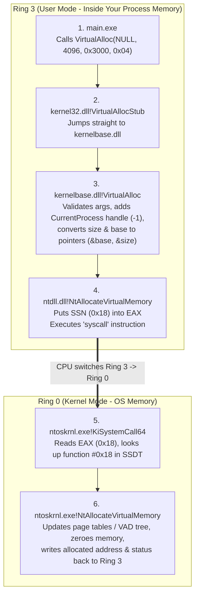
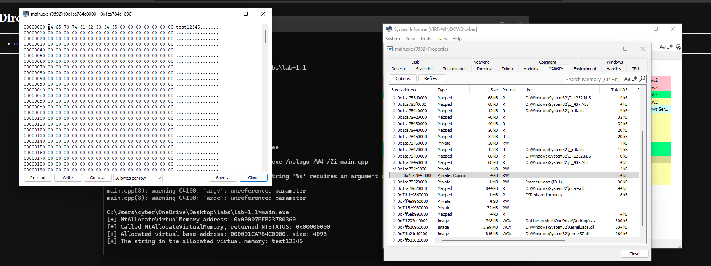
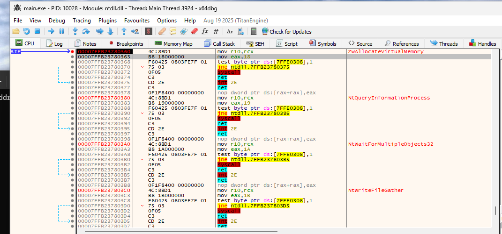

# Module 1.1: Rings, Subsystems, and the Windows Call Chain

Let's start from zero. Before we talk about DLLs, APIs, or malware, we need to understand **what problem the Operating System and CPU are trying to solve** when you double-click an `.exe` file.

---

## 1. The Core Problem: Why Can't Your Program Just Touch RAM or Hardware Directly?

Imagine you write a simple C program:

```text
int x = 42;
```

And at the same time, your web browser is open with your bank password in memory, and Windows itself is running in memory.

If every program on your computer could read and write to **any** physical RAM address, or send raw commands directly to your SSD:
1. A bug in your C program (like an uninitialized pointer) could accidentally overwrite the OS code and crash the whole computer (Blue Screen of Death).
2. Any random program (like a calculator app) could simply read the RAM belonging to your web browser and steal your passwords.

To stop this, the **CPU hardware itself** (Intel/AMD x86_64) has a built-in security mode switch.

### CPU Privilege Rings (Ring 3 vs. Ring 0)
Think of the CPU as having two modes of operation:

1. **Ring 3 (User Mode — "Untrusted / Restricted Mode"):**
   - When you launch `notepad.exe`, `chrome.exe`, or your own `main.exe`, the CPU runs its instructions in **Ring 3**.
   - In Ring 3, the CPU **blocks** dangerous instructions. Your code is locked inside its own private sandbox of memory (called a *Virtual Address Space*, which we'll cover in Module 1.2).
   - If your code in Ring 3 tries to ask the CPU "give me 4 KB of new RAM" or "open `C:\secret.txt`" directly, **it can't**. The CPU hardware literally forbids Ring 3 code from changing memory mappings or talking to the disk controller.

2. **Ring 0 (Kernel Mode — "God Mode"):**
   - The core of the Windows Operating System (`ntoskrnl.exe`, located in `C:\Windows\System32\ntoskrnl.exe`) and hardware drivers (`*.sys` files) run in **Ring 0**.
   - Code running in Ring 0 can execute *any* CPU instruction, read/write *any* process's memory, and talk to hardware.

### So how does a Ring 3 program actually do *anything* useful?
Since your program in Ring 3 cannot allocate memory, create files, spawn threads, or send network packets on its own, it has to **ask the Kernel (Ring 0) to do it on its behalf**.

How do you ask the Kernel?
The CPU provides a special instruction called **`syscall`** (System Call).
When a program executes `syscall`:
1. The CPU pauses your Ring 3 code.
2. The CPU switches its privilege level from **Ring 3 $\rightarrow$ Ring 0**.
3. The CPU jumps to a specific entry point inside the Windows Kernel (`ntoskrnl.exe`) that only Ring 0 knows about.
4. The Kernel checks if your request is allowed, performs the action (e.g., maps 4 KB of RAM for your process), switches the CPU back from **Ring 0 $\rightarrow$ Ring 3**, and returns control to your program.

---

## 2. What is a DLL, and Why Are `kernel32.dll`, `kernelbase.dll`, and `ntdll.dll` in My Process?

Before tracing the call chain, let's clarify what a **DLL (Dynamic Link Library)** actually is in memory.

When you write a C program on Windows and call `CreateFileW` or `VirtualAlloc`, where does the machine code for `VirtualAlloc` live? It is **not** compiled inside your `main.exe`.
Instead, Windows keeps shared libraries on disk (`C:\Windows\System32\*.dll`). When your `main.exe` starts, Windows maps several system DLLs directly into your process's memory space so your code can call functions inside them.

Every standard Windows process automatically gets these three critical DLLs mapped into its User-Mode (Ring 3) memory:
1. **`ntdll.dll`** (Layer 1 — The Gatekeeper to the Kernel)
2. **`kernelbase.dll`** (Layer 2 — The Core Win32 Logic)
3. **`kernel32.dll`** (Layer 3 — The Public Win32 Front Door)

Wait—**why three different DLLs in Ring 3 just to ask the Kernel for one thing?!**

### The Historical & Architectural Reason
When Microsoft engineers (led by Dave Cutler) designed **Windows NT** in 1989–1993, they didn't want Windows to only run Windows apps. They wanted corporates and governments to buy Windows NT to run **POSIX (Unix)** apps and **OS/2** apps too.

So they split User Mode into two concepts:
1. **The Native API (`ntdll.dll`):**
   - This is the *true* internal interface of Windows NT.
   - Its functions all start with `Nt` or `Zw` (like `NtCreateFile`, `NtAllocateVirtualMemory`).
   - Microsoft **never meant for normal developers to call `ntdll.dll` directly**. They kept it mostly undocumented so Microsoft could change how the kernel works between Windows versions without breaking millions of apps.
2. **Environment Subsystem DLLs (`kernel32.dll` / `kernelbase.dll`):**
   - This is the documented **Win32 API** (the functions you read about on MSDN, like `CreateFileW`, `VirtualAlloc`, `CreateProcessW`).
   - Its job is to provide a stable, programmer-friendly API that never breaks between Windows XP, Windows 7, Windows 10, and Windows 11.
   - Internally, `kernel32.dll` and `kernelbase.dll` take your friendly Win32 arguments, convert them into the complex internal structures that `ntdll.dll` expects, and then call `ntdll.dll`.
   - *(Why both `kernel32.dll` and `kernelbase.dll`? Around Windows 7, Microsoft refactored `kernel32.dll` by moving most of the actual code into `kernelbase.dll` so low-level services and Windows Store apps could load `kernelbase.dll` without pulling in legacy baggage from `kernel32.dll`. Today, `kernel32.dll` often just forwards your call straight to `kernelbase.dll`.)*

---

## 3. Concrete Walkthrough: What Happens When You Call `VirtualAlloc`?

Let's trace a real example with concrete numbers and registers so nothing is abstract.

Suppose you want to allocate **4,096 bytes (1 page)** of readable and writable memory in your C++ program.
Normally, a Windows programmer writes:
```text
void* ptr = VirtualAlloc(NULL, 4096, MEM_COMMIT | MEM_RESERVE, PAGE_READWRITE);
```

Here is the exact journey your CPU takes when that line runs:



Let's zoom in on **Step 3 (`kernelbase.dll`)** and **Step 4 (`ntdll.dll`)**, because this is where everything clicks.

### Zooming in on Step 3: How `kernelbase.dll` Translates Your Call
Notice that `VirtualAlloc` took **4 arguments** and **returned a pointer (`void*`)**:
- Arg 1 (`lpAddress`): `NULL` (meaning: "OS, you pick the memory address for me")
- Arg 2 (`dwSize`): `4096`
- Arg 3 (`flAllocationType`): `MEM_COMMIT | MEM_RESERVE` (`0x00003000`)
- Arg 4 (`flProtect`): `PAGE_READWRITE` (`0x04`)

When `kernelbase.dll!VirtualAlloc` runs, it has to call `ntdll.dll!NtAllocateVirtualMemory`.
But `NtAllocateVirtualMemory` is a **Native API (NTAPI)** function. Native API functions work very differently from Win32 functions:

1. **Native API functions do NOT return pointers or handles as their return value.**
   Instead, almost every `Nt*` function returns a 32-bit status code called an **`NTSTATUS`** (`0x00000000` means `STATUS_SUCCESS`, anything negative like `0xC0000005` means an error occurred).
2. **Wait—if `NtAllocateVirtualMemory` returns `NTSTATUS`, how does it give us back the allocated memory pointer?!**
   It uses **output pointer parameters (`IN OUT` pointers)**!
   Instead of passing `NULL` by value for the address, you create a pointer variable `PVOID baseAddr = NULL;` on your stack, and pass **the address of that pointer (`&baseAddr`)** to `NtAllocateVirtualMemory`. When the Kernel finishes allocating memory, the Kernel overwrites your `baseAddr` variable in-place with the newly allocated address!
   The same thing happens with the size: you create a variable `SIZE_T regionSize = 4096;` and pass **`&regionSize`**. When the Kernel finishes, it overwrites `regionSize` with the actual number of bytes it allocated (rounded up to a full 4096-byte page).
3. **Why does `NtAllocateVirtualMemory` take 6 arguments instead of 4?**
   Because `VirtualAlloc` only allocates memory in *your own* process. The Kernel doesn't have two separate syscalls for "allocate in my process" (`VirtualAlloc`) and "allocate in another process" (`VirtualAllocEx`). There is only **one** underlying function in `ntdll.dll`: `NtAllocateVirtualMemory`, which takes a `ProcessHandle` as its 1st argument!
   When you want to allocate memory in your own process, `kernelbase.dll` simply passes the special pseudo-handle `(HANDLE)-1` (which means "Current Process").

### Zooming in on Step 4: Inside `ntdll.dll!NtAllocateVirtualMemory`
What is actually inside `ntdll.dll` when `NtAllocateVirtualMemory` is called?
You might expect hundreds of lines of C code. **Nope!**
Because `ntdll.dll` is still in Ring 3 (User Mode), it can't allocate memory either! Its **only job** is to trigger the `syscall` instruction so the CPU switches to Ring 0.

If you open `ntdll.dll` in x64dbg and look at `NtAllocateVirtualMemory`, the entire function is just **6 instructions**:

```nasm
mov r10, rcx                  ; 1. Copy 1st argument (RCX) into R10
mov eax, 18h                  ; 2. Put System Service Number (SSN = 0x18) into EAX
test byte ptr [7FFE0308h], 1  ; 3. (Legacy check, always 0 on modern x64)
jne short +3                  ; 4. (Never jumps on modern 64-bit Windows)
syscall                       ; 5. Enter Ring 0! Kernel reads EAX (0x18) and R10, RDX, R8, R9
ret                           ; 6. Return to caller (EAX holds the NTSTATUS return code)
```

Let's understand every single line of that assembly—because later in Phase 4, you will be writing and manipulating this exact stub:
- **Why `mov r10, rcx`?**
  On 64-bit Windows (the **Microsoft x64 calling convention**), when you call any function, the first 4 arguments are passed in CPU registers:
  - 1st arg: `RCX`
  - 2nd arg: `RDX`
  - 3rd arg: `R8`
  - 4th arg: `R9`
  - 5th, 6th, ... args: pushed onto the Stack (`RSP`).
  However, the Intel/AMD hardware specification for the `syscall` instruction says: *"When `syscall` executes, the CPU automatically saves the next instruction's address (`RIP`) into the **`RCX` register** so the Kernel knows where to return to."*
  That means the `syscall` instruction **destroys whatever was in `RCX`**! So right before `syscall`, `ntdll.dll` copies your 1st argument from `RCX` into `R10` (`mov r10, rcx`).
- **What is `mov eax, 18h`? (The System Service Number / SSN)**
  There are ~470 different `Nt*` functions in `ntdll.dll` (`NtCreateFile`, `NtOpenProcess`, `NtAllocateVirtualMemory`, etc.), and **all of them execute the exact same `syscall` instruction**.
  How does the Kernel know *which* function you wanted to call when `syscall` enters Ring 0?
  By the number sitting in the **`EAX` register**!
  That number (`0x18` in this example) is called the **System Service Number (SSN)** (or syscall ID). Inside the Kernel (`ntoskrnl.exe`), there is a giant array of function pointers called the **SSDT (System Service Descriptor Table)**. When `syscall` fires with `EAX = 0x18`, the Kernel simply looks up `SSDT[0x18]`, which points to the Kernel's `NtAllocateVirtualMemory` implementation!

---

## 4. Why Does This Matter for Red Team / Malware Development?

Now think like a defensive engineer building an **EDR (Endpoint Detection & Response)** product (like CrowdStrike, Defender for Endpoint, SentinelOne).

You want to catch malware when it tries to allocate executable memory or inject into another process.
Ideally, you would put all your monitoring in the Kernel (Ring 0). Wait—Microsoft has a security feature called **Kernel Patch Protection (PatchGuard)**: if an EDR driver tries to modify the Kernel's SSDT (`ntoskrnl.exe`), Windows immediately triggers a Blue Screen of Death (`CRITICAL_STRUCTURE_CORRUPTION`)!

### Wait — Why Doesn't Microsoft Just Give EDRs Official Kernel Callbacks for Memory APIs?
Microsoft *does* provide official Ring 0 Kernel Callbacks for rare lifecycle events:
- **Process creation/termination:** `PsSetCreateProcessNotifyRoutineEx`
- **Thread creation/termination:** `PsSetCreateThreadNotifyRoutine`
- **DLL / EXE / Driver loading:** `PsSetLoadImageNotifyRoutine`
- **Opening a handle to a process/thread:** `ObRegisterCallbacks`

However, Microsoft **refuses** to provide synchronous blocking Kernel Callbacks for memory operations like `NtAllocateVirtualMemory` or `NtProtectVirtualMemory`. Why?

1. **The Frequency & Performance Problem:**
   - Process creation and DLL loading happen relatively rarely (dozens of times when launching an app, then near zero).
   - Memory allocation (`NtAllocateVirtualMemory`) and permission flipping (`NtProtectVirtualMemory`) happen **thousands of times per second** across the OS—every time a C++ heap (`malloc`/`HeapAlloc`) expands, or a browser (Chrome/Edge) or `.NET` / JavaScript JIT compiler compiles code in real time.
   - Synchronous Kernel Callbacks **freeze (block)** the calling thread until every registered driver finishes inspecting the call. If a 3rd-party EDR driver ran synchronous inspection logic inside `ntoskrnl.exe` on every single memory allocation or permission change, the entire operating system would grind to a crawl.
2. **Historical Stability Disasters (Why PatchGuard Exists):**
   - In the 32-bit Windows XP era (before PatchGuard), antivirus drivers hooked the Kernel's SSDT directly to intercept memory and file syscalls. Poorly written AV hooks and hook collisions caused massive waves of Blue Screens of Death (BSODs)—which users blamed on Microsoft. With 64-bit Windows, Microsoft locked the SSDT via PatchGuard and restricted synchronous kernel callbacks strictly to low-frequency events.

### What About Kernel ETW-Ti vs. Ring 3 `ntdll.dll` Hooks?
In Windows 10/11, Microsoft added **ETW-Ti (Event Tracing for Windows — Threat Intelligence)** inside the kernel (`ntoskrnl.exe`), which can emit telemetry events when certain memory operations occur. However, there is a massive architectural difference:

| Feature | Ring 3 `ntdll.dll` Inline Hook | Ring 0 Kernel ETW-Ti |
| :--- | :--- | :--- |
| **Where does it live?** | Ring 3 (inside your process's `ntdll.dll`) | Ring 0 (inside `ntoskrnl.exe`) |
| **When does it run?** | **Synchronously (Before the syscall!)** The EDR pauses your thread, inspects arguments/stack, and can **block** the call before it reaches Ring 0. | **Asynchronously (After the fact!)** The kernel drops a telemetry packet into a buffer without waiting, so the OS stays fast—meaning the syscall has already executed by the time the EDR reads the event. |
| **Can Ring 3 code tamper with it?** | **Yes!** Because `ntdll.dll` lives in your own process's user-mode memory, you can inspect, unhook, or bypass it via direct/indirect syscalls. | **No!** Ring 3 cannot touch kernel memory, and only special Microsoft-signed Antimalware (`PPL`) drivers can subscribe to ETW-Ti. |

Because EDRs want to **synchronously inspect and block** suspicious memory calls (and easily read user-mode arguments/call stacks without massive kernel-to-user round-trip overhead), **they inject an EDR DLL into Ring 3 (your process!) and overwrite the instructions inside `ntdll.dll`:**

```text
Normal ntdll.dll!NtAllocateVirtualMemory:
  mov r10, rcx
  mov eax, 18h
  ...
  syscall
  ret

Hooked by EDR in ntdll.dll!NtAllocateVirtualMemory:
  jmp <EDR_DLL_Inspect_Function>   ; <--- EDR overwrote the first 5 bytes!
  ...
```

Because `ntdll.dll` lives in **Ring 3 (your own process's memory)**:
1. If you call `VirtualAlloc` (`kernel32.dll`), it calls `kernelbase.dll`, which calls `ntdll.dll`.
2. If you bypass `kernel32.dll` and call `ntdll.dll!NtAllocateVirtualMemory` directly, you verify how Native APIs work, avoid high-level Win32 imports in your binary's Import table, and prepare yourself to inspect (and eventually bypass) those exact `ntdll.dll` stubs.

---

## 5. How to Call an Undocumented `ntdll.dll` Function in C/C++

When you call `VirtualAlloc`, you just `#include <windows.h>` and write `VirtualAlloc(...)` because Microsoft put its declaration in `<windows.h>` and its import stub in `kernel32.lib`.

For `NtAllocateVirtualMemory`, Microsoft did **not** put it in `<windows.h>`. If you try to write `NtAllocateVirtualMemory(...)` in your `.cpp` file, the compiler (`cl.exe`) will say:
`error C3861: 'NtAllocateVirtualMemory': identifier not found`

So how do we call a function inside a DLL when it's not in our header files?
We use **Dynamic API Resolution** (3 steps):

### Step 1: Tell the C/C++ Compiler the Function's "Shape" (Signature)
First, we look up the official/reverse-engineered signature of `NtAllocateVirtualMemory` on [ntdoc.m417z.com/ntallocatevirtualmemory](https://ntdoc.m417z.com/ntallocatevirtualmemory):

```text
NTSYSCALLAPI
NTSTATUS
NTAPI
NtAllocateVirtualMemory(
    _In_ HANDLE ProcessHandle,
    _Inout_ _At_(*BaseAddress, _Readable_bytes_(*RegionSize) _Writable_bytes_(*RegionSize) _Post_readable_byte_size_(*RegionSize)) PVOID *BaseAddress,
    _In_ ULONG_PTR ZeroBits,
    _Inout_ PSIZE_T RegionSize,
    _In_ ULONG AllocationType,
    _In_ ULONG Protect
);
```

Strip away all the ugly Microsoft SAL annotations (`_In_`, `_Inout_`, `_At_...`) and see what's actually left:
- **Return Type:** `NTSTATUS` (which is just a `LONG` — a 32-bit signed integer).
- **Calling Convention:** `NTAPI` (a macro defined in `<windows.h>` as `__stdcall`).
- **Parameter 1 (`HANDLE ProcessHandle`):** Handle to the process where memory should be allocated. For our own process, we can use `GetCurrentProcess()` (which returns `(HANDLE)-1`).
- **Parameter 2 (`PVOID *BaseAddress`):** A **pointer to a `void*`**! Why a pointer to a pointer? Because if we have `PVOID base = nullptr;`, we pass `&base` (`PVOID*`). On input, `base == nullptr` tells the OS "pick any free address". On output, the OS writes the chosen address (e.g. `0x000001A2B3C40000`) into `base`.
- **Parameter 3 (`ULONG_PTR ZeroBits`):** Used only for special alignment masks. Always pass `0`.
- **Parameter 4 (`PSIZE_T RegionSize`):** A **pointer to a `SIZE_T`** (`SIZE_T*`)! You create `SIZE_T size = ...;` and pass `&size`. On input, it's how many bytes you want. On output, the OS overwrites `size` with how many bytes it actually gave you.
- **Parameter 5 (`ULONG AllocationType`):** Bitmask of flags. To reserve the address space AND back it with actual memory right now, pass `MEM_COMMIT | MEM_RESERVE` (both macros are already in `<windows.h>`).
- **Parameter 6 (`ULONG Protect`):** Page permissions. For readable and writable memory, pass `PAGE_READWRITE` (also already in `<windows.h>`).

In C/C++, to call a function via a memory address, you define a **function pointer type** using `typedef` (or `using` in C++).
Recall how function pointer `typedef` syntax works in C:
```text
// Example for a dummy function: int MyAdd(int a, int b);
typedef int (NTAPI *fnMyAdd)(int a, int b);
```
You will write a similar `typedef` for `NtAllocateVirtualMemory`!

### Step 2: Find Where `ntdll.dll` Lives in Your Process Memory
Since `ntdll.dll` is already loaded into every process, we don't even need `LoadLibrary`. We can ask Windows for its base address in memory using:
- `HMODULE GetModuleHandleA(LPCSTR lpModuleName);`
  - Pass `"ntdll.dll"`. It returns an `HMODULE` (which is literally just the base memory address where `ntdll.dll` starts in your process!).

### Step 3: Find the Exact Memory Address of `NtAllocateVirtualMemory` Inside `ntdll.dll`
Once you have the `HMODULE` for `ntdll.dll`, ask Windows to look up the address of the exported function `"NtAllocateVirtualMemory"` using:
- `FARPROC GetProcAddress(HMODULE hModule, LPCSTR lpProcName);`
  - Pass the `ntdll.dll` module handle and `"NtAllocateVirtualMemory"`.
  - Cast the returned `FARPROC` to your custom function pointer type from Step 1!

---

## 6. Lab 1.1: Hands-On Practice

Now it's your turn to write the C/C++ code on your Windows 11 VM.

### What Your Program Should Do:
1. Include `<windows.h>` and `<stdio.h>` (or `<iostream>`).
2. Define the `typedef` for `NtAllocateVirtualMemory` (and define `NTSTATUS` as `LONG` if you didn't include `<winternl.h>`).
3. Use `GetModuleHandleA` and `GetProcAddress` to get a callable function pointer to `NtAllocateVirtualMemory`. Print the address of `NtAllocateVirtualMemory` so you can see where it lives inside `ntdll.dll`!
4. Create your `PVOID baseAddress = NULL;` and `SIZE_T regionSize = 100;` (yes, set it to **100 bytes** on purpose!).
5. Call `NtAllocateVirtualMemory` for the current process with `MEM_COMMIT | MEM_RESERVE` and `PAGE_READWRITE`.
6. Print:
   - The returned `NTSTATUS` in hex (`0x%08X`).
   - The `baseAddress` after the call (`%p`).
   - The `regionSize` after the call (`%zu` or `%llu`).
7. Copy a short string (e.g. using `memcpy` or `strcpy_s`) into the allocated memory at `baseAddress`, and print the string back from `baseAddress` to prove the memory works.
8. Call `getchar()` before `return 0;` so the program pauses and stays running.

### How to Compile on Your Windows 11 VM:
Open **x64 Native Tools Command Prompt for VS** (important: make sure it's the **x64** prompt, not x86!) and compile with:
```cmd
cl.exe /nologo /W4 /Zi main.cpp
```
*(Why `/Zi`? It generates a `.pdb` debug symbols file so when you open `main.exe` in x64dbg, you can easily see your `main` function and variable names!)*

### Inspection Tasks (While Your Program is Paused at `getchar()`):
1. **In System Informer:**
   - Find your `main.exe` process $\rightarrow$ double-click it $\rightarrow$ click the **Memory** tab.
   - Scroll to the exact `baseAddress` your program printed in the console.
   - Double-click that row in the Memory tab to open the hex dump and find the string you wrote!
2. **In x64dbg:**
   - Open `main.exe` in x64dbg.
   - In the command bar at the very bottom of x64dbg, type:
     `bp NtAllocateVirtualMemory`
     and press Enter.
   - Press **F9** (Run) until it hits your breakpoint at `NtAllocateVirtualMemory`.
   - Look at the disassembly window: you are now looking directly at the raw assembly stub inside `ntdll.dll`!

### Report Back When Ready:
Paste your C/C++ code here (or any compiler/runtime errors you run into!), along with:
1. What changed about `regionSize` after `NtAllocateVirtualMemory` returned (you asked for `100` bytes—what did the kernel change `regionSize` to, and why)?
2. In x64dbg, at `NtAllocateVirtualMemory`, what hex number was moved into `eax` (`mov eax, ???`) right before the `syscall` instruction?

---

## 7. Lab 1.1 Results & Findings

- **Source Code:** [`windows/labs/lab-1.1/main.cpp`](./labs/lab-1.1/main.cpp)

### Console Output
```text
[+] NtAllocateVirtualMemory address: 0x00007FFB23780360
[+] Called NtAllocateVirtualMemory, returned NTSTATUS: 0x00000000
[+] Allocated virtual base address: 0x000001CA784C0000, size: 4096
[+] The string in the allocated virtual memory: test12345
```

### Key Observations
1. **Why Passing `NULL` for `ProcessHandle` Returned `0xC0000008` (`STATUS_INVALID_HANDLE`):**
   - Unlike `VirtualAlloc` (which implicitly operates on the current process), `NtAllocateVirtualMemory` requires an explicit process handle. Passing `GetCurrentProcess()` (the pseudo-handle `(HANDLE)-1`) resolved the error and returned `0x00000000` (`STATUS_SUCCESS`).
2. **Page Granularity (`RegionSize`: `100` $\rightarrow$ `4096` bytes):**
   - Even though `allocatedSize` was initialized to `100` bytes, the kernel rounded `allocatedSize` up to **`4096` bytes (`0x1000`)** because the x64 MMU manages virtual memory in minimum 4 KB page units.
3. **Inspecting the Allocated Region in System Informer:**
   - At virtual address `0x1ca784c0000`, the memory region is listed as `Private: Commit`, `4 kB`, protection `RW` (`PAGE_READWRITE`), containing the ASCII bytes `74 65 73 74 31 32 33 34 35` (`test12345`).



4. **Inspecting the `ntdll.dll` Syscall Stub in x64dbg:**
   - Breaking on `NtAllocateVirtualMemory` (`0x00007FFB23780360`) revealed that x64dbg labels the exact same address as `ZwAllocateVirtualMemory` (proving `Nt*` and `Zw*` are identical aliases in Ring 3).
   - The System Service Number (SSN) loaded into `EAX` (`mov eax, 18`) is **`0x18`**.
   - Neighboring `Nt*` stubs (`NtQueryInformationProcess` = `0x19`, `NtWaitForMultipleObjects32` = `0x1A`, `NtWriteFileGather` = `0x1B`) are spaced `0x20` (32 bytes) apart with sequentially increasing SSNs.



