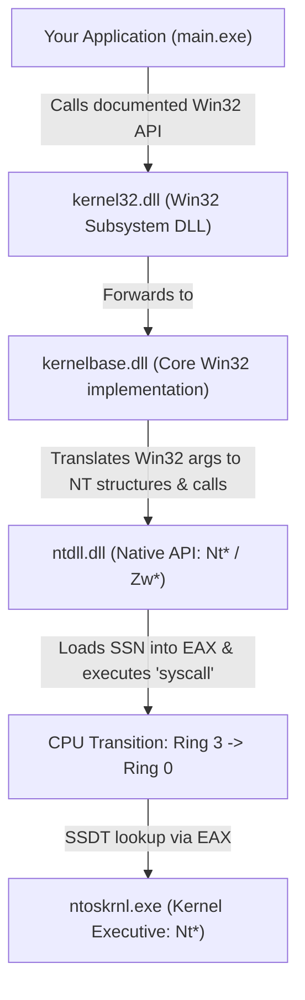

# Module 1.1: Rings, Subsystems, and the Windows Call Chain

## 1. CPU Privilege Rings (Hardware Enforced)
Modern x86_64 processors enforce hardware separation so a buggy or malicious user application cannot overwrite the OS kernel or another process's memory.

Although x86 technically defines 4 rings (Ring 0 to Ring 3), Windows only uses two:
- **Ring 3 (User Mode):** Where your applications (`notepad.exe`, your C++ binaries) and Subsystem DLLs (`kernel32.dll`, `ntdll.dll`) run. Code in Ring 3 **cannot** directly touch physical hardware, modify page tables, or read kernel memory.
- **Ring 0 (Kernel Mode):** Where the Windows Executive (`ntoskrnl.exe`) and device drivers (`*.sys`) run. Full access to all CPU instructions and all memory.

> **Concrete Example:**
> When your C++ program wants to allocate memory or open a file, it cannot just talk to the SSD controller or edit the CPU's page tables. It must ask Ring 0 to do it on its behalf. That transition from Ring 3 to Ring 0 is called a **System Call (`syscall`)**.

---

## 2. Why Does Windows Have So Many DLLs for One Action?
On Linux, `open()` in `libc` almost immediately executes the `syscall` instruction.
Windows was designed in the early 1990s (Windows NT) to support multiple "Environment Subsystems" (Win32, POSIX, OS/2) on top of a single shared kernel.

Even though today almost everything uses the Win32 subsystem, that layered architecture remains:



### Step-by-Step Concrete Trace: Allocating Memory
Suppose your program calls `VirtualAlloc(NULL, 4096, MEM_COMMIT | MEM_RESERVE, PAGE_READWRITE)`.

1. **`kernel32.dll!VirtualAlloc`**
   - Historically held the Win32 code, now mostly a thin stub (or API Set forwarder) that jumps straight to `kernelbase.dll`.
2. **`kernelbase.dll!VirtualAlloc`**
   - Validates Win32 parameters.
   - Converts Win32 concepts into **Native API (NTAPI)** concepts. For example, `VirtualAlloc` doesn't take a process handle (it assumes the current process), so `kernelbase.dll` supplies the pseudo-handle `(HANDLE)-1` (`NtCurrentProcess()`).
   - Calls `ntdll.dll!NtAllocateVirtualMemory`.
3. **`ntdll.dll!NtAllocateVirtualMemory`**
   - `ntdll.dll` is the **lowest layer in User Mode**. It is mapped into *every* Windows process automatically by the kernel before the process even starts running.
   - Inside `ntdll.dll`, the function `NtAllocateVirtualMemory` is only ~20 bytes of assembly!
   - Here is what every `Nt*` stub in `ntdll.dll` looks like on x64 Windows 10/11:
     ```nasm
     mov r10, rcx          ; Save 1st argument (RCX is clobbered by the 'syscall' instruction!)
     mov eax, <SSN>        ; Move the System Service Number (e.g., 0x18) into EAX
     test byte ptr [7FFE0308h], 1 ; Check KUSER_SHARED_DATA for syscall vs int 2eh support
     jne short +3
     syscall               ; Jump from Ring 3 to Ring 0!
     ret                   ; Return to caller with NTSTATUS in EAX
     ```
4. **Ring 0 (`ntoskrnl.exe`)**
   - The CPU switches to Ring 0, jumps to the kernel's system call handler (`KiSystemCall64`), looks up index `EAX` (the **SSN**) in the **System Service Descriptor Table (SSDT)**, and runs the real kernel function `ntoskrnl.exe!NtAllocateVirtualMemory`.

---

## 3. Why Red Teamers / Malware Developers Care
- **EDRs live in User Mode too:** Most EDRs inject their own monitoring DLL into your process and place hooks (overwrite the first 5–14 bytes with a `JMP`) inside `kernelbase.dll` or `ntdll.dll`.
- **Bypassing the Win32 layer:** Sometimes an API only exists in `ntdll.dll` and has no `kernel32.dll` equivalent, or calling the `Nt*` function directly gives you finer control over parameters that `kernelbase.dll` hides from you.
- **Understanding `Nt*` vs `Zw*`:**
  - In **User Mode (`ntdll.dll`)**: `NtAllocateVirtualMemory` and `ZwAllocateVirtualMemory` point to the **exact same address** in memory. There is zero difference in Ring 3.
  - In **Kernel Mode (`ntoskrnl.exe`)**: `Nt*` validates pointers assuming the caller came from User Mode (`PreviousMode == UserMode`), whereas `Zw*` sets `PreviousMode = KernelMode` so kernel drivers can call `Nt*` functions without failing security checks on kernel-space pointers.

---

## 4. Key Differences When Coding Against `ntdll.dll`

| Feature | Win32 API (`kernel32.dll`) | Native API (`ntdll.dll`) |
| :--- | :--- | :--- |
| **Documentation** | Officially documented on MSDN | Mostly undocumented (use **ntdoc.m417z.com** or `phnt` headers) |
| **Header / Lib** | Included in `<windows.h>` & `kernel32.lib` | You must define the function pointer typedef yourself and resolve it at runtime (or link `ntdll.lib`) |
| **Return Value** | Returns a `HANDLE`, `BOOL`, or `LPVOID` (`NULL` on failure, check `GetLastError()`) | Almost always returns **`NTSTATUS`** (`0` / `STATUS_SUCCESS` = success; negative = error). Every output is returned via pointer parameters (`OUT` args)! |
| **Strings** | Null-terminated `char*` or `wchar_t*` | Counted **`UNICODE_STRING`** structs (`Length`, `MaximumLength`, `Buffer`) |

---

## 5. Lab 1.1: Your First Native API Call & Debugger Inspection

### Objective
Write a C/C++ program on your Windows 11 VM that allocates a 4 KB page of memory **without** calling `VirtualAlloc` or `malloc`—instead, resolve and call `NtAllocateVirtualMemory` directly from `ntdll.dll`.

### Step-by-Step Guide (No C/C++ Code Spoilers!)
1. **Look up the signature of `NtAllocateVirtualMemory`:**
   - Open [ntdoc.m417z.com/ntallocatevirtualmemory](https://ntdoc.m417z.com/ntallocatevirtualmemory) or Microsoft's WDK docs.
   - Look closely at its 6 parameters:
     1. `ProcessHandle`: For the current process, pass `(HANDLE)-1` (or `GetCurrentProcess()`).
     2. `BaseAddress`: A pointer to a `PVOID` (`PVOID*`). Notice it's an `IN OUT` parameter! If you initialize your `PVOID base = nullptr;` and pass `&base`, the kernel chooses the address and writes the allocated address back into your `base` variable.
     3. `ZeroBits`: `ULONG_PTR` — set to `0`.
     4. `RegionSize`: A pointer to a `SIZE_T` (`PSIZE_T`). Also `IN OUT`! Initialize `SIZE_T size = 4096;` and pass `&size`.
     5. `AllocationType`: `ULONG` (`MEM_COMMIT | MEM_RESERVE`).
     6. `Protect`: `ULONG` (`PAGE_READWRITE`).
   - Return type: `NTSTATUS` (a 32-bit signed integer `LONG`). Check success with the macro `NT_SUCCESS(status)` (or `status >= 0`).
2. **Define a Function Pointer Type (`typedef` or `using`):**
   - Remember the calling convention (`NTAPI` / `__stdcall`, though on x64 there is only one unified calling convention).
3. **Resolve the Function Address at Runtime:**
   - Use `GetModuleHandleA("ntdll.dll")` (or `GetModuleHandleW`) to get the base address of `ntdll.dll` in your process.
   - Use `GetProcAddress(hNtdll, "NtAllocateVirtualMemory")` and cast it to your function pointer type.
4. **Call It, Write to the Memory, and Pause:**
   - Call your resolved function pointer.
   - Print the returned `NTSTATUS` (in hex, e.g., `0x%08X`) and the allocated `BaseAddress` (`%p`).
   - Write a recognizable string or magic bytes into that allocated memory.
   - Call `getchar()` at the end so the process stays alive for inspection.
5. **Verify in Your Tools:**
   - **System Informer:** Find your running process $\rightarrow$ double-click $\rightarrow$ **Memory** tab $\rightarrow$ find the exact address your program printed. Check its State (`Commit`), Type (`Private`), and Protection (`RW`). Double-click it to read the memory and see your string!
   - **x64dbg:** Open your binary in x64dbg, put a breakpoint on `NtAllocateVirtualMemory` (`bp NtAllocateVirtualMemory`), and look at the disassembly of `NtAllocateVirtualMemory` inside `ntdll.dll`. Find the `mov eax, <SSN>` and `syscall` instructions!

### Deliverables to Report Back
1. Your C/C++ source code.
2. What System Service Number (SSN) did `NtAllocateVirtualMemory` have in `EAX` on your Windows 11 VM when you inspected it in x64dbg?
3. What happened if you passed `size = 100` instead of `4096`? What value did the kernel write back into your `size` variable after the call, and why?
