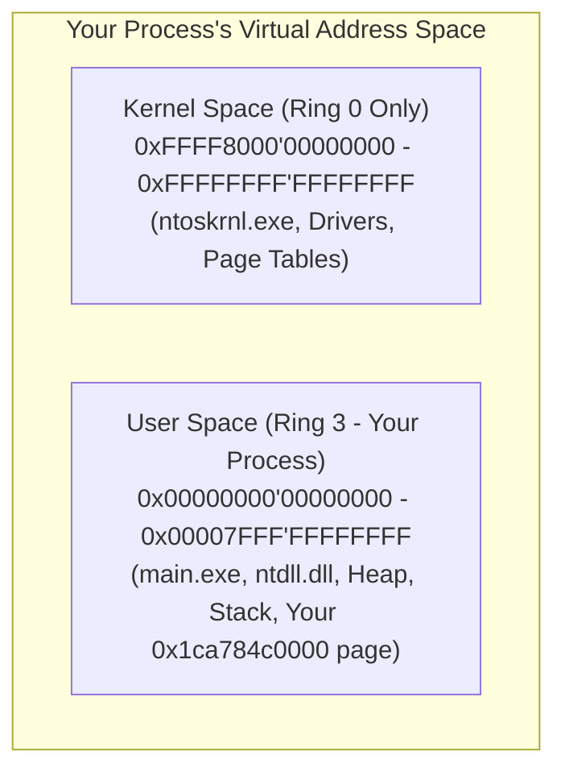
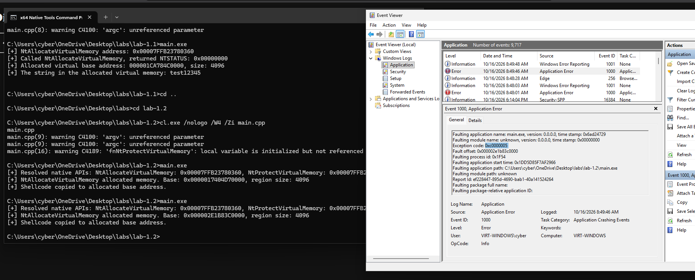
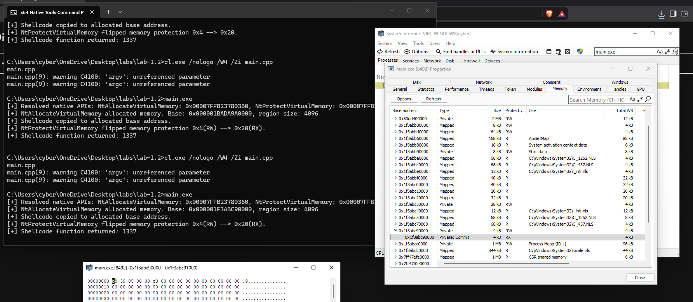
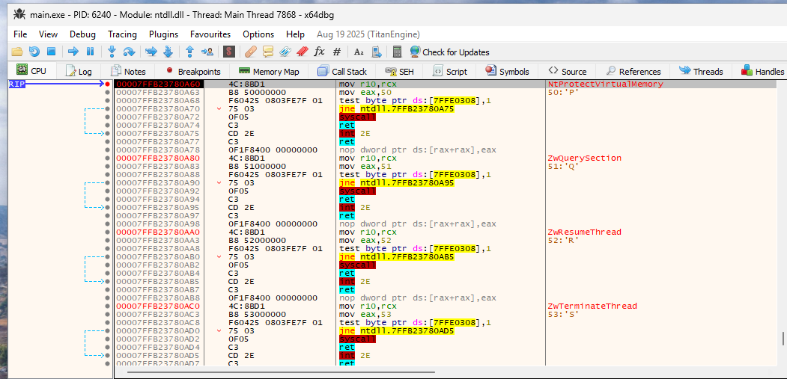

# Module 1.2: Virtual Memory, Page Permissions & Executing Raw Machine Code

In Lab 1.1, you saw two huge clues about how Windows manages memory:
1. You asked `NtAllocateVirtualMemory` for **100 bytes**, and the Kernel forced your `allocatedSize` variable up to **4,096 bytes (`0x1000`)**.
2. In System Informer's Memory tab, your region at `0x1ca784c0000` had three specific labels:
   - **Type:** `Private`
   - **State:** `Commit`
   - **Protection:** `RW` (`PAGE_READWRITE`)

Now let's peel back the curtain and see how Virtual Memory actually works under the hood, why the CPU refuses to execute code in `RW` memory, and why EDRs lose their minds when they see `RWX` (`PAGE_EXECUTE_READWRITE`).

---

## 1. What is Virtual Memory? (The Per-Process Illusion)

Suppose your computer has 32 GB of physical RAM sticks plugged into the motherboard.
And suppose you open **two** instances of your `main.exe` at the same time.

Wait—if every process had to share raw physical RAM addresses directly, Process A and Process B would constantly step on each other's toes. Even worse, Process A could read Process B's memory just by guessing an address!

So the CPU (specifically a hardware unit inside the CPU called the **MMU — Memory Management Unit**) and the Windows Kernel team up to create an illusion called **Virtual Memory**:

- **Every single 64-bit process thinks it has its own private, gigantic 128 TerabyteUser-Mode address space** (from `0x00000000'00000000` to `0x00007FFF'FFFFFFFF`).
- Meanwhile, the upper half of the 64-bit address space (`0xFFFF8000'00000000` to `0xFFFFFFFF'FFFFFFFF`) belongs to **Kernel Mode (Ring 0)**. Every process shares the same Kernel mapping in the top half, but the CPU hardware forbids Ring 3 code from reading or writing any `0xFFFF...` address!



### How Does a Virtual Address Become a Physical RAM Address? (Pages & Page Tables)
When your program writes `"test12345"` to virtual address `0x000001CA784C0000`, that number is **not** a real location on your physical DDR4/DDR5 RAM stick.
Instead, the CPU's MMU translates your Virtual Address into a Physical RAM Address using **Page Tables** managed by the Kernel.

To keep those Page Tables from becoming impossibly huge, the CPU does **not** track memory byte-by-byte. Instead, the CPU divides all memory into fixed **4,096-byte (`0x1000` byte / 4 KB) blocks called Pages**.

- That is why when you asked `NtAllocateVirtualMemory` for `100` bytes in Lab 1.1, the Kernel gave you `4,096` bytes!
- **4 KB (`0x1000`) is the smallest unit of memory the CPU hardware can map or protect.** You cannot make the first 100 bytes of a page read-only and the next 100 bytes writable—permissions apply to the **entire 4,096-byte page**!
- *(Notice the last 3 hex digits of your allocated address in Lab 1.1: `0x000001CA784C0000` ends in `000`! Every 4 KB page starts at an address that is a multiple of `0x1000`.)*

---

## 2. Memory States (`Free`, `Reserve`, `Commit`)

When you look at System Informer's Memory tab, every memory region has a **State**. There are three possible states on Windows:

| State | Constant | What It Actually Means |
| :--- | :--- | :--- |
| **Free** | `MEM_FREE` (`0x10000`) | Unclaimed virtual address space. If your C++ pointer tries to read or write a `Free` address, the CPU immediately throws exception `0xC0000005` (`STATUS_ACCESS_VIOLATION`). |
| **Reserved** | `MEM_RESERVE` (`0x2000`) | You told the Kernel: *"Hold this range of virtual addresses for me so no other DLL or `malloc` call takes it, **but don't allocate any physical RAM/pagefile for it yet**."* If you try to read/write `Reserved` memory without committing it first, you **still** get `0xC0000005` (`STATUS_ACCESS_VIOLATION`)! |
| **Committed** | `MEM_COMMIT` (`0x1000`) | Backed by real storage (physical RAM or disk pagefile). You can actually read/write/execute it (depending on its protection flags). |

> **Why did we pass `MEM_COMMIT | MEM_RESERVE` (`0x3000`) in Lab 1.1?**
> Because we wanted to do both steps at once: reserve a brand-new virtual address range **and** immediately commit 1 page (4 KB) of real memory at that address!

*(Bonus Internals Fact: What is Allocation Granularity? While individual pages are **4 KB (`0x1000`)**, whenever you **reserve** a brand-new region of address space with `MEM_RESERVE`, Windows aligns the starting base address to a **64 KB (`0x10000`)** boundary. Notice your base address in Lab 1.1: `0x000001CA784C0000` actually ends in **four** zeroes (`0000`)—a 64 KB boundary!)*

---

## 3. Memory Types (`Private`, `Mapped`, `Image`) — And Why Scanners Care!

Look back at your System Informer screenshot from Lab 1.1. Under the **Type** column, you can see three different types of memory in your process:

1. **`Image` (`MEM_IMAGE`):**
   - Look at the bottom of your System Informer screenshot: `0x7ffb21ef0000` (`kernel32.dll`), `0x7ffb20960000` (`KernelBase.dll`), `0x7ff737c40000` (`main.exe`).
   - These regions are marked **`Image`**. That means the Windows Kernel mapped a legitimate PE file (`.exe` or `.dll`) from a file on disk (`C:\Windows\System32\...`).
2. **`Mapped` (`MEM_MAPPED`):**
   - Memory backed by a data file on disk (like `locale.nls` in your screenshot) or shared memory (a *Section Object*) between processes.
3. **`Private` (`MEM_PRIVATE`):**
   - Look at your `0x1ca784c0000` allocation (and the `Process Heap`).
   - It is marked **`Private`**. It is **not** backed by any file on disk! It was created dynamically at runtime via `VirtualAlloc` / `NtAllocateVirtualMemory`.

### Red Team / EDR Insight: "Unbacked Executable Memory"
Ask yourself: **Where should executable machine code (`RX` or `RWX`) normally live in a legitimate Windows program?**
Inside `.exe` and `.dll` files! Which means legitimate executable code almost always has **Type = `Image`**!

When you allocate memory using `VirtualAlloc` / `NtAllocateVirtualMemory`, its Type is **`Private`** (there is no `.dll` file on disk backing it).
If an EDR memory scanner (like **Moneta** or **Pe-sieve**) scans your process and sees a page of memory where:
- **Type == `Private`** AND
- **Protection == Executable (`RX` or `RWX`)**

The scanner immediately says: *"Hold on! Why is there executable machine code sitting in `Private` memory that didn't come from any DLL on disk?! Somebody injected shellcode or a reflective loader here!"*
Keep this (`Private` vs. `Image`) in the back of your mind—in Phase 3 and Phase 4, this distinction becomes critical.

---

## 4. Page Permissions, DEP (NX Bit), and the `RW` $\rightarrow$ `RX` Dance

In Lab 1.1, you allocated memory with `PAGE_READWRITE` (`RW`). You copied `"test12345"` into it and read it back.
What happens if, instead of ASCII text `"test12345"`, you copy raw x86_64 CPU instructions (shellcode) into that `PAGE_READWRITE` page and try to **call it as a function**?

### Hardware Enforced Data Execution Prevention (DEP / The NX Bit)
Modern x64 CPUs have a hardware bit in every Page Table Entry called the **NX bit (No-Execute)** (Intel calls it **XD — Execute Disable**).
- When a page has `PAGE_READWRITE` (`0x04`), the Kernel sets **`NX = 1`** in the CPU's Page Table for that page.
- The very nanosecond the CPU's instruction pointer (`RIP`) jumps to an address inside a `PAGE_READWRITE` page to execute an instruction, the CPU hardware refuses to run it and raises an immediate **`0xC0000005` (`STATUS_ACCESS_VIOLATION`)** crash!

### So How Do We Execute Code We Placed in Memory?
To let the CPU execute instructions inside our allocated page, the page's protection must include **Execute** permission.

Here are the most common Windows Page Protection constants:

| Constant | Hex Value | System Informer Label | Meaning |
| :--- | :--- | :--- | :--- |
| `PAGE_NOACCESS` | `0x01` | `NA` | Cannot read, write, or execute. Touching it crashes (`0xC0000005`). |
| `PAGE_READONLY` | `0x02` | `R` | Can read bytes; writing or executing crashes. |
| `PAGE_READWRITE` | `0x04` | `RW` | Can read and write bytes; **executing crashes (NX=1)**. |
| `PAGE_EXECUTE_READ` | `0x20` | `RX` | Can read and **execute instructions (NX=0)**; **writing crashes!** |
| `PAGE_EXECUTE_READWRITE` | `0x40` | `RWX` | Can read, write, AND execute at the same time. |

### Why NOT Just Allocate `PAGE_EXECUTE_READWRITE` (`RWX`) From the Start?
In beginner tutorials from 2010, people wrote:
`VirtualAlloc(..., PAGE_EXECUTE_READWRITE)`
Why is `PAGE_EXECUTE_READWRITE` (`0x40`) a terrible idea in real-world engagements?
Because legitimate programs almost **never** need a memory page to be writable and executable *at the exact same time* (known as the **W^X — Write XOR Execute** security principle).
Requesting `PAGE_EXECUTE_READWRITE` in `NtAllocateVirtualMemory` is the loudest possible alarm bell you can ring—EDRs and ETW-Ti flag `RWX` allocations immediately.

### Instead: The `W^X` Two-Step (`RW` $\rightarrow$ `RX`)
Instead of allocating `RWX` memory:
1. **Step 1 (`PAGE_READWRITE`):** Allocate the memory page as `PAGE_READWRITE` (`0x04`). Write your machine code bytes into the buffer using `memcpy`. (At this point, it looks like normal data allocation).
2. **Step 2 (`PAGE_EXECUTE_READ`):** Once you are done writing the bytes, you no longer need Write permission! You ask the Kernel to flip the page's permission from `PAGE_READWRITE` (`RW`) to `PAGE_EXECUTE_READ` (`RX`, `0x20`).
3. **Step 3 (Execute):** Cast the memory address to a function pointer and call it!

---

## 5. How Permission Flipping Works: `VirtualProtect` vs. `NtProtectVirtualMemory`

Just like `VirtualAlloc` is a wrapper around `ntdll.dll!NtAllocateVirtualMemory`, the Win32 function `VirtualProtect` is a wrapper around **`ntdll.dll!NtProtectVirtualMemory`**.

Let's look at the signature of `NtProtectVirtualMemory` on [ntdoc.m417z.com/ntprotectvirtualmemory](https://ntdoc.m417z.com/ntprotectvirtualmemory):

```text
NTSYSCALLAPI
NTSTATUS
NTAPI
NtProtectVirtualMemory(
    _In_ HANDLE ProcessHandle,
    _Inout_ PVOID *BaseAddress,
    _Inout_ PSIZE_T RegionSize,
    _In_ ULONG NewProtect,
    _Out_ PULONG OldProtect
);
```

Look closely at the 5 parameters—there is a **very important trap** in Parameter 5 (`OldProtect`):
1. **`HANDLE ProcessHandle`**: `(HANDLE)-1` (or `GetCurrentProcess()`).
2. **`PVOID *BaseAddress`**: Pointer to your base address variable (`&allocatedBaseAddress`).
3. **`PSIZE_T RegionSize`**: Pointer to your size variable (`&allocatedSize`).
4. **`ULONG NewProtect`**: The new protection flag you want (e.g., `PAGE_EXECUTE_READ`, which is `0x20`).
5. **`PULONG OldProtect`**: A pointer to a `ULONG` variable (`ULONG oldProtect = 0;` $\rightarrow$ pass `&oldProtect`).
   - **TRAP WARNING:** When the Kernel changes your page's permissions to `NewProtect`, the Kernel writes the *previous* permission value (`0x04` / `PAGE_READWRITE`) into `*OldProtect`. If you pass `NULL` for `OldProtect`, **`NtProtectVirtualMemory` will fail with `0xC0000005` (`STATUS_ACCESS_VIOLATION`)** because the Kernel tries to write to your pointer! You *must* pass the address of a valid `ULONG` variable (`&oldProtect`).

---

## 6. Lab 1.2: Build a Raw Machine Code Executor (`RW` $\rightarrow$ `RX` $\rightarrow$ Execute)

Before we ever touch complex payloads, let's prove that you can write raw x86_64 CPU opcodes into a byte array, copy them into a dynamically allocated memory page, flip the page from `RW` to `RX` using `NtProtectVirtualMemory`, and execute those bytes as a C++ function!

### What Machine Code Will We Execute?
Let's write a tiny 6-byte x86_64 assembly function that returns the integer `1337` (`0x0539` in hex):

In x86_64 assembly, how does a function return an `int` to C/C++?
By putting the return value into the **`EAX` register** and executing **`ret`**!

```nasm
mov eax, 1337     ; Opcode bytes: 0xB8, 0x39, 0x05, 0x00, 0x00  (5 bytes, little-endian!)
ret               ; Opcode byte:  0xC3                          (1 byte)
```

Wait—why is `1337` (`0x00000539`) written as `0x39, 0x05, 0x00, 0x00` in memory?
Because x86_64 is **Little-Endian**: the least significant byte (`0x39`) is stored at the lowest memory address first, followed by `0x05`, `0x00`, `0x00`!

### Your Lab 1.2 Tasks:
Create a new directory `windows/labs/lab-1.2/` and write `main.cpp` to do the following:

1. **Resolve Two Native APIs from `ntdll.dll`:**
   - Resolve `NtAllocateVirtualMemory` (just like Lab 1.1).
   - Define the `typedef` for `NtProtectVirtualMemory` and resolve it from `ntdll.dll` via `GetProcAddress`.
2. **Allocate `RW` Memory:**
   - Call `NtAllocateVirtualMemory` to allocate 1 page (`4096` bytes) with **`PAGE_READWRITE`**.
3. **Copy Your 6-Byte Machine Code Stub:**
   - Create an `unsigned char` array containing the 6 bytes: `0xB8, 0x39, 0x05, 0x00, 0x00, 0xC3`.
   - Copy those 6 bytes into your `allocatedBaseAddress` using `memcpy`.
4. **Experiment A — Test Hardware DEP (Crash on Purpose First!):**
   - Before calling `NtProtectVirtualMemory`, try casting `allocatedBaseAddress` to a function pointer that takes `void` and returns `int` (`typedef int (*fnShellcode)();`), call it right while the page is still `PAGE_READWRITE`, and print the returned `int`.
   - Run it or step through it in x64dbg—watch the CPU hardware kill your program with an Access Violation (`0xC0000005`) the instant `RIP` lands on your `PAGE_READWRITE` page!
5. **Experiment B — Flip `RW` $\rightarrow$ `RX` and Execute Cleanly:**
   - Now call `NtProtectVirtualMemory` right after `memcpy` to change the page protection from `PAGE_READWRITE` to **`PAGE_EXECUTE_READ`**.
   - Print the `NTSTATUS` of `NtProtectVirtualMemory` and print what value the Kernel wrote into your `oldProtect` variable (`0x%X`).
   - Now call your function pointer to `allocatedBaseAddress`, capture the `int` return value, and print it!
   - Pause with `getchar()` so you can inspect the page in **System Informer** (verify Protection is now **`RX`** instead of `RW`) and step into your 6-byte function in **x64dbg**!

### Deliverables to Report Back:
1. What happened in Experiment A when you tried to call `allocatedBaseAddress` while its protection was still `PAGE_READWRITE`?
2. In Experiment B, what value did `NtProtectVirtualMemory` write into `oldProtect`, what SSN (`mov eax, ???`) did `NtProtectVirtualMemory` have in `ntdll.dll`, and what did your 6-byte function return?

---

## 7. Lab 1.2 Results & Findings

- **Source Code:** [`windows/labs/lab-1.2/main.cpp`](./labs/lab-1.2/main.cpp)

### Experiment A: Executing `PAGE_READWRITE` Memory (Hardware DEP Crash)
- **What Happened:** Calling the function pointer at `allocatedBaseAddress` (`0x000002E1B83C0000`) while the page had `PAGE_READWRITE` (`0x04`) protection immediately terminated the process.
- **Event Viewer Analysis:**
  - `Exception code: 0xc0000005` (`STATUS_ACCESS_VIOLATION` — triggered by the CPU's NX/XD bit on a non-executable page).
  - `Fault offset: 0x000002e1b83c0000` (exact base address of the `Private` allocation).
  - `Faulting module name: unknown` — because the memory region is `MEM_PRIVATE` (unbacked by any `.exe` or `.dll` file on disk).



### Experiment B: Flipping `RW` $\rightarrow$ `RX` via `NtProtectVirtualMemory` & Executing
- **Console Output:**
  ```text
  [+] Resolved native APIs: NtAllocateVirtualMemory: 0x00007FFB23780360, NtProtectVirtualMemory: 0x00007FFB23780A60
  [+] NtAllocateVirtualMemory allocated memory. Base: 0x000001F3ABC90000, region size: 4096
  [+] Shellcode copied to allocated base address.
  [+] NtProtectVirtualMemory flipped memory protection 0x4(RW) --> 0x20(RX).
  [+] Shellcode function returned: 1337
  ```
- **System Informer Verification:**
  - At `0x1f3abc90000`, the page state is `Private: Commit`, `4 kB`, protection **`RX`** (`PAGE_EXECUTE_READ`), containing the 6-byte machine code stub `b8 39 05 00 00 c3` (`mov eax, 1337; ret`).
  - `oldProtection` received `0x4` (`PAGE_READWRITE`) from the kernel, and the executed stub returned `1337` in `EAX`.



- **x64dbg `NtProtectVirtualMemory` Syscall Stub Inspection:**
  - At `0x00007FFB23780A60` (`NtProtectVirtualMemory`), the System Service Number (SSN) loaded into `EAX` is **`0x50`** (`mov eax, 50`).
  - Neighboring stubs continue the `0x20`-byte stride pattern: `ZwQuerySection` (`0x51`), `ZwResumeThread` (`0x52`), `ZwTerminateThread` (`0x53`).



