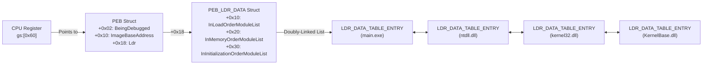
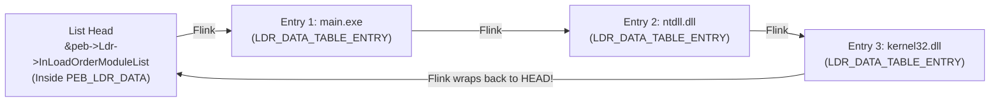
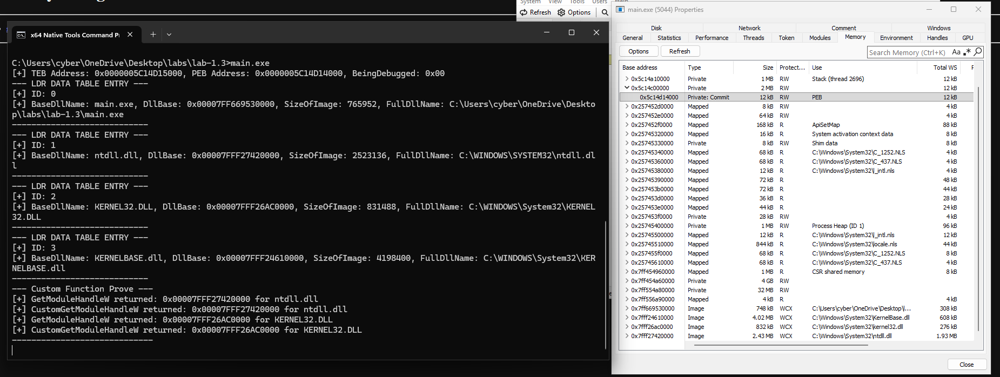
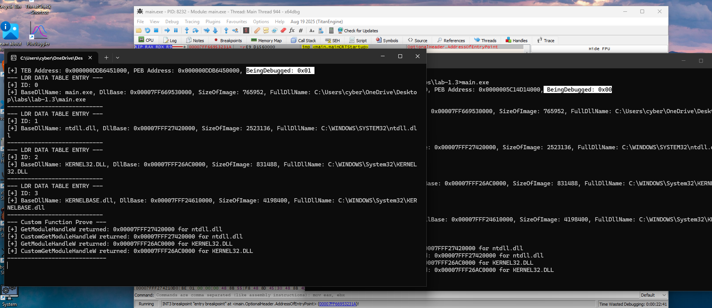

# Module 1.3: Process & Thread Anatomy (`TEB`, `PEB`, and `PEB_LDR_DATA` Walking)

In Lab 1.1 and Lab 1.2, you called `GetModuleHandleA("ntdll.dll")` to get the base memory address of `ntdll.dll`.
Have you ever stopped to ask: **How does `GetModuleHandleA` actually know where `ntdll.dll` is in memory?**

Does `GetModuleHandleA` make a `syscall` to ask the Kernel (`Ring 0`)?
**No!** It never enters the Kernel at all!
Everything `GetModuleHandleA` needs is already sitting inside a secret bookkeeping table right inside your own process's User-Mode (`Ring 3`) memory.

Today, we are going to learn:
1. What a **Process** vs. a **Thread** actually is at the OS level.
2. What the **TEB (Thread Environment Block)** and **PEB (Process Environment Block)** are, and how the CPU's **`GS` register** points directly to them.
3. How Windows uses **circular doubly-linked lists (`LIST_ENTRY`)** inside the `PEB` to track every loaded `.exe` and `.dll`.
4. How to write your own custom `GetModuleHandle` from scratch without calling a single Win32 API!

---

## 1. Process vs. Thread (The Container vs. The Worker)

Beginners often say "my process is running."
Strictly speaking, **processes do not run on the CPU—threads do!**

Think of a **Process** as a **House (a passive container)**, and a **Thread** as a **Person living inside the house (an active worker)**:

| Concept | Process (The Container) | Thread (The Worker / Execution Unit) |
| :--- | :--- | :--- |
| **What does it own?** | - The Virtual Address Space (128 TB of User-Mode memory mappings)<br/>- Loaded DLLs (`ntdll.dll`, `kernel32.dll`)<br/>- Open Handles (files, registry keys)<br/>- The Security Access Token (who owns this process) | - Its own set of CPU Registers (`RIP`, `RSP`, `RAX`, `RCX`, ...)<br/>- Its own **Stack** (local variables, function call return addresses)<br/>- Thread Local Storage (TLS) |
| **How many exist?** | 1 Process per running program instance | Every process starts with **1 Main Thread**, and can spawn dozens of additional threads that all share the exact same Virtual Address Space! |
| **Kernel Object (Ring 0)** | `EPROCESS` (lives in Kernel memory) | `ETHREAD` (lives in Kernel memory) |
| **User-Mode Struct (Ring 3)** | **`PEB` (Process Environment Block)** | **`TEB` (Thread Environment Block)** |

---

## 2. Why Do the `TEB` and `PEB` Exist in Ring 3?

Wait—if the Kernel already keeps track of your process in `EPROCESS` (Ring 0) and your threads in `ETHREAD` (Ring 0), why does Windows *also* create a **`PEB`** and **`TEB`** inside **User-Mode (Ring 3)** memory?

For the exact same performance reason we discussed in Module 1.1!
When standard functions in `kernel32.dll` or `ntdll.dll` need basic information like:
- *"What is my current Thread ID or Process ID?"*
- *"What was the last error code set by `SetLastError()` (`GetLastError()`)?"*
- *"What DLLs are currently loaded in this process (`GetModuleHandle`)?"*
- *"What command-line arguments (`argc`/`argv`) were passed to this process?"*
- *"Is a debugger currently attached to this process (`IsDebuggerPresent()`)?"*

If Windows had to execute a `syscall` (switching Ring 3 $\rightarrow$ Ring 0 $\rightarrow$ Ring 3) every single time a program called `GetLastError()` or `GetModuleHandle()`, programs would be terribly slow.
So when the Kernel creates a process and its threads, the Kernel allocates two special structures inside **your process's Ring 3 memory**:
- **One `PEB` (Process Environment Block)** for the entire process.
- **One `TEB` (Thread Environment Block)** for *each* thread in the process.

---

## 3. How Do You Find the `TEB` and `PEB` in Memory? (The `GS` Segment Register)

Okay, so the `TEB` and `PEB` sit somewhere inside your process's User-Mode memory.
Because of ASLR (Address Space Layout Randomization), their memory addresses change every time you run your program.
So how does your code (or `ntdll.dll`) know what memory address the `TEB` and `PEB` are at without calling an API?

### The CPU Hardware Shortcut: The `GS` Register
On 64-bit Windows (x86_64), the OS Kernel uses a special CPU hardware register called **`GS`** (a leftover segment register from the old 16-bit/32-bit x86 days).
Whenever the Windows Kernel schedules your thread to run on a CPU core, the Kernel points the base of the **`GS` register** directly at the start of **that thread's `TEB` (Thread Environment Block)**!

*(Note: On 32-bit x86 Windows, Windows used the `FS` register instead of `GS`. On 64-bit x64 Windows, it is always **`GS`**).*

Let's look at the first few fields inside the 64-bit **`TEB`** structure:

| Offset in `TEB` | Field Name | Size | What It Contains |
| :--- | :--- | :--- | :--- |
| `gs:[0x00]` | `NtTib.ExceptionList` | 8 bytes | Structured Exception Handling (SEH) frame pointer (32-bit legacy) |
| `gs:[0x08]` | `NtTib.StackBase` | 8 bytes | High address (top) of this thread's Stack |
| `gs:[0x10]` | `NtTib.StackLimit` | 8 bytes | Low address (bottom) of this thread's Stack |
| **`gs:[0x30]`** | **`NtTib.Self`** | **8 bytes** | **A pointer to the `TEB` itself!** (The linear virtual address of this `TEB`) |
| `gs:[0x40]` | `ClientId.UniqueProcess` | 8 bytes | Your Process ID (PID) — this is literally all `GetCurrentProcessId()` reads! |
| `gs:[0x48]` | `ClientId.UniqueThread` | 8 bytes | Your Thread ID (TID) — this is literally all `GetCurrentThreadId()` reads! |
| **`gs:[0x60]`** | **`ProcessEnvironmentBlock`** | **8 bytes** | **A pointer to the `PEB`!** |
| `gs:[0x68]` | `LastErrorValue` | 4 bytes | The thread's `GetLastError()` value! |

Look at **`gs:[0x60]`**:
Every thread's `TEB` holds a pointer to the process's **`PEB`** at offset **`0x60`**!
So in 64-bit Windows assembly, if you want to load the address of the `PEB` into `RAX`, it is literally **one single CPU instruction**:
```nasm
mov rax, gs:[60h]
```

### How Do We Read `gs:[0x60]` in C/C++ on MSVC?
On 64-bit MSVC (`cl.exe`), Microsoft does not allow inline `__asm { ... }` blocks, Instead, MSVC provides **Compiler Intrinsics** in `<intrin.h>` (which is also automatically available when you include `<windows.h>`):
- **`unsigned __int64 __readgsqword(unsigned long Offset);`**
  - "Read a Quadword (8 bytes / 64 bits) from the `GS` segment at `Offset`."
  - If you call `__readgsqword(0x30)`, the compiler emits `mov rax, gs:[30h]` and returns the `TEB*` address!
  - If you call **`__readgsqword(0x60)`**, the compiler emits `mov rax, gs:[60h]` and returns the **`PEB*`** address!

---

## 4. Inside the `PEB` (Process Environment Block)

Once you read `gs:[0x60]`, you have the base address of your process's **`PEB`**.
What lives inside the `PEB` on 64-bit Windows? Let's look at the most important offsets:

| Offset in `PEB` (x64) | Field Name | Type | What It Means & Why Red Teamers Care |
| :--- | :--- | :--- | :--- |
| `+0x002` | **`BeingDebugged`** | `BYTE` (`UCHAR`) | `1` if a user-mode debugger (like x64dbg) is attached, `0` otherwise. When you call the Win32 API `IsDebuggerPresent()`, it literally just reads `PEB->BeingDebugged`! (If you overwrite this byte with `0`, `IsDebuggerPresent()` returns `FALSE`!) |
| `+0x010` | **`ImageBaseAddress`** | `PVOID` | The base **Virtual Address (VA)** where your `.exe` (`main.exe`) is mapped in your process's virtual address space! *(Note: Every pointer in Ring 3 is a Virtual Address. Also, when you call `GetModuleHandle(NULL)`, it simply returns `PEB->ImageBaseAddress` without even walking the module list!)* |
| **`+0x018`** | **`Ldr`** | **`PPEB_LDR_DATA`** | **Pointer (VA) to the Loader Data structure (`PEB_LDR_DATA`) that tracks every loaded DLL in the process!** |
| `+0x020` | **`ProcessParameters`** | `PRTL_USER_PROCESS_PARAMETERS` | Pointer to the structure holding your `CommandLine`, `ImagePathName`, `CurrentDirectory`, and environment variables (`envp`). |



---

## 5. How Windows Tracks Loaded DLLs: `PEB_LDR_DATA` and `LIST_ENTRY`

This is the most important data structure in Phase 1. Take your time reading this section!

At offset **`+0x18`** inside the `PEB` is a pointer named **`Ldr`**, which points to a structure called **`PEB_LDR_DATA`**.
Inside `PEB_LDR_DATA`, the Windows Loader keeps **three circular doubly-linked lists** of every module (`.exe` and `.dll`) currently loaded in your process:
1. **`InLoadOrderModuleList`** (offset `+0x10` in `PEB_LDR_DATA`): Modules in the exact order they were loaded into the process:
   - 1st entry: Your executable (`main.exe`)
   - 2nd entry: `ntdll.dll`
   - 3rd entry: `kernel32.dll`
   - 4th entry: `KernelBase.dll` ...
2. **`InMemoryOrderModuleList`** (offset `+0x20` in `PEB_LDR_DATA`): The exact same modules.
3. **`InInitializationOrderModuleList`** (offset `+0x30` in `PEB_LDR_DATA`): Modules in the order their `DllMain` initialization ran (`ntdll.dll` is 1st here because `main.exe` doesn't have a `DllMain`).

### Wait — How Does a Windows `LIST_ENTRY` Linked List Work?
In a university Computer Science class, when you learn linked lists in C, you usually write a node struct like this:
```text
// Textbook Linked List Node:
struct TextbookNode {
    int data;
    TextbookNode* next; // Points to the BEGINNING of the next TextbookNode
};
```
**Windows does NOT do it that way!**
Instead, Windows defines a generic 16-byte struct called **`LIST_ENTRY`** (already defined for you in `<windows.h>`):
```text
typedef struct _LIST_ENTRY {
    struct _LIST_ENTRY *Flink; // "Forward Link" (Next)
    struct _LIST_ENTRY *Blink; // "Backward Link" (Previous)
} LIST_ENTRY, *PLIST_ENTRY;
```
And Windows embeds `LIST_ENTRY` **inside** larger structs (like `LDR_DATA_TABLE_ENTRY`, which represents one loaded DLL).

### Crucial Concept: What Does `Flink` Point To?!
**`Flink` does NOT always point to offset `0x00` (the start) of the struct!**
**`Flink` points directly to the matching `LIST_ENTRY` field inside the next struct!**

Let's look at the actual layout of **`LDR_DATA_TABLE_ENTRY`** (the struct that describes a loaded `.exe` or `.dll` on 64-bit Windows):

```text
Offset  Field Name                        Type             Description
------  --------------------------------  ---------------  ----------------------------------------------------------
+0x00   InLoadOrderLinks                  LIST_ENTRY       (16 bytes: Flink, Blink) -> Points to next InLoadOrderLinks (+0x00)!
+0x10   InMemoryOrderLinks                LIST_ENTRY       (16 bytes: Flink, Blink) -> Points to next InMemoryOrderLinks (+0x10)!
+0x20   InInitializationOrderLinks        LIST_ENTRY       (16 bytes: Flink, Blink) -> Points to next InInitOrderLinks (+0x20)!
+0x30   DllBase                           PVOID            *** THE BASE MEMORY ADDRESS OF THE DLL (HMODULE)! ***
+0x38   EntryPoint                        PVOID            The address of DllMain / entry point
+0x40   SizeOfImage                       ULONG            Total size of the module in memory (in bytes)
+0x48   FullDllName                       UNICODE_STRING   Full path, e.g. "C:\Windows\System32\ntdll.dll" (16 bytes)
+0x58   BaseDllName                       UNICODE_STRING   Just the filename, e.g. "ntdll.dll" (16 bytes)
```

Look closely at offset **`+0x00`** vs. offset **`+0x10`** in the table above:
- If you walk **`InLoadOrderModuleList`** (and `InLoadOrderLinks`), notice that `InLoadOrderLinks` is at **offset `+0x00`** (the very beginning!) of `LDR_DATA_TABLE_ENTRY`.
  That means the address of `InLoadOrderLinks` **IS** the address of `LDR_DATA_TABLE_ENTRY`! You can simply cast `PLIST_ENTRY` directly to `(PLDR_DATA_TABLE_ENTRY)` without any pointer math!
- By contrast, what if you walk **`InMemoryOrderModuleList`** (which is the only list Microsoft includes in their stripped-down `<winternl.h>` header)?
  `InMemoryOrderLinks` sits at **offset `+0x10` (16 bytes)** inside `LDR_DATA_TABLE_ENTRY`! So if you have a `PLIST_ENTRY` pointing to `InMemoryOrderLinks`, it is pointing **16 bytes (`0x10`) past the start** of the `LDR_DATA_TABLE_ENTRY` struct! (To get the start of the struct from `InMemoryOrderLinks`, you either subtract `0x10` bytes or use the Windows macro `CONTAINING_RECORD(currEntry, LDR_DATA_TABLE_ENTRY, InMemoryOrderLinks)`).

> **Pro Tip for Malware Dev:**
> Never rely on Microsoft's `<winternl.h>` header! Why? Because Microsoft intentionally filled `<winternl.h>` with `BYTE Reserved1[...]` fields to hide `InLoadOrderModuleList` and `BaseDllName` from developers!
> Instead, red teamers define their own clean `UNICODE_STRING`, `PEB_LDR_DATA`, `LDR_DATA_TABLE_ENTRY`, and `PEB` structs in their own code (sourced from **ntdoc.m417z.com** or WinDbg's `dt ntdll!_PEB`), and walk **`InLoadOrderModuleList`** where offset `+0x00` is the start of the struct!

---

## 6. How Strings Work in the `PEB`: `UNICODE_STRING`

Remember in Module 1.1 we mentioned that Native APIs and internal Windows structures do **not** use simple `char*` strings?
Look at `FullDllName` (`+0x48`) and `BaseDllName` (`+0x58`) in `LDR_DATA_TABLE_ENTRY`. Both have the type **`UNICODE_STRING`**.

Here is the exact layout of `UNICODE_STRING` on 64-bit Windows (16 bytes total):
```text
typedef struct _UNICODE_STRING {
    USHORT Length;        // +0x00 (2 bytes): Length of the string in BYTES (not characters!), excluding null terminator
    USHORT MaximumLength; // +0x02 (2 bytes): Total size of Buffer allocated in BYTES
    // (4 bytes of automatic compiler padding here on x64 so Buffer is 8-byte aligned!)
    PWSTR  Buffer;        // +0x08 (8 bytes): Pointer to wide characters (wchar_t* / UTF-16)
} UNICODE_STRING, *PUNICODE_STRING;
```

Two things to keep in mind when printing or comparing a `UNICODE_STRING`:
1. **`Buffer` is a Wide String (`wchar_t*`, 2 bytes per character, UTF-16)** — not an ASCII `char*`!
   - To print a `wchar_t*` in `printf`, use **`%ls`** (or `%S`), or use `wprintf(L"%s\n", entry->BaseDllName.Buffer)`.
   - To compare two `wchar_t*` strings case-insensitively (remember: sometimes Windows loads `"KERNEL32.DLL"` in uppercase and `"ntdll.dll"` in lowercase!), you can use **`_wcsicmp(entry->BaseDllName.Buffer, L"ntdll.dll") == 0`** (or write your own lowercase character-by-character loop).

---

## 7. How Do You Know When Stop Walking a Circular Doubly-Linked List?

Wait—`InLoadOrderModuleList` is a **circular** list! The last DLL's `Flink` doesn't point to `NULL`; it wraps all the way back around to the **List Head** inside `PEB_LDR_DATA`!



So if you write `while (curr != NULL)`, **your program will loop forever!**
How do you walk a circular `LIST_ENTRY` list and stop after visiting every DLL once?

1. **Save the address of the List Head itself** (which lives inside `PEB_LDR_DATA`, *not* inside any `LDR_DATA_TABLE_ENTRY`):
   - `PLIST_ENTRY listHead = &peb->Ldr->InLoadOrderModuleList;`
2. **Start your cursor (`currEntry`) at the first real module (`listHead->Flink`):**
   - `PLIST_ENTRY currEntry = listHead->Flink;`
3. **Loop while `currEntry != listHead`:**
   - Inside the loop, cast `currEntry` to your `LDR_DATA_TABLE_ENTRY*` pointer.
   - Read `DllBase`, `SizeOfImage`, `BaseDllName.Buffer`, and `FullDllName.Buffer`.
   - Advance to the next module: `currEntry = currEntry->Flink;`
4. The moment `currEntry` wraps back around and equals `listHead`, the loop terminates cleanly!

### Wait — Does Starting at `listHead->Flink` Skip the First Module?!
**No!** Why? Because **`listHead` is NOT a module (`LDR_DATA_TABLE_ENTRY`)!**

Look at where `listHead` lives in memory vs. where the actual modules live:

```text
+-------------------------------------------------------+
| Struct: PEB_LDR_DATA  (Only ONE of this in the PEB!)  |
|   +0x00: Length                                       |
|   +0x04: Initialized                                  |
|   +0x08: SsHandle                                     |
|   +0x10: InLoadOrderModuleList (Flink, Blink) <-------+--- This is listHead!
+-------------------------------------------------------+    It is JUST a 16-byte
                         |                                   anchor (Flink + Blink)
                         | listHead->Flink                   inside PEB_LDR_DATA!
                         v                                   There is NO DllBase or
+-------------------------------------------------------+    BaseDllName here!
| Struct: LDR_DATA_TABLE_ENTRY #1 (main.exe)            |
|   +0x00: InLoadOrderLinks (Flink, Blink) <------------+--- This is listHead->Flink!
|   +0x30: DllBase = 0x7FF7...                          |    The FIRST real module!
|   +0x58: BaseDllName = "main.exe"                     |
+-------------------------------------------------------+
                         |
                         | currEntry->Flink
                         v
+-------------------------------------------------------+
| Struct: LDR_DATA_TABLE_ENTRY #2 (ntdll.dll)           |
|   +0x00: InLoadOrderLinks (Flink, Blink)              |
|   +0x30: DllBase = 0x7FFB...                          |
|   +0x58: BaseDllName = "ntdll.dll"                    |
+-------------------------------------------------------+
```

Think of `listHead` (`&peb->Ldr->InLoadOrderModuleList`) as the **keychain ring** itself, and each `LDR_DATA_TABLE_ENTRY` (`main.exe`, `ntdll.dll`, `kernel32.dll`) as a **key hanging on the ring**:
- If you tried to cast `listHead` itself to `(LDR_DATA_TABLE_ENTRY*)`, you would be reading random bytes inside `PEB_LDR_DATA`, not a module!
- `listHead->Flink` is the **first real module (`main.exe`)**.
- When the last module's `Flink` points back to `listHead` (the keychain ring inside `PEB_LDR_DATA`), you know you've come full circle!

---

## 8. Lab 1.3: Walk the `PEB` & Build Your Own Custom `GetModuleHandle`

Let's put this into practice! You are going to write a program in `windows/labs/lab-1.3/main.cpp` that inspects your own `TEB` and `PEB`, enumerates every loaded DLL by walking `InLoadOrderModuleList`, and implements your own `CustomGetModuleHandleW(const wchar_t* moduleName)` function!

### Step 1: Inspect the Structs in WinDbg or Check the Exact Layout
Before writing code, here are the exact struct layouts you need to define at the top of your `main.cpp` (since we are **not** using `<winternl.h>`):

1. **`UNICODE_STRING`**:
   - `USHORT Length;`
   - `USHORT MaximumLength;`
   - `PWSTR Buffer;`
2. **`PEB_LDR_DATA`**:
   - `ULONG Length;` (`+0x00`, 4 bytes)
   - `BOOLEAN Initialized;` (`+0x04`, 1 byte + 3 bytes padding)
   - `PVOID SsHandle;` (`+0x08`, 8 bytes)
   - `LIST_ENTRY InLoadOrderModuleList;` (`+0x10`, 16 bytes)
   - `LIST_ENTRY InMemoryOrderModuleList;` (`+0x20`, 16 bytes)
   - `LIST_ENTRY InInitializationOrderModuleList;` (`+0x30`, 16 bytes)
3. **`LDR_DATA_TABLE_ENTRY`**:
   - `LIST_ENTRY InLoadOrderLinks;` (`+0x00`, 16 bytes)
   - `LIST_ENTRY InMemoryOrderLinks;` (`+0x10`, 16 bytes)
   - `LIST_ENTRY InInitializationOrderLinks;` (`+0x20`, 16 bytes)
   - `PVOID DllBase;` (`+0x30`, 8 bytes)
   - `PVOID EntryPoint;` (`+0x38`, 8 bytes)
   - `ULONG SizeOfImage;` (`+0x40`, 4 bytes + 4 bytes padding)
   - `UNICODE_STRING FullDllName;` (`+0x48`, 16 bytes)
   - `UNICODE_STRING BaseDllName;` (`+0x58`, 16 bytes)
4. **`PEB`** (up to offset `+0x18`):
   - `BYTE InheritedAddressSpace;` (`+0x00`)
   - `BYTE ReadImageFileExecOptions;` (`+0x01`)
   - `BYTE BeingDebugged;` (`+0x02`)
   - `BYTE BitField;` (`+0x03` + 4 bytes padding)
   - `PVOID Mutant;` (`+0x08`, 8 bytes)
   - `PVOID ImageBaseAddress;` (`+0x10`, 8 bytes)
   - `PPEB_LDR_DATA Ldr;` (`+0x18`, 8 bytes)

### Step 2: What Your Program in `windows/labs/lab-1.3/main.cpp` Should Do
1. **Read the `TEB` and `PEB` via `__readgsqword`:**
   - Print the `TEB` address (`__readgsqword(0x30)`).
   - Print the `PEB` address (`__readgsqword(0x60)`).
   - Print `peb->BeingDebugged` and `peb->ImageBaseAddress`.
2. **Walk `peb->Ldr->InLoadOrderModuleList`:**
   - Loop through every loaded module in the process and print:
     - `BaseDllName.Buffer` (`%ls`)
     - `DllBase` (`0x%p`)
     - `SizeOfImage` (`%lu` bytes)
     - `FullDllName.Buffer` (`%ls`)
3. **Write a Function `HMODULE CustomGetModuleHandleW(const wchar_t* targetModuleName)`:**
   - Inside this function, walk `InLoadOrderModuleList`, compare each entry's `BaseDllName.Buffer` with `targetModuleName` (case-insensitively using `_wcsicmp`), and return `(HMODULE)entry->DllBase` when found (or `NULL` if not found).
4. **Prove Your Custom Function Is Identical to Win32 `GetModuleHandleW`:**
   - In `main()`, call both `CustomGetModuleHandleW(L"ntdll.dll")` and `GetModuleHandleW(L"ntdll.dll")` (and do the same for `L"KERNEL32.DLL"` — in uppercase to prove your case-insensitive check works!).
   - Print both addresses side by side to prove your manual `PEB` walk returns the exact same base address as the official Win32 API!

### Deliverables to Report Back:
1. Your code in `windows/labs/lab-1.3/main.cpp` and console output.
2. What modules were loaded in your process (and in what exact order did `InLoadOrderModuleList` list them)?
3. What happened to `peb->BeingDebugged` when you ran `main.exe` normally from `cmd.exe` (`0`) vs. when you launched `main.exe` inside **x64dbg** (`1`)?

---

## 9. Lab 1.3 Results & Findings

- **Source Code:** [`windows/labs/lab-1.3/main.cpp`](./labs/lab-1.3/main.cpp)

### Console Output
```text
[+] TEB Address: 0x0000005C14D15000, PEB Address: 0x0000005C14D14000, BeingDebugged: 0x00
--- LDR DATA TABLE ENTRY ---
[+] ID: 0
[+] BaseDllName: main.exe, DllBase: 0x00007FF669530000, SizeOfImage: 765952, FullDllName: C:\Users\cyber\OneDrive\Desktop\labs\lab-1.3\main.exe
----------------------------
--- LDR DATA TABLE ENTRY ---
[+] ID: 1
[+] BaseDllName: ntdll.dll, DllBase: 0x00007FFF27420000, SizeOfImage: 2523136, FullDllName: C:\WINDOWS\SYSTEM32\ntdll.dll
----------------------------
--- LDR DATA TABLE ENTRY ---
[+] ID: 2
[+] BaseDllName: KERNEL32.DLL, DllBase: 0x00007FFF26AC0000, SizeOfImage: 831488, FullDllName: C:\WINDOWS\System32\KERNEL32.DLL
----------------------------
--- LDR DATA TABLE ENTRY ---
[+] ID: 3
[+] BaseDllName: KERNELBASE.dll, DllBase: 0x00007FFF24610000, SizeOfImage: 4198400, FullDllName: C:\WINDOWS\System32\KERNELBASE.dll
----------------------------
--- Custom Function Prove ---
[+] GetModuleHandleW returned: 0x00007FFF27420000 for ntdll.dll
[+] CustomGetModuleHandleW returned: 0x00007FFF27420000 for ntdll.dll
[+] GetModuleHandleW returned: 0x00007FFF26AC0000 for KERNEL32.DLL
[+] CustomGetModuleHandleW returned: 0x00007FFF26AC0000 for KERNEL32.DLL
-----------------------------
```

### Key Observations
1. **Why Truncating a 64-Bit Pointer into a `ULONG` Crashed (`0xC0000005`):**
   - Windows uses the **LLP64** data model where `long` and `ULONG` remain **32-bit (4 bytes)** even on 64-bit Windows! Storing `__readgsqword(0x60)` into a `ULONG` truncated the upper 32 bits of the `PEB` virtual address, causing an immediate `0xC0000005` (`STATUS_ACCESS_VIOLATION`) when dereferencing `programPEB`. Switching to `ULONG64` (or `ULONG_PTR` / `PVOID`) preserved all 64 bits.
2. **Module Load Order (`InLoadOrderModuleList`):**
   - Walking `InLoadOrderModuleList` confirmed the exact Windows process initialization order:
     - **ID `0`:** `main.exe` (the image executable itself)
     - **ID `1`:** `ntdll.dll`
     - **ID `2`:** `KERNEL32.DLL`
     - **ID `3`:** `KERNELBASE.dll`
3. **`CustomGetModuleHandleW` vs. `GetModuleHandleW`:**
   - Walking `PEB->Ldr->InLoadOrderModuleList` in User Mode returned the exact same `DllBase` virtual addresses (`0x00007FFF27420000` for `ntdll.dll` and `0x00007FFF26AC0000` for `KERNEL32.DLL`) as `GetModuleHandleW`, without calling a single Win32 API.



4. **`PEB->BeingDebugged` (`0x00` vs. `0x01`):**
   - Running `main.exe` directly from `cmd.exe` printed `BeingDebugged: 0x00`.
   - Launching `main.exe` under **x64dbg** flipped `PEB->BeingDebugged` at offset `+0x02` to `0x01` (which is the exact byte checked by `IsDebuggerPresent()`).



