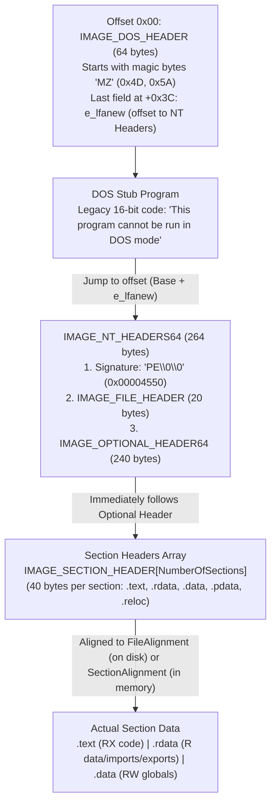
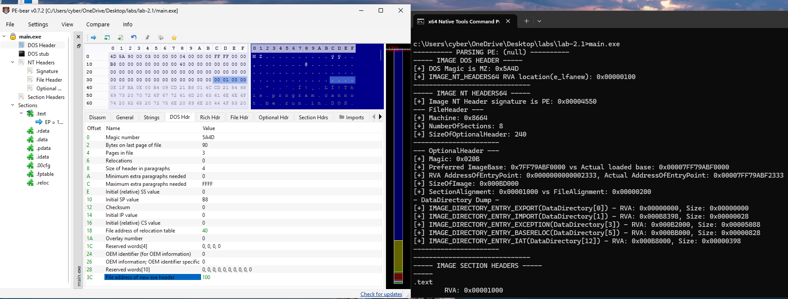
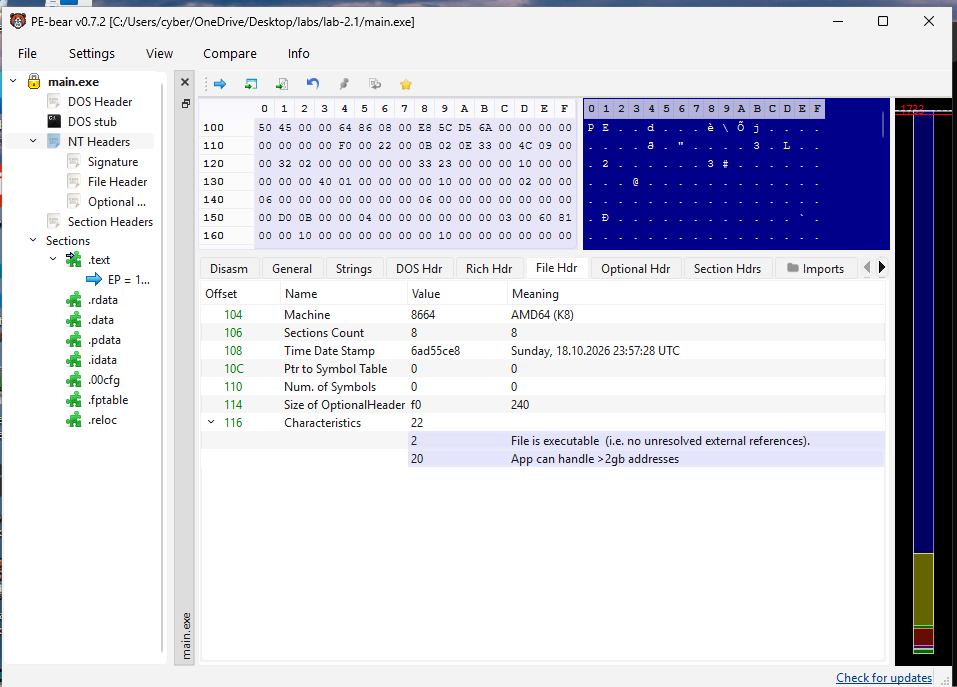
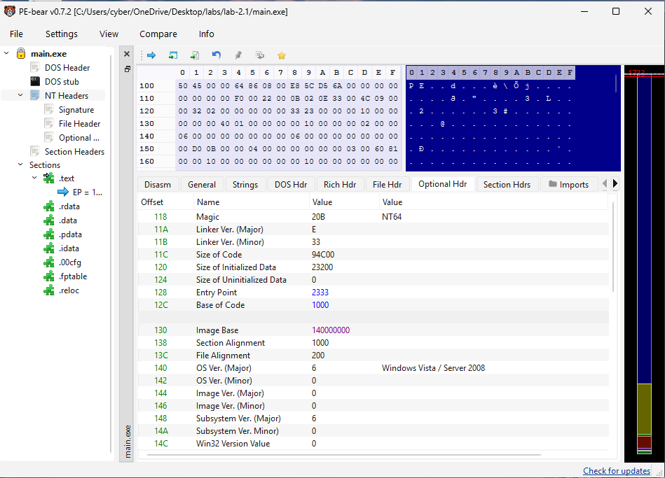
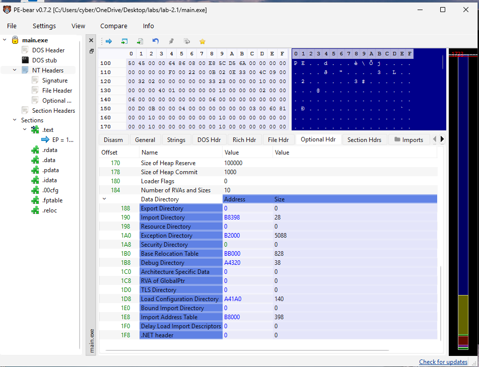
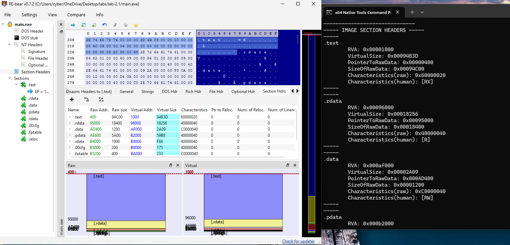

# Module 2.1: The Portable Executable (PE) File Format — Headers, Sections, and Disk vs. Memory

Welcome to **Phase 2**!

In Lab 1.3, you walked the `PEB` and found that `ntdll.dll` was mapped into your process at Virtual Address `0x00007FFF27420000`, and `main.exe` was mapped at `0x00007FF669530000`.
Wait—**what is actually sitting at `0x00007FF669530000` (or at byte `0` of `main.exe` on disk)?**

Is it immediately CPU instructions (`mov`, `push`, `call`)?
**No!** If the CPU jumped straight to `0x00007FF669530000` and tried to execute the first byte, your program would crash!

Why? Because the beginning of every `.exe`, `.dll`, and `.sys` (driver) file on Windows is a structured **blueprint** called the **Portable Executable (PE) Header**.
Before the Windows Loader (`ntdll.dll`) can run `main.exe`, it reads this blueprint to answer questions like:
- *"Is this a 32-bit (`x86`) or 64-bit (`x64`) program?"*
- *"How much virtual memory (`SizeOfImage`) do I need to reserve for this program?"*
- *"Where inside the file is the machine code (`.text`), the read-only strings (`.rdata`), and the global variables (`.data`), and what page permissions (`RX`, `R`, `RW`) should each section get?"*
- *"Which DLLs and functions (`Imports`) does this program need me to resolve before it starts?"*
- *"Which functions (`Exports`) does this DLL offer to other programs?"*
- *"Once everything is mapped into memory, what exact offset (`AddressOfEntryPoint`) should `RIP` jump to in order to start executing?"*

If you understand the PE format from first principles, you can:
1. Build your own **`GetProcAddress`** from scratch (Module 2.2).
2. Hook functions via the **Import Address Table (IAT)** (Module 2.3).
3. Build a **Reflective Loader / Manual Mapper** that loads a DLL straight from memory without ever touching disk or calling `LoadLibrary` (Module 4.1).

Let's break down the entire PE structure step by step with concrete byte offsets.

---

## 1. The Big Picture: A PE File from Top to Bottom

Whether a PE file is sitting on your SSD (`C:\Windows\System32\notepad.exe`) or already mapped into Virtual Memory (`0x00007FF669530000`), it always has the exact same sequence of headers at the top, followed by the **Sections** (`.text`, `.rdata`, `.data`, etc.):



Good news: **Every single PE header struct (`IMAGE_DOS_HEADER`, `IMAGE_NT_HEADERS64`, `IMAGE_SECTION_HEADER`, etc.) is already defined for you inside `<windows.h>`** (specifically inside `<winnt.h>`, which `<windows.h>` includes automatically)! You don't even have to write `typedef struct` for them—you just need to know what lives inside each struct and how to navigate from one to the next.

---

## 2. Header #1: `IMAGE_DOS_HEADER` (Offset `0x00`, Size: 64 Bytes)

Every PE file begins at byte `0` with a 64-byte (`0x40` byte) structure called **`IMAGE_DOS_HEADER`**.

Wait—why is there a 1980s **MS-DOS** header at the start of a 64-bit Windows 11 executable?!
Backwards compatibility! In the early 1990s, if someone accidentally ran a Windows program inside old 16-bit MS-DOS, Microsoft didn't want the computer to crash—they wanted a tiny 16-bit DOS stub at the start of the `.exe` to print:
`"This program cannot be run in DOS mode."` and exit cleanly.

Even though 64-bit Windows hasn't supported MS-DOS for 20+ years, **the Windows Kernel and Loader still check two fields inside `IMAGE_DOS_HEADER`** (and literally ignore the other 17 fields!):

```text
typedef struct _IMAGE_DOS_HEADER {
    WORD   e_magic;    // +0x00 (2 bytes): Magic number! MUST be 0x5A4D ('MZ' in ASCII, little-endian)
    ...                // +0x02 .. +0x3B: 58 bytes of old 16-bit MS-DOS fields (completely ignored by Windows!)
    LONG   e_lfanew;   // +0x3C (4 bytes): File offset (RVA) to the real PE header (IMAGE_NT_HEADERS)!
} IMAGE_DOS_HEADER, *PIMAGE_DOS_HEADER;
```

Let's examine those two fields:
1. **`e_magic` (Offset `+0x00`, `WORD` / 2 bytes):**
   - Contains the ASCII characters `'M'` (`0x4D`) and `'Z'` (`0x5A`)—named after **Mark Zbikowski**, one of the original architects of MS-DOS.
   - Because x86_64 is **Little-Endian**, when you read those 2 bytes (`0x4D`, `0x5A`) as a 16-bit `WORD`, the second byte (`0x5A`) is the upper byte and the first byte (`0x4D`) is the lower byte: **`0x5A4D`**!
   - `<windows.h>` defines the macro **`IMAGE_DOS_SIGNATURE`** (`0x5A4D`). Always check `dosHeader->e_magic == IMAGE_DOS_SIGNATURE` to verify you are actually looking at a valid PE file!
2. **`e_lfanew` (Offset `+0x3C`, `LONG` / 4 bytes):**
   - Stands for *"File address of new exe header"*.
   - Why can't the real PE header always start at a fixed offset like `0x80`? Because the compiler can make the legacy DOS stub slightly shorter or longer (or add compiler Rich Headers between the DOS stub and the PE header).
   - So the 4-byte integer at offset **`+0x3C` (`dosHeader->e_lfanew`)** tells you **how many bytes from the very beginning of the file/module you need to add to reach `IMAGE_NT_HEADERS64`**!
   - **Concrete Pointer Math Warning (Why `(BYTE*)baseAddr + offset` Instead of `dosHeader + offset`):**
     In C/C++, when you add an integer `N` to a pointer `ptr`, **the compiler does NOT simply add `N` bytes to the address!** Instead, C automatically multiplies `N` by `sizeof(*ptr)` (the size in bytes of the type `ptr` points to):
     $$\text{New Address} = \text{Old Address} + \left(N \times \text{sizeof}(\text{type})\right)$$
     Suppose `main.exe` starts at `0x10000` and `dosHeader->e_lfanew` is `0xF0` (240 bytes), meaning `IMAGE_NT_HEADERS64` sits at exact address **`0x100F0`**:
     - **WRONG (`dosHeader + dosHeader->e_lfanew`):**
       Because `dosHeader` has type `IMAGE_DOS_HEADER*` and `sizeof(IMAGE_DOS_HEADER)` is **64 bytes (`0x40`)**, the C compiler thinks you want the 240th struct in an array of `IMAGE_DOS_HEADER`s:
       $$\text{0x10000} + (\text{0xF0} \times 64\text{ bytes}) = \text{0x10000} + \text{0x3C00} = \textbf{0x13C00} \quad (\text{Overshot by 15,120 bytes! Crash!})$$
     - **RIGHT (`(BYTE*)baseAddr + dosHeader->e_lfanew`):**
       Because `sizeof(BYTE)` (`unsigned char`) is **always `1` byte**, adding `0xF0` to a `BYTE*` moves forward by `0xF0 * 1` bytes:
       $$\text{0x10000} + (\text{0xF0} \times 1\text{ byte}) = \textbf{0x100F0} \quad (\text{Exact address of the NT Headers!})$$
     - **Rule of Thumb:** Whenever a PE field gives you a byte offset (`e_lfanew` or any `RVA`), **always** add it to a **`BYTE*`** (or `ULONG_PTR` / `uintptr_t`) base address, never to a `struct*`!

---

## 3. Header #2: `IMAGE_NT_HEADERS64` (Starts at `baseAddr + e_lfanew`)

Once you jump to `baseAddr + dosHeader->e_lfanew`, you land on **`IMAGE_NT_HEADERS64`** (or simply `IMAGE_NT_HEADERS` when compiling as 64-bit).

It is a container struct with **3 parts**:

```text
typedef struct _IMAGE_NT_HEADERS64 {
    DWORD                   Signature;       // +0x00 (4 bytes): 'PE\0\0' -> 0x00004550 (IMAGE_NT_SIGNATURE)
    IMAGE_FILE_HEADER       FileHeader;      // +0x04 (20 bytes): Physical layout info (CPU arch, number of sections)
    IMAGE_OPTIONAL_HEADER64 OptionalHeader;  // +0x18 (240 bytes): Loader info (ImageBase, EntryPoint, DataDirectory[])
} IMAGE_NT_HEADERS64, *PIMAGE_NT_HEADERS64;
```

Let's inspect each of the 3 parts inside `IMAGE_NT_HEADERS64`:

### Part 1: `Signature` (`+0x00`, 4 bytes)
- Contains the ASCII bytes `'P'`, `'E'`, `'\0'`, `'\0'` (`0x50, 0x45, 0x00, 0x00`).
- In little-endian `DWORD`, that is **`0x00004550`** (defined in `<windows.h>` as **`IMAGE_NT_SIGNATURE`**).

### Part 2: `FileHeader` (`IMAGE_FILE_HEADER`, `+0x04`, 20 bytes)
Also known as the COFF Header. It describes the high-level physical properties of the binary:

| Field in `FileHeader` | Type | What It Means |
| :--- | :--- | :--- |
| **`Machine`** | `WORD` | Target CPU architecture. **`0x8664`** (`IMAGE_FILE_MACHINE_AMD64`) = 64-bit x64; `0x014C` (`IMAGE_FILE_MACHINE_I386`) = 32-bit x86. |
| **`NumberOfSections`** | `WORD` | **How many sections (`.text`, `.rdata`, `.data`, etc.) exist in this PE file!** You need this number to loop over the Section Headers array! |
| `TimeDateStamp` | `DWORD` | Unix timestamp (seconds since Jan 1, 1970) when the compiler/linker built this `.exe`/`.dll`. *(Blue teams use this for forensics; red teamers often stomp/spoof it).* |
| `PointerToSymbolTable` | `DWORD` | Legacy COFF symbol offset (`0` on modern PE files). |
| `NumberOfSymbols` | `DWORD` | Legacy COFF symbol count (`0` on modern PE files). |
| **`SizeOfOptionalHeader`** | `WORD` | Size in bytes of the `OptionalHeader` that immediately follows (`240` / `0xF0` bytes for 64-bit PE files). |
| **`Characteristics`** | `WORD` | Bitmask flags: e.g. `IMAGE_FILE_EXECUTABLE_IMAGE` (`0x0002`), `IMAGE_FILE_DLL` (`0x2000` — tells you if this file is a `.dll` vs an `.exe`!). |

### Part 3: `OptionalHeader` (`IMAGE_OPTIONAL_HEADER64`, `+0x18`, 240 bytes)
First: **What is the difference between `FileHeader` and `OptionalHeader`?**
- **`FileHeader` (20 bytes) — "What is inside this file on disk?"**
  It only knows basic static facts: *"This file was compiled for an x64 CPU (`Machine = 0x8664`), and it has `6` sections (`NumberOfSections = 6`)."*
  Notice what `FileHeader` does **NOT** know: Where is `main()`? How much RAM does the OS need to allocate? Which DLLs does this program import?
- **`OptionalHeader` (240 bytes) — "The Instruction Manual for the Windows Loader (`ntdll.dll`)!"**
  *(Ignore the misleading word "Optional"—Microsoft only named it that in 1993 because raw `.obj` compiler object files don't have one. Every `.exe` and `.dll` is 100% required to have `OptionalHeader`!)*

#### Step-by-Step: How the Windows Loader Uses `OptionalHeader` When You Launch `main.exe`
1. **Step A ("Is this 32-bit or 64-bit?") $\rightarrow$ `OptionalHeader.Magic`:**
   - Checks the first 2 bytes (`WORD`). If `Magic == 0x020B`, the Loader knows this is a 64-bit (`PE32+`) binary (`0x010B` = 32-bit `PE32`).
2. **Step B ("How much Virtual Memory do I allocate, and where?") $\rightarrow$ `SizeOfImage` & `ImageBase`:**
   - The Loader reads **`OptionalHeader.SizeOfImage`** (e.g., `765952` bytes / `0xBB000` from Lab 1.3!) to know how many bytes of contiguous Virtual Memory to reserve via `NtAllocateVirtualMemory`.
   - The Loader checks **`OptionalHeader.ImageBase`** (default `0x0000000140000000` for `.exe`, `0x0000000180000000` for `.dll`). Because of ASLR, Windows usually maps the binary at a random address (e.g. `0x00007FF669530000`) and calculates the difference (`ActualBase - OptionalHeader.ImageBase`) to fix up pointers later.
3. **Step C ("How are sections aligned on Disk vs. in RAM?") $\rightarrow$ `FileAlignment` & `SectionAlignment`:**
   - On disk, sections are packed on **`FileAlignment`** (`0x200` = 512-byte) boundaries.
   - In RAM, the Loader stretches sections out to **`SectionAlignment`** (`0x1000` = 4,096-byte page) boundaries so the CPU MMU can give `.text` (`RX`) and `.data` (`RW`) separate page permissions.
4. **Step D ("Where are the Import, Export, and Relocation tables?") $\rightarrow$ `DataDirectory[16]`:**
   - At the end of `OptionalHeader` is an array of 16 `(VirtualAddress RVA, Size)` pairs pointing to the Export Table (`[0]`), Import Table (`[1]`), Exception Table (`[3]`), Relocation Table (`[5]`), and IAT (`[12]`).
5. **Step E ("Which instruction do I jump to (`RIP`) to start the program?") $\rightarrow$ `AddressOfEntryPoint`:**
   - Once all sections and imports are ready, the Loader reads the RVA in **`OptionalHeader.AddressOfEntryPoint`** (e.g., `0x231A`) and sets the thread's `RIP` to:
     $$\text{Start Address (VA)} = \text{ActualLoadedBase} + \text{OptionalHeader.AddressOfEntryPoint}$$

```text
+-----------------------------------------------------------------------+
| IMAGE_NT_HEADERS64  (Starts at: (BYTE*)baseAddr + dosHeader->e_lfanew)|
|                                                                       |
|  1. Signature (4 bytes): "PE\0\0" (0x00004550)                        |
|                                                                       |
|  2. FileHeader (20 bytes):                                            |
|     - Machine (0x8664 = x64)                                          |
|     - NumberOfSections (e.g., 6)                                      |
|     - SizeOfOptionalHeader (240 bytes)                                |
|                                                                       |
|  3. OptionalHeader (240 bytes) -- THE LOADER'S INSTRUCTION MANUAL:    |
|     - Magic (0x020B = 64-bit PE32+)                                   |
|     - AddressOfEntryPoint (RVA where execution starts, e.g., 0x231A)  |
|     - ImageBase (Preferred base address, e.g., 0x140000000)           |
|     - SectionAlignment (0x1000 in RAM) vs FileAlignment (0x200 Disk)  |
|     - SizeOfImage (Total RAM needed, e.g., 0xBB000 bytes)             |
|     - DataDirectory[16] (Array of 16 RVA+Size pointers to Exports,    |
|                          Imports, Relocations, Exceptions, IAT...)    |
+-----------------------------------------------------------------------+
```

| Field in `OptionalHeader` | Type | Concrete Meaning |
| :--- | :--- | :--- |
| **`Magic`** | `WORD` | **`0x020B`** (`IMAGE_NT_OPTIONAL_HDR64_MAGIC`) = **PE32+ (64-bit)**.<br/>`0x010B` (`IMAGE_NT_OPTIONAL_HDR32_MAGIC`) = PE32 (32-bit). |
| **`AddressOfEntryPoint`** | `DWORD` | **RVA (Relative Virtual Address)** of the program's entry point (e.g., `mainCRTStartup` or `DllMain`). When the Loader finishes mapping the PE into memory at `ImageBase`, it starts execution at **`ImageBase + AddressOfEntryPoint`**! |
| **`ImageBase`** | `ULONGLONG` (8 bytes) | The **preferred** Virtual Address where this binary wants to be loaded in memory (by default `0x0000000140000000` for 64-bit `.exe`s, `0x0000000180000000` for 64-bit `.dll`s). Because of ASLR, Windows usually loads it at a different random base address and fixes it up using Relocations (Module 2.3). |
| **`SectionAlignment`** | `DWORD` | Alignment of sections **when mapped in Virtual Memory** — almost always **`0x1000` (4,096 bytes / 1 page)**! Why? Because page permissions (`RX`, `R`, `RW`) can only be applied on 4 KB page boundaries! |
| **`FileAlignment`** | `DWORD` | Alignment of raw section data **when sitting on Disk** — usually **`0x200` (512 bytes)** (the size of a traditional disk sector) so files on disk don't waste space with 4 KB padding! |
| **`SizeOfImage`** | `DWORD` | Total size in bytes of the entire PE image once expanded in **Virtual Memory** (rounded up to `SectionAlignment`). When a loader maps a PE into memory, it calls `NtAllocateVirtualMemory` with `SizeOfImage`! |
| **`SizeOfHeaders`** | `DWORD` | Combined size of DOS Header + NT Headers + Section Headers, rounded up to `FileAlignment`. |
| `Subsystem` | `WORD` | `2` (`IMAGE_SUBSYSTEM_WINDOWS_GUI` — no console window, like `notepad.exe`) vs. `3` (`IMAGE_SUBSYSTEM_WINDOWS_CUI` — console app, like your `main.exe`). |
| **`DataDirectory[16]`** | `IMAGE_DATA_DIRECTORY[16]` | **An array of 16 "table pointers" (`VirtualAddress` RVA + `Size`)** at the end of the Optional Header that point to the **Export Table**, **Import Table**, **Relocation Table**, **Exception Table (`.pdata`)**, etc.! |

---

## 4. The Crucial Concept: Disk vs. Memory (`File Offset` vs. `RVA` vs. `VA`)

Pause here and read this carefully—this is the single most important concept in Phase 2!

Look back at `SectionAlignment` (`0x1000` = 4096 bytes in Memory) vs. `FileAlignment` (`0x200` = 512 bytes on Disk).
Why does a PE file look **different on Disk** than it does **in Virtual Memory**?

- **On Disk (`main.exe` file on SSD):** Nobody is executing the file directly off the SSD, and there are no MMU page permissions on disk. So to keep `.exe` files small on disk, the compiler packs each section onto **512-byte (`0x200`)** boundaries (`FileAlignment`).
- **In Memory (after the Windows Loader maps `main.exe` into RAM):** The CPU's MMU needs `.text` (code) to be `RX` (`PAGE_EXECUTE_READ`) and `.data` (global variables) to be `RW` (`PAGE_READWRITE`). As you learned in Module 1.2, the CPU can **only** set permissions on **4,096-byte (`0x1000`)** page boundaries! So when the Windows Loader copies each section from Disk into Virtual Memory, it stretches/pads the spacing between sections out to **4,096-byte (`0x1000`)** boundaries (`SectionAlignment`)!

```text
ON DISK (FileAlignment = 0x200)               IN VIRTUAL MEMORY (SectionAlignment = 0x1000)
Base = File Byte 0                            ImageBase = 0x00007FF669530000
+-------------------------------+ 0x0000      +-------------------------------+ +0x0000 (RVA 0x0000)
| PE Headers (DOS + NT + Secs)  |             | PE Headers (DOS + NT + Secs)  |
+-------------------------------+ 0x0400      | (padded with 0x00 to 0x1000)  |
| .text Section (Raw Code)      |             +-------------------------------+ +0x1000 (RVA 0x1000)
| (File Offset = 0x0400)        |             | .text Section (RX Code)       |
+-------------------------------+ 0x0A00      | (VirtualAddress RVA = 0x1000) |
| .rdata Section (Read-only)    |             | (padded with 0x00 to 0x2000)  |
| (File Offset = 0x0A00)        |             +-------------------------------+ +0x2000 (RVA 0x2000)
+-------------------------------+ 0x1000      | .rdata Section (R Strings)    |
| .data Section (Globals)       |             | (VirtualAddress RVA = 0x2000) |
| (File Offset = 0x1000)        |             +-------------------------------+ +0x3000 (RVA 0x3000)
+-------------------------------+             | .data Section (RW Globals)    |
                                              +-------------------------------+
```

This gives us **three** ways to describe an address in a PE file. Memorize these three definitions:

1. **VA (Virtual Address):**
   - The actual 64-bit pointer in memory when the process is running (e.g., `0x00007FF669531000`).
2. **RVA (Relative Virtual Address):**
   - The offset **in memory** relative to `ImageBase`!
   - Formula:
     $$\text{RVA} = \text{VA} - \text{ImageBase}$$
     $$\text{VA} = \text{ImageBase} + \text{RVA}$$
   - **Why does almost every field inside PE headers (`AddressOfEntryPoint`, `DataDirectory[i].VirtualAddress`, Export/Import tables) store an RVA instead of a VA or File Offset?**
     Because once the Windows Loader maps the PE into memory, finding anything is literally just **`ImageBase + RVA`**!
3. **Raw File Offset (`PointerToRawData`):**
   - The byte offset from byte `0` of the file **on disk** (before the sections have been stretched out to `0x1000` page boundaries!).
   - Look at the diagram above: `.text` is at **RVA `0x1000`** in memory, but on disk it sits at **File Offset `0x0400`**!
   - So if you read a file off disk into a raw buffer (`ReadFile`) without mapping its sections to their `VirtualAddress` offsets, an RVA like `0x1000` is **not** at byte `0x1000` of your disk buffer! By contrast, if you inspect a module that is **already mapped in memory** (like `main.exe` or `ntdll.dll`), every RVA is literally just **`(BYTE*)moduleBase + RVA`**!

---

## 5. Header #3: The Section Headers (`IMAGE_SECTION_HEADER`)

Immediately after `IMAGE_NT_HEADERS64` sits an array of **`IMAGE_SECTION_HEADER`** structs.
How many elements are in this array?
**`ntHeaders->FileHeader.NumberOfSections`**!

How do you get a pointer to the first `IMAGE_SECTION_HEADER`?
- **Method A (Windows Macro):** `<windows.h>` provides the built-in macro **`IMAGE_FIRST_SECTION(ntHeaders)`**, which automatically calculates the exact address right after `ntHeaders->OptionalHeader`!
- **Method B (Pointer Math):** `(PIMAGE_SECTION_HEADER)((BYTE*)&ntHeaders->OptionalHeader + ntHeaders->FileHeader.SizeOfOptionalHeader)`.

Each `IMAGE_SECTION_HEADER` is **40 bytes** (`0x28` bytes) and looks like this:

```text
typedef struct _IMAGE_SECTION_HEADER {
    BYTE  Name[8];               // +0x00 (8 bytes): ASCII name, e.g. ".text", ".rdata", ".data" (NOT guaranteed to be null-terminated if 8 chars long!)
    union {
        DWORD PhysicalAddress;
        DWORD VirtualSize;       // +0x08 (4 bytes): Actual size of the section's contents in memory (before page rounding)
    } Misc;
    DWORD VirtualAddress;        // +0x0C (4 bytes): *** RVA of this section when mapped in Memory! (e.g. 0x1000) ***
    DWORD SizeOfRawData;         // +0x10 (4 bytes): Size of this section on Disk (multiple of FileAlignment 0x200)
    DWORD PointerToRawData;      // +0x14 (4 bytes): *** File Offset of this section on Disk! (e.g. 0x400) ***
    ...                          // (Relocations/Linenumbers fields, unused in linked PEs)
    DWORD Characteristics;       // +0x24 (4 bytes): Flags! Is it executable? Readable? Writable?
} IMAGE_SECTION_HEADER, *PIMAGE_SECTION_HEADER;
```

Look at how every piece of the puzzle fits together in `IMAGE_SECTION_HEADER`:
- **Where is this section on Disk?** At byte `PointerToRawData`, with length `SizeOfRawData`.
- **Where does this section go in Virtual Memory?** At `ImageBase + VirtualAddress` (RVA), with actual content size `Misc.VirtualSize`.
- *(Think ahead to Module 4.1 when you build a Reflective DLL Loader: how do you map a PE file from a raw disk buffer into virtual memory? You literally loop over `NumberOfSections` and `memcpy(imageBase + section[i].VirtualAddress, rawFileBuffer + section[i].PointerToRawData, section[i].SizeOfRawData)`! That's it!)*

### Common PE Sections You Will See:
- **`.text`**: Executable machine code (`Characteristics` includes `IMAGE_SCN_MEM_EXECUTE | IMAGE_SCN_MEM_READ` $\rightarrow$ `RX`).
- **`.rdata`**: Read-only data—string literals, `const` variables, the Import Directory, and Export Directory (`IMAGE_SCN_MEM_READ` $\rightarrow$ `R`).
- **`.data`**: Initialized global and `static` C/C++ variables (`IMAGE_SCN_MEM_READ | IMAGE_SCN_MEM_WRITE` $\rightarrow$ `RW`).
- **`.pdata`**: Exception handling / stack unwinding table (`RUNTIME_FUNCTION` array on x64 — huge in Module 4.3 for Call Stack Spoofing!).
- **`.reloc`**: Base relocation table (fixes hardcoded addresses when ASLR moves the image — Module 2.3).

---

## 6. The Data Directories (`OptionalHeader.DataDirectory[16]`)

Wait—sections like `.rdata` can be hundreds of kilobytes long and hold strings, constants, imports, exports, and debug info all packed together.
How does the Windows Loader find the **Export Table** or **Import Table** inside `.rdata` without scanning the whole section?

At the end of `ntHeaders->OptionalHeader` is an array of 16 entries called **`DataDirectory`**:
```text
typedef struct _IMAGE_DATA_DIRECTORY {
    DWORD VirtualAddress; // RVA (offset from ImageBase in memory) where the table starts!
    DWORD Size;           // Size of that table in bytes
} IMAGE_DATA_DIRECTORY, *PIMAGE_DATA_DIRECTORY;
```

Each index (`0` to `15`) has a fixed meaning defined in `<windows.h>`:
- Index `0` (**`IMAGE_DIRECTORY_ENTRY_EXPORT`**): The **Export Directory** (functions this DLL exports — Module 2.2).
- Index `1` (**`IMAGE_DIRECTORY_ENTRY_IMPORT`**): The **Import Directory** (DLLs and functions this binary imports — Module 2.3).
- Index `3` (**`IMAGE_DIRECTORY_ENTRY_EXCEPTION`**): The **Exception Directory (`.pdata`)** (Module 4.3).
- Index `5` (**`IMAGE_DIRECTORY_ENTRY_BASERELOC`**): The **Base Relocation Table (`.reloc`)** (Module 2.3).
- Index `12` (**`IMAGE_DIRECTORY_ENTRY_IAT`**): The **Import Address Table (IAT)** (actual patched function pointers — Module 2.3).

*(If a binary doesn't have a particular table—for example, `main.exe` usually doesn't export functions—then `DataDirectory[0].VirtualAddress` and `Size` will simply be `0`.)*

---

### Putting It All Together: Complete Vertical Memory Map of a Loaded PE

Here is the entire PE file in Virtual Memory drawn as one continuous vertical map from offset `+0x0000` down into the actual sections (`+0x1000`, `+0x2000`, `+0x3000`), assuming `e_lfanew = 0x80` and 3 sections (`.text`, `.rdata`, `.data`):

```text
================================================================================
VIRTUAL MEMORY MAP OF A LOADED 64-BIT PE (Base Address = 0x7FF600000000)
================================================================================

RVA Offset   What Lives Here? (THE HEADERS PAGE: 0x0000 -> 0x0FFF)
----------   -------------------------------------------------------------------
+0x0000      +-----------------------------------------------------------------+
             | 1. IMAGE_DOS_HEADER (64 bytes: 0x0000 -> 0x003F)                |
             |    - +0x00: e_magic = 0x5A4D ("MZ")                             |
             |    - +0x3C: e_lfanew = 0x00000080  --- (Points to +0x0080!) --+ |
+0x0040      +---------------------------------------------------------------|-+
             | 2. DOS Stub (64 bytes: 0x0040 -> 0x007F)                      | |
             |    "This program cannot be run in DOS mode."                  | |
+0x0080      +---------------------------------------------------------------v-+
             | 3. IMAGE_NT_HEADERS64 (264 bytes total: 0x0080 -> 0x0187)       |
             |                                                                 |
             |  +0x0080: Signature (4 bytes) = 0x00004550 ("PE\0\0")           |
             |                                                                 |
             |  +0x0084: FileHeader (20 bytes: 0x0084 -> 0x0097)               |
             |           - Machine = 0x8664                                    |
             |           - NumberOfSections = 3  (Tells us 3 Section Headers!) |
             |           - SizeOfOptionalHeader = 240 (0xF0 bytes)             |
             |                                                                 |
             |  +0x0098: OptionalHeader (240 bytes: 0x0098 -> 0x0187)          |
             |           - +0x0098: Magic = 0x020B                             |
             |           - +0x00A8: AddressOfEntryPoint = 0x1050 --------------+---+
             |           - +0x00B0: ImageBase = 0x140000000                    |   |
             |           - ...                                                 |   |
             |           - +0x0108: DataDirectory[16] (128 bytes: 16 x 8B)     |   |
             |               [0] EXPORT: RVA = 0x2080, Size = 0x90 ----------+ |   |
             |               [1] IMPORT: RVA = 0x2110, Size = 0x50 --------+ | |   |
             |               ...                                           | | |   |
             |               [15] (Ends at +0x0187)                        | | |   |
+0x0188      +-------------------------------------------------------------|-|-|---+
             | 4. SECTION HEADERS ARRAY (IMAGE_SECTION_HEADER[3])          | | |   |
             |    (Right after OptionalHeader! Each is 40 bytes / 0x28)    | | |   |
             |    *** This is ONLY the Table of Contents (Metadata)! ***   | | |   |
             |                                                             | | |   |
             |  +0x0188: SectionHeader[0] (40 bytes: 0x0188 -> 0x01AF)     | | |   |
             |           - Name = ".text"                                  | | |   |
             |           - VirtualAddress (RVA) = 0x1000 ------------------|-|-|---+--+
             |           - PointerToRawData (Disk) = 0x0400                | | |   |  |
             |                                                             | | |   |  |
             |  +0x01B0: SectionHeader[1] (40 bytes: 0x01B0 -> 0x01D7)     | | |   |  |
             |           - Name = ".rdata"                                 | | |   |  |
             |           - VirtualAddress (RVA) = 0x2000 ------------------|-|-|---+--+--+
             |           - PointerToRawData (Disk) = 0x0A00                | | |   |  |  |
             |                                                             | | |   |  |  |
             |  +0x01D8: SectionHeader[2] (40 bytes: 0x01D8 -> 0x01FF)     | | |   |  |  |
             |           - Name = ".data"                                  | | |   |  |  |
             |           - VirtualAddress (RVA) = 0x3000 ------------------|-|-|---+--+--+--+
             |           - PointerToRawData (Disk) = 0x1000                | | |   |  |  |  |
+0x0200      +-------------------------------------------------------------|-|-|---+  |  |  |
             |    (Zero padding from +0x0200 to +0x0FFF to fill Page #0)   | | |   |  |  |  |
             +-------------------------------------------------------------|-|-|---+  |  |  |
                                                                           | | |   |  |  |  |
RVA Offset   What Lives Here? (THE ACTUAL SECTIONS: +0x1000 and below!)    | | |   |  |  |  |
----------   --------------------------------------------------------------|-|-|---|--|--|--+
+0x1000      +-------------------------------------------------------------|-|-|---|<-+  |  |
             | ACTUAL SECTION 0: .text (Executable Machine Code, RX)       | | |   |     |  |
             |                                                             | | |   |     |  |
             |  +0x1050: Entry Point (mainCRTStartup instructions!) <------|-|-|---+     |  |
             |           48 89 5C 24 08 57 48 83 EC 20 ...                 | | |         |  |
+0x2000      +-------------------------------------------------------------|-|-|---------v--+
             | ACTUAL SECTION 1: .rdata (Read-Only Data, R)                | | |            |
             |                                                             | | |            |
             |  +0x2000: String literals ("Hello world", etc.)             | | |            |
             |  +0x2080: IMAGE_EXPORT_DIRECTORY (The Export Table!) <------|-+-+            |
             |  +0x2110: IMAGE_IMPORT_DESCRIPTOR[] (The Import Table!) <---+                |
+0x3000      +------------------------------------------------------------------------------v
             | ACTUAL SECTION 2: .data (Global / Static Variables, RW)                      |
             |  +0x3000: int globalCounter = 42;                                            |
             +------------------------------------------------------------------------------+
```

1. **Where is `OptionalHeader.DataDirectory[16]` vs. the actual Export/Import Tables?**
   - `DataDirectory[16]` is the **last 128 bytes inside `OptionalHeader`** (`+0x0108` to `+0x0187` above). It only holds **16 bookmarks (RVA + Size)**.
   - When you follow `DataDirectory[0].VirtualAddress` (`0x2080`) or `DataDirectory[1].VirtualAddress` (`0x2110`), those RVAs point down **inside the `.rdata` section**, where the actual `IMAGE_EXPORT_DIRECTORY` and `IMAGE_IMPORT_DESCRIPTOR[]` tables live!
2. **Where is `IMAGE_SECTION_HEADER[]` vs. the actual `.text` / `.rdata` / `.data` sections?**
   - The `IMAGE_SECTION_HEADER` array sits **immediately after `OptionalHeader`** (starting at `+0x0188` above, right after `DataDirectory[15]`).
   - Each 40-byte `IMAGE_SECTION_HEADER` is just a **Table-of-Contents entry** pointing down to `+0x1000` (`.text`), `+0x2000` (`.rdata`), and `+0x3000` (`.data`)!

---

## 7. Lab 2.1: Build Your Own PE Header & Section Parser

Let's turn this theory into muscle memory!
Create `windows/labs/lab-2.1/main.cpp`. You are going to write a PE parser that inspects a loaded module in memory (and compares `VirtualAddress` RVA vs. `PointerToRawData` Disk Offset!).

### What Your Program Should Do:
1. **Pick a Target Module in Memory:**
   - Use your `CustomGetModuleHandleW` from Lab 1.3 (or `GetModuleHandleA(NULL)` for `main.exe` / `GetModuleHandleA("ntdll.dll")` for `ntdll.dll`) to get the base address (`BYTE* baseAddr`) of a module in memory. (Even better: write a helper function `void ParsePE(const char* label, BYTE* baseAddr)` and call it on **both** `main.exe` and `ntdll.dll`!).
2. **Parse & Validate `IMAGE_DOS_HEADER`:**
   - Cast `baseAddr` to `PIMAGE_DOS_HEADER`.
   - Check if `dosHeader->e_magic == IMAGE_DOS_SIGNATURE` (`0x5A4D`).
   - Print `e_magic` (in hex, `0x%04X`) and `e_lfanew` (`0x%08X`).
3. **Parse & Validate `IMAGE_NT_HEADERS64`:**
   - Compute `PIMAGE_NT_HEADERS64 ntHeaders = (PIMAGE_NT_HEADERS64)(baseAddr + dosHeader->e_lfanew);`.
   - Check if `ntHeaders->Signature == IMAGE_NT_SIGNATURE` (`0x00004550`).
   - From `ntHeaders->FileHeader`, print:
     - `Machine` (`0x%04X`)
     - `NumberOfSections` (`%u`)
     - `SizeOfOptionalHeader` (`%u` bytes)
   - From `ntHeaders->OptionalHeader`, print:
     - `Magic` (`0x%04X`)
     - Preferred `ImageBase` (`0x%llX`) vs. Actual Loaded Base (`0x%p`)
     - `AddressOfEntryPoint` RVA (`0x%08X`) **and** the actual Entry Point VA in memory (`baseAddr + AddressOfEntryPoint`)!
     - `SizeOfImage` (`0x%08X` / `%u` bytes)
     - `SectionAlignment` (`0x%08X`) vs. `FileAlignment` (`0x%08X`)
4. **Dump Key `DataDirectory` Entries:**
   - Print the `VirtualAddress` (RVA) and `Size` of:
     - `IMAGE_DIRECTORY_ENTRY_EXPORT` (`0`)
     - `IMAGE_DIRECTORY_ENTRY_IMPORT` (`1`)
     - `IMAGE_DIRECTORY_ENTRY_EXCEPTION` (`3`)
     - `IMAGE_DIRECTORY_ENTRY_BASERELOC` (`5`)
     - `IMAGE_DIRECTORY_ENTRY_IAT` (`12`)
5. **Walk & Print All Sections (`IMAGE_SECTION_HEADER`):**
   - Get the first section header using `PIMAGE_SECTION_HEADER secHeader = IMAGE_FIRST_SECTION(ntHeaders);`.
   - Loop `i` from `0` to `ntHeaders->FileHeader.NumberOfSections - 1` and print for each section (`secHeader[i]`):
     - Section Name: **Careful!** `secHeader[i].Name` is an 8-byte `BYTE[8]` array that might not have a null terminator if the name is all 8 characters long! Use **`%.8s`** in `printf` so it prints at most 8 characters safely!
     - Memory RVA (`VirtualAddress`: `0x%08X`) and `Misc.VirtualSize` (`0x%08X`)
     - Disk File Offset (`PointerToRawData`: `0x%08X`) and `SizeOfRawData` (`0x%08X`)
     - `Characteristics` (`0x%08X`) — and check bitflags (`IMAGE_SCN_MEM_READ`, `IMAGE_SCN_MEM_WRITE`, `IMAGE_SCN_MEM_EXECUTE`) to print `[R]`, `[W]`, `[X]`!

### Verification in PE-bear (Visual Proof!):
Open your compiled `main.exe` inside **PE-bear** on your Windows 11 VM!
- Click on **DOS Hdr**, **File Hdr**, **Optional Hdr**, and **Section Hdrs** in PE-bear and compare every single hex number in PE-bear against what your C++ program printed in the console!

### Deliverables to Report Back:
1. Your code in `windows/labs/lab-2.1/main.cpp` and a screenshot of your console output side-by-side with **PE-bear**.
2. Look at the `.text` section of your `main.exe`: what is its `VirtualAddress` (RVA in memory) vs. its `PointerToRawData` (offset on disk), and why are those two numbers different?
3. Look at `IMAGE_DIRECTORY_ENTRY_EXPORT` for `main.exe` vs. `ntdll.dll`: why is the Export Directory RVA `0` for `main.exe` but non-zero for `ntdll.dll`?

---

## 8. Lab 2.1 Results & Findings

- **Source Code:** [`windows/labs/lab-2.1/main.cpp`](./labs/lab-2.1/main.cpp)

### Key Observations
1. **Why `.text` Has `RVA = 0x00001000` in Memory vs. `PointerToRawData = 0x00000400` on Disk:**
   - In `main.exe`, `FileAlignment` is `0x200` (512 bytes) while `SectionAlignment` is `0x1000` (4,096 bytes / 1 page).
   - On disk, the PE headers fit inside the first `0x400` (1,024) bytes, so `.text` starts immediately at File Offset `0x00000400`.
   - When mapped into Virtual Memory, `.text` must start on a fresh 4 KB page boundary (`0x00001000`) so the MMU can apply `[RX]` (`0x60000020`) permissions to `.text` without making the PE headers executable.
   - *(Notice in `ntdll.dll`, Microsoft compiled it with `FileAlignment == SectionAlignment == 0x1000`, so `.text` has both `RVA = 0x1000` and `PointerToRawData = 0x1000` until `.data`, which has uninitialized globals where `VirtualSize = 0x8FD0` > `SizeOfRawData = 0x2000`!).*
2. **Comparing `DataDirectory` Between `main.exe` and `ntdll.dll`:**
   - **`IMAGE_DIRECTORY_ENTRY_EXPORT` (`DataDirectory[0]`):** `0x00000000` in `main.exe` (standard executables do not export functions for other modules to call), whereas `ntdll.dll` has an Export Directory at RVA `0x001B91C0` (size `0x13AA7`, residing inside `ntdll.dll`'s `.rdata` section `[0x174000 .. 0x1CC667]`).
   - **`IMAGE_DIRECTORY_ENTRY_IMPORT` (`DataDirectory[1]`):** `main.exe` has an Import Directory at RVA `0x000B8398` (inside `.idata`), whereas **`ntdll.dll` has `RVA = 0x00000000` (zero imports!)** because `ntdll.dll` is the lowest user-mode layer and depends on no other user-mode DLL!
3. **Preferred `ImageBase` In Memory vs. On Disk (PE-bear):**
   - In PE-bear (reading the raw file on disk), `OptionalHeader.ImageBase` is `0x0000000140000000`.
   - In our live memory parser, `OptionalHeader.ImageBase` read `0x00007FF79ABF0000` (matching the actual ASLR loaded base!), because the Windows Kernel updates `OptionalHeader.ImageBase` in memory when mapping the image!

### Visual Verification in PE-bear vs. Custom Parser Output

#### 1. `IMAGE_DOS_HEADER` (`e_magic = 0x5A4D`, `e_lfanew = 0x100`)


#### 2. `IMAGE_FILE_HEADER` (`Machine = 0x8664`, `Sections = 8`, `SizeOfOptionalHeader = 0xF0`)


#### 3. `IMAGE_OPTIONAL_HEADER64` (`Magic = 0x20B`, `EntryPoint = 0x2333`, Alignments)


#### 4. `DataDirectory[16]` (Export, Import, Exception, Base Reloc, IAT)


#### 5. `IMAGE_SECTION_HEADER[]` (`.text`, `.rdata`, `.data`, `.pdata`, `.idata`, `.00cfg`, `.fptable`, `.reloc`)


