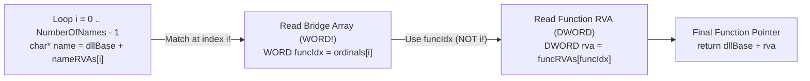
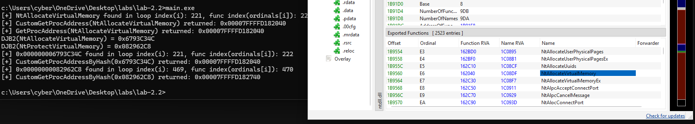
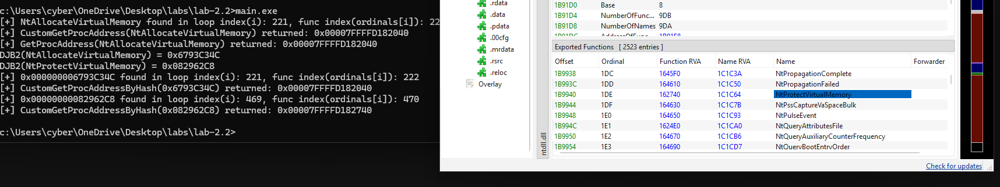

# Module 2.2: The Export Address Table (EAT), Custom `GetProcAddress`, and API Hashing

Look at what you have built so far:
1. In **Lab 1.1 & 1.2**, you called `GetModuleHandleA("ntdll.dll")` and `GetProcAddress(hNtdll, "NtAllocateVirtualMemory")`.
2. In **Lab 1.3**, you eliminated `GetModuleHandle` completely by walking the `PEB` (`InLoadOrderModuleList`) to find `ntdll.dll`'s base address (`0x00007FFF27420000`).
3. In **Lab 2.1**, you parsed `ntdll.dll`'s PE headers and saw:
   `[+] IMAGE_DIRECTORY_ENTRY_EXPORT(DataDirectory[0]) - RVA: 0x001B91C0, Size: 0x00013AA7`

Now ask yourself the next logical question:
**Once you have `ntdll.dll`'s base address, how does `GetProcAddress(hNtdll, "NtAllocateVirtualMemory")` actually find the memory address of `NtAllocateVirtualMemory` inside `ntdll.dll`?**

Does `GetProcAddress` make a `syscall` into the Kernel?
**No!** Just like `GetModuleHandle`, `GetProcAddress` is **100% User-Mode (Ring 3) PE parsing**!
It simply jumps to `DataDirectory[0]` (`IMAGE_DIRECTORY_ENTRY_EXPORT`) inside the DLL's `.rdata` section, walks three parallel arrays inside the **Export Directory (`IMAGE_EXPORT_DIRECTORY`)**, and returns the function's Virtual Address!

Today you will learn:
1. How the **Export Directory (`IMAGE_EXPORT_DIRECTORY`)** and its **3 parallel arrays** work.
2. Why there are **3 arrays instead of 1** (`AddressOfNames`, `AddressOfNameOrdinals`, `AddressOfFunctions`).
3. What a **Forwarded Export** is (e.g., `kernel32.dll!HeapAlloc` $\rightarrow$ `"NTDLL.RtlAllocateHeap"`).
4. How **API Hashing** lets you resolve any function in `ntdll.dll` or `kernel32.dll` without having a single string like `"NtAllocateVirtualMemory"` or `"VirtualProtect"` anywhere in your compiled `.exe`!

---

## 1. Where Lives the Export Table? (`DataDirectory[0]`)

Remember from Lab 2.1:
Inside `ntHeaders->OptionalHeader.DataDirectory[IMAGE_DIRECTORY_ENTRY_EXPORT]` (which is `DataDirectory[0]`), there are two fields:
- `VirtualAddress`: The **RVA** where the Export Table starts (e.g. `0x001B91C0` in `ntdll.dll`).
- `Size`: The total size in bytes of the Export Table region (e.g. `0x00013AA7`).

When you add that RVA to the DLL's base address in memory:
```text
PIMAGE_EXPORT_DIRECTORY exportDir = (PIMAGE_EXPORT_DIRECTORY)((BYTE*)dllBase + dataDir[0].VirtualAddress);
```
You land directly on a 40-byte structure called **`IMAGE_EXPORT_DIRECTORY`** (already defined in `<windows.h>`!).

---

## 2. Inside `IMAGE_EXPORT_DIRECTORY` (40 Bytes)

Here is the exact layout of `IMAGE_EXPORT_DIRECTORY` in `<winnt.h>`:

```text
typedef struct _IMAGE_EXPORT_DIRECTORY {
    DWORD   Characteristics;        // +0x00 (4 bytes): Unused (always 0)
    DWORD   TimeDateStamp;          // +0x04 (4 bytes): Time the export data was created
    WORD    MajorVersion;           // +0x08 (2 bytes)
    WORD    MinorVersion;           // +0x0A (2 bytes)
    DWORD   Name;                   // +0x0C (4 bytes): RVA to the ASCII string name of this DLL (e.g. "ntdll.dll")
    DWORD   Base;                   // +0x10 (4 bytes): Starting ordinal number (usually 1)
    DWORD   NumberOfFunctions;      // +0x14 (4 bytes): Total count of exported functions (by name + by ordinal)
    DWORD   NumberOfNames;          // +0x18 (4 bytes): Count of functions exported BY NAME
    DWORD   AddressOfFunctions;     // +0x1C (4 bytes): RVA to DWORD[NumberOfFunctions] (The EAT!)
    DWORD   AddressOfNames;         // +0x20 (4 bytes): RVA to DWORD[NumberOfNames] (Function Name RVAs!)
    DWORD   AddressOfNameOrdinals;  // +0x24 (4 bytes): RVA to WORD[NumberOfNames]  (Function Index Bridge!)
} IMAGE_EXPORT_DIRECTORY, *PIMAGE_EXPORT_DIRECTORY;
```

Focus on the last **5 fields** (`+0x14` to `+0x24`). Everything `GetProcAddress` does happens right there!

### Wait — Why Are `NumberOfFunctions` and `NumberOfNames` Sometimes Different?
In Windows DLLs, a function can be exported in two ways:
1. **By Name (99% of functions):** Has both a human-readable ASCII name (like `"NtAllocateVirtualMemory"`) and a number (an index/ordinal).
2. **By Ordinal Only (Rare):** The developer exported the function *only* by a number (e.g. Ordinal `#42`) and stripped its string name to save space or hide what it does.

Because a few functions might be exported without a name, `NumberOfFunctions` is $\ge$ `NumberOfNames`.
 And because not every function has a name, Windows cannot just use one giant `struct { char* name; void* address; }` array!
Instead, Windows splits the Export Table into **three separate arrays** in memory.

---

## 3. The Three Parallel Arrays (How `GetProcAddress` Works Step-by-Step)

This 3-array lookup is one of the most famous mechanisms in Windows Internals. Let's look at all three arrays side-by-side first:

| Array Name in `IMAGE_EXPORT_DIRECTORY` | Element Type & Size | Number of Elements | What Each Element Holds |
| :--- | :--- | :--- | :--- |
| **1. `AddressOfNames`** | **`DWORD`** (4 bytes each) | `NumberOfNames` | Each `DWORD` is an **RVA pointing to a `char*` ASCII string** (e.g., `"NtAllocateVirtualMemory"`). |
| **2. `AddressOfNameOrdinals`** | **`WORD`** (**2 bytes each!!**) | `NumberOfNames` | Each `WORD` is the **16-bit integer index (`ordinalIndex`)** into the `AddressOfFunctions` array! |
| **3. `AddressOfFunctions` (EAT)** | **`DWORD`** (4 bytes each) | `NumberOfFunctions` | Each `DWORD` is the **RVA of the actual machine code** of that function! |

> **CRITICAL SIZE TRAP:**
> Look closely at the element types in the table above:
> - `AddressOfNames` is an array of **`DWORD`s (4 bytes each)** $\rightarrow$ `DWORD* nameRVAs = (DWORD*)(dllBase + exportDir->AddressOfNames);`
> - `AddressOfFunctions` is an array of **`DWORD`s (4 bytes each)** $\rightarrow$ `DWORD* funcRVAs = (DWORD*)(dllBase + exportDir->AddressOfFunctions);`
> - **`AddressOfNameOrdinals` is an array of `WORD`s (`USHORT`, 2 bytes each!!)** $\rightarrow$ `WORD* ordinals = (WORD*)(dllBase + exportDir->AddressOfNameOrdinals);`
> *(If you accidentally cast `AddressOfNameOrdinals` to `DWORD*` instead of `WORD*`, your index will multiply by 4 bytes instead of 2 bytes and return the wrong function address every time!)*

### Concrete Example with Real Numbers!

Suppose a tiny DLL (`demo.dll`, loaded at `dllBase = 0x7FF000000000`) exports 3 functions by name, and 1 nameless function by ordinal at slot `0`:

```text
ARRAY 1: AddressOfNames             ARRAY 2: AddressOfNameOrdinals     ARRAY 3: AddressOfFunctions (EAT)
(DWORD* nameRVAs)                   (WORD* ordinals)                   (DWORD* funcRVAs)
+-------------------------+         +--------------------+             +----------------------------------+
| [0] RVA -> "AlphaFunc"  | ------> | [0] WORD value = 2 | --------+   | [0] RVA = 0x1010 (Nameless func) |
| [1] RVA -> "BetaFunc"   | --+     | [1] WORD value = 3 | ------+ |   | [1] RVA = 0x1040 (GammaFunc!)    |
| [2] RVA -> "GammaFunc"  | -+|     | [2] WORD value = 1 | ----+ | |   | [2] RVA = 0x1080 (AlphaFunc!)    |
+-------------------------+  ||     +--------------------+     | | +-> | [3] RVA = 0x10C0 (BetaFunc!)     |
                             ||                                | +---> +----------------------------------+
                             |+--------------------------------|-------+
                             +---------------------------------+
```

Let's trace how to find **`"GammaFunc"`** step-by-step using that diagram:

1. **Step 1: Search `AddressOfNames` (`nameRVAs`) for `"GammaFunc"`**
   - We loop `i` from `0` to `exportDir->NumberOfNames - 1`.
   - For each `i`, how do we get the `char*` function name string?
     `const char* funcName = (const char*)(dllBase + nameRVAs[i]);`
   - At `i = 0`: `funcName` is `"AlphaFunc"` (no match).
   - At `i = 1`: `funcName` is `"BetaFunc"` (no match).
   - At `i = 2`: `funcName` is `"GammaFunc"` — **MATCH FOUND at `i = 2`!**
2. **Step 2: Use `i` (`2`) to look up the bridge index in `AddressOfNameOrdinals` (`ordinals`)**
   - Wait: can we just plug `i = 2` directly into `funcRVAs[2]`?
   - Look at the diagram above! `funcRVAs[2]` is `"AlphaFunc"`, **NOT** `"GammaFunc"`!
   - Instead, we MUST look up `ordinals[i]` (`ordinals[2]`):
     `WORD funcIndex = ordinals[2];` $\rightarrow$ **`funcIndex = 1`**!
   - Why did Microsoft design it with this middle `ordinals` bridge array?
     Because `AddressOfNames` is always sorted **alphabetically (`A` to `Z`)** so the Windows Loader can do a fast binary search (`O(log N)`), whereas `AddressOfFunctions` is ordered by **ordinal number**! So `AddressOfNameOrdinals[i]` is the bridge that maps alphabetical name `#i` to function slot `#funcIndex`!
3. **Step 3: Use `funcIndex` (`1`) to read `AddressOfFunctions` (`funcRVAs`)**
   - Now we read `DWORD funcRVA = funcRVAs[funcIndex];` (`funcRVAs[1]`, which is `0x1040`).
   - Add `dllBase` to `funcRVA`:
     `PVOID funcVA = (PVOID)(dllBase + funcRVA);` (`0x7FF000001040`).
   - **Done!** You now have the exact callable Virtual Address of `"GammaFunc"`!



---

## 4. Bonus Internals Detail: What is a "Forwarded Export"?

What if you run the 3 steps above on `kernel32.dll` to look up `"HeapAlloc"` (or `"AcquireSRWLockExclusive"`), and you get `funcRVA`?
When you jump to `dllBase + funcRVA` in `kernel32.dll` for `"HeapAlloc"`, you do **not** find CPU instructions (`mov`, `push`)!
Instead, sitting at `dllBase + funcRVA` is the ASCII string:
`"NTDLL.RtlAllocateHeap"`!

Wait—what?! Why is there an ASCII string instead of machine code?!
That is called a **Forwarded Export**!
Remember in Module 1.1 we learned that `kernel32.dll` is often a thin front door that forwards calls to `kernelbase.dll` or `ntdll.dll`?
Instead of wasting CPU cycles with a `jmp` instruction inside `.text`, the PE format has a clever trick:
- **Rule:** If a function's `funcRVA` points **outside** the Export Directory (`funcRVA < exportDirRVA` or `funcRVA >= exportDirRVA + exportDirSize`), it points to normal machine code in `.text`.
- **Exception (Forwarded Export):** If a function's `funcRVA` lands **INSIDE the bounds of the Export Directory itself** (`funcRVA >= dataDir[0].VirtualAddress && funcRVA < dataDir[0].VirtualAddress + dataDir[0].Size`), then `dllBase + funcRVA` is **NOT machine code**—it is a `"DLLNAME.FunctionName"` forwarder string telling `GetProcAddress` to go look up that function in the other DLL!
- *(In `ntdll.dll`, there are zero forwarded exports because `ntdll.dll` is the bottom of User Mode—every export in `ntdll.dll` points directly to real code!)*

---

## 5. Red Team / Maldev Technique: API Hashing (Hiding All Strings!)

Now let's think like a malware analyst or reverse engineer inspecting your binary from Lab 1.1 or Lab 1.2.
Before even running your `main.exe` in a debugger, the analyst runs the `strings` command (or opens PE-bear's **Strings** tab) on your `main.exe`.
What strings immediately pop up in plaintext inside your `.rdata` section?
- `"ntdll.dll"`
- `"NtAllocateVirtualMemory"`
- `"NtProtectVirtualMemory"`

Any AV/EDR static scanner or YARA rule that sees `"NtAllocateVirtualMemory"` and `"NtProtectVirtualMemory"` sitting in plaintext inside an unknown `.exe` immediately flags the file as suspicious!

### How Do We Resolve `"NtAllocateVirtualMemory"` Without Putting the String `"NtAllocateVirtualMemory"` in Our Binary?
We use **API Hashing**!

Here is how API Hashing works:
1. Instead of passing a string `"NtAllocateVirtualMemory"` to our custom `GetProcAddress`, we pass a **32-bit integer hash** (for example, `0xF5376888`).
2. Inside our custom `GetProcAddressByHash(HMODULE dllBase, DWORD targetHash)` function:
   - As we loop `i` from `0` to `NumberOfNames - 1` over `ntdll.dll`'s `AddressOfNames` array in memory, we read each exported function's name string (`funcName`, which lives inside `ntdll.dll`'s memory, NOT in our binary!).
   - We run a tiny 5-line hash function (like **DJB2** or **ROR13** or **FNV-1a**) on `funcName` in real time to compute `DWORD currentHash = HashStringDjb2(funcName);`.
   - We check: `if (currentHash == targetHash)`!
   - When the hashes match, we return `dllBase + funcRVAs[ordinals[i]]`!

### Look at the Result in Your Compiled `.exe`:
- Does your `.exe` import `NtAllocateVirtualMemory` in its Import Table? **No.**
- Does your `.exe` call `GetModuleHandle` or `GetProcAddress`? **No** (if you use your `PEB` walker + EAT walker).
- Does the string `"NtAllocateVirtualMemory"` exist *anywhere* inside your `.exe` file on disk? **NO!** The only thing in your `.exe` is a 4-byte integer like `0xF5376888`!

### The Classic Maldev Hash Algorithm: DJB2
The most famous, dead-simple string hashing algorithm used in red team loaders is **DJB2** (created by Daniel J. Bernstein):
1. Start with a `DWORD hash = 5381;` (magic prime seed).
2. Loop through each character `c` of the string until the null terminator `'\0'`:
   - Multiply `hash` by `33` and add `c`:
     $$\text{hash} = ((\text{hash} \ll 5) + \text{hash}) + c$$
     *(Why `(hash << 5) + hash`? Because shifting left by 5 bits is $hash \times 32$, plus $hash$ = $hash \times 33$!)*
3. Return `hash`.

---

## 6. Lab 2.2: Build `CustomGetProcAddress` & Resolve `ntdll` APIs by Hash!

Let's build this! Create `windows/labs/lab-2.2/main.cpp`.
In this lab, you will combine your `PEB` knowledge (Module 1.3) and your `PE` header knowledge (Module 2.1) to build:
1. `FARPROC CustomGetProcAddress(HMODULE moduleBase, const char* targetFuncName)` (by string name).
2. `DWORD HashStringDjb2(const char* str)` + `FARPROC CustomGetProcAddressByHash(HMODULE moduleBase, DWORD targetHash)` (by DJB2 hash!).

### Step-by-Step Guide for `windows/labs/lab-2.2/main.cpp`:

1. **Get `ntdll.dll`'s Base Address Using Your `CustomGetModuleHandle` from Lab 1.3/2.1:**
   - No `GetModuleHandleA` allowed! Use your `PEB` walker.
2. **Write `FARPROC CustomGetProcAddress(HMODULE moduleBase, const char* targetFuncName)`:**
   - Cast `moduleBase` to `BYTE* baseAddr`.
   - Navigate `IMAGE_DOS_HEADER` $\rightarrow$ `IMAGE_NT_HEADERS64` $\rightarrow$ `OptionalHeader.DataDirectory[IMAGE_DIRECTORY_ENTRY_EXPORT]`.
   - Get `PIMAGE_EXPORT_DIRECTORY exportDir = (PIMAGE_EXPORT_DIRECTORY)(baseAddr + exportDirRVA);`.
   - Get pointers to the **three parallel arrays** (watch the types!):
     - `DWORD* nameRVAs = (DWORD*)(baseAddr + exportDir->AddressOfNames);`
     - `WORD* ordinals = (WORD*)(baseAddr + exportDir->AddressOfNameOrdinals);`
     - `DWORD* funcRVAs = (DWORD*)(baseAddr + exportDir->AddressOfFunctions);`
   - Loop `DWORD i = 0; i < exportDir->NumberOfNames; i++`:
     - Get `const char* currFuncName = (const char*)(baseAddr + nameRVAs[i]);`.
     - If `strcmp(currFuncName, targetFuncName) == 0`:
       - Look up `WORD funcIndex = ordinals[i];`
       - Look up `DWORD funcRVA = funcRVAs[funcIndex];`
       - Return `(FARPROC)(baseAddr + funcRVA);`
   - If the loop finishes without a match, return `NULL`.
3. **Verify `CustomGetProcAddress` Against Official `GetProcAddress`:**
   - Call both `GetProcAddress(hNtdll, "NtAllocateVirtualMemory")` and `CustomGetProcAddress(hNtdll, "NtAllocateVirtualMemory")`.
   - Print both addresses side-by-side to prove your EAT parser returns the exact same pointer!
4. **Write `DWORD HashStringDjb2(const char* str)` & `CustomGetProcAddressByHash`:**
   - Implement `HashStringDjb2`.
   - Print the DJB2 hex hashes (`0x%08X`) of `"NtAllocateVirtualMemory"` and `"NtProtectVirtualMemory"`.
   - Write `CustomGetProcAddressByHash(HMODULE moduleBase, DWORD targetHash)` — identical to `CustomGetProcAddress`, except instead of `strcmp`, you compare `HashStringDjb2(currFuncName) == targetHash`!
   - Resolve `NtAllocateVirtualMemory` and `NtProtectVirtualMemory` using **only their DJB2 hex hashes** (`0x...`) and verify the returned addresses match!

### Visual Verification in PE-bear:
Open `C:\Windows\System32\ntdll.dll` in **PE-bear** $\rightarrow$ click the **Exports** tab, find `NtAllocateVirtualMemory`, and check its **Ordinal**, **Function RVA**, and **Name RVA**!

### Deliverables to Report Back:
1. Your code in `windows/labs/lab-2.2/main.cpp` and console output.
2. What DJB2 hash values (`0x%08X`) did you get for `"NtAllocateVirtualMemory"` and `"NtProtectVirtualMemory"`?
3. When your `CustomGetProcAddress` found `"NtAllocateVirtualMemory"`, what was its loop index `i` in `AddressOfNames` vs. its `ordinals[i]` value in `AddressOfNameOrdinals`? (Are they the same or different in `ntdll.dll`, and why?)

---

## 7. Lab 2.2 Results & Findings

- **Source Code:** [`windows/labs/lab-2.2/main.cpp`](./labs/lab-2.2/main.cpp)

### Console Output
```text
[+] NtAllocateVirtualMemory found in loop index(i): 221, func index(ordinals[i]): 222
[+] CustomGetProcAddress(NtAllocateVirtualMemory) returned: 0x00007FFFFD182040
[+] GetProcAddress(NtAllocateVirtualMemory) returned: 0x00007FFFFD182040
DJB2(NtAllocateVirtualMemory) = 0x6793C34C
DJB2(NtProtectVirtualMemory) = 0x082962C8
[+] 0x000000006793C34C found in loop index(i): 221, func index(ordinals[i]): 222
[+] CustomGetProcAddressByHash(0x6793C34C) returned: 0x00007FFFFD182040
[+] 0x00000000082962C8 found in loop index(i): 469, func index(ordinals[i]): 470
[+] CustomGetProcAddressByHash(0x082962C8) returned: 0x00007FFFFD182740
```

### Key Observations
1. **Why `i` (`AddressOfNames` Index) and `ordinals[i]` (`AddressOfFunctions` Index) Differ in `ntdll.dll`:**
   - In `ntdll.dll`'s `IMAGE_EXPORT_DIRECTORY`, `NumberOfFunctions` is `0x9DB` (`2523`) while `NumberOfNames` is `0x9DA` (`2522`) — meaning `1` function at the start of `ntdll.dll` is exported **by ordinal only (nameless)**.
   - Consequently, for `NtAllocateVirtualMemory`, its alphabetical name index is `i = 221`, whereas `ordinals[221]` is `222`!
   - Similarly, for `NtProtectVirtualMemory`, its name index is `i = 469`, whereas `ordinals[469]` is `470`!
   - Skipping `AddressOfNameOrdinals` and indexing `AddressOfFunctions[i]` directly would have resolved the wrong function!
2. **Matching `ordinals[i]` Against PE-bear's Hex `Ordinal` Column:**
   - In PE-bear, `exportDir->Base` for `ntdll.dll` is `8`.
   - The official PE Ordinal displayed by PE-bear is `Base + ordinals[i]`:
     - **`NtAllocateVirtualMemory`:** `8 + 222 = 230` (Decimal) = **`0xE6`** (Hex), with `Function RVA = 0x162040` (`0x00007FFFFD020000 + 0x162040 = 0x00007FFFFD182040`).
     - **`NtProtectVirtualMemory`:** `8 + 470 = 478` (Decimal) = **`0x1DE`** (Hex), with `Function RVA = 0x162740` (`0x00007FFFFD020000 + 0x162740 = 0x00007FFFFD182740`).
3. **API Hashing with DJB2:**
   - `"NtAllocateVirtualMemory"` $\rightarrow$ **`0x6793C34C`**
   - `"NtProtectVirtualMemory"` $\rightarrow$ **`0x082962C8`**
   - `CustomGetProcAddressByHash` resolved both functions using only their 32-bit DJB2 hashes.

### Visual Verification in PE-bear (`ntdll.dll` Export Directory)

#### 1. `NtAllocateVirtualMemory` (`Ordinal = 0xE6` / `230`, `Function RVA = 0x162040`)


#### 2. `NtProtectVirtualMemory` (`Ordinal = 0x1DE` / `478`, `Function RVA = 0x162740`)


