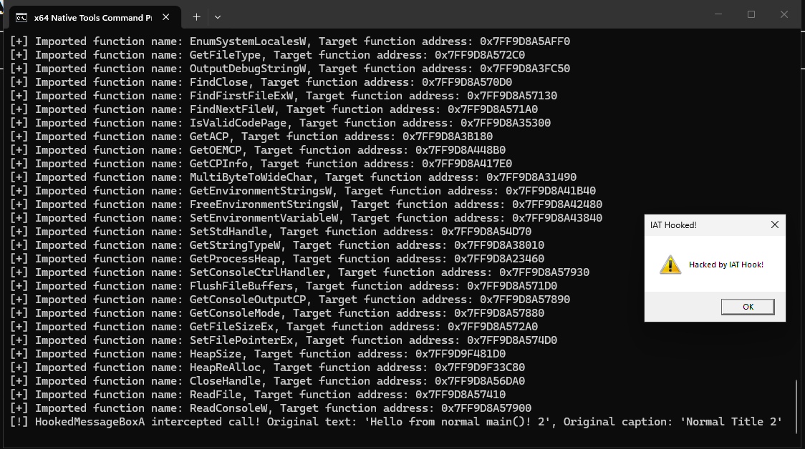

# Module 2.3: The Import Address Table (IAT), Base Relocations (`.reloc`), and IAT Hooking

This is the final module of **Phase 2 (The PE Format)**—and it connects two of the most important concepts in Windows Internals and Malware Development:
1. **How your `.exe` calls functions in other DLLs (`Imports` / `IAT`)**, and how **IAT Hooking** hijacks those calls.
2. **How your `.exe` survives being loaded at a random ASLR address (`Base Relocations` / `.reloc`)** when the compiler hardcoded memory addresses inside it.

Let's start from first principles with concrete examples and memory diagrams.

---

## Part 1: The Import Directory & The Import Address Table (IAT)

### 1. The Core Problem: How Can `cl.exe` Compile a Call to `MessageBoxA` When It Doesn't Know Where `user32.dll` Will Live in RAM?

Suppose you write a normal C++ program that calls:
```text
MessageBoxA(NULL, "Hello", "Title", MB_OK);
```
When the MSVC compiler (`cl.exe`) and linker (`link.exe`) build your `main.exe` on disk, think about what the compiler **cannot** know:
- It has **no idea** what Virtual Address `user32.dll` will be loaded at when you run `main.exe` tomorrow (because of ASLR, `user32.dll`'s base address changes on every reboot).
- It has **no idea** what exact RVA `MessageBoxA` will have inside `user32.dll` on Windows 10 vs. Windows 11.

So how can the compiler generate an x64 `call` instruction inside `.text` to call `MessageBoxA`?!

### The Solution: An Indirect Function Pointer Slot (The IAT!)
Instead of trying to emit a direct call (`call 0x7FFB12345678`), the compiler does something super clever:
1. Inside your binary's `.rdata` / `.idata` section, the linker creates an **8-byte (64-bit) slot** reserved specifically for `MessageBoxA`'s address.
   - That array of 8-byte function pointer slots is called the **IAT (Import Address Table)**.
2. Inside your `.text` code, whenever you call `MessageBoxA(...)`, the compiler emits an **indirect call through that 8-byte IAT slot**:
   ```nasm
   call qword ptr [rip + offset_to_IAT_slot_for_MessageBoxA]
   ```
   *(In English: "CPU, go read the 8-byte address sitting inside `MessageBoxA`'s IAT slot, and jump to that address!")*
3. **When you launch `main.exe`, the Windows Loader (`ntdll.dll`) runs BEFORE `main()`:**
   - The Loader reads your PE's **Import Directory (`DataDirectory[1]`)**.
   - It sees that you need `"user32.dll"` $\rightarrow$ `"MessageBoxA"`.
   - The Loader loads `user32.dll`, finds the real Virtual Address of `MessageBoxA` (using the exact EAT logic you built in Lab 2.2!), and **writes that 64-bit Virtual Address directly into your 8-byte IAT slot!**

---

### 2. Why Are There TWO Thunk Arrays Per DLL? (`OriginalFirstThunk` vs. `FirstThunk`)

When you look up `DataDirectory[IMAGE_DIRECTORY_ENTRY_IMPORT]` (`DataDirectory[1]`), it points to an array of **`IMAGE_IMPORT_DESCRIPTOR`** structs—**one struct for each imported DLL** (e.g., one for `KERNEL32.dll`, one for `USER32.dll`, one for `ucrtbase.dll`), terminated by an all-zero `IMAGE_IMPORT_DESCRIPTOR` at the end.

Here is the exact layout of `IMAGE_IMPORT_DESCRIPTOR` (20 bytes, defined in `<windows.h>`):

```text
typedef struct _IMAGE_IMPORT_DESCRIPTOR {
    union {
        DWORD   Characteristics;
        DWORD   OriginalFirstThunk; // +0x00 (4 bytes): RVA to the ILT (Import Lookup Table - array of IMAGE_THUNK_DATA64)
    } DUMMYUNIONNAME;
    DWORD   TimeDateStamp;          // +0x04 (4 bytes): 0 (unless bound imports are used)
    DWORD   ForwarderChain;         // +0x08 (4 bytes): -1 if no forwarders
    DWORD   Name;                   // +0x0C (4 bytes): *** RVA to the ASCII string name of the DLL (e.g. "USER32.dll")! ***
    DWORD   FirstThunk;             // +0x10 (4 bytes): *** RVA to the IAT (Import Address Table - array of IMAGE_THUNK_DATA64)! ***
} IMAGE_IMPORT_DESCRIPTOR, *PIMAGE_IMPORT_DESCRIPTOR;
```

Hold on! Look at offset `+0x00` (**`OriginalFirstThunk`**) and offset `+0x10` (**`FirstThunk`**).
Both of them are RVAs that point to arrays of 8-byte **`IMAGE_THUNK_DATA64`** structs (terminated by a `0` entry).
**Why does each imported DLL have TWO arrays (`OriginalFirstThunk` and `FirstThunk`)?!**

Because the Windows Loader **overwrites `FirstThunk` (the IAT) in memory**!
Look at the difference between **On Disk (Before Loader runs)** vs. **In Memory (After Loader runs)**:

```text
====================================================================================
BEFORE THE LOADER RUNS (ON DISK): Both arrays hold the EXACT SAME RVA to the name!
====================================================================================

OriginalFirstThunk (ILT)                     IMAGE_IMPORT_BY_NAME        FirstThunk (IAT)
(Read-Only Blueprint: "What do I need?")     (Hint + ASCII Function Name)(Will be overwritten!)
+------------------------------------+       +------------------------+  +------------------------------------+
| [0] RVA = 0x5000 ------------------+-----> | Hint: 0x012A           |  | [0] RVA = 0x5000 (Points to name!) |
| [1] RVA = 0x5020 ------------------+---+   | Name: "MessageBoxA\0"  |  | [1] RVA = 0x5020 (Points to name!) |
| [2] 0x0000000000000000 (End)       |   |   +------------------------+  | [2] 0x0000000000000000 (End)       |
+------------------------------------+   |   +------------------------+  +------------------------------------+
                                         +-> | Hint: 0x004B           |
                                             | Name: "GetAsyncKeyState"|
                                             +------------------------+

====================================================================================
AFTER THE LOADER RUNS (IN LIVE MEMORY): FirstThunk (IAT) is overwritten with VAs!
====================================================================================

OriginalFirstThunk (ILT)                     IMAGE_IMPORT_BY_NAME        FirstThunk (IAT)
(STILL points to the function names!)                                    (OVERWRITTEN with real 64-bit VAs!)
+------------------------------------+       +------------------------+  +------------------------------------+
| [0] RVA = 0x5000 ------------------+-----> | Hint: 0x012A           |  | [0] VA = 0x00007FFB41238890        | --> Real user32!MessageBoxA
| [1] RVA = 0x5020 ------------------+---+   | Name: "MessageBoxA\0"  |  | [1] VA = 0x00007FFB41214410        | --> Real user32!GetAsyncKeyState
| [2] 0x0000000000000000 (End)       |   |   +------------------------+  | [2] 0x0000000000000000 (End)       |
+------------------------------------+   |   +------------------------+  +------------------------------------+
                                         +-> | Hint: 0x004B           |
                                             | Name: "GetAsyncKeyState"|
                                             +------------------------+
```

Let that diagram sink in!
- **On Disk:** Both `OriginalFirstThunk` (also called the **ILT — Import Lookup Table**) and `FirstThunk` (the **IAT — Import Address Table**) contain the exact same RVAs pointing to `IMAGE_IMPORT_BY_NAME` structs (`{ WORD Hint; CHAR Name[1]; }`).
- **In Live Memory (when your program is running):**
  - The Windows Loader has **already overwritten `FirstThunk` (the IAT)** with the real 64-bit Virtual Addresses (`0x00007FFB...`) of the functions!
  - So if your code is running in live memory and you want to know **which function name** corresponds to slot `j` of the IAT (`FirstThunk[j]`), where do you read the function's name from?
    **From `OriginalFirstThunk[j]`!** Because `OriginalFirstThunk` was *never* overwritten—it still points to `IMAGE_IMPORT_BY_NAME->Name`!
  - And where lives the **actual function pointer** that the CPU jumps to when your program calls that function?
    **In `FirstThunk[j].u1.Function`!**

### How `IMAGE_THUNK_DATA64` Works in C/C++
Both `OriginalFirstThunk` and `FirstThunk` are arrays of `IMAGE_THUNK_DATA64`:
```text
typedef struct _IMAGE_THUNK_DATA64 {
    union {
        ULONGLONG ForwarderString;  // PBYTE
        ULONGLONG Function;         // *** In FirstThunk (IAT): The 64-bit Virtual Address of the imported function! ***
        ULONGLONG Ordinal;          // If imported by ordinal instead of name
        ULONGLONG AddressOfData;    // *** In OriginalFirstThunk (ILT): RVA to IMAGE_IMPORT_BY_NAME! ***
    } u1;
} IMAGE_THUNK_DATA64, *PIMAGE_THUNK_DATA64;
```
Notice it's a **`union` of 8-byte (`ULONGLONG`) fields**!
- When reading **`OriginalFirstThunk`** (`PIMAGE_THUNK_DATA64 origThunk`):
  1. First check if the function was imported by Ordinal instead of Name using the macro `IMAGE_SNAP_BY_ORDINAL64(origThunk->u1.Ordinal)` (which checks if the highest bit `0x8000000000000000` is set).
  2. Otherwise (imported by name), `origThunk->u1.AddressOfData` is an **RVA** pointing to `IMAGE_IMPORT_BY_NAME`:
     ```text
     PIMAGE_IMPORT_BY_NAME importByName = (PIMAGE_IMPORT_BY_NAME)(baseAddr + origThunk->u1.AddressOfData);
     const char* funcName = importByName->Name; // Null-terminated ASCII string!
     ```
- When reading or modifying **`FirstThunk`** (`PIMAGE_THUNK_DATA64 iatThunk`):
  - `iatThunk->u1.Function` is the **actual 64-bit function pointer in memory**!

---

## Part 2: IAT Hooking (Hijacking API Calls!)

Now look at `iatThunk->u1.Function` in the diagram above.
Remember: every time your `.exe` calls `MessageBoxA(...)` (or `GetCurrentProcessId()`, `Sleep()`, etc.), the CPU executes:
```nasm
call qword ptr [rip + offset_to_iatThunk]
```
It literally reads the 8-byte address stored inside **`iatThunk->u1.Function`** and jumps to it!

Wait a second...
**What happens if we overwrite `iatThunk->u1.Function` in memory with the address of OUR OWN C++ function (`HookedMessageBoxA`)?!**

1. Next time any code inside `main.exe` calls `MessageBoxA(NULL, "Hello", "Title", MB_OK)`, the CPU reads `iatThunk->u1.Function`...
2. Instead of jumping to `user32.dll!MessageBoxA`, **the CPU jumps straight into our `HookedMessageBoxA` function!**
3. Inside `HookedMessageBoxA`, we can inspect the arguments, print a message, modify the text (e.g. change `"Hello"` to `"PWNED BY IAT HOOK!"`), and then call the saved original `MessageBoxA` pointer so the program continues working normally!

> **TRAP WARNING When Overwriting `iatThunk->u1.Function`:**
> Look back at your Lab 2.1 section output for `main.exe`:
> Where does the IAT live? Inside `.rdata` / `.idata`!
> And what page permission did `.rdata` / `.idata` have in Lab 2.1?
> **`[R]` (`PAGE_READONLY`)!**
> If you try to write `iatThunk->u1.Function = (ULONGLONG)MyHook;` while the IAT page is `PAGE_READONLY`, what will the CPU do?
> Immediate **`0xC0000005` (`STATUS_ACCESS_VIOLATION`)**!
> So how do you overwrite an IAT entry?
> 1. Use `NtProtectVirtualMemory` (or `VirtualProtect`) to temporarily flip the IAT page to **`PAGE_READWRITE`** (`RW`).
> 2. Overwrite `iatThunk->u1.Function` with your hook function's address.
> 3. Restore the original page protection (`oldProtect`) using `NtProtectVirtualMemory`!

---

## Part 3: Base Relocations (`.reloc` — `DataDirectory[5]`)

Before we jump into the lab, we need to understand the last critical piece of the PE format that you will need when we build a Reflective DLL Loader in Phase 4: **Base Relocations (`.reloc`)**.

### Why Do Base Relocations Exist?
In Lab 2.1, you saw in PE-bear that `main.exe` on disk has:
- Preferred `OptionalHeader.ImageBase` = **`0x0000000140000000`**.
When the compiler builds `main.exe`, most x64 instructions use `RIP`-relative addressing (`[rip + offset]`), which works at any base address automatically.
**However**, what if your C/C++ code has a global pointer initialized to the address of another global variable or string?
```text
const char* globalMessage = "Secret String"; // Stored in .data!
```
On disk, the compiler has to write an actual 8-byte memory address into `globalMessage` inside `.data`!
Since the compiler assumes the binary will load at `0x140000000`, and `"Secret String"` is at RVA `0x96050`, the compiler hardcodes the value **`0x0000000140096050`** directly into `.data` on disk!

Now, what happens when you run `main.exe` and **ASLR** loads `main.exe` at **`0x00007FF79ABF0000`** instead of `0x0000000140000000`?!
If the Loader does nothing, `globalMessage` still points to `0x0000000140096050` (unmapped memory $\rightarrow$ crash!).

### How the Loader Fixes Hardcoded Addresses: The Delta ($\Delta$)
1. The Loader calculates the **Delta** (the difference between where the PE was *actually* loaded and where it *wanted* to be loaded):
   $$\Delta = \text{ActualBase} - \text{PreferredImageBase}$$
2. Next, how does the Loader know *which exact 8-byte locations* inside `.data` / `.rdata` / `.text` contain hardcoded addresses that need $+\Delta$ added to them?
   It reads the **Base Relocation Table (`DataDirectory[IMAGE_DIRECTORY_ENTRY_BASERELOC]`, index `5`, inside `.reloc`)**!
3. The `.reloc` section is a series of blocks (`IMAGE_BASE_RELOCATION`), one block per 4 KB (`0x1000`) page:
   ```text
   typedef struct _IMAGE_BASE_RELOCATION {
       DWORD   VirtualAddress; // +0x00 (4 bytes): Page RVA (e.g. 0xAF000)
       DWORD   SizeOfBlock;    // +0x04 (4 bytes): Total byte size of this header (8B) + all WORD entries following it
   } IMAGE_BASE_RELOCATION, *PIMAGE_BASE_RELOCATION;
   ```
   Immediately following the 8-byte `IMAGE_BASE_RELOCATION` header is an array of 16-bit **`WORD`** entries (`(SizeOfBlock - 8) / sizeof(WORD)` entries):
   - **Upper 4 bits of the `WORD` (`entry >> 12`):** Relocation Type (`IMAGE_REL_BASED_DIR64` = `10` / `0xA` = "Add 64-bit $\Delta$ to the 8-byte pointer at this offset"; `IMAGE_REL_BASED_ABSOLUTE` = `0` = padding, ignore).
   - **Lower 12 bits of the `WORD` (`entry & 0x0FFF`):** Offset (`0x000` to `0xFFF`) within that page (`VirtualAddress`) where the hardcoded 8-byte pointer sits!
   - To apply the relocation:
     `ULONGLONG* patchAddr = (ULONGLONG*)(baseAddr + relocBlock->VirtualAddress + (entry & 0x0FFF));`
     `*patchAddr += delta;`
   *(When we build our Reflective DLL Loader in Module 4.1, you will write a 15-line loop using this exact formula!)*

---

## 4. Lab 2.3: Walk the Import Table & Build an IAT Hook!

Let's put Part 1 and Part 2 into action right now!
Create `windows/labs/lab-2.3/main.cpp`.

In this lab, you will:
1. Walk `main.exe`'s **Import Directory (`DataDirectory[1]`)** and print every imported DLL (`IMAGE_IMPORT_DESCRIPTOR`) and every imported function name (`OriginalFirstThunk`) alongside its live IAT address (`FirstThunk`).
2. **Hook `MessageBoxA` (or `GetCurrentProcessId`) via the IAT** so that when `main()` calls the standard Win32 API `MessageBoxA`, your custom hook function intercepts it, modifies the arguments, and redirects execution!

### Step-by-Step Guide for `windows/labs/lab-2.3/main.cpp`:

1. **Include `<windows.h>` and Link `user32.lib`:**
   - So you can call `MessageBoxA` in `main()`, either add `#pragma comment(lib, "user32.lib")` at the top of `main.cpp` or pass `user32.lib` on the `cl.exe` command line.
2. **Write a Global Variable to Save the Original `MessageBoxA` Pointer, and Write Your `HookedMessageBoxA` Function:**
   - Define the function pointer `typedef` for `MessageBoxA`:
     `typedef int (WINAPI *fnMessageBoxA)(HWND hWnd, LPCSTR lpText, LPCSTR lpCaption, UINT uType);`
   - Create a global pointer: `fnMessageBoxA g_OrigMessageBoxA = NULL;`
   - Write your hook function with the exact same signature:
     `int WINAPI HookedMessageBoxA(HWND hWnd, LPCSTR lpText, LPCSTR lpCaption, UINT uType)`
   - Inside `HookedMessageBoxA`:
     - Print to the console: `"[!] HookedMessageBoxA intercepted call! Original text: '%s', Original caption: '%s'\n"`
     - Call `return g_OrigMessageBoxA(hWnd, "Hacked by IAT Hook!", "IAT Hooked!", MB_ICONWARNING | MB_OK);`!
3. **Walk `main.exe`'s Import Directory (`IMAGE_IMPORT_DESCRIPTOR`):**
   - Get `BYTE* baseAddr = (BYTE*)GetModuleHandleA(NULL);` (or your `CustomGetModuleHandleA(NULL)`).
   - Navigate `IMAGE_DOS_HEADER` $\rightarrow$ `IMAGE_NT_HEADERS64` $\rightarrow$ `OptionalHeader.DataDirectory[IMAGE_DIRECTORY_ENTRY_IMPORT]`.
   - Cast `baseAddr + importDirRVA` to `PIMAGE_IMPORT_DESCRIPTOR importDesc`.
   - Loop through each imported DLL while `importDesc->Name != 0`:
     - Get the DLL name: `const char* dllName = (const char*)(baseAddr + importDesc->Name);`
     - Print the DLL name!
     - Get the two thunk pointers:
       - `PIMAGE_THUNK_DATA64 origThunk = (PIMAGE_THUNK_DATA64)(baseAddr + importDesc->OriginalFirstThunk);`
       - `PIMAGE_THUNK_DATA64 iatThunk  = (PIMAGE_THUNK_DATA64)(baseAddr + importDesc->FirstThunk);`
     - Loop through the thunks while `origThunk->u1.AddressOfData != 0`:
       - Check that it is NOT imported by ordinal (`!(origThunk->u1.Ordinal & IMAGE_ORDINAL_FLAG64)`).
       - Get `PIMAGE_IMPORT_BY_NAME importByName = (PIMAGE_IMPORT_BY_NAME)(baseAddr + origThunk->u1.AddressOfData);`.
       - Print the imported function name (`importByName->Name`) and its current IAT address (`0x%llX` from `iatThunk->u1.Function`).
       - **If `strcmp(importByName->Name, "MessageBoxA") == 0`:**
         1. Save the original function pointer: `g_OrigMessageBoxA = (fnMessageBoxA)iatThunk->u1.Function;`
         2. Change page permissions of `&iatThunk->u1.Function` (size `sizeof(ULONGLONG)`) to `PAGE_READWRITE` using `VirtualProtect` (or your `NtProtectVirtualMemory` from Lab 1.2!).
         3. Overwrite `iatThunk->u1.Function = (ULONGLONG)HookedMessageBoxA;`!
         4. Restore the page permissions back to `oldProtect`!
       - Advance **both** pointers: `origThunk++; iatThunk++;`
     - Advance to the next DLL: `importDesc++;`
4. **Test the Hook in `main()`!**
   - Before installing the hook (or after installing the hook), call the normal Win32 API:
     `MessageBoxA(NULL, "Hello from normal main()!", "Normal Title", MB_OK);`
   - Watch your `MessageBoxA` call get hijacked by your IAT hook and pop up a warning box saying `"Hacked by IAT Hook!"`!

### Deliverables to Report Back:
1. Your code in `windows/labs/lab-2.3/main.cpp` and a screenshot of the console output + the hooked `MessageBoxA` popup!
2. Why did we have to read the function name `"MessageBoxA"` from `OriginalFirstThunk` instead of `FirstThunk` when our program was running in memory?
3. What happened if you tried to overwrite `iatThunk->u1.Function` without calling `VirtualProtect` / `NtProtectVirtualMemory` first?

---

## 5. Lab 2.3 Results & Findings

- **Source Code:** [`windows/labs/lab-2.3/main.cpp`](./labs/lab-2.3/main.cpp)

### Console Output
```text
[+] 0x082962C8 found in loop index(i): 469, func index(ordinals[i]): 470
[+] Imported DLL name found: USER32.dll
[+] Imported function name: MessageBoxA, Target function address: 0x7FF9D7FBFC90
[+] MessageBoxA page permissions: RW
[+] MessageBoxA hooked! Restoring the page permissions...
[+] Page permissions restored: R
[+] Imported DLL name found: KERNEL32.dll
[+] Imported function name: IsDebuggerPresent, Target function address: 0x7FF9D8A3D8A0
[+] Imported function name: WriteConsoleW, Target function address: 0x7FF9D8A57960
[+] Imported function name: GetCurrentProcess, Target function address: 0x7FF9D8A23E40
[+] Imported function name: QueryPerformanceCounter, Target function address: 0x7FF9D8A23480
[+] Imported function name: GetCurrentProcessId, Target function address: 0x7FF9D8A22BB0
[+] Imported function name: GetCurrentThreadId, Target function address: 0x7FF9D8A18620
[+] Imported function name: GetSystemTimeAsFileTime, Target function address: 0x7FF9D8A30E70
[+] Imported function name: InitializeSListHead, Target function address: 0x7FF9D9F5C980
[+] Imported function name: SetUnhandledExceptionFilter, Target function address: 0x7FF9D8A43500
[+] Imported function name: GetStartupInfoW, Target function address: 0x7FF9D8A3E3C0
[+] Imported function name: GetModuleHandleW, Target function address: 0x7FF9D8A3B600
[+] Imported function name: CreateFileW, Target function address: 0x7FF9D8A57050
[+] Imported function name: RtlUnwindEx, Target function address: 0x7FF9D8A3F9F0
[+] Imported function name: InterlockedPushEntrySList, Target function address: 0x7FF9D9FCBA80
[+] Imported function name: InterlockedFlushSList, Target function address: 0x7FF9D9FCBC80
[+] Imported function name: GetLastError, Target function address: 0x7FF9D8A18640
[+] Imported function name: SetLastError, Target function address: 0x7FF9D8A28280
[+] Imported function name: FlsAlloc, Target function address: 0x7FF9D8A3FAF0
[+] Imported function name: FlsGetValue, Target function address: 0x7FF9D8A12A00
[+] Imported function name: FlsSetValue, Target function address: 0x7FF9D8A37CF0
[+] Imported function name: FlsFree, Target function address: 0x7FF9D8A42440
[+] Imported function name: EnterCriticalSection, Target function address: 0x7FF9D9EFCEA0
[+] Imported function name: LeaveCriticalSection, Target function address: 0x7FF9D9EFCFA0
[+] Imported function name: InitializeCriticalSectionEx, Target function address: 0x7FF9D8A56EB0
[+] Imported function name: DeleteCriticalSection, Target function address: 0x7FF9D9F423F0
[+] Imported function name: RtlLookupFunctionEntry, Target function address: 0x7FF9D8A3C810
[+] Imported function name: EncodePointer, Target function address: 0x7FF9D9FC7290
[+] Imported function name: RaiseException, Target function address: 0x7FF9D8A3B2C0
[+] Imported function name: RtlPcToFileHeader, Target function address: 0x7FF9D8A37D30
[+] Imported function name: GetStdHandle, Target function address: 0x7FF9D8A3FA30
[+] Imported function name: WriteFile, Target function address: 0x7FF9D8A57520
[+] Imported function name: GetModuleFileNameW, Target function address: 0x7FF9D8A3C730
[+] Imported function name: ExitProcess, Target function address: 0x7FF9D8A417A0
[+] Imported function name: TerminateProcess, Target function address: 0x7FF9D8A424A0
[+] Imported function name: FreeLibrary, Target function address: 0x7FF9D8A3C7D0
[+] Imported function name: GetModuleHandleExW, Target function address: 0x7FF9D8A3E410
[+] Imported function name: GetProcAddress, Target function address: 0x7FF9D8A33140
[+] Imported function name: GetCommandLineA, Target function address: 0x7FF9D8A401A0
[+] Imported function name: GetCommandLineW, Target function address: 0x7FF9D8A40E00
[+] Imported function name: IsProcessorFeaturePresent, Target function address: 0x7FF9D8A3D8D0
[+] Imported function name: HeapAlloc, Target function address: 0x7FF9D9F11550
[+] Imported function name: HeapFree, Target function address: 0x7FF9D8A23E50
[+] Imported function name: WideCharToMultiByte, Target function address: 0x7FF9D8A32570
[+] Imported function name: RtlCaptureContext, Target function address: 0x7FF9D8A56B60
[+] Imported function name: RtlVirtualUnwind, Target function address: 0x7FF9D8A28190
[+] Imported function name: RtlUnwind, Target function address: 0x7FF9D8A40DE0
[+] Imported function name: UnhandledExceptionFilter, Target function address: 0x7FF9D8A5C0C0
[+] Imported function name: GetCurrentThread, Target function address: 0x7FF9D8A229E0
[+] Imported function name: GetTempPathW, Target function address: 0x7FF9D8A57370
[+] Imported function name: IsThreadAFiber, Target function address: 0x7FF9D8A314B0
[+] Imported function name: VirtualProtect, Target function address: 0x7FF9D8A38460
[+] Imported function name: LoadLibraryExW, Target function address: 0x7FF9D8A3C7B0
[+] Imported function name: GetDateFormatW, Target function address: 0x7FF9D8A447B0
[+] Imported function name: GetTimeFormatW, Target function address: 0x7FF9D8A43440
[+] Imported function name: CompareStringW, Target function address: 0x7FF9D8A39130
[+] Imported function name: LCMapStringW, Target function address: 0x7FF9D8A32590
[+] Imported function name: GetLocaleInfoW, Target function address: 0x7FF9D8A3C940
[+] Imported function name: IsValidLocale, Target function address: 0x7FF9D8A43AF0
[+] Imported function name: GetUserDefaultLCID, Target function address: 0x7FF9D8A39BB0
[+] Imported function name: EnumSystemLocalesW, Target function address: 0x7FF9D8A5AFF0
[+] Imported function name: GetFileType, Target function address: 0x7FF9D8A572C0
[+] Imported function name: OutputDebugStringW, Target function address: 0x7FF9D8A3FC50
[+] Imported function name: FindClose, Target function address: 0x7FF9D8A570D0
[+] Imported function name: FindFirstFileExW, Target function address: 0x7FF9D8A57130
[+] Imported function name: FindNextFileW, Target function address: 0x7FF9D8A571A0
[+] Imported function name: IsValidCodePage, Target function address: 0x7FF9D8A35300
[+] Imported function name: GetACP, Target function address: 0x7FF9D8A3B180
[+] Imported function name: GetOEMCP, Target function address: 0x7FF9D8A448B0
[+] Imported function name: GetCPInfo, Target function address: 0x7FF9D8A417E0
[+] Imported function name: MultiByteToWideChar, Target function address: 0x7FF9D8A31490
[+] Imported function name: GetEnvironmentStringsW, Target function address: 0x7FF9D8A41B40
[+] Imported function name: FreeEnvironmentStringsW, Target function address: 0x7FF9D8A42480
[+] Imported function name: SetEnvironmentVariableW, Target function address: 0x7FF9D8A43840
[+] Imported function name: SetStdHandle, Target function address: 0x7FF9D8A54D70
[+] Imported function name: GetStringTypeW, Target function address: 0x7FF9D8A38010
[+] Imported function name: GetProcessHeap, Target function address: 0x7FF9D8A23460
[+] Imported function name: SetConsoleCtrlHandler, Target function address: 0x7FF9D8A57930
[+] Imported function name: FlushFileBuffers, Target function address: 0x7FF9D8A571D0
[+] Imported function name: GetConsoleOutputCP, Target function address: 0x7FF9D8A57890
[+] Imported function name: GetConsoleMode, Target function address: 0x7FF9D8A57880
[+] Imported function name: GetFileSizeEx, Target function address: 0x7FF9D8A572A0
[+] Imported function name: SetFilePointerEx, Target function address: 0x7FF9D8A574D0
[+] Imported function name: HeapSize, Target function address: 0x7FF9D9F481D0
[+] Imported function name: HeapReAlloc, Target function address: 0x7FF9D9F33C80
[+] Imported function name: CloseHandle, Target function address: 0x7FF9D8A56DA0
[+] Imported function name: ReadFile, Target function address: 0x7FF9D8A57410
[+] Imported function name: ReadConsoleW, Target function address: 0x7FF9D8A57900
[!] HookedMessageBoxA intercepted call! Original text: 'Hello from normal main()! 2', Original caption: 'Normal Title 2'
```

### Key Observations
1. **Why We Read Function Names from `OriginalFirstThunk` (ILT) Instead of `FirstThunk` (IAT) at Runtime:**
   - Before the program runs (on disk), both `OriginalFirstThunk` and `FirstThunk` hold RVAs pointing to `IMAGE_IMPORT_BY_NAME` structs (`Hint` + ASCII function name).
   - When the Windows Loader maps the binary into memory, it **overwrites `FirstThunk` (the IAT)** in-place with the resolved 64-bit Virtual Addresses (VAs) of the imported functions (`0x7FF9D7FBFC90` for `MessageBoxA`).
   - Therefore, in live memory, we must read the function names from `OriginalFirstThunk` (which remains untouched) while reading/modifying the live function pointer at the corresponding index in `FirstThunk`.
2. **Why `NtProtectVirtualMemory` Is Required Before Modifying an IAT Entry:**
   - The IAT resides inside a read-only section (`.rdata` / `.idata` with `PAGE_READONLY` protection). Attempting to overwrite `iatThunk->u1.Function` without first flipping the page to `PAGE_READWRITE` triggers an immediate `0xC0000005` (`STATUS_ACCESS_VIOLATION`) crash.
   - Note that `NtProtectVirtualMemory`'s second parameter (`PVOID* BaseAddress`) is an `IN OUT` pointer to a `PVOID` variable because the kernel rounds the address down to the nearest `0x1000` page boundary in-place.
3. **End-to-End Integration (PEB Walk + DJB2 Hash Resolution + IAT Walk + Syscall Protection Flip):**
   - `NtProtectVirtualMemory` was resolved dynamically from `ntdll.dll` using `CustomGetModuleHandleA` (PEB walk) and `CustomGetProcAddressByHash` (`0x082962C8`), then used to unprotect the IAT, hook `MessageBoxA`, and restore `PAGE_READONLY`.



