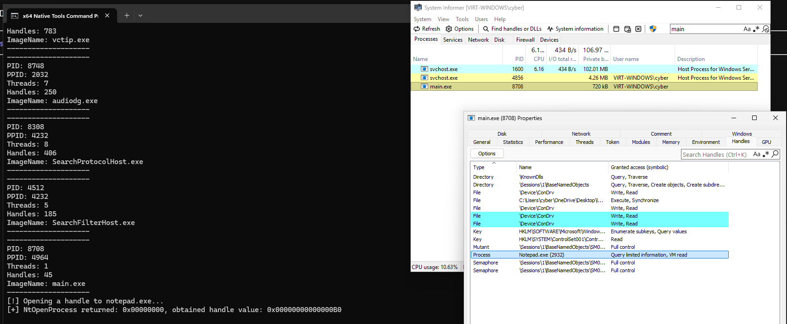

# Module 3.1: Objects, Handles, Access Masks, and Process Enumeration (`EPROCESS` & `NtQuerySystemInformation`)

Welcome to **Phase 3: Processes, Handles, Tokens & Cross-Process Primitives**!

In Phase 1 and Phase 2, everything we did stayed strictly inside **our own process (`main.exe`)**:
- We allocated and protected memory inside `main.exe` (`GetCurrentProcess()` = `(HANDLE)-1`).
- We walked `main.exe`'s `PEB` (`gs:[0x60]`).
- We parsed `main.exe`'s and `ntdll.dll`'s PE headers inside `main.exe`'s virtual address space.

Now ask yourself:
**What if your program (`main.exe`) wants to interact with a *different* running process on the machine (like `notepad.exe` or `explorer.exe`)?**
Remember from Module 1.2: every process is locked inside its own private Virtual Address Space! Your `main.exe` cannot just guess a pointer inside `notepad.exe` and dereference it—your pointers only map to `main.exe`'s own page tables!

To touch *another* process (or a file, a thread, a registry key, or a shared memory section), you must go through the **Windows Object Manager** in the Kernel (`Ring 0`) and obtain a **Handle (`HANDLE`)**.

Today we will learn from first principles:
1. What a **Kernel Object** (like `EPROCESS` and `ETHREAD`) actually is in Ring 0.
2. What a **`HANDLE`** actually is under the hood (spoiler: it is **NOT** a pointer—it is an **index into your process's Kernel Handle Table**!).
3. What an **Access Mask (`ACCESS_MASK`)** is (`PROCESS_VM_READ`, `PROCESS_VM_WRITE`, `PROCESS_ALL_ACCESS`), and how EDRs use Kernel Callbacks (`ObRegisterCallbacks`) to strip your handle permissions!
4. How to enumerate all running processes on the system **without** calling high-level Win32 APIs (`CreateToolhelp32Snapshot`), by calling **`NtQuerySystemInformation(SystemProcessInformation)`** and walking the kernel's returned array of `SYSTEM_PROCESS_INFORMATION` structures, then opening a real handle to a target process via **`NtOpenProcess`**!

---

## 1. Kernel Objects (`EPROCESS` & `ETHREAD`) and the Windows Object Manager

Inside the Windows Kernel (`ntoskrnl.exe` in Ring 0, at addresses `0xFFFF8000'00000000`+), everything the OS manages—processes, threads, files, tokens, events, shared memory sections—is represented as a C struct in Kernel memory managed by a subsystem called the **Object Manager (`Ob`)**.

Every Kernel Object has two parts in Ring 0 memory:
1. **`OBJECT_HEADER`** (sits immediately *before* the object body): Stores reference counts (`PointerCount` in kernel, `HandleCount` in user mode), the object's type (`Process`, `Thread`, `File`), and a pointer to its **Security Descriptor** (who is allowed to open this object!).
2. **Object Body** (the actual kernel structure):
   - For a **Process**, the Object Body is the **`EPROCESS`** structure.
   - For a **Thread**, the Object Body is the **`ETHREAD`** structure.

### What Lives Inside `EPROCESS` (in Ring 0)?
Remember in Module 1.3 when you walked the `PEB` in Ring 3?
`EPROCESS` is the **true, master bookkeeping structure** for a process, and it lives in **Ring 0 (Kernel Space)** where Ring 3 code cannot touch or fake it!
Inside every process's `EPROCESS` struct in the Kernel are fields like:
- **`UniqueProcessId`**: The Process ID (`PID`, e.g., `4120`).
- **`ActiveProcessLinks`**: A circular doubly-linked list (`LIST_ENTRY`) chaining every running `EPROCESS` on the entire computer together!
- **`Peb`**: The pointer to that process's User-Mode `PEB`.
- **`Token`**: A pointer to the process's Security Token (who owns this process and what privileges it has — Module 3.3).
- **`ObjectTable`**: A pointer (`PHANDLE_TABLE`) to **this process's private Handle Table**!

---

## 2. What Is a `HANDLE` Really? (The Handle Table & `GrantedAccess`)

In `<windows.h>`, `HANDLE` is defined as `typedef void* HANDLE;`.
Because it's `typedef`'d as `void*`, beginners think a `HANDLE` (like `0x00000000000000A4`) is a memory address.

**A `HANDLE` is NOT a memory address!**
Think about it: why would the Kernel ever give User Mode (Ring 3) the raw Kernel memory address (`0xFFFF8A01'23456000`) of an `EPROCESS` struct?!
1. Ring 3 can't dereference a `0xFFFF...` address anyway (instant Access Violation!).
2. If handles were raw pointers, a malicious Ring 3 program could just forge a pointer and pass it to a syscall without ever checking permissions!

### Instead: The Coat-Check Ticket Analogy (Per-Process Handle Table)
Think of the Kernel as a VIP club coat-check room:
1. When your process asks the Kernel to open `notepad.exe` (`PID = 5000`), you tell the Kernel **two** things:
   - *Which* process you want (`PID = 5000`).
   - *What permissions (**`DesiredAccess`**)* you are asking for (e.g., *"I want permission to read and write `notepad.exe`'s memory"* $\rightarrow$ `PROCESS_VM_READ | PROCESS_VM_WRITE`).
2. The Kernel's Object Manager (`ObOpenObjectByPointer`) checks **once**—right at the moment you open the handle!—whether your security token is allowed to have those permissions on `notepad.exe`.
3. If allowed, the Kernel creates a new row in **your process's private Handle Table (`EPROCESS->ObjectTable`)** in Ring 0!
   Each row (`HANDLE_TABLE_ENTRY`, 16 bytes) in your process's Handle Table stores two critical pieces of data:
   - **`ObjectPointerBits`**: The real Ring 0 Kernel address (`0xFFFF...`) of `notepad.exe`'s `EPROCESS` struct!
   - **`GrantedAccessBits` (25 bits)**: The exact bitmask of permissions (`ACCESS_MASK`) that the Kernel approved when you opened this handle!
4. Finally, the Kernel returns the **slot number (multiplied by 4)**—for example, `0xA4`—back to your Ring 3 program as your `HANDLE`!

```text
YOUR RING 3 PROCESS (main.exe)              RING 0 KERNEL MEMORY (EPROCESS->ObjectTable)
+-----------------------------+             +--------+-----------------------------+------------------------+
| HANDLE hProc = 0x000000A4;  | ----------> | Handle | Kernel Object Pointer       | GrantedAccess Bitmask  |
+-----------------------------+  (Slot #41) +--------+-----------------------------+------------------------+
  (Why multiples of 4?                      | 0x0004 | -> EPROCESS / Event / File  | 0x001F0003             |
   Slot 1 = 0x04, Slot 2 = 0x08...          | ...    | ...                         | ...                    |
   0xA4 / 4 = Slot #41!)                    | 0x00A4 | -> 0xFFFF8A01'99887000      | 0x00000038             |
                                            |        |    (notepad.exe EPROCESS!)  | (VM_OPERATION|READ|WR) |
                                            +--------+-----------------------------+------------------------+
```

Look closely at that table—this explains **everything** about how Windows security and handles work:
- **Why are Handle values always multiples of 4 (`0x04`, `0x08`, `0x0C`, ..., `0xA4`)?**
  Because the bottom 2 bits of a handle value (`bits 0 and 1`) are reserved as tag bits, so the Kernel literally shifts your handle right by 2 (`handle >> 2`, which is `handle / 4`) to get the array index in your Handle Table!
- **What happens later when you call `NtAllocateVirtualMemory(hProc, ...)` or `NtWriteVirtualMemory(hProc, ...)` using `hProc = 0xA4`?**
  The Kernel looks up row `0xA4` in `main.exe`'s Handle Table:
  1. It checks **`GrantedAccessBits`**: *"Does row `0xA4`'s `GrantedAccess` include `PROCESS_VM_WRITE` (`0x0020`)?"*
     - If **YES**: the Kernel follows `ObjectPointerBits` to `notepad.exe`'s `EPROCESS` and writes the memory!
     - If **NO** (for example, if you only opened `hProc` with `PROCESS_QUERY_LIMITED_INFORMATION`!): the Kernel immediately rejects the call and returns **`0xC0000022` (`STATUS_ACCESS_DENIED`)**!

---

## 3. Process Access Masks (`ACCESS_MASK`) & How EDRs Strip Handles!

When you open a handle to a process (via `OpenProcess` or `NtOpenProcess`), you pass a 32-bit bitmask (`ACCESS_MASK`) called `DesiredAccess`.
Here are the specific Process Access Rights defined in `<windows.h>` that you will use constantly:

| Access Flag Constant | Hex Value | What It Allows You To Do With the `HANDLE` |
| :--- | :--- | :--- |
| `PROCESS_TERMINATE` | `0x0001` | Kill the process (`NtTerminateProcess` / `TerminateProcess`). |
| `PROCESS_CREATE_THREAD` | `0x0002` | Create a remote thread inside the process (`CreateRemoteThread` / `NtCreateThreadEx`). |
| `PROCESS_VM_OPERATION` | `0x0008` | **Modify the process's Virtual Address Space** (`NtAllocateVirtualMemory`, `NtProtectVirtualMemory`, `NtMapViewOfSection`). |
| `PROCESS_VM_READ` | `0x0010` | Read the process's memory (`ReadProcessMemory` / `NtReadVirtualMemory`). |
| `PROCESS_VM_WRITE` | `0x0020` | Write to the process's memory (`WriteProcessMemory` / `NtWriteVirtualMemory`). |
| `PROCESS_DUP_HANDLE` | `0x0040` | Duplicate handles from/into the process (`NtDuplicateObject`). |
| `PROCESS_QUERY_INFORMATION` | `0x0400` | Query full info (`PEB` address, token, exit code) via `NtQueryInformationProcess`. |
| `PROCESS_QUERY_LIMITED_INFORMATION` | `0x1000` | Query basic info (image path, PID, priority) — requires the lowest privilege! |
| `PROCESS_ALL_ACCESS` | `0x001FFFFF` | **Every possible permission bit turned on!** |

### Red Team / EDR Insight: Why Requesting `PROCESS_ALL_ACCESS` Gets You Caught (and Blocked by `ObRegisterCallbacks`)!
Remember in Module 1.1 we mentioned that Microsoft provides an official Kernel Callback called **`ObRegisterCallbacks`** for process/thread handle operations?
Every time your code calls `OpenProcess` or `NtOpenProcess`, **before** the Kernel writes `GrantedAccessBits` into your Handle Table row, the Kernel invokes any registered EDR/Antivirus `ObRegisterCallbacks` driver!

What does the EDR driver (or Windows Defender when protecting `lsass.exe`) do inside `ObRegisterCallbacks`?
- It receives a pointer to `OB_PRE_CREATE_HANDLE_INFORMATION`, which contains your `DesiredAccess` bitmask!
- If the EDR sees an untrusted process asking for `PROCESS_VM_READ` (`0x0010`) on `lsass.exe`, or greedily asking for `PROCESS_ALL_ACCESS` (`0x001FFFFF`) on another process when it doesn't need it, the driver **strips (clears) the dangerous bits out of `DesiredAccess`** (`DesiredAccess &= ~PROCESS_VM_READ`)!
- Notice how sneaky that is: `NtOpenProcess` still returns `STATUS_SUCCESS` (`0x00000000`) and gives you a valid `HANDLE`, **but the `GrantedAccess` inside your Handle Table has had `PROCESS_VM_READ` silently removed!**
- **Rule of Least Privilege in Maldev:** Never lazily pass `PROCESS_ALL_ACCESS`! Only request the exact minimum bitflags your operation actually needs (e.g., `PROCESS_QUERY_LIMITED_INFORMATION` when inspecting a process, or `PROCESS_VM_OPERATION | PROCESS_VM_WRITE` when mapping/writing memory).

---

## 4. How Do You Enumerate Running Processes? (`CreateToolhelp32Snapshot` vs. `NtQuerySystemInformation`)

Suppose you want your program to find the Process ID (`PID`) of `"notepad.exe"` automatically by its name.
In normal Win32 tutorials, people call `CreateToolhelp32Snapshot(TH32CS_SNAPPROCESS, 0)` $\rightarrow$ `Process32FirstW` $\rightarrow$ `Process32NextW`.

Wait—how does `CreateToolhelp32Snapshot` actually get the list of running processes from the Kernel?!
Under the hood, `kernel32.dll!CreateToolhelp32Snapshot` calls an undocumented/semi-documented powerhouse syscall in `ntdll.dll`:
**`NtQuerySystemInformation`**!

Let's look at the signature of `NtQuerySystemInformation` on [ntdoc.m417z.com/ntquerysysteminformation](https://ntdoc.m417z.com/ntquerysysteminformation):

```text
NTSYSCALLAPI
NTSTATUS
NTAPI
NtQuerySystemInformation(
    _In_ SYSTEM_INFORMATION_CLASS SystemInformationClass, // Enum: what kind of system info do we want?
    _Out_writes_bytes_opt_(SystemInformationLength) PVOID SystemInformation, // Pointer to our output buffer!
    _In_ ULONG SystemInformationLength,                   // Size of our output buffer in bytes
    _Out_opt_ PULONG ReturnLength                         // Kernel writes the required buffer size here!
);
```

When you pass **`SystemProcessInformation` (which is enum value `5`)** as the 1st argument (`SystemInformationClass`), `NtQuerySystemInformation` walks the Kernel's `EPROCESS` list and copies a snapshot of **every running process and thread on the system** into your user-mode buffer!

### The Classic Two-Call Buffer Sizing Pattern (`STATUS_INFO_LENGTH_MISMATCH`)
Wait: before calling `NtQuerySystemInformation`, how could your C++ program possibly know how many processes are running right now, or how many kilobytes of memory are needed to hold all of them?!
**You can't know ahead of time!**
So with `NtQuerySystemInformation`, you always use the **Two-Call Pattern**:

1. **Call #1 (Probe for the Required Size):**
   - Create `ULONG returnLength = 0;`.
   - Call `NtQuerySystemInformation((SYSTEM_INFORMATION_CLASS)5, NULL, 0, &returnLength);` (passing `NULL` buffer and `0` size!).
   - Because `0` bytes is too small to hold the process list, `NtQuerySystemInformation` returns the error code **`0xC0000004` (`STATUS_INFO_LENGTH_MISMATCH`)**—**AND it writes the exact number of bytes required into your `returnLength` variable!**
2. **Call #2 (Allocate the Buffer & Fetch the Real Data):**
   - Add a tiny safety margin (e.g., `returnLength += 0x2000;`) just in case a new process spawned between Call #1 and Call #2.
   - Allocate a buffer of size `returnLength` (using `HeapAlloc(GetProcessHeap(), HEAP_ZERO_MEMORY, returnLength)` or `calloc` or `NtAllocateVirtualMemory`).
   - Call `NtQuerySystemInformation((SYSTEM_INFORMATION_CLASS)5, buffer, returnLength, &returnLength);` again!
   - This time it returns **`0x00000000` (`STATUS_SUCCESS`)**, and your `buffer` is now filled with a chain of **`SYSTEM_PROCESS_INFORMATION`** structs!

---

## 5. Walking `SYSTEM_PROCESS_INFORMATION` (`NextEntryOffset`)

How is the buffer returned by `NtQuerySystemInformation(5, ...)` laid out in memory?
Is it a fixed-size C array `proc[0], proc[1], proc[2]`?
**No!** Because each process has a different number of threads (`Threads[]` array at the end of each struct), each entry has a **variable size**!

Instead of pointers, each `SYSTEM_PROCESS_INFORMATION` struct begins at offset `+0x00` with a 4-byte `ULONG` field called **`NextEntryOffset`**:

```text
Buffer Start (procInfo)
+---------------------------------------------------------------+
| Entry 0: System Idle Process (PID 0)                          |
|   +0x00: NextEntryOffset = 0x0260  --- (Add 0x260 bytes!) --+ |
|   +0x38: ImageName (UNICODE_STRING) = NULL                  | |
|   +0x50: UniqueProcessId = 0                                | |
+-------------------------------------------------------------|-+
|   (Variable number of SYSTEM_THREAD_INFORMATION structs...) | |
+-------------------------------------------------------------v-+
| Entry 1: System (PID 4)                                       |
|   +0x00: NextEntryOffset = 0x08A0  --- (Add 0x8A0 bytes!) --+ |
|   +0x38: ImageName (UNICODE_STRING) = L"System"             | |
|   +0x50: UniqueProcessId = 4                                | |
+-------------------------------------------------------------|-+
|   ...                                                       | |
+-------------------------------------------------------------v-+
| Last Entry: main.exe (PID 9420)                               |
|   +0x00: NextEntryOffset = 0x0000  <-- 0 MEANS LAST ENTRY!    |
|   +0x38: ImageName (UNICODE_STRING) = L"main.exe"           |
|   +0x50: UniqueProcessId = 9420                             |
+---------------------------------------------------------------+
```

Let's look at the exact layout of **`SYSTEM_PROCESS_INFORMATION`** on 64-bit Windows (up to the fields we care about, at offsets `+0x00` to `+0x60`):

```text
typedef struct _SYSTEM_PROCESS_INFORMATION {
    ULONG           NextEntryOffset;              // +0x00 (4 bytes): Byte offset to the next struct (0 if last!)
    ULONG           NumberOfThreads;              // +0x04 (4 bytes): Number of threads in this process
    LARGE_INTEGER   WorkingSetPrivateSize;        // +0x08 (8 bytes)
    ULONG           HardFaultCount;               // +0x10 (4 bytes)
    ULONG           NumberOfThreadsHighWatermark; // +0x14 (4 bytes)
    ULONGLONG       CycleTime;                    // +0x18 (8 bytes)
    LARGE_INTEGER   CreateTime;                   // +0x20 (8 bytes)
    LARGE_INTEGER   UserTime;                     // +0x28 (8 bytes)
    LARGE_INTEGER   KernelTime;                   // +0x30 (8 bytes)
    UNICODE_STRING  ImageName;                    // +0x38 (16 bytes): Process executable name (e.g. L"notepad.exe")!
    LONG            BasePriority;                 // +0x48 (4 bytes + 4 bytes padding on x64)
    HANDLE          UniqueProcessId;              // +0x50 (8 bytes): *** The Process ID (PID)! Cast to (ULONG_PTR) or (DWORD)! ***
    HANDLE          InheritedFromUniqueProcessId; // +0x58 (8 bytes): *** The Parent Process ID (PPID)! ***
    ULONG           HandleCount;                  // +0x60 (4 bytes): How many handles this process has open!
    ULONG           SessionId;                    // +0x64 (4 bytes): Windows Session ID (0 = Services, 1+ = User Desktop)
    // ... (Additional memory/IO counters follow, which we don't even need to read!)
} SYSTEM_PROCESS_INFORMATION, *PSYSTEM_PROCESS_INFORMATION;
```

### Three Important Tips When Walking `SYSTEM_PROCESS_INFORMATION`:
1. **How to advance to the next process:**
   - Check `if (currProc->NextEntryOffset == 0) break;` AFTER processing the current entry! (If you use `while (currProc->NextEntryOffset != 0)`, you would skip the very last process in the list!).
   - Otherwise, advance the pointer by `NextEntryOffset` bytes (remember C pointer math: cast to `BYTE*` first!):
     `currProc = (PSYSTEM_PROCESS_INFORMATION)((BYTE*)currProc + currProc->NextEntryOffset);`
2. **Watch out for PID `0` (`System Idle Process`):**
   - For PID `0`, `currProc->ImageName.Buffer` is **`NULL`**! Always check `if (currProc->ImageName.Buffer != NULL)` before passing `currProc->ImageName.Buffer` to `_wcsicmp` or `printf("%ls")`, otherwise `_wcsicmp(NULL, ...)` will crash!
3. **Why is `UniqueProcessId` typed as `HANDLE` (`void*`)?**
   - Inside the Kernel's Handle Table / CID Table (`PspCidTable`), Process IDs and Thread IDs are generated using the exact same table mechanism as Handles! So in Windows headers, `UniqueProcessId` is a `HANDLE`, even though its value is literally just the integer PID (e.g. `(DWORD)(ULONG_PTR)currProc->UniqueProcessId` = `4120`).

---

## 6. Opening a Handle to Another Process via `NtOpenProcess`

Once you walk `SYSTEM_PROCESS_INFORMATION` and find the `UniqueProcessId` (PID) of `"notepad.exe"`, how do you open a `HANDLE` to it without calling `kernel32.dll!OpenProcess`?
By calling **`ntdll.dll!NtOpenProcess`** directly!

Let's look at the signature of `NtOpenProcess` on [ntdoc.m417z.com/ntopenprocess](https://ntdoc.m417z.com/ntopenprocess):

```text
NTSYSCALLAPI
NTSTATUS
NTAPI
NtOpenProcess(
    _Out_ PHANDLE ProcessHandle,               // 1. Pointer to HANDLE variable (&hProcess) where Kernel writes the handle!
    _In_ ACCESS_MASK DesiredAccess,            // 2. Access Mask (e.g., PROCESS_QUERY_LIMITED_INFORMATION | PROCESS_VM_READ)
    _In_ POBJECT_ATTRIBUTES ObjectAttributes,  // 3. Pointer to OBJECT_ATTRIBUTES struct (24/48 bytes, initialized to 0)
    _In_opt_ PCLIENT_ID ClientId               // 4. Pointer to CLIENT_ID struct containing { UniqueProcess (PID), UniqueThread (0) }!
);
```

Let's look at those two small structs (`OBJECT_ATTRIBUTES` and `CLIENT_ID`) that `NtOpenProcess` expects in Parameters 3 and 4:

1. **`CLIENT_ID` (16 bytes on x64):**
   Holds the target Process ID and Thread ID:
   ```text
   typedef struct _CLIENT_ID {
       HANDLE UniqueProcess; // Set this to (HANDLE)(ULONG_PTR)targetPid!
       HANDLE UniqueThread;  // Set this to NULL (0) when opening a process!
   } CLIENT_ID, *PCLIENT_ID;
   ```
2. **`OBJECT_ATTRIBUTES` (48 bytes on x64):**
   Used by many `Nt*` functions to specify object names or handle inheritance. For `NtOpenProcess`, we only need `Length = sizeof(OBJECT_ATTRIBUTES)` and everything else set to `0` (`NULL`):
   ```text
   typedef struct _OBJECT_ATTRIBUTES {
       ULONG           Length;                   // Set to sizeof(OBJECT_ATTRIBUTES)
       HANDLE          RootDirectory;            // NULL
       PUNICODE_STRING ObjectName;               // NULL
       ULONG           Attributes;               // 0
       PVOID           SecurityDescriptor;       // NULL
       PVOID           SecurityQualityOfService; // NULL
   } OBJECT_ATTRIBUTES, *POBJECT_ATTRIBUTES;
   ```

---

## 7. Lab 3.1: Enumerate Processes via `NtQuerySystemInformation` & Open a Target Process Handle via `NtOpenProcess`

Let's build this! Create `windows/labs/lab-3.1/main.cpp`.

### Preparation on Your Windows 11 VM:
Open an instance of **`notepad.exe`** on your Windows 11 VM and leave it running in the background so your tool has a live target process to find and inspect!

### What Your Program in `windows/labs/lab-3.1/main.cpp` Should Do:
1. **Resolve `NtQuerySystemInformation`, `NtOpenProcess`, and `NtClose` from `ntdll.dll`:**
   - Use your `CustomGetModuleHandleA("ntdll.dll")` + `CustomGetProcAddress` (or `CustomGetProcAddressByHash`!).
   - *(Note: `NtClose` simply takes `(HANDLE Handle)` and returns `NTSTATUS`—it is the native version of `CloseHandle`!).*
2. **Enumerate All Running Processes Using `NtQuerySystemInformation(5, ...)`:**
   - Perform **Call #1** (`NULL` buffer, `0` length) to get `returnLength` (and verify the returned `NTSTATUS` is `0xC0000004` `STATUS_INFO_LENGTH_MISMATCH`).
   - Allocate a buffer of size `returnLength + 0x2000` and perform **Call #2**.
   - Walk the `SYSTEM_PROCESS_INFORMATION` chain using `NextEntryOffset`.
   - For each process, print:
     - `PID` (`(DWORD)(ULONG_PTR)curr->UniqueProcessId`)
     - `PPID` (`(DWORD)(ULONG_PTR)curr->InheritedFromUniqueProcessId`)
     - `Threads` (`curr->NumberOfThreads`)
     - `Handles` (`curr->HandleCount`)
     - `ImageName` (`curr->ImageName.Buffer ? curr->ImageName.Buffer : L"[System Idle]"`)
   - While walking the list, check if `curr->ImageName.Buffer` matches `L"notepad.exe"` (case-insensitively with `_wcsicmp`). When found, save its `PID`!
3. **Open a Handle to `notepad.exe` Using `NtOpenProcess`:**
   - Initialize `CLIENT_ID cid = { (HANDLE)(ULONG_PTR)notepadPid, NULL };`.
   - Initialize `OBJECT_ATTRIBUTES oa = { sizeof(OBJECT_ATTRIBUTES) };`.
   - Call `NtOpenProcess(&hProcess, PROCESS_QUERY_LIMITED_INFORMATION | PROCESS_VM_READ, &oa, &cid);`.
   - Print the returned `NTSTATUS` (`0x%08X`) and the obtained **`HANDLE` value (`0x%p`)**!
   - Pause with `getchar()` **before** calling `NtClose(hProcess)`!

### Visual Verification in System Informer (The Ultimate Proof!):
While your `main.exe` is paused at `getchar()`:
1. Open **System Informer** $\rightarrow$ double-click your **`main.exe`** process $\rightarrow$ click the **Handles** tab!
2. Look for the exact **Handle hex value** (e.g., `0xA4` or `0x120`) that your `main.exe` printed to the console!
3. Look at the columns in System Informer's **Handles** tab for that row:
   - **Type:** `Process`
   - **Name:** `notepad.exe (<PID>)`
   - **Granted access:** `0x1010` (`PROCESS_QUERY_LIMITED_INFORMATION | PROCESS_VM_READ`)!

### Deliverables to Report Back:
1. Your code in `windows/labs/lab-3.1/main.cpp` and a screenshot showing your console output alongside System Informer's **Handles** tab for `main.exe`!
2. Look at the `HANDLE` hex value `NtOpenProcess` gave you: is it a multiple of 4 (`0x...0`, `0x...4`, `0x...8`, `0x...C`)? Why?
3. What happened in Call #1 of `NtQuerySystemInformation` when you passed `NULL` and `0`—what `NTSTATUS` code did it return, and how many bytes did the Kernel write into `returnLength`?

---

## 8. Lab 3.1 Results & Findings

### Implementation (`windows/labs/lab-3.1/main.cpp`)
In [`windows/labs/lab-3.1/main.cpp`](labs/lab-3.1/main.cpp), we built a zero-Win32-import process enumerator and handle opener:
1. **PEB Walk + DJB2 API Hashing:** Located `ntdll.dll` in memory via `PEB->Ldr->InLoadOrderModuleList` (`__readgsqword(0x60)`) and resolved four native syscalls directly from `ntdll.dll`'s Export Address Table by DJB2 hash:
   - `NtQuerySystemInformation` (`0xEE4F73A8`, ordinal `523`)
   - `NtOpenProcess` (`0x5003C058`, ordinal `444`)
   - `NtClose` (`0x8B8E133D`, ordinal `262`)
   - `NtAllocateVirtualMemory` (`0x6793C34C`, ordinal `222`)
2. **Two-Step `NtQuerySystemInformation(SystemProcessInformation)` Query:**
   - **Call #1 (`NULL` buffer, `0` size):** Returned `0xC0000004` (`STATUS_INFO_LENGTH_MISMATCH`) and populated `returnLength = 0x00032E38` (`208,440` bytes).
   - **Buffer Allocation (`NtAllocateVirtualMemory`):** Added `0x2000` (`8,192` bytes) of safety margin to `returnLength` and allocated the buffer in the current process (`(HANDLE)-1`).
   - **Call #2:** Returned `0x00000000` (`STATUS_SUCCESS`) with `returnLength = 0x00032DE8` (`208,360` bytes)—80 bytes smaller than Call #1 (`sizeof(SYSTEM_THREAD_INFORMATION) == 0x50`), proving in real time that threads/processes appear and disappear between the two syscalls!
3. **Walking `SYSTEM_PROCESS_INFORMATION` & Opening `Notepad.exe` via `NtOpenProcess`:**
   - Walked the variable-length `SYSTEM_PROCESS_INFORMATION` chain from `PID 0` (`[System Idle]`) and `PID 4` (`System`) all the way to the tail of `PsActiveProcessHead` (`PID 8708`, `main.exe`, spawned by `PID 4964` `cmd.exe`).
   - Located `Notepad.exe` at `PID 2932` (`PPID 5392` `explorer.exe`, `19` threads, `926` handles).
   - Initialized `CLIENT_ID` (`UniqueProcess = (HANDLE)(ULONG_PTR)2932`, `UniqueThread = NULL`) and `OBJECT_ATTRIBUTES` (`Length = sizeof(OBJECT_ATTRIBUTES)`), then called `NtOpenProcess` with least-privilege access rights: `PROCESS_QUERY_LIMITED_INFORMATION | PROCESS_VM_READ` (`0x1010`).
   - Obtained handle **`0x00000000000000B0`** (`176` in decimal). Because the bottom 2 bits of every Windows `HANDLE` are reserved as tag bits (`ExCreateHandle`), the Kernel shifts the handle right by 2 (`176 >> 2 = 44`) to index into `main.exe`'s `EPROCESS.ObjectTable` (`_HANDLE_TABLE_ENTRY` #44, matching `main.exe`'s `Handles: 45` count right before calling `NtOpenProcess`!).

### Console Output & System Informer Verification


In System Informer (`main.exe (8708) Properties -> Handles`), we verified our newly created `_HANDLE_TABLE_ENTRY`:
- **Type:** `Process`
- **Name:** `Notepad.exe (2932)`
- **Granted access (symbolic):** `Query limited information, VM read` (`0x1010`)

