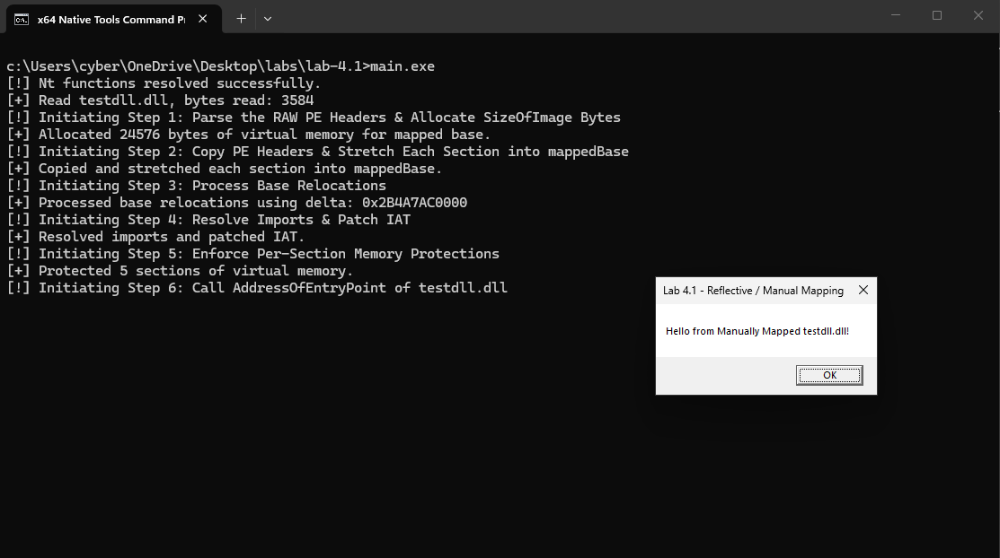
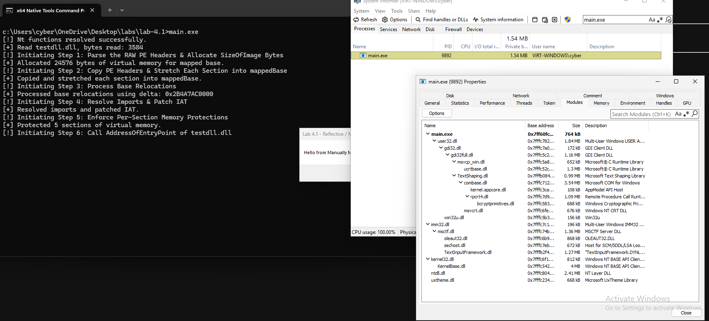
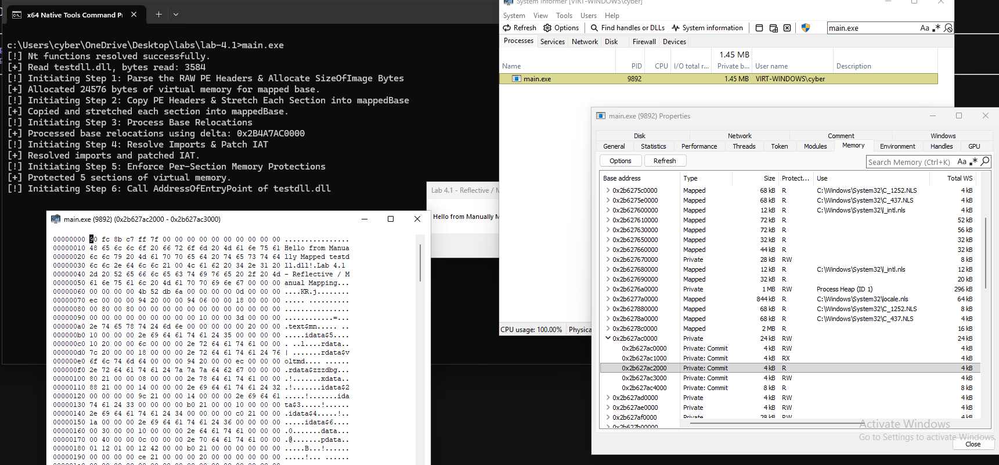

# Module 4.1: Reflective PE Loading & Manual Mapping Internals (Building Your Own `LoadLibrary`)

## 1. First Principles: Why Can't You Just `fread()` a `.dll` and Jump to It?

Suppose you have a compiled DLL on disk (`testdll.dll`) that pops a `MessageBoxA`, and you read its raw file bytes from disk into a memory buffer (`rawPe`) using `CreateFileA` + `ReadFile`.
Why can't you just make `rawPe` executable (`PAGE_EXECUTE_READWRITE`) and jump to `rawPe + AddressOfEntryPoint`?

If you try that, the CPU will crash within milliseconds with **`0xC0000005` (`STATUS_ACCESS_VIOLATION`)**.
Why? Because a PE file on disk (`rawPe`) is **packed for disk storage (`FileAlignment = 0x200`)**, not laid out for CPU execution (`SectionAlignment = 0x1000`)!

### What `rawPe` (Disk Layout) Looks Like Before Mapping
Suppose `testdll.dll` is `0x0C00` bytes (`3,072` bytes) on disk, compiled with Preferred `ImageBase = 0x0000000180000000` and `SizeOfImage = 0x5000` (`20,480` bytes).
When you read `testdll.dll` from disk into `rawPe` (say at heap address `0x000001A000010000`), here is what is sitting inside `rawPe`:

```text
DISK BUFFER IN MEMORY: rawPe = 0x000001A000010000 (Total File Size: 0x0C00 / 3,072 bytes)
+---------------------------------------------------------------------------------------+
| Offset +0x0000 .. +0x03FF (0x200 B): PE Headers (DOS Header + NT Headers + Sec Table) |
|   - OptionalHeader.ImageBase        = 0x0000000180000000 (Preferred Base)             |
|   - OptionalHeader.SizeOfImage      = 0x5000 (Needs 5 pages / 20 KB when mapped!)     |
|   - OptionalHeader.SizeOfHeaders    = 0x0400                                          |
+---------------------------------------------------------------------------------------+
| Offset +0x0400 .. +0x05FF (0x200 B): .text Section (Machine Code for DllMain)         |
|   - PROBLEM #1: Packed at +0x0400! But all RIP-relative instructions inside .text     |
|     were compiled assuming .text is at VirtualAddress +0x1000, NOT +0x0400!           |
+---------------------------------------------------------------------------------------+
| Offset +0x0600 .. +0x07FF (0x200 B): .rdata Section (IAT + String Literals)           |
|   - RVA +0x2000 (File +0x0600): IAT (FirstThunk[0]) = 0x0000000000002080              |
|     PROBLEM #2: FirstThunk[0] holds an RVA to "\0\0MessageBoxA", NOT a function addr! |
|   - RVA +0x2050 (File +0x0650): ASCII String "Hello from Manually Mapped testdll!"    |
+---------------------------------------------------------------------------------------+
| Offset +0x0800 .. +0x09FF (0x200 B): .data Section (Global Variables)                 |
|   - RVA +0x3000 (File +0x0800): const char* g_Message = 0x0000000180002050            |
|     PROBLEM #3: Hardcoded to Preferred Base (0x180000000 + 0x2050)!                   |
+---------------------------------------------------------------------------------------+
| Offset +0x0A00 .. +0x0BFF (0x200 B): .reloc Section (Base Relocation Table)           |
|   - Block for Page RVA 0x3000: Entry 0xA000 (Type=10 DIR64, Offset=0x000 -> g_Message)|
+---------------------------------------------------------------------------------------+
```

Look at the **four things that are broken** in `rawPe` above:
1. **Section Offsets Are Squished Together:** `.text` is at `+0x0400` instead of `+0x1000`, `.rdata` is at `+0x0600` instead of `+0x2000`, and `.data` is at `+0x0800` instead of `+0x3000`.
2. **Global Pointers Point to `0x0000000180002050`:** `g_Message` is hardcoded for the preferred `ImageBase` (`0x180000000`), which isn't mapped in our process!
3. **The IAT (`FirstThunk`) Holds String RVAs, Not Function Addresses:** `FirstThunk[0]` holds `0x00002080` instead of the live address of `USER32.dll!MessageBoxA`.
4. **Memory Permissions Are `RW`:** The `.text` code section is not executable (`RX`).

---

## 2. Stealth & Evasion: Why Avoid `LoadLibraryA`, `GetProcAddress`, and Loose Page Permissions?

Before writing our custom loader, we must address three critical detection vectors that expose amateur loaders to EDRs and memory scanners:

### Vector 1: Why `LoadLibraryA` Is an EDR Beacon
When code calls `LoadLibraryA("foo.dll")`:
1. **Kernel Image Load Notification:** Under the hood, `LoadLibraryA` calls `ntdll!LdrLoadDll` $\rightarrow$ `NtCreateSection(SEC_IMAGE)`. The Windows Kernel executes **`PsSetLoadImageNotifyRoutine`**, alerting all registered EDR drivers and logging **Sysmon Event ID 7 (Image Load)** with full caller call stack telemetry.
2. **User-Mode API Hooks:** EDRs hook `LoadLibraryA`, `LoadLibraryExW`, and `LdrLoadDll` with inline `jmp` stubs.
3. **Module Enumeration Footprint:** `LoadLibraryA` inserts an `LDR_DATA_TABLE_ENTRY` into `PEB->Ldr` lists (`InLoadOrderModuleList`, `InMemoryOrderModuleList`, `InInitializationOrderModuleList`). Any tool or scanner walking the PEB immediately sees the module.

> [!IMPORTANT]
> **How to Resolve Dependencies Without `LoadLibraryA`:**
> Most target processes already have common system DLLs (`ntdll.dll`, `kernel32.dll`, `kernelbase.dll`, and `user32.dll`) loaded into memory.
> Instead of calling `LoadLibraryA`, a stealth loader uses **`CustomGetModuleHandleA`** (walking `PEB->Ldr` like you did in Module 1.3) to check if the dependency module is already loaded. If present, it retrieves `DllBase` directly—triggering **zero kernel callbacks, zero Sysmon events, and zero hook trips**!

### Vector 2: Why `GetProcAddress` Is Flagged
Calling Win32 `GetProcAddress` on suspicious functions (`VirtualAlloc`, `WriteProcessMemory`, `CreateRemoteThread`, etc.) is heavily monitored by user-mode hooks and ETW.
A stealth loader implements its own **`CustomGetProcAddress`** (walking the target module's `IMAGE_EXPORT_DIRECTORY` EAT directly in memory, as you built in Module 2.2) to resolve export addresses without touching Win32 APIs!

### Vector 3: Why Leaving `.rdata` as `RW` Gets Flagged by Memory Scanners
Security scanners (such as **PE-sieve**, **Moneta**, and EDR memory inspection threads) scan virtual memory pages looking for anomalies:
- In legitimate PE binaries mapped by the Windows loader, section permissions strictly match the compiled PE characteristics:
  - `.text` $\rightarrow$ **`PAGE_EXECUTE_READ` (`RX`)**
  - `.rdata` $\rightarrow$ **`PAGE_READONLY` (`R`)**
  - `.data` $\rightarrow$ **`PAGE_READWRITE` (`RW`)**
- If an EDR scans your process and finds an `.rdata` section (containing strings and an Import Address Table) marked as **`PAGE_READWRITE` (`RW`)** in `Private` memory, it flags it as an **unfinalized / unpacked injected PE**!
- During loading, `.rdata` *must* be `RW` because Step 4 writes live function pointers into the IAT. But once Step 4 finishes, a production loader must loop through every section and enforce **Per-Section Protections** via `NtProtectVirtualMemory`, locking `.rdata` down to **`PAGE_READONLY`**!

---

## 3. The 6 Steps of Manual PE Mapping (With Memory Layouts After Every Step!)

Let's walk through all 6 steps and inspect the **exact memory layout of `rawPe` and `mappedBase` after every single step**!

---

### Step 1: Parse the Raw PE Headers & Allocate `SizeOfImage` Bytes (`mappedBase`)

First, we parse `dosHeader` and `ntHeaders` inside `rawPe` and allocate a new virtual memory buffer of size **`ntHeaders->OptionalHeader.SizeOfImage`** (`0x5000` bytes = 20 KB) using `NtAllocateVirtualMemory` with `PAGE_READWRITE`:

```text
PIMAGE_DOS_HEADER   dosHeader = (PIMAGE_DOS_HEADER)rawPe;
PIMAGE_NT_HEADERS64 ntHeaders = (PIMAGE_NT_HEADERS64)(rawPe + dosHeader->e_lfanew);

BYTE*  mappedBase = NULL;
SIZE_T imageSize  = ntHeaders->OptionalHeader.SizeOfImage; // 0x5000 bytes
NtAllocateVirtualMemory((HANDLE)-1, (PVOID*)&mappedBase, 0, &imageSize, MEM_COMMIT | MEM_RESERVE, PAGE_READWRITE);
```

#### Memory Layout After Step 1:
Suppose `NtAllocateVirtualMemory` gives us **`mappedBase = 0x0000021A40050000`**.
Right now, `rawPe` has the packed file bytes, and `mappedBase` is 5 empty pages (`0x5000` bytes) of zeroes:

```text
rawPe (0x000001A000010000)                     mappedBase (0x0000021A40050000) [All Pages: RW]
(0x0C00 bytes - Packed Disk Layout)            (0x5000 bytes - Fresh Zero-Filled Allocation)
+------------------------------------+         +-----------------------------------------------+
| +0x0000: PE Headers (0x400 B)      |         | +0x0000 .. +0x0FFF: [ 00 00 00 00 ... ] (RW)  |
+------------------------------------+         +-----------------------------------------------+
| +0x0400: .text      (0x200 B)      |         | +0x1000 .. +0x1FFF: [ 00 00 00 00 ... ] (RW)  |
+------------------------------------+         +-----------------------------------------------+
| +0x0600: .rdata     (0x200 B)      |         | +0x2000 .. +0x2FFF: [ 00 00 00 00 ... ] (RW)  |
+------------------------------------+         +-----------------------------------------------+
| +0x0800: .data      (0x200 B)      |         | +0x3000 .. +0x3FFF: [ 00 00 00 00 ... ] (RW)  |
+------------------------------------+         +-----------------------------------------------+
| +0x0A00: .reloc     (0x200 B)      |         | +0x4000 .. +0x4FFF: [ 00 00 00 00 ... ] (RW)  |
+------------------------------------+         +-----------------------------------------------+
```

---

### Step 2: Copy PE Headers & Stretch Each Section into `mappedBase`

Step 2 has two parts:

#### Step 2A: Copy the PE Headers (`SizeOfHeaders`)
Copy the first `ntHeaders->OptionalHeader.SizeOfHeaders` (`0x400`) bytes from `rawPe` into the beginning of `mappedBase`:
```text
memcpy(mappedBase, rawPe, ntHeaders->OptionalHeader.SizeOfHeaders);
```

#### Step 2B: Copy Each Section from `PointerToRawData` to `VirtualAddress`
Loop through all `ntHeaders->FileHeader.NumberOfSections` section headers (`IMAGE_FIRST_SECTION(ntHeaders)`).
For each section where `SizeOfRawData > 0`, copy `SizeOfRawData` bytes:
- **From source (disk offset):** `rawPe + sectionHeader[i].PointerToRawData`
- **To destination (memory RVA):** `mappedBase + sectionHeader[i].VirtualAddress`

```text
PIMAGE_SECTION_HEADER sectionHeader = IMAGE_FIRST_SECTION(ntHeaders);

for (WORD i = 0; i < ntHeaders->FileHeader.NumberOfSections; i++) {
    if (sectionHeader[i].SizeOfRawData > 0) {
        BYTE* destSection = mappedBase + sectionHeader[i].VirtualAddress;
        BYTE* srcSection  = rawPe      + sectionHeader[i].PointerToRawData;
        memcpy(destSection, srcSection, sectionHeader[i].SizeOfRawData);
    }
}
```

#### Memory Layout After Step 2 (Headers & Sections Stretched to `0x1000` Boundaries!):
Look at how `rawPe` (left) has now been stretched out into `mappedBase` (right), with zero-padding automatically filling the gaps up to each `0x1000` page boundary:

```text
rawPe (0x000001A000010000)                     mappedBase (0x0000021A40050000) [All Pages: RW]
+------------------------------------+         +----------------------------------------------------+
| +0x0000: PE Headers (0x400 B)      | ======> | +0x0000 (VA 0x21A40050000): PE Headers (0x400 B)   |
+------------------------------------+         |   (0x0400..0x0FFF is zero-padded)                  |
| +0x0400: .text (PtrToRaw = 0x400)  | ======\ +----------------------------------------------------+
+------------------------------------+        \> +0x1000 (VA 0x21A40051000): .text Section          |
| +0x0600: .rdata (PtrToRaw = 0x600) | ======\ |   - DllMain machine code now at +0x1000!           |
+------------------------------------+        \+----------------------------------------------------+
| +0x0800: .data (PtrToRaw = 0x800)  | =====\  > +0x2000 (VA 0x21A40052000): .rdata Section         |
+------------------------------------+       \ |   - +0x2000: IAT FirstThunk[0] = 0x00002080 (BAD!) |
| +0x0A00: .reloc (PtrToRaw = 0xA00) | ====\  \|   - +0x2050: "Hello from Manually Mapped testdll!" |
+------------------------------------+      \  +----------------------------------------------------+
                                             \ > +0x3000 (VA 0x21A40053000): .data Section          |
                                              \|   - +0x3000: g_Message = 0x0000000180002050 (BAD!) |
                                               +----------------------------------------------------+
                                               > +0x4000 (VA 0x21A40054000): .reloc Section         |
                                               |   - Relocation block for Page RVA 0x3000           |
                                               +----------------------------------------------------+
```

---

### Step 3: Process Base Relocations (`.reloc` — `IMAGE_DIRECTORY_ENTRY_BASERELOC`)

Now we fix every hardcoded 64-bit pointer inside `mappedBase`!

#### 3A. Calculate the Relocation Delta (`delta`)
```text
LONGLONG delta = (LONGLONG)(mappedBase - (BYTE*)ntHeaders->OptionalHeader.ImageBase);
// delta = 0x0000021A40050000 - 0x0000000180000000 = +0x00000218C0050000
```

#### 3B. Walk the Variable-Length `IMAGE_BASE_RELOCATION` Blocks
```text
IMAGE_DATA_DIRECTORY relocDir = ntHeaders->OptionalHeader.DataDirectory[IMAGE_DIRECTORY_ENTRY_BASERELOC];
if (delta != 0 && relocDir.VirtualAddress != 0 && relocDir.Size > 0) {
    PIMAGE_BASE_RELOCATION relocBlock = (PIMAGE_BASE_RELOCATION)(mappedBase + relocDir.VirtualAddress);

    while (relocBlock->VirtualAddress != 0) {
        DWORD count   = (relocBlock->SizeOfBlock - sizeof(IMAGE_BASE_RELOCATION)) / sizeof(WORD);
        WORD* entries = (WORD*)((BYTE*)relocBlock + sizeof(IMAGE_BASE_RELOCATION));

        for (DWORD i = 0; i < count; i++) {
            WORD type   = entries[i] >> 12;
            WORD offset = entries[i] & 0x0FFF;
            if (type == IMAGE_REL_BASED_DIR64) {
                ULONGLONG* patchAddr = (ULONGLONG*)(mappedBase + relocBlock->VirtualAddress + offset);
                *patchAddr += delta;
            }
        }
        relocBlock = (PIMAGE_BASE_RELOCATION)((BYTE*)relocBlock + relocBlock->SizeOfBlock);
    }
}
```

#### Memory Layout After Step 3 (`.data` Pointers Now Fixed!):
```text
mappedBase (0x0000021A40050000) AFTER STEP 3:
+------------------------------------------------------------------------------------+
| +0x0000 (VA 0x21A40050000): PE Headers                                             |
+------------------------------------------------------------------------------------+
| +0x1000 (VA 0x21A40051000): .text Section (DllMain code)                           |
+------------------------------------------------------------------------------------+
| +0x2000 (VA 0x21A40052000): .rdata Section                                         |
|   - +0x2000: IAT FirstThunk[0] = 0x00002080 (Still unresolved! Fixed in Step 4)    |
|   - +0x2050 (VA 0x21A40052050): "Hello from Manually Mapped testdll!"  <-------+   |
+--------------------------------------------------------------------------------|---+
| +0x3000 (VA 0x21A40053000): .data Section                                      |   |
|   - +0x3000: g_Message:                                                        |   |
|       BEFORE Step 3: 0x0000000180002050 (Preferred Base + 0x2050)              |   |
|       + delta:       0x00000218C0050000                                        |   |
|       ---------------------------------                                        |   |
|       AFTER Step 3:  0x0000021A40052050 (Points directly to +0x2050 above!) ---+   |
+------------------------------------------------------------------------------------+
| +0x4000 (VA 0x21A40054000): .reloc Section                                         |
+------------------------------------------------------------------------------------+
```

---

### Step 4: Resolve Imports & Patch the IAT (`IMAGE_DIRECTORY_ENTRY_IMPORT`) Without Win32 APIs

#### The Parallel Thunk Structure
Every imported DLL in `IMAGE_DIRECTORY_ENTRY_IMPORT` has two parallel arrays of 8-byte `IMAGE_THUNK_DATA64`:
- **`OriginalFirstThunk` (ILT - Import Lookup Table):** Unmodified lookup pointers pointing to `IMAGE_IMPORT_BY_NAME` (`Hint` + ASCII function name) or ordinals.
- **`FirstThunk` (IAT - Import Address Table):** The table that the compiled machine code dereferences at runtime. **We must overwrite each slot with the live 64-bit function pointer!**

```text
  OriginalFirstThunk (ILT)                           FirstThunk (IAT)
  [Read-Only Lookup Metadata]                        [Overwritten at Runtime with Live Addrs]

+-----------------------------+                    +-----------------------------+
| Entry 0: RVA 0x00002080     |                    | Entry 0: RVA 0x00002080     | <--- Before Step 4
+-----------------------------+                    +-----------------------------+
               |                                                  |
               v                                                  v  (Step 4 Overwrites this!)
    +-----------------------+                      +-----------------------------+
    | IMAGE_IMPORT_BY_NAME: |                      | Entry 0: 0x00007FF9D7FBFC90 | <--- After Step 4
    | Hint: 0x02B4          |                      +-----------------------------+
    | Name: "MessageBoxA\0" |                      (Live Virtual Address of USER32!MessageBoxA)
    +-----------------------+
```

#### Pure Custom Resolution (Zero `LoadLibraryA`, Zero `GetProcAddress`!):
Instead of Win32 APIs, we use our own functions:
1. **Find Module Base via `CustomGetModuleHandleA(dllName)`:**
   Walks `PEB->Ldr->InLoadOrderModuleList` to find the loaded module (e.g., `USER32.dll`) without triggering image load callbacks.
2. **Find Export Address via `CustomGetProcAddress(hDepModule, funcName)`:**
   Walks the target module's `IMAGE_EXPORT_DIRECTORY` EAT directly in memory!

```text
IMAGE_DATA_DIRECTORY importDir = ntHeaders->OptionalHeader.DataDirectory[IMAGE_DIRECTORY_ENTRY_IMPORT];
if (importDir.VirtualAddress != 0 && importDir.Size > 0) {
    PIMAGE_IMPORT_DESCRIPTOR importDesc = (PIMAGE_IMPORT_DESCRIPTOR)(mappedBase + importDir.VirtualAddress);

    while (importDesc->Name != 0) {
        const char* dllName = (const char*)(mappedBase + importDesc->Name);
        
        // Custom PEB walk to get loaded module handle (NO LoadLibraryA!)
        HMODULE hDepModule = CustomGetModuleHandleA(dllName);
        if (!hDepModule) {
            // Error: Dependency is not loaded in host process
            return FALSE;
        }

        PIMAGE_THUNK_DATA64 origThunk = (PIMAGE_THUNK_DATA64)(mappedBase + (importDesc->OriginalFirstThunk ? importDesc->OriginalFirstThunk : importDesc->FirstThunk));
        PIMAGE_THUNK_DATA64 iatThunk  = (PIMAGE_THUNK_DATA64)(mappedBase + importDesc->FirstThunk);

        while (origThunk->u1.AddressOfData != 0) {
            FARPROC funcAddr = NULL;
            if (IMAGE_SNAP_BY_ORDINAL64(origThunk->u1.Ordinal)) {
                // Imported by Ordinal
                WORD ordinal = (WORD)IMAGE_ORDINAL64(origThunk->u1.Ordinal);
                funcAddr = CustomGetProcAddressByOrdinal(hDepModule, ordinal);
            } else {
                // Imported by Name
                PIMAGE_IMPORT_BY_NAME importByName = (PIMAGE_IMPORT_BY_NAME)(mappedBase + origThunk->u1.AddressOfData);
                // Custom EAT walk to get function VA (NO GetProcAddress!)
                funcAddr = CustomGetProcAddress(hDepModule, importByName->Name);
            }
            
            // Overwrite IAT slot with live virtual address!
            iatThunk->u1.Function = (ULONGLONG)funcAddr;

            origThunk++;
            iatThunk++;
        }
        importDesc++;
    }
}
```

#### Memory Layout of `mappedBase` After Step 4 (IAT Live!):
```text
mappedBase (0x0000021A40050000) AFTER STEP 4:
+------------------------------------------------------------------------------------+
| +0x0000 (VA 0x21A40050000): PE Headers                                             |
+------------------------------------------------------------------------------------+
| +0x1000 (VA 0x21A40051000): .text Section (DllMain code)                           |
+------------------------------------------------------------------------------------+
| +0x2000 (VA 0x21A40052000): .rdata Section                                         |
|   - +0x2000: IAT FirstThunk[0]:                                                    |
|       BEFORE Step 4: 0x0000000000002080 (RVA to "\0\0MessageBoxA")                 |
|       AFTER Step 4:  0x00007FF9D7FBFC90 (Live VA of USER32.dll!MessageBoxA!)       |
|   - +0x2050: "Hello from Manually Mapped testdll!"                                 |
+------------------------------------------------------------------------------------+
| +0x3000 (VA 0x21A40053000): .data Section                                          |
|   - +0x3000: g_Message = 0x0000021A40052050 (Relocated in Step 3!)                 |
+------------------------------------------------------------------------------------+
| +0x4000 (VA 0x21A40054000): .reloc Section                                         |
+------------------------------------------------------------------------------------+
```

---

### Step 5: Enforce Per-Section Memory Protections (`NtProtectVirtualMemory`)

Now that Step 3 (Relocations) and Step 4 (IAT) are done writing to `.rdata` and `.data`, we must lock down the sections to their authentic protections.
Instead of leaving everything `RW` or blindly making the whole block `RWX`, we iterate through all sections in `IMAGE_FIRST_SECTION(ntHeaders)` and translate `Characteristics` to Windows protection flags:

#### Section Characteristics Translation:
```text
ULONG GetSectionProtection(DWORD characteristics) {
    if (characteristics & IMAGE_SCN_MEM_EXECUTE) {
        if (characteristics & IMAGE_SCN_MEM_WRITE)
            return PAGE_EXECUTE_READWRITE; // 0x40 (Rare in clean binaries)
        if (characteristics & IMAGE_SCN_MEM_READ)
            return PAGE_EXECUTE_READ;      // 0x20 (.text)
        return PAGE_EXECUTE;
    }
    if (characteristics & IMAGE_SCN_MEM_WRITE)
        return PAGE_READWRITE;             // 0x04 (.data)
    if (characteristics & IMAGE_SCN_MEM_READ)
        return PAGE_READONLY;              // 0x02 (.rdata, .reloc)
    return PAGE_NOACCESS;
}
```

Apply protection for each section individually:
```text
for (WORD i = 0; i < ntHeaders->FileHeader.NumberOfSections; i++) {
    PVOID  secBase = mappedBase + sectionHeader[i].VirtualAddress;
    SIZE_T secSize = sectionHeader[i].Misc.VirtualSize;
    if (secSize == 0) secSize = sectionHeader[i].SizeOfRawData;

    ULONG protect = GetSectionProtection(sectionHeader[i].Characteristics);
    ULONG oldProt = 0;
    NtProtectVirtualMemory((HANDLE)-1, &secBase, &secSize, protect, &oldProt);
}
```

#### Memory Layout of `mappedBase` After Step 5 (Per-Section Protections Enforced!):
```text
mappedBase (0x0000021A40050000) AFTER STEP 5:
+--------------------------------------------------------------------+---------------+
| Section & Offset                                                   | Page Perm     |
+--------------------------------------------------------------------+---------------+
| +0x0000 (VA 0x21A40050000): PE Headers                             | R / ReadOnly  |
+--------------------------------------------------------------------+---------------+
| +0x1000 (VA 0x21A40051000): .text Section (DllMain machine code)   | RX (EXEC_RD!) |
+--------------------------------------------------------------------+---------------+
| +0x2000 (VA 0x21A40052000): .rdata Section (Locked IAT + Strings)  | R (ReadOnly!) |
+--------------------------------------------------------------------+---------------+
| +0x3000 (VA 0x21A40053000): .data Section (Relocated Globals)      | RW (READWRITE)|
+--------------------------------------------------------------------+---------------+
| +0x4000 (VA 0x21A40054000): .reloc Section                         | R (ReadOnly)  |
+--------------------------------------------------------------------+---------------+
```

Notice:
- **`.text` is `RX`:** Ready to execute, but protected from writes.
- **`.rdata` is locked down to `R`:** The IAT is now read-only, matching a genuine Windows Loader mapping!
- **`.data` remains `RW`:** The DLL can write to global state normally.

---

### Step 6: Call `DllMain` (`AddressOfEntryPoint`)!

```text
typedef BOOL (WINAPI *fnDllMain)(
    HINSTANCE hinstDLL,
    DWORD     fdwReason,
    LPVOID    lpvReserved
);

fnDllMain DllMain = (fnDllMain)(mappedBase + ntHeaders->OptionalHeader.AddressOfEntryPoint);
DllMain((HINSTANCE)mappedBase, DLL_PROCESS_ATTACH, NULL);
```

#### Execution Trace Inside `mappedBase` During Step 6:
```text
1. CPU jumps RIP to mappedBase + AddressOfEntryPoint (inside .text at +0x1000, which is RX!).
2. DllMain reads g_Message from .data (+0x3000):
     Gets 0x0000021A40052050 ("Hello from Manually Mapped testdll!") -> Relocated in Step 3!
3. DllMain calls MessageBoxA through the IAT at .rdata (+0x2000, which is R!):
     Calls 0x00007FF9D7FBFC90 (USER32.dll!MessageBoxA)               -> Resolved in Step 4!
4. The MessageBoxA window pops up on screen!
```

---

## 4. Lab 4.1 Step-by-Step Guide: Build `testdll.dll` & Stealth Manual Mapper

In Lab 4.1 (`windows/labs/lab-4.1/`), you will build two files:
1. **`testdll.cpp` $\rightarrow$ `testdll.dll`:** Minimal 64-bit DLL importing `USER32.dll!MessageBoxA` and non-const global string pointers.
2. **`main.cpp` $\rightarrow$ `main.exe`:** Custom Manual Mapper that loads `testdll.dll` with:
   - **Zero Win32 loader calls:** No `LoadLibraryA`, no `GetProcAddress`. Uses `CustomGetModuleHandleA` (PEB walk) and `CustomGetProcAddress` (EAT walk).
   - **Per-Section Memory Protections:** `.text` $\rightarrow$ `RX`, `.rdata` $\rightarrow$ `R`, `.data` $\rightarrow$ `RW` via `NtProtectVirtualMemory`.

---

### Part A: Compile `testdll.cpp` (`windows/labs/lab-4.1/testdll.cpp`)

In `windows/labs/lab-4.1/testdll.cpp`:
```text
#include <windows.h>

const char* g_Message = "Hello from Manually Mapped testdll.dll!";
const char* g_Title   = "Lab 4.1 - Reflective / Manual Mapping";

BOOL WINAPI DllMain(HINSTANCE hinstDLL, DWORD fdwReason, LPVOID lpvReserved) {
    if (fdwReason == DLL_PROCESS_ATTACH) {
        MessageBoxA(NULL, g_Message, g_Title, MB_OK);
    }
    return TRUE;
}
```

Compile with:
```bat
cl.exe /nologo /LD /GS- testdll.cpp /link /ENTRY:DllMain /NODEFAULTLIB user32.lib
```

---

### Part B: Write Your Stealth Manual Mapper (`windows/labs/lab-4.1/main.cpp`)

Make sure `main.cpp` links with `user32.lib` (e.g. `#pragma comment(lib, "user32.lib")` or `cl main.cpp user32.lib`) so that `USER32.dll` is already loaded into `main.exe`'s address space by the OS at startup. This allows `CustomGetModuleHandleA("USER32.dll")` to find it cleanly in `PEB->Ldr` without calling `LoadLibraryA`!

#### Program Workflow:
1. **Read `testdll.dll` from disk** into heap buffer `rawPe` via `CreateFileA` + `ReadFile`.
2. **Parse Headers** and allocate `SizeOfImage` bytes at `mappedBase` with `PAGE_READWRITE` via `NtAllocateVirtualMemory`.
3. **Copy Headers** (`SizeOfHeaders` bytes) to `mappedBase`.
4. **Copy Each Section** from `rawPe + PointerToRawData` to `mappedBase + VirtualAddress`.
5. **Process Base Relocations (`.reloc`)**: Calculate `delta = mappedBase - PreferredImageBase`, walk `IMAGE_BASE_RELOCATION` blocks, and patch all `IMAGE_REL_BASED_DIR64` pointers (`*patchAddr += delta`).
6. **Resolve Imports (Pure EAT Walk)**:
   - Walk `IMAGE_IMPORT_DESCRIPTOR` entries.
   - For each DLL, call `CustomGetModuleHandleA(dllName)`.
   - Walk `OriginalFirstThunk` and `FirstThunk`. Resolve each function using your custom EAT export resolver (by name or ordinal), and write into `iatThunk->u1.Function`.
7. **Apply Per-Section Memory Protections**:
   - Loop through all sections in `IMAGE_FIRST_SECTION(ntHeaders)`.
   - Check `sectionHeader[i].Characteristics` and call `NtProtectVirtualMemory` for each section:
     - `.text` $\rightarrow$ `PAGE_EXECUTE_READ` (`RX`)
     - `.rdata` $\rightarrow$ `PAGE_READONLY` (`R`)
     - `.data` $\rightarrow$ `PAGE_READWRITE` (`RW`)
8. **Call `DllMain`** at `mappedBase + AddressOfEntryPoint`!

---

## 5. Visual Verification in System Informer (While the `MessageBoxA` Is Open on Screen!)

Leave the `MessageBoxA` open and inspect **`main.exe`** in **System Informer**:

1. **Check Modules Tab:**
   - Look for **`testdll.dll`** in the **Modules** tab $\rightarrow$ **it is completely absent!** (Zero `PEB->Ldr` trace).
2. **Check Memory Tab (`mappedBase`):**
   - Scroll to `mappedBase`:
   - Inspect the individual pages of `mappedBase`:
     - Header page (`+0x0000`): `R` or `RW`
     - `.text` page (`+0x1000`): **`RX` (`PAGE_EXECUTE_READ`)**
     - `.rdata` page (`+0x2000`): **`R` (`PAGE_READONLY`)** $\rightarrow$ Proves the IAT is locked!
     - `.data` page (`+0x3000`): **`RW` (`PAGE_READWRITE`)**

### Deliverables to Report Back:
1. Your `windows/labs/lab-4.1/testdll.cpp` and `windows/labs/lab-4.1/main.cpp`, plus screenshots showing:
   - Console output + popped `MessageBoxA`.
   - System Informer's **Modules** tab (demonstrating `testdll.dll` is invisible).
   - System Informer's **Memory** tab for `mappedBase` showing distinct **`RX`** (`.text`) and **`R`** (`.rdata`) section pages!
2. Why must `.rdata` be writable (`RW`) during Step 4, and what detection risk is introduced if it remains `RW` after loading is complete?
3. How does `CustomGetModuleHandleA` locate a dependency like `USER32.dll` without triggering the Kernel's `PsSetLoadImageNotifyRoutine` callback?

---

## 6. Lab 4.1 Results & Findings

### Implementation (`windows/labs/lab-4.1/main.cpp` & `testdll.cpp`)
In [`windows/labs/lab-4.1/main.cpp`](labs/lab-4.1/main.cpp) and [`testdll.cpp`](labs/lab-4.1/testdll.cpp), we built an evasion-conscious User-Mode PE Loader (Manual Mapper):
1. **Zero Win32 Loader Calls (`LoadLibraryA` / `GetProcAddress` Bypassed):**
   - Linked `main.exe` against `user32.lib` with a benign startup call (`GetDesktopWindow()`) so `USER32.dll` is mapped by the OS at startup.
   - Used `CustomGetModuleHandleA` (PEB walking `PEB->Ldr->InLoadOrderModuleList`) to locate `USER32.dll`'s `DllBase` with zero syscalls and zero `PsSetLoadImageNotifyRoutine` callbacks.
   - Used `CustomGetProcAddress` (EAT walking `IMAGE_EXPORT_DIRECTORY`) to resolve `MessageBoxA`'s virtual address directly in memory.
2. **6-Step In-Memory Mapping Pipeline:**
   - **Step 1:** Allocated `24,576` bytes (`SizeOfImage = 0x6000`) of committed `PAGE_READWRITE` memory at `mappedBase = 0x000002B627AC0000` via `NtAllocateVirtualMemory`.
   - **Step 2:** Copied `SizeOfHeaders` and stretched each section from `PointerToRawData` to `VirtualAddress`.
   - **Step 3:** Applied Base Relocations for `delta = 0x2B4A7AC0000` by walking `IMAGE_BASE_RELOCATION` blocks and patching all `IMAGE_REL_BASED_DIR64` pointers in `.data` (fixing `g_Message` and `g_Title`).
   - **Step 4:** Resolved imports across `OriginalFirstThunk` and `FirstThunk`, writing the live `0x7FFFC78BFC90` (`USER32.dll!MessageBoxA`) address into the IAT.
   - **Step 5:** Enforced per-section memory protections via `NtProtectVirtualMemory`: `.text` to `PAGE_EXECUTE_READ` (`RX`), `.rdata` to `PAGE_READONLY` (`R`), and `.data` to `PAGE_READWRITE` (`RW`).
   - **Step 6:** Invoked `DllMain((HINSTANCE)mappedBase, DLL_PROCESS_ATTACH, NULL)` at `AddressOfEntryPoint`, popping the message box cleanly.

### Console Output
```text
c:\Users\cyber\OneDrive\Desktop\labs\lab-4.1>main.exe
[!] Nt functions resolved successfully.
[+] Read testdll.dll, bytes read: 3584
[!] Initiating Step 1: Parse the RAW PE Headers & Allocate SizeOfImage Bytes
[+] Allocated 24576 bytes of virtual memory for mapped base.
[!] Initiating Step 2: Copy PE Headers & Stretch Each Section into mappedBase
[+] Copied and stretched each section into mappedBase.
[!] Initiating Step 3: Process Base Relocations
[+] Processed base relocations using delta: 0x2B4A7AC0000
[!] Initiating Step 4: Resolve Imports & Patch IAT
[+] Resolved imports and patched IAT.
[!] Initiating Step 5: Enforce Per-Section Memory Protections
[+] Protected 5 sections of virtual memory.
[!] Initiating Step 6: Call AddressOfEntryPoint of testdll.dll
```

### System Informer Verification






1. **Unregistered Module Footprint (`Modules` Tab):**
   - Inspecting the loaded modules of `main.exe (9892)` shows `main.exe`, `user32.dll`, `kernel32.dll`, `ntdll.dll`, etc., while **`testdll.dll` is completely unregistered and absent from the module tree**. Because we mapped the PE manually into private virtual memory without calling `LdrLoadDll`, no `LDR_DATA_TABLE_ENTRY` was ever registered in `PEB->Ldr`.
2. **Per-Section Protection Verification (`Memory` Tab at `0x2b627ac0000`):**
   - `0x2b627ac0000` (4 kB): `Private: Commit`, `RW` (PE Headers)
   - `0x2b627ac1000` (4 kB): `Private: Commit`, **`RX`** (`.text` — executable code)
   - `0x2b627ac2000` (4 kB): `Private: Commit`, **`R`** (`.rdata` — locked IAT and read-only strings)
   - `0x2b627ac3000` (4 kB): `Private: Commit`, **`RW`** (`.data` — relocated global variables)
   - `0x2b627ac4000` (8 kB): `Private: Commit`, `R` (`.reloc`)
3. **Hex Dump Verification (`0x2b627ac2000` `.rdata`):**
   - At byte offset `+0x00`: `90 fc 8b c7 ff 7f 00 00` (`0x7FFFC78BFC90` = live address of `USER32.dll!MessageBoxA` in the IAT).
   - At byte offset `+0x10`: `"Hello from Manually Mapped testdll.dll!"` followed by `"Lab 4.1 - Reflective / Manual Mapping"`.

